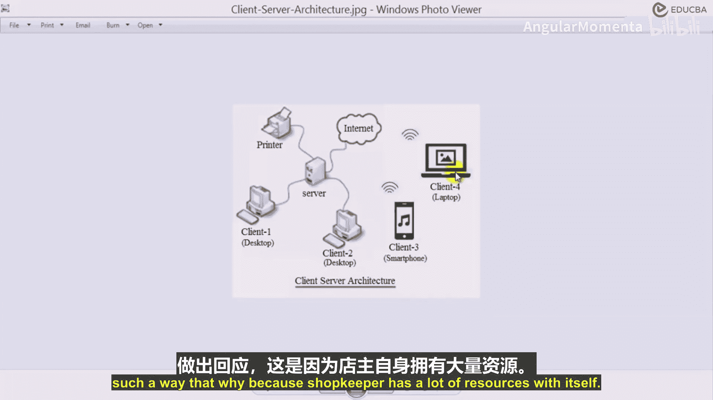
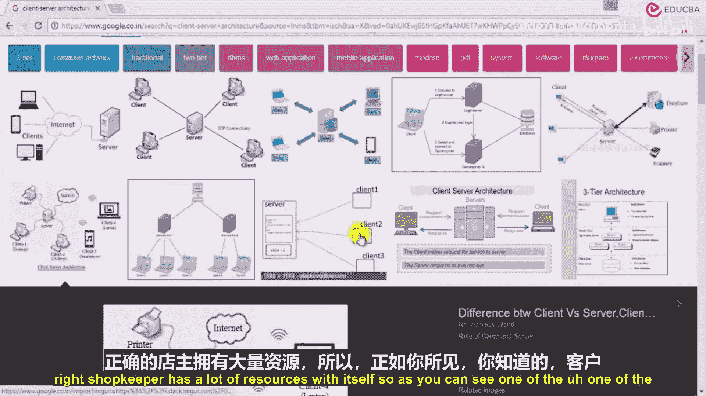
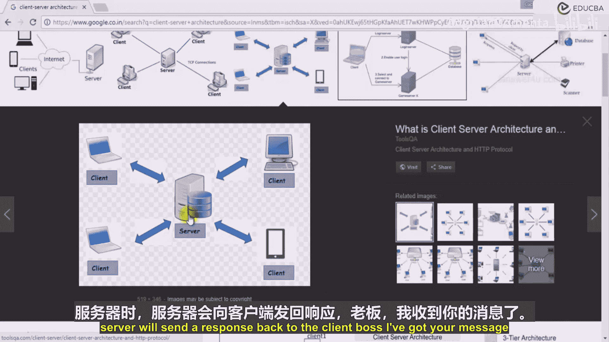

# 【EDUCBA】数据分析高级Python：构建与优化-｜-Advanced-Python-for-Data-Analysis：-Build---Optimize-p07-02_01_01_客户端服务器的网络层面--BV1nmcKzBEU3_p7-

We're here to learn about the networking aspect of things right now where networking plays a very important part in programming when we come to the especially when we come to internet of things so so basically a lot of things which are networked together one after the other they are network together over the internet or their network together over some local network and they talk to each other。

 so what comes to your mind when you know the minute I say networking the minute I say networking maybe something like maybe something like getting a network。

 getting network together by a lot of people you know being in touch with people communicating with people and so on there's a lot of networking aspects which come to your mind so networking can be social networking where you have Whatsapp。

 Facebook or you know，Or you know， LinkedIn where you have something。

 something more more sophisticated for with respect to your work profile。

 so you have different types of network。Which you can think of now。

When it comes to networking with regards to with regards to computers。

 what are we talking about networking here， networking here we say is basically connecting to computers two things two devices anywhere in the world with each other over some kind of an interface over some you know。

 somebody there is an arbitrator in between that's what we are doing and there exactly is what we call about network right Okay。

 so now let's say for example， let's say we are going to have let's let's understand the most one of the most popular。

Things about networking。I'll just focus today on messaging okay， or chatting。

 as you can think about messaging is with respect from one computer to another computer or with respect to one device to another device。

 That's what exactly chatting or messaging would be all about， let's say。

 for example you were logged in your Whatsapp is on in your phone and you would say hi to your friend。

 So let's say X Y， Z talks to ABC hi send from the phone of X， Y。

 Z to that hi is being sent as a message to phone of ABC it is sent from X， Y， Z to ABC right。

 So if X， Y Z sends the message hi。It has to go to ABC's phone and it is to reach the application Whatsapp and it has to open up there right now comes a question are these two phones networked together you can say well perhaps they are actually communicating with each other fine。

 but are they actually connected to each other no they are not connected to each other who are they connected to Okay。

 so let's say for example。😡，This is this is a smartphone which I've shown ahead over here。

 There's a smartphone connected via the internet via w-fi， it is connected to the internet。

 another laptop is connected to the internet so let's say this is X Y Z who is always logged in on the smartphone and this guy is the one who uses let's say Whatsapp web or something like that where he gets his messages on his laptop okay so you're connecting via the internet and you know this guy is connecting via the internet and finally it has to talk to this particular client。

Okay， it has to talk to this particular， this particular device。 Now， the most。

 one of the most popular models which networking uses is called as the client server model。

 which we are going to discuss in detail as we go ahead。 Allright。

 I can understand the client server model very similar to。To a shopkeeper and a customer， right？

 So let's say， for example， a shopkeeper is approached by customers。

  customers can be many Shopkeeper is one。 So shopkeepers can be approached by many customers and customers will request the shopkeeper for some sort of some sort of you know。

 some sort of data or some sort of not data， but some sort of things that you want to buy。 let's say。

 for example， grocery or you know， something like fruits， vegetables or something like that。

 So quite a lot of things that you would want to ask for ask the customer to ask the shopkeeper to give you。

 So the customer comes and gives a request to the request to the shopkeeper that I want this particular thing。

 and the shopkeeper serves the customer or， you know， give some kind of response to the customer。

In such a way that why， because shopkeeper has a lot of resources with itself， right。

 Shopkeeper has a lot of resources with itself。 So as you can see， one of the one of the models that。

 you know， one of the one of the popular models of client server， which which we can deal with。

 maybe something like this。 So there are many customers coming up to this shopkeeper。

 So the shopkeeper is equivalent to a server。😊。

Okay， and many customers coming to talk to the many clients coming to talk to the server。

 they connect to the server。 they don't connect to each other。 They connect to the server。

 So server is a main shopkeeper， which has some resources as you can see this this is a database symbol。

 but this is a lot of resources with him where he can give a lot of data to whoever to whichever client requested for data。

 it can give data right So this is what the this is what the shopkeeper this is what the server does。

 right the server will give a response to respective client。

 so when a client requests the server will give the server will give a particular response right Okay so that exactly is networking now with regards to networking if you could you know。

 so that exactly is networking。 Now say for example， if this client wants to talk to this client。

 Okay， if this client wants to talk to this client， what will it do， it will talk to the server ask。

Server to talk to this client and this client will get the information given by this client。

 So they are more than not connected to each other directly。 but yeah， virtually yes。

 they are connected， their networked by a server So this is how the popular client server model works。

 Okay， so now if you think about Whatsapp， as I told you say for example。

 this was client1 where this is Whatsapp on one。 and this is Whatsapp or another。 Now。

 if this guy wants to talk to this guy。 when the message is sent to the server。

 the server will send the response back to the client， boss， I've got your message。😊。

