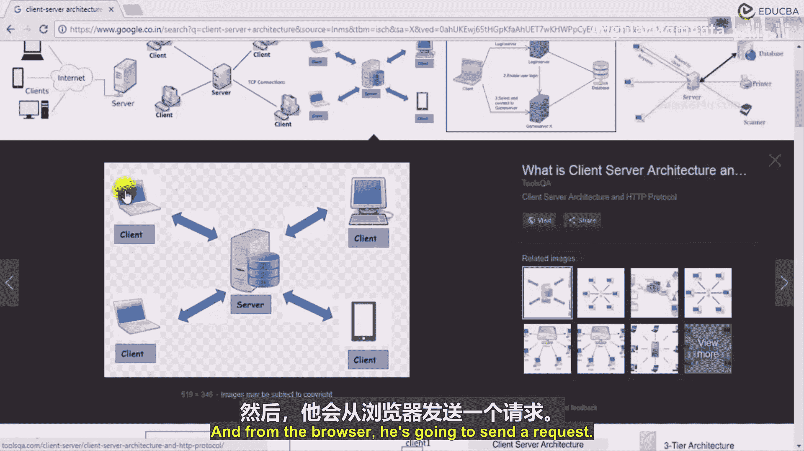
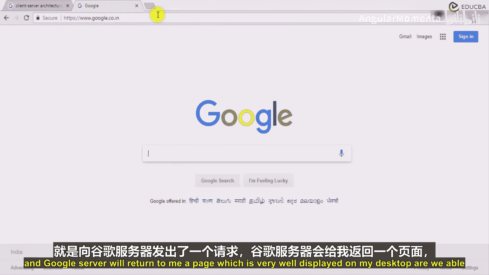
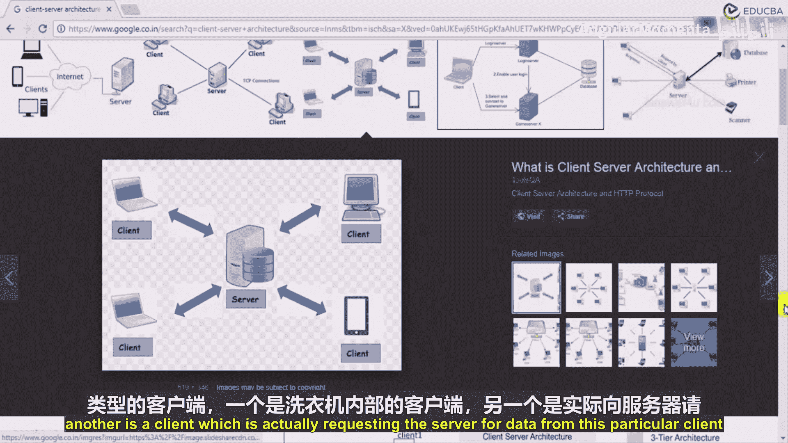

# 【EDUCBA】数据分析高级Python：构建与优化-｜-Advanced-Python-for-Data-Analysis：-Build---Optimize-p08-02_01_02_客户端与服务器的消息通信--BV1nmcKzBEU3_p8-

When he gets a response that I've got a message， you get a single tick。You know。

 you get a single tick on your message saying that the server has got your message because you are connected to the internet。

 Your message has gone to the server。 The server has got the message but a single tick does not mean that this guy has got right because only the server has gone now comes a question When this guy comes online the server sends a message to this guy。

 he gets he gets a message the server will send back to this particular client it will send back oh。

 this particular client has got the message you can very well see it with a double tick which is a double tick but when this client opens the message and reads it up he tells a server that he read it and this guy tells a client that client whoed too has read it which means you get a double blue tick。

Right。😊，So this is the exact flow of how the client server works。

 So the server is the main server which is there somewhere outside who is trying to arbitrate between between both the clients。

 correct So this is the popular model that that client server requires or this is the popular model that is used by networking。

 Now let's say for example， where in our Io application we have a device which is connected to the internet。

 maybe the ESP8 to 66 or maybe the raspberry pi or maybe some kind of device which is remotely connected to the internet。

 Okay when you're remotely connected to the Internet。Right， you can also say for example。

 from you as an IoT device can take a lot of data from sensors right from different kinds of sensors you will get a lot of data from the external environment or you may be doing some kind of computation right something that the client may be doing something that the IoT device may be doing al right and at regular intervals。

 this guy will update the server saying I've got you know I've got this particular data。

 this particular data， this particular data let me take a real use case let's say for example。

 I put this particular device in in a washing machine okay so this particular IoT device that I have that is that is a controller that I have I put it in a washing machine now the washing machine when I put this particular controller in a washing machine you know it maybe you are you are using it for monitoring monitoring the data monitoring different sensors。

Something different motors monitoring different things， which comes from the washing machine， right。

 That's what you're trying to do。So let's say this guy。

Tries to get a lot of value from the washing machine like say， for example。

 when the washing machine got on when the washing machine got off when did motor When did this particular motor start you know is this motor working fine okay is the washing happening properly is the temperature of the water getting coming up to a particular level and stuff like that So you have different things that this particular client is monitoring about a particular washing machine。

 but because it is connected to the internet， it is going why the internet。

 the data is gonna be stored in databases in the server So you're going to store data in let's say to the server send data to the server。

 the server will store it in databases now when data is stored in databases okay by the server now there may be a different washing machine client guy So now who is this this guy is not the this guy is not the device okay by the way this guy maybe you know washing machine。

Service send， let's say， for example， if this was a Samsung washing machine or a whirlpool washing machine。

 Okay， and you had you had a device which was put in the particular washing machine and over here。😊。

Let's say a Samsung or or a whirlpool guy is trying to monitor whether all his washing machines are working fine in the all of the United States。

 so when he's trying to have a look at like that so he will try to fight figure out how many clients are there okay okay he will try to figure out all right。

 all washing machines are working fine。Now， when he wants to see about the washing machines data。

 what is he gonna do， He's going to log in onto a browser like this。

 He's going to log in onto a Chrome or some kind of a browser。 And from the browser。

 he's going to send a request like how I send a request right now when I send Google do code in。

 that's a request。 That's a request I'm sending to Google server right that's a request that I'm sending to Google server like say for example。

 if I send it to you knoweducB do co right So I am sending this particular request to EducB So that's the request which is happening to their servers and that server will then give me a response back which I can see it as a page right when I say Google do co it is a request which is being made to Google server and Google server will return to me a page which is very well displayed on my desktopile are you able to want to stand so the same way the same way。

GuMake a request to the server saying that hey， I'm looking at it from a browser。

 I want data from this washing machine， then the server will take data from the washing machine。

 try to put this data in proper inrop pages like say for example。

 Htmlcss jascript pages where it tries to put them in web pages format and tries to send it to you as an HttP response。

 Okay so it is an Http response， we come to that maybe if you don't understand it you can you know we can think about it later but now let's say it sends a response。

 which is nothing but a page which is displayed on your screen So that guy is monitoring the washing machine real time。

 So this guy is also a client this guy is also client but these are two different kinds of client one is a client which is inside the washing machine Another is a client which is actually requesting the server for data from this particular client So this is the popular。

Of the client server model and how they are going to be used in Io。

 This is what we have gone through。