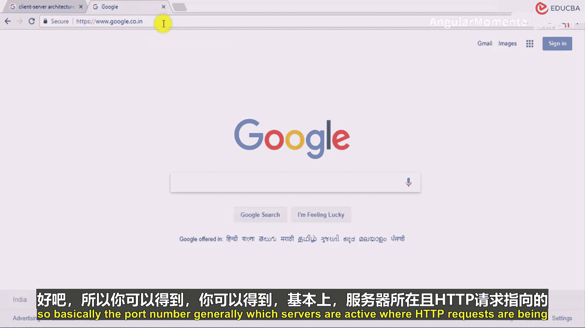

# 【EDUCBA】数据分析高级Python：构建与优化-｜-Advanced-Python-for-Data-Analysis：-Build---Optimize-p09-02_01_03_服务器IP从客户端到服务器--BV1nmcKzBEU3_p9-

One question that comes into our mind is， okay， now。

 how does this guy talk to this guy through this guy， Let's say， for example。Let's say。

 let's say these two guys want to talk to each other to Whatsapp clients。

 they want to talk to each other， right， so let me come to this particular。

 So this client wants to talk to this client。 Okay， or something like that。

 This client wants to talk to this client。 So two clients want to talk to each other。

 They are both connected to the Internet， but they are going to talk via the server， right， Okay。

 so how are they going to talk to each other。 They can talk to each other or a client which is connected to the Internet。

 Okay， you need to talk to it via a particular。You call it as you know a particular address or something like that that in such a way that they are identified like say for example。

 if you are making a call from home to just as I said。

 you are a client and you want to request the shopkeeper instead of going to the shopkeeper's address。

 you want to make a call and ask the shopkeeper to deliver it to you。Right， now comes a question。

 Okay， how do I。Contact the shopkeeper Okay， I can contact the shopkeeper just by only one way。

 What is a way that I can contact the shopkeeper， I can contact the shopkeeper by knowing his phone number。

Right， I know his phone number。 I ring his number he gets now how does he know where should he deliver because I tell him my address so I have an address and I have his phone number which makes me contact him and he can contact me right and he can get button the same way we need some kind of an address if one client needs to talk to server which means basically the client needs to know the server IP to which he can talk to so he will say I want to talk to the server okay when I talk to the server I am basically talking to a particular IP address Now the server when he want to talk to another client okay you send to the server and the server sends it to another client the server should also should also know the client's IP address so you have to know the IP address of the client and the server both of these things are very much you know。

A very much needed， say for example， this client needs to talk to the server。

 so which means he should know the server's IP and when the server wants to talk to the client。

 the server should know the client's IP。Right， both of them need to communicate with each other over the Internet。

 So you require the I。 So let's say， for example， you send a message from Whatsapp。 Okay。

 so ABC is sending to X， Y， Z， and ABC sends。Hi， it goes to Whatsapp server Now from Whatsapp server。

 it has to go to Xyz's phone so Xyz's phone is connected to the internet when Xyz's phone is connected to the internet it has an IP address right Xyz's phone has an IP address now when Xyz's phone has an IP address Xyz's phone has an IP address can I say because Xyz's phone has an IP address can I say that I can reach my message from the server to Xyz by giving his IP address my message can reach till his phone I can reach till Xyz that is till his phone I reach because every phone is characterized every phone connected to the internet is characterized by its IP address but now comes a question how can we ensure that the message reaches Whatsapp on his phone what if the message which comes from Whatsapp server comes。

phoneone， because of the IP address。But it lands up in Facebook app， It's not a good thing right。

 it should land in Whatsapp in Whatsapp client right in that Whatsapp application。

 it should not land up in in something else right so that's something which is very important if let's say you send a message to the server and the server when he sends a message to the Whatsapp to a Whatsapp of another phone。

😡，IP address is only sufficient to reach the phone。 IP address is only sufficient to reach the phone。

 but if you want to reach from the phone， if you want to reach an application。

 a particular application on the phone you require something more than an IP address and that more than the IP address is called as a port number so you require two things first is you require a IP address and for application for each application to reach still each applications you require a port number。

 let's say for example， when I say Google do code do1 okay when I request the Google server I'm requesting Google server but Google server by default okay is at a port the port is called as 80 the port is called as 80 so when you write a port 80 you know that's by default。

 you know he's at port 80 so by default it's not shown。

So even if you don't write anything colon 80 it is actually by default calling port number 80 that is what HDp request do but if you write there let's say colon 8080 enter it will never give you response back why because Google server is not that is not at port 8080 but it at port 80 so if you write port 80 and say enter okay so that is port 8080 now if I say 80 okay it got double right 80 and enter okay。

Colinity。So he's got a bit stubborn now。Alright， so。

 so you can get you can get so basically the port number generally which servers are active where htP requests are being directed to or at port 18 Okay。

 so these are a few things that you need to remember。😊。

When we understand the client server model correct Okay and so there are two things that are required as we understand from here。

 we require the IP address and the port number， of course well understand in detail as we program okay。

