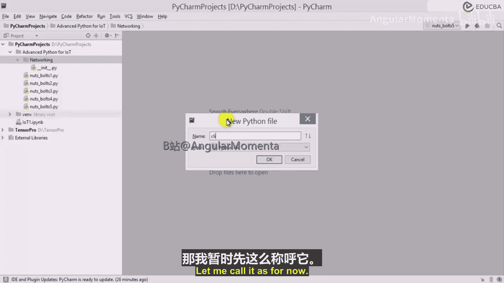
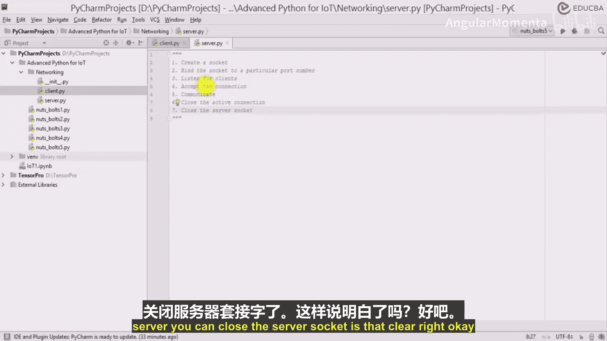

# 【EDUCBA】数据分析高级Python：构建与优化-｜-Advanced-Python-for-Data-Analysis：-Build---Optimize-p10-02_01_04_网络编程层面--BV1nmcKzBEU3_p10-

Beginning with。The programming aspect of networking， right。

So we come on to our project in that advanced Python for IoT。

 let me create a new package inside this particular file。

 so I'll create a package let me call the package as I'll call it as you know， networking。

So I call this packet is networking。Inside networking， I'll have a new Python file。

 let me call it us for now， client BY。

It's already a Python file let me create a Python file which is also called this。

Sver be inside the networking package right so both of them are ready for me and I can start up right away to create a client and create a server Okay。

 now coming to a client and client site coding in Python involves a few steps al right。

 where the steps are as false as。one。😡，Create。A client socket。 create a client socket， or rather。

 it just create a socket。Just create a socket。 Now， what is a socket， A socket is something which。

 which has。Which consists of。Both。IP address。And Port them。

So it is nothing but a socket is nothing but an application that is going to be active at a particular port of a device which is connected to the internet right so it consists of both of these things it consists socket is nothing but something which consists of both IP address and port number right it is connected to the internet along with that it is active at a particular port that's a socket。

😊，So creating then the second thing after creating a socket， if it is a client side code。

 what you need to do is connect。😊，Connect。The socket to a server socket， connect the socket。

 which you have created to a server socket。After you connect， communicate， right？Maybe send。

 maybe receive， communicate。four。😡，After you communicate， what you can do is so you create a socket。

 you connect the socket to a server socket， you communicate with each other。

 right the client talk to the server， server， talks to the client and so on。

 so they both communicate。Now， after the communication part comes， you create， you connect。

 you communicate， then if you want to stop communicating with the server。Close your socket。

 Closese your socket。That's it。 The steps declined are fairly simple。 now coming to the server。

right now server side requires a few more steps create a socket is same a server also requires to have a socket。

 but this time I need to say bind the socket， bind the socket to a particular to a particular port。😊。

Number why because it can be convenient for different clients to connect to a particular portal like say for example。

 if you are setting up shops somewhere right， you will put it somewhere which is more accessible for multiple customers。

 maybe it maybe a grocery shop maybe in a residential area or an E3 can be somewhere near a public spot。

Right so you have something where you need to bind after binding the socket to a particular port number。

 so you need to do that。Okay， so you have to say， okay。

 my silver socket is going to be bound to vote number。8080 or port number1 to 3，4 or port number 80。

 That's how each of the server sockets are bound to a particular port number After you bind the socket to a particular port。

 the server has to listen for client right， let's say， for example。

 you set up shop somewhere and after setting up shop at a particular address What if you close the shuttle and stay at home I there any is there any use of the server or is there any use of the shop。

 No， there is a use of the shop only if after you open the shop you wait and listen for。

You wait and listen for some kind of customers to come， right， you're listening for clients Now。

 after you listen for clients， let's say a client connected。

 a client connected to the server in this particular step。Right， a client connected to the server。

 So the minute a client connects the server must do。A job of accepting the connection， right。

 accepting the connection。So if we accept， you know？😊，Accept the client connection。

 So if you accept the particular client connection， you know， the client will connect to the server。

 there will be something like， you know， it's something like this， right。

 you build there is a particular how do how does the shopkeeper get back to the client Okay。

 let's say for example， if you go to a restaurant， the shopkeeper is the one you know。

 who is managing everything， Okay， and you want to eat food， you go to one of the tables。 Okay。

 you place the order wire a waiter right， it goes to the shopkeeper then it goes to maybe the you know。

 the guys make the food and then from there， it comes back to you wire the waiter right。

 when you accept the connection when you accept the connection， it's basically you are accepting one。

😊，You are accepting a particular you know something like a means of communication。

 you are accepting a connection itself， which means this connection is established until this connection is closed we both can keep communicating with each other okay so this connection is established it' is like a means of talking to each other that connection is established so you need to accept the connection after accepting the connection two more things you need to communicate right after communicating so send receive data。

😊，After communicating， all I need to do is。Close the。Active connection。 Close the active connection。

RightSo let's say for example， if there were many clients which were connecting which were trying to connect to the server。

 you have to accept each of the connections separately one up the other。😊，Then。Okay。

 you need to communicate with each connection individually why are different different waiters maybe。

 but you need to communicate with each of them。And then close active close all the active connections and after closing all the active connections。

 you can close the server。😊，You can close the service side。Is that clear， right， okay。

