# 【EDUCBA】数据分析高级Python：构建与优化-｜-Advanced-Python-for-Data-Analysis：-Build---Optimize-p11-02_02_01_编写客户端与服务器端代码--BV1nmcKzBEU3_p11-

Write the server side code and so on right so let's say at the client side。

 the code that I need to do for creating a socket is provided for me by the socket module which I need to import。

 so the client side code or the server side code is going to be written using the socket module。

 so I need to import the socket module。And this is what I need to do。

 I need to import the socket module and then I need to use the methods and you know classes of the socket module to to go ahead so I import the socket module so I do that by saying import socket。

😊，So there is a module called a socket which you can import。 So you import the socket module Now。

 if you want to use it， of course， you need to know the methods that are there。

 you need to know how to create a socket。And stuff like that。 So let's go on to the documentation。

 Let's click on。Socket Python library， perfect。 So you have one for Python 2 and you have one for Python 3。

 go for the Python 3，1 right So let's say socket socket。

 you're going for this particular networking protocol out here。 So how do you create a socket。

 a socket is created okay so let's say a socket。 So we come to this create sockets。

 it says the following function is all create socket objects So you have a method called as socket socket dot socket。

 this particular function， the following function is all create socket。 So there's a function。

 which is helping to create a socket object。 So socket dot socket we're going to just it is going to call this function。

 Lets create a socket dot socket this particular function is going to create a socket for us right。

 It's going to create these are all going to create socket objects， which means if they create a。

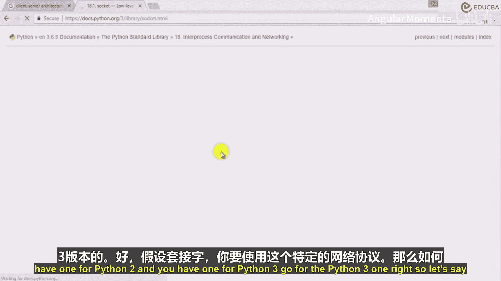

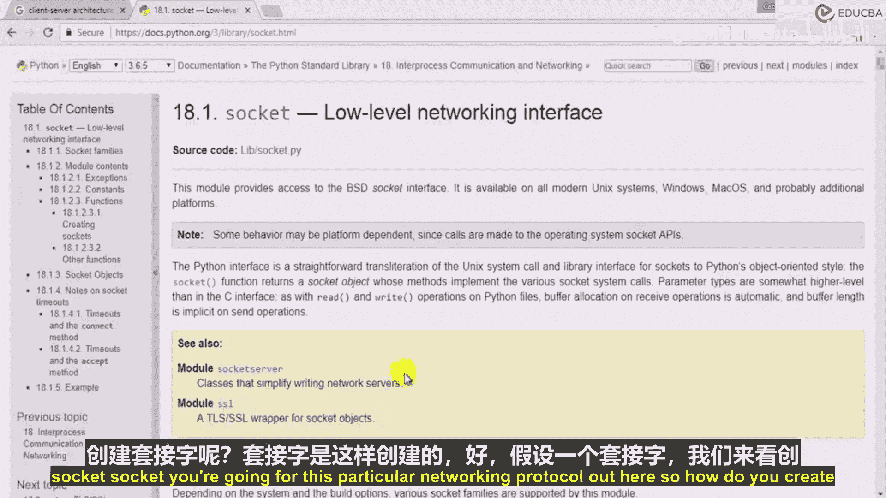

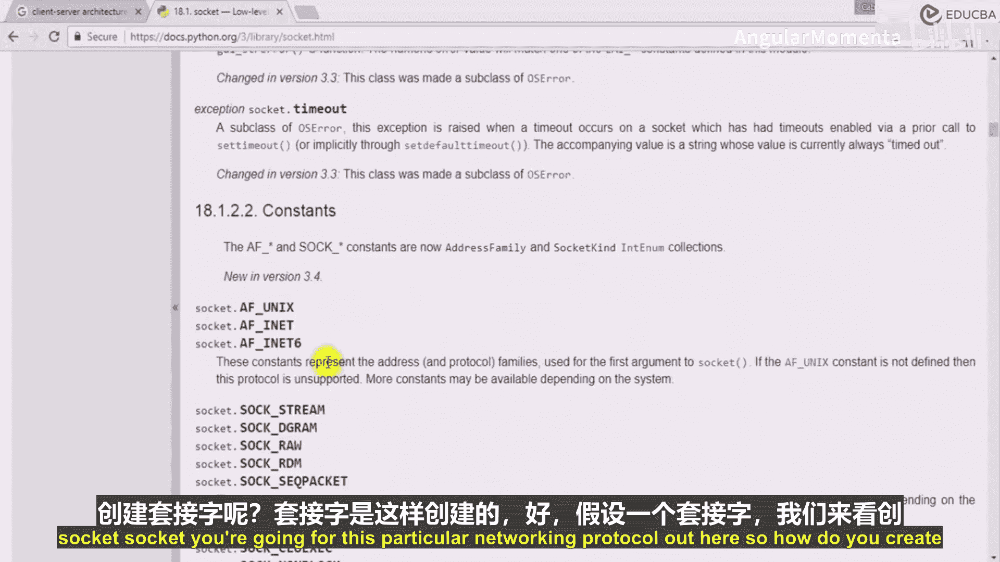

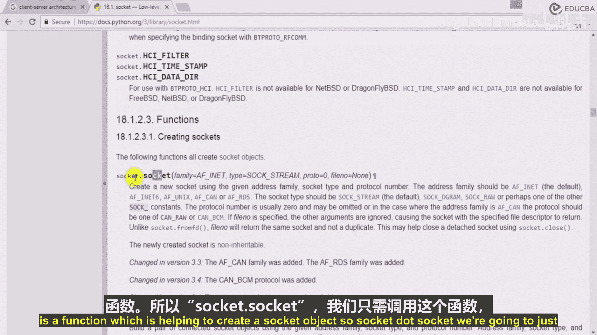

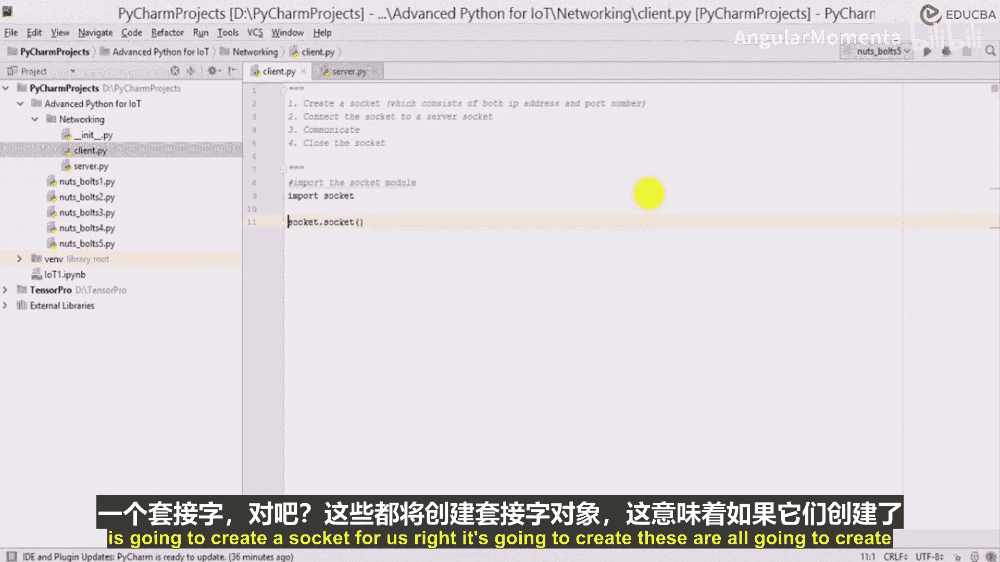

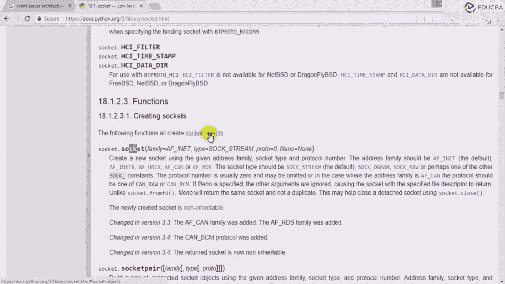

objectject I need to save that。 So because it's a client Let me call it as a client socket。

 though the server socket is also created pretty much the same itself。

 so it doesn't matter until you start doing the other functions yourself socket do socket。

 but then of course I need to impose socket socket do socket。 this will also return to me a socket。

 which I will store it in server soet So you have a client socket here you have a server socket here。

 now what of them need to communicate with each other right that's our main task to be done So let's say the client socket that is with the soet do soet I need to communicate Okay。

 let's say how will they both talk to each other。 how will the client socket talk to the server socket Okay。

 that's our main question。 Okay so let me say something like this What is the next step First is create a socket。

 the next step is connect the socket to a server socket。 So I'm going use。The coin socket dot。

 I have to use a particular method to connect to the server socket。

 so there is a method called connect。😊，Oh， so I need to connect to the server socket。

 I need to give an address Oh but my server is not yet active。

 so I need to create a server socket first I need to bind it to a particular IP address and then only I can execute this step of clientscket do connect。

 So I will just。😊，I will just hashtag that and I will go to the server socket and let me say。

 what can the server socket do。 First is I need to bind him bind， I there a bind。 Yeah。

 I need to bind it to give it in a topple。I need to bind it to the IP address of the current computer。

 so that can be empty。 You don't need to say anything in that。

 But you need to say what is the port number that you want to bind it to。

 Let me say I want to bind it to port number 1 to 3，4 right the server socket do bind。

 It's bound to a particular port1 to34 and you have on the same machine itself。

 So the IP address of the machine is on the same。 So now you will say。

 sir we are going to run the client do py we are going to run the server py it both are on the same machine。

 but you say client and server are supposed to be on different machines of course that's how it happens in the real world。

 client and servers are in different machines。 a client， maybe theyre on a phone and the server。

 maybe they're somewhere else。 but now we are making client server run on the same machine。

 but they are going to run on two different ports， which means they both are going to communicate with each other over the network。

 but they are going to talk to each other over using different they are going to be active at two different port。

Right so even though we technically run them on the same machine。

 okay it's like saying in the same building， they're both running。 okay theyre both there。

 but the shop is on the ground floor， but the client is on the fourth floor so the client can any time go down to the shop and talked but they are both on the same building theyre both in the same building So basically this is like how we' are going to say so when you says it dot connect。

 I need to connect to the server give it in the top I want to connect it I want to connect to the server。

 which is in the same machine same machine means I need to say local host which means I want to connect to server。

 which is on the local host， which is on the same machine and that server is active at port number one to 34 so connect to the server at port number one to34 yeah I bound the server I connect to the client all right it's not it running but still okay now the server has to keep listening for clients。

Listen。😊，After to listen， you know， because this guy is connecting to this guy is connecting to the server。

 the server has to accept it， so server socket died。😊，Da accept now， what is accept return to you。

 What is accept return， except is a method which returns two things。

 Let's have a look at the documentation。 Oops， sorry。

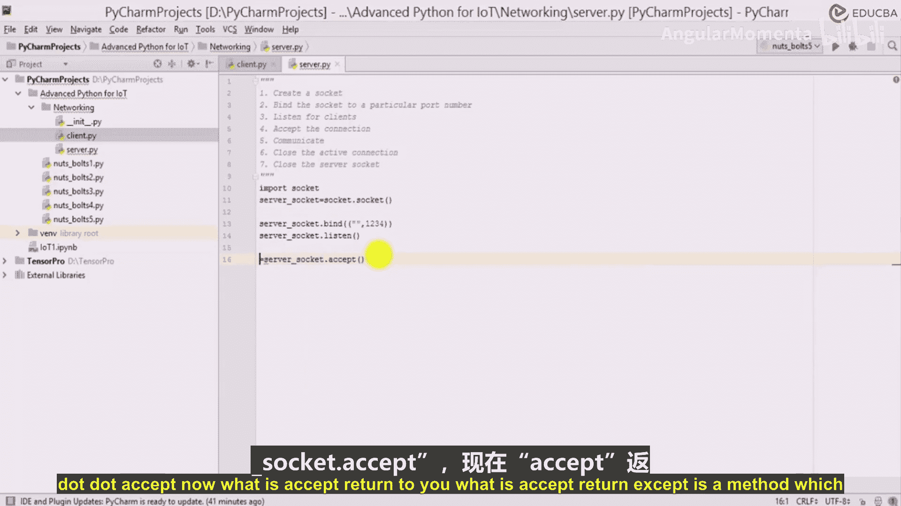

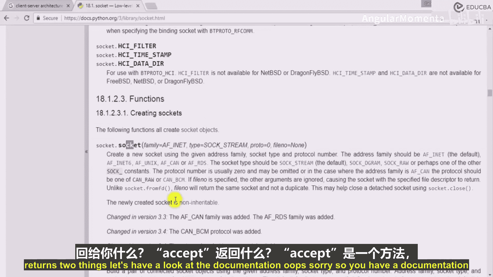

So。You have a documentation out here and server socket。 Yes socket objects。

 So except it accepts a connection。 The socket must be bound to an address and listening for connection。

 The return value。 What is a return value。 The return value of this accepting a connection。

 return value is a pair con comma address where con is a new socket object usable to send and receive data on the connection and address is the address bound to the socket on the other end of the connection。

 So the return value is a pair where con is a new socket object usable to send receive data on the connection。

😊。

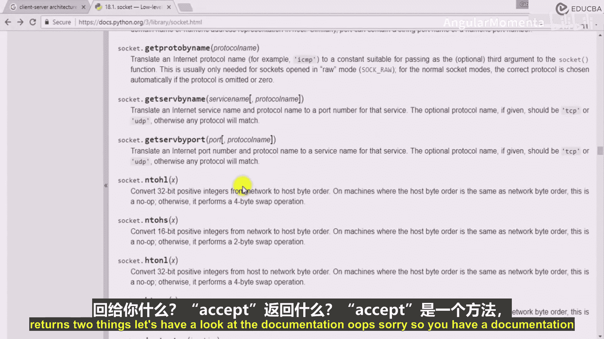

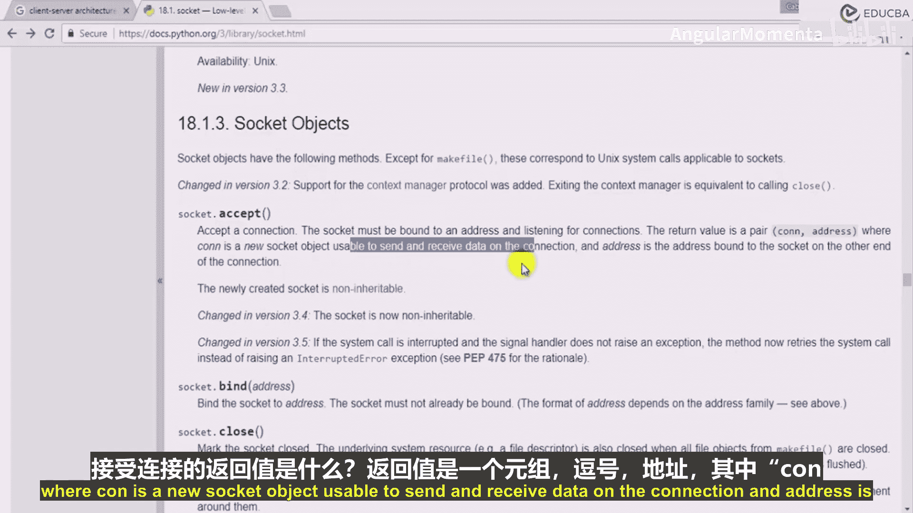

And address is the address bound to the socket on the other end of the connection。 So basically。

 what you doing is。You have a new socket object which you can use to send and receive data for that particular connection Okay so the server socket which creates which the server socket when you do an accept you get a new socket object which is there in con which is going to be used to talk with that particular client so now if there's another particular client which you accept you will get another con you will get another object。

 a new socket object which can be used for talking to that particular client that is client2 so you have client1 client to each of them are communicated with a new with a completely different socket object called the gal and the address is the address of the client which is connected to the server so were going accept that into con comma ADDR you can accept that into two variables so for now you can print you can print。

😊。

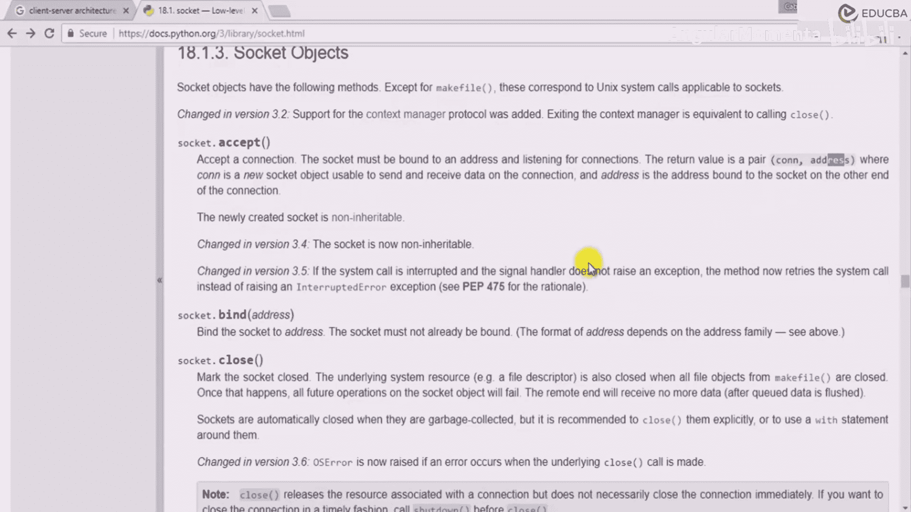

Hey， got a client。From address。Coma ADDR。Right， so before that， I can just say print。Server is。

Bound to pots。Number。Deote number 1 to 3，4， the Uri can hot code that and now print over here after to listen。

 print。Silber is listening。Is listening。For clients。

Co and then when the accept happens you accept and then of course it it has to keep， you know。

 it has to now wait for the client to talk to the server。

 it has to wait for the client to talk to the server so the client will talk to the server and let's say the server will wait until it gets a particular connection。

 let's say client dot you have to。Sver must wait for getting some data， so let's say receive。

It takes in some buffer size let's call it as bytes number of bytes receive that as data now I want to tell you something about this particular data we are going to print that data and we'll understand that when we print data we will understand what is the kind of data that you get from the client right now the data that you get from the client okay the data that you get from the client is going to be bytes you cant send things on the network as a string but you have to send bytes one after the other bytes so bytes needed to be decoded into a string bytes have to be decoded into a string so you need to say data dot decocode。

And you need to use the decocode method for decoding it into a string。

 So now you have the data dot decocode and you can just print that out。😊，Correct。

 let's say the client on the other hand， is there sending the data。

 so let's say client that soet dot。Send all。 We'll send all data。 We can just say。Hi， Sil。Hos。Hi。

 silver， you know。I am。All right， you can just say。I'm client。Im a client alright。

 so that's it for now。 Okay， but then you cannot send it like this because you it's you cannot send a string。

 you need to send it as bytes， so you need to encode them。

 You just need to write thatt encode it gets encoded because the default value is UTF8。

 which converts it into a bytes， right。Dot encode。 and after encoding it， after sending everything。

 all I need to do is after dots send all。If let's say the server wants to say， okay。

 so let's stop out here， let's close the connection。 let's close the socket。

 So I'll do client socket do。That clue。Now， at the same time。

 the silver socket also needs to be closed。So after that after data。

t decocode first is I need to close the active connection。 that's what we have done in point number6。

 close the active connection， so I will say conduct close。

And then I will say server underscore underscore socket dot close。

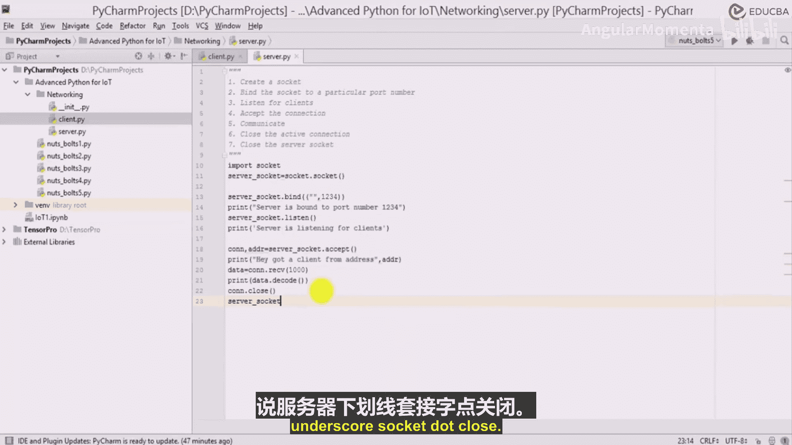

Right？