# 【EDUCBA】数据分析高级Python：构建与优化-｜-Advanced-Python-for-Data-Analysis：-Build---Optimize-p13-02_02_03_Python多线程工具包--BV1nmcKzBEU3_p13-

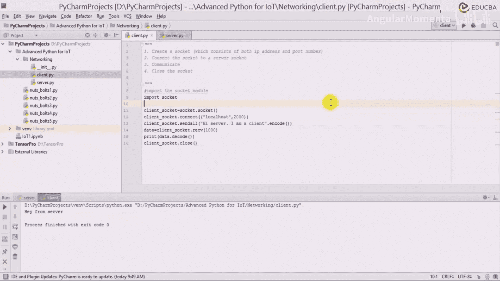

So we go on to multi threadreading for that。 Let's create a new package， new。Python package。

 Let's call it as multithing。

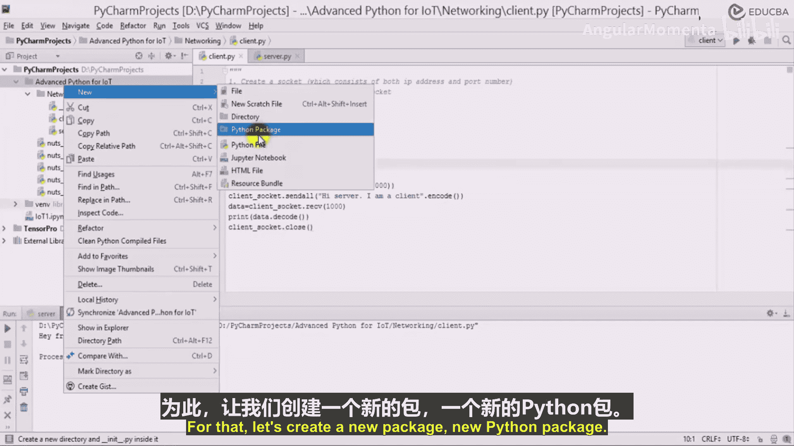

So in this particular package， let's go for a new Python file。And let's call it as。You know。

 multi thread。

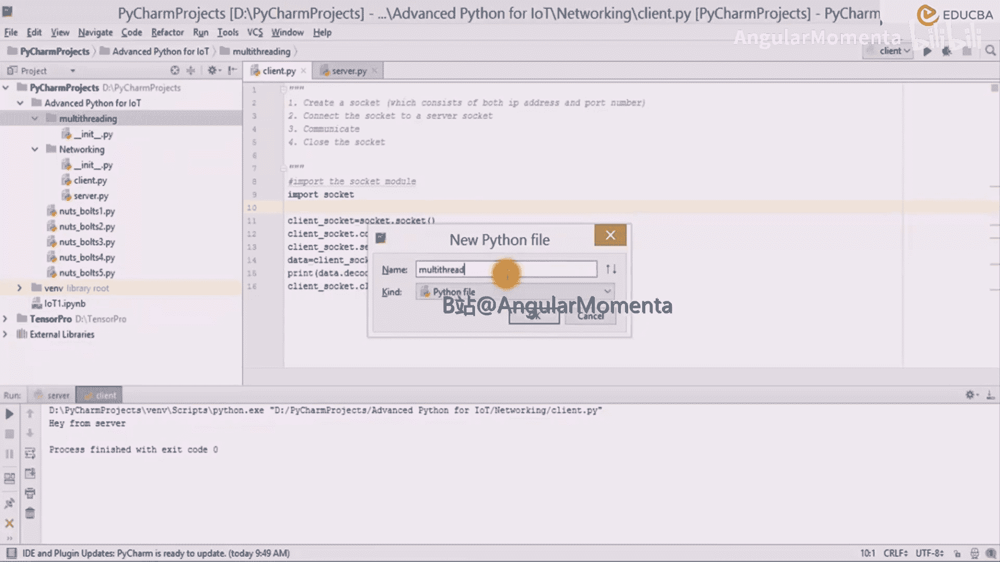

one。Okay， now in this particular multitraing， what we can do is。

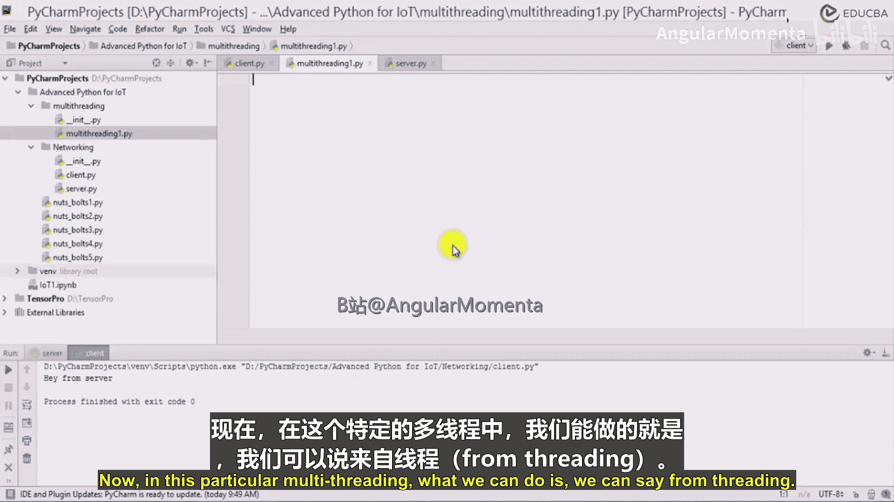

We can say from threading。

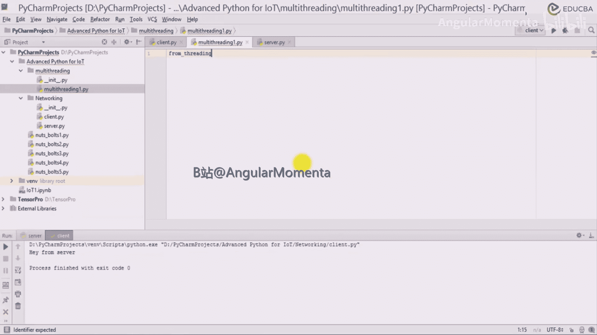

Imput。Thriat。So threading is the module that is going to be used and thread is the class that we are going to use from the threading module in order to create a thread。

😡，So I'll just write there。From trading module。We need to import。The third class。4。For getting。

 for creating。Multi threadreading objects。Okay。😊，Ready cool。 So now I have from setting import trade。

 What I need to do is I need to create an object。 Let's say the object is one second。 Okay。

 so I create an object。

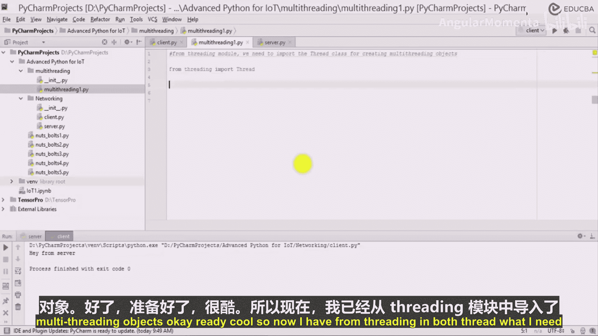

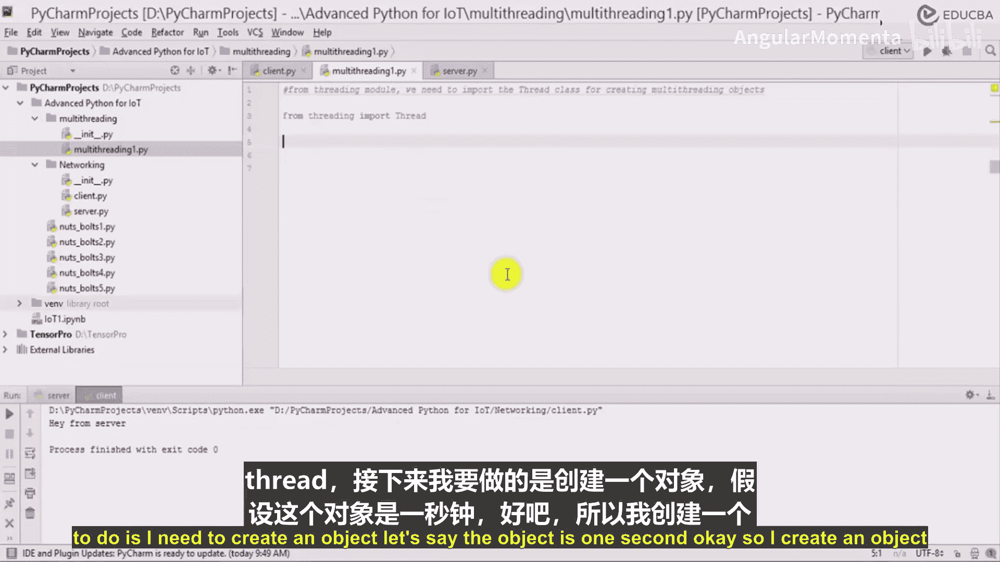

Okay， so I need to create a thread object， so let me say I'll create a thread object by calling the thread class so I can do it by just saying t1 equal to thread。

 but over here I need to say，Target， I need to define a keyword argument target as some function which needs to be called whenever the thread is started。

 whenever the thread is started so here I'm just creating a thread object。

 but I need to call this particular function when my thread is started so I can started by saying T1 do start。

 but T1 dot start will only you know I need to call this will start by executing those lines of code which are there in F1 F1 is not there currently so I need to define an F1 function。

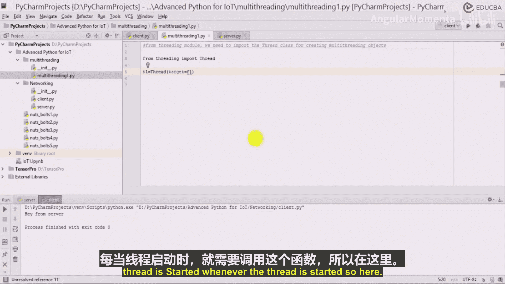

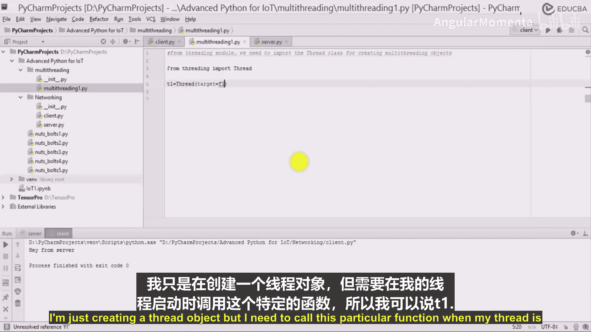

Okay， which what will it do， let's say what this guy does is it prints。

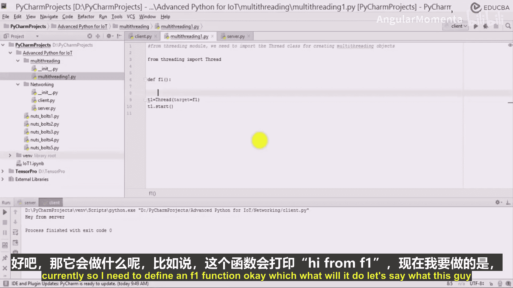

Hi from F1。 Now， what I'm going to do is I'm going to sleep in。 I'm going to sleep for。

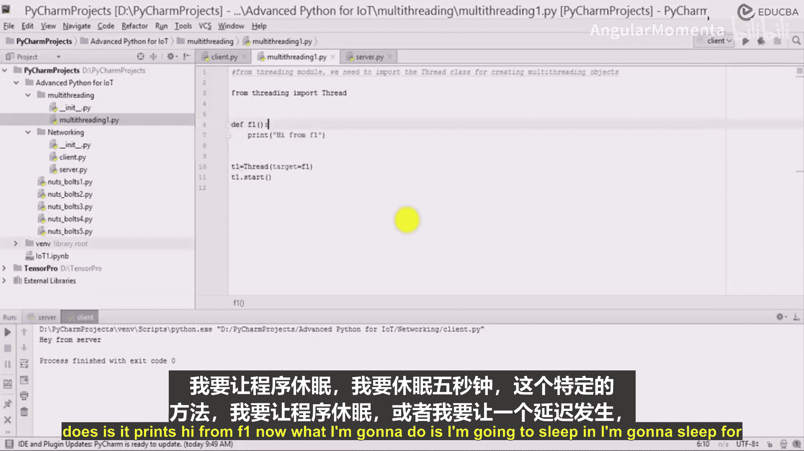

5 seconds， this particular method， I'm going to sleep， or I'm going to cause a delay to happen。

 So I'm going to import time。 And from time， I'm going to say time dot sleep。

 I need to say how many seconds I need to sleep。 So time dot sleep 5 seconds。And then after that。

 I need to print， saying。After saying hi from a fun。I need to say。Hi。😊，I woke up。

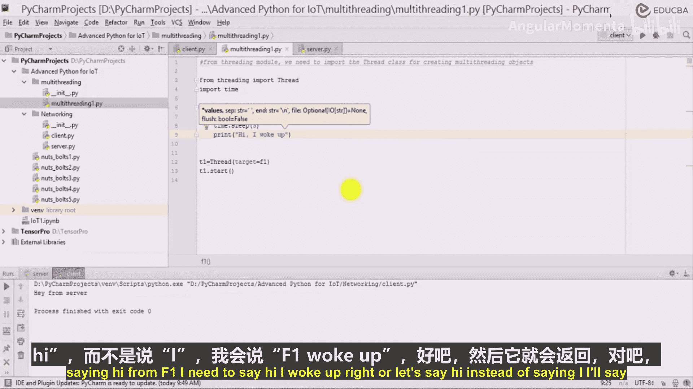

Right or let's say hi， instead of saying I， I'll say F1 worker。😊。

Okay and now it will come back right so t1 dot start will start that thread okay we start but the main program what will the main program do at that time。

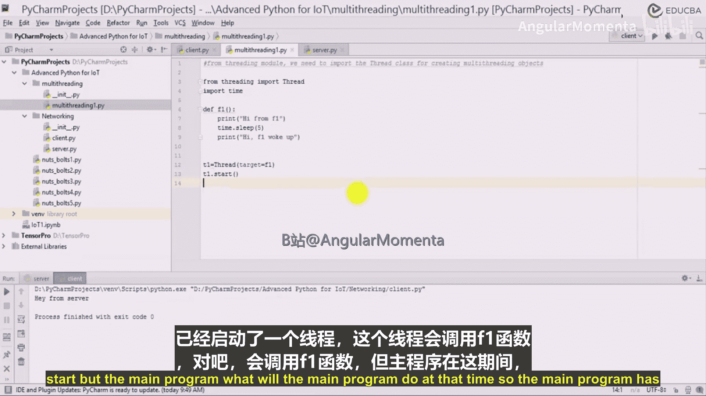

So， the main program has begun a thread and this thread will call the F1 function correct。

 we will call the F1 function， but the main program in meantime what this guy prints is。Hi from in。

Main also goes off to sleep for， let's say， five seconds。

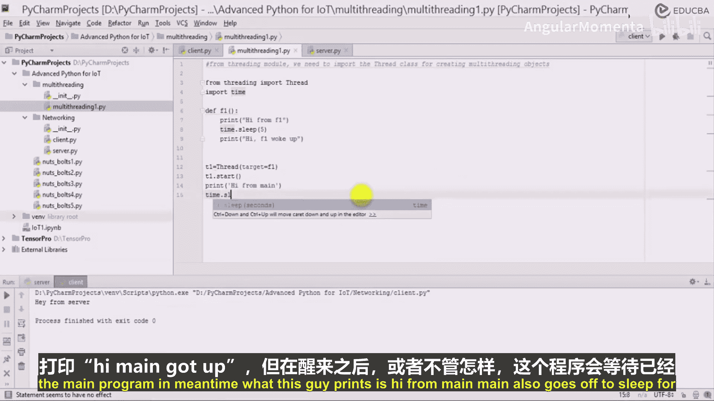

And。Print， high， main gotup。But after getting up or before getting or whatever。

 this guy is going to wait until the thread that has begun joins back。

 gets finished and then the main execution of the program stops so if I save it and if I control shift F10。

😡。

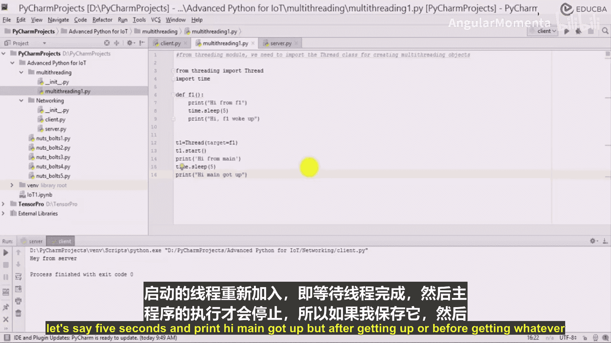

H from main， then high from main。 hi from F and high from main。 So oh， and then hi eon got up。

 then high main got up。 So hi from So first when this when I did a T1 dot start。

 Eon was called high from F1 was printed。 But when this guy was sleeping in the meantime。

 the next line also got printed。 print high from Ma， this guy also went out to sleep。

 Both things are happening simultaneously， and then it printed high E1 got up。 high main got up。

 Then T1 dotch。Are you able to understand these are a few things that happen when you come to multi threadreading al right。

 what if I want to create multiple threads and I want to pass arguments to the function？

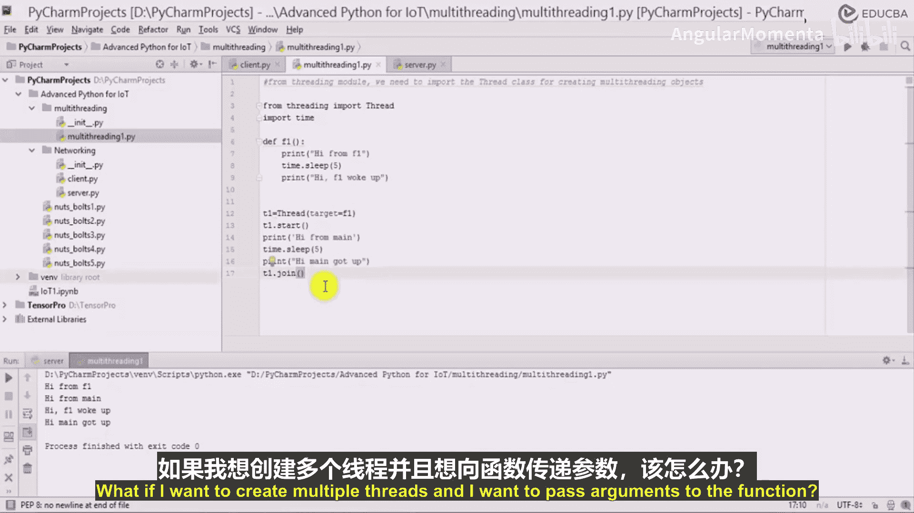

Like， say， for example， I want to create multiple threads something like this。 I'll show it to you。

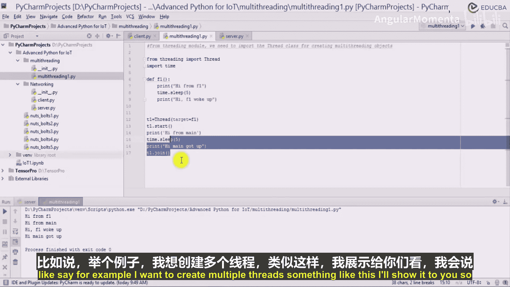

So。I'll say four， I in range， let me say 10。I want to just create different threads。😡。

I want to create different threads， okay， a thread。

 I want to create a thread in each loop in each iteration， I want to create a thread。😊。

And after each iteration， after creating a thread， all I need to do is。

I need to say t got start right so in each of the times the target should be the target should be F1。

But in a one， I should be able to print。😡，I should be able to print。😊，I should be able to print。

The value of I which is being passed from here so that means I need to take over here a variable let me call it as where for now or whereas all the keyword let me just call it as。

Yeah， let me say a or A R G argument。 Okay， so all I need to do is I need to print high from F1。

With argument。看完ERG。Right。😊，Okay， so I need to print that。Okay， and hi， E book up with argument。

Instead of saying。Let me say， plus convert it into a string SR of ER G。Right。

 so that becomes a one print statement。 So I do a T dot start and target F1。

Now I need to send the argument so I need to send it with Ags equal to I need to send it in a topper。

 I'll send it in a topple I need to send the value of I with a comma because I have to send a tople it has to be two values not just one So I'm going to send this I'm going do this for a multithreading and then I'm going run this let me say control shift F 10 multi threadreading high from F1 with argument0 with argument 1 with argument to all of these different functions got executed and then suddenly high F1 woke up after after5 seconds right high F1 wokeup with argument 01。

9，8，7，60， but they are not an auto y because threads you can never predict when they wake up in what auto will they wake up or what will get executed it's very difficult because the machine because of the system which is being executing this So if you run again All right all of them are just started and then all of them will stop by saying hi F1 wokeup。

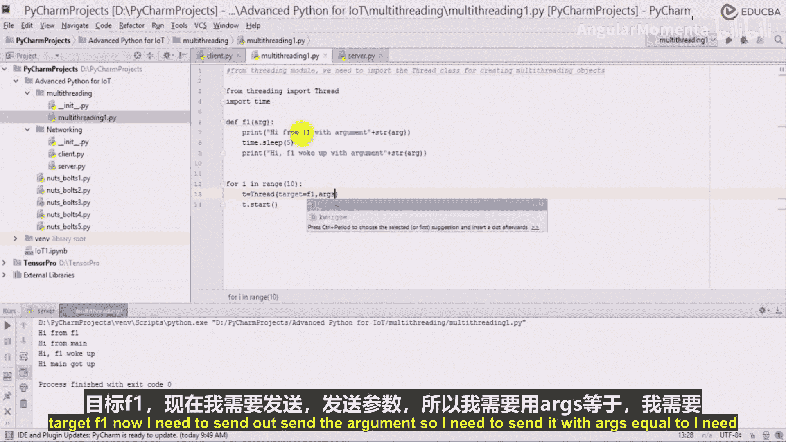

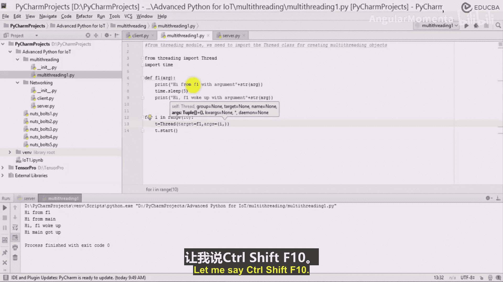

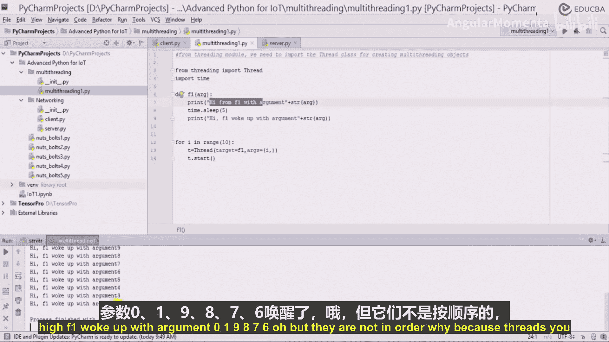

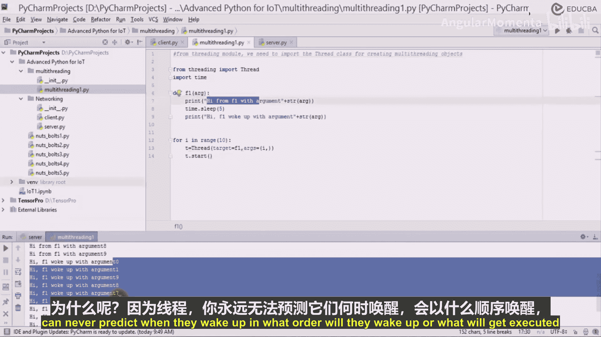

Right so you can just have a look at what happens different threads have started。

 different threads stopped and then it says process finished with Ex code this right so these are a few things that we need to want to stand about multi threadreading now we're going to use this concept of multi threadreading to create a chat box where chatbot okay where the client is going to talk to the server okay the client is going to talk to the server the server is going to talk to the client and both of them need to happen simultaneously and of course we need multi threadreading for the same right。

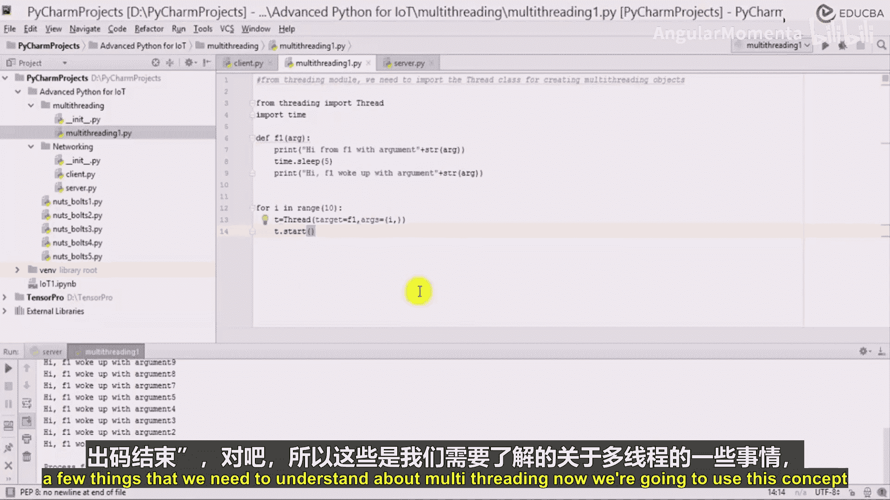

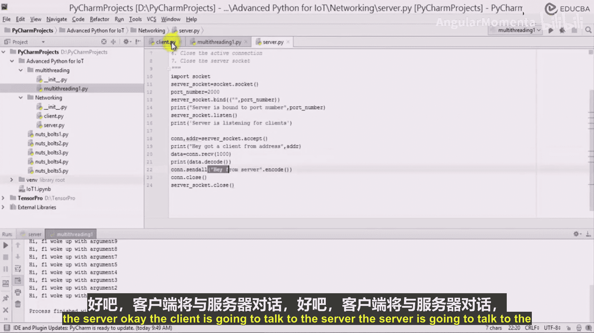

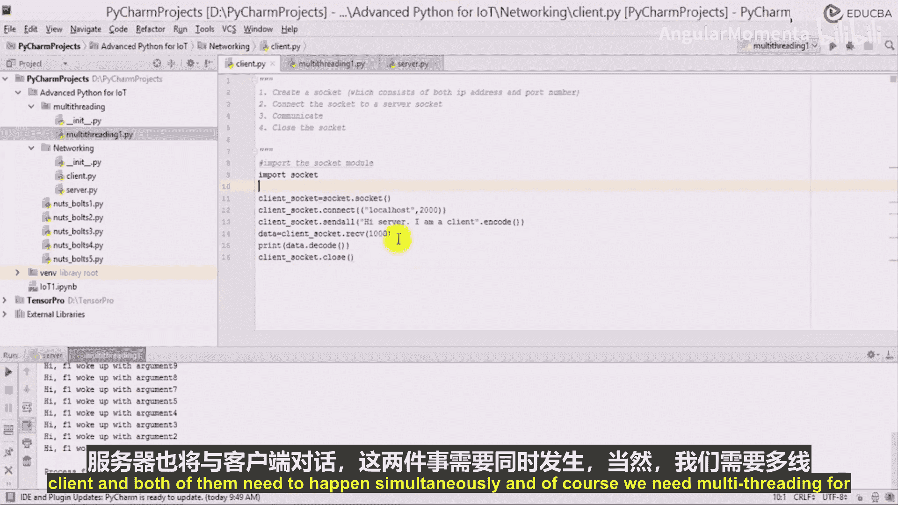