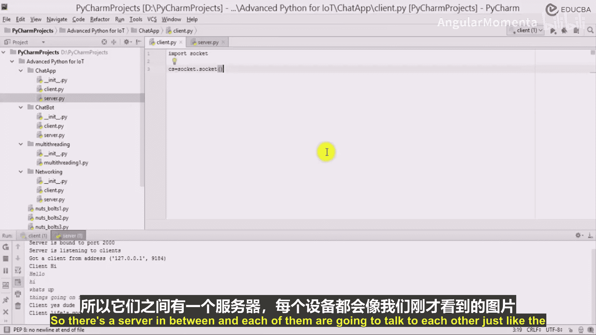
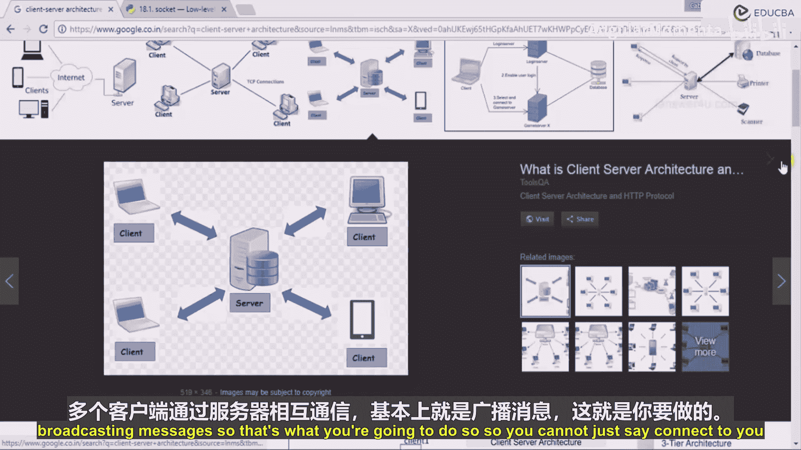
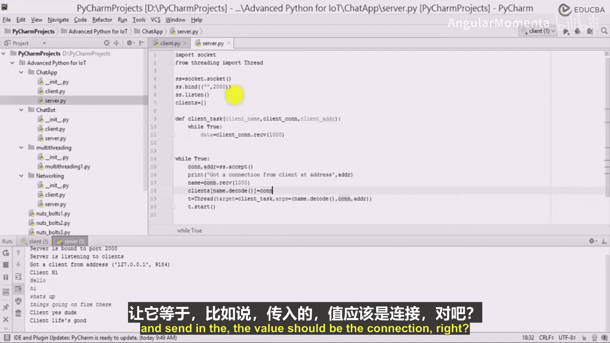

# 【EDUCBA】数据分析高级Python：构建与优化-｜-Advanced-Python-for-Data-Analysis：-Build---Optimize-p17-03_02_01_创建与导入客户端套接字--BV1nmcKzBEU3_p17-

Let's begin up with the chat app now so we can create a chat app by saying new。

Package and let me create chat app right here。So in this particular chat up。

 let me say new Python file。Of course， it's going to be a and there's going to be a silver。

Things are pretty much the same， but of course， when we do it more number of times。

 you will be more familiar with what we are trying to do so we can close up all the other applications for multi threadreading chat by chat。

Chat app， this is the client at Py server， chat app。 Okay， networking server。

 So we close all of them。 just the cliented server for chat app is is started。

 let's say in the client at P by， let me say， import。Let me call it this import。So we have。

 of course， I need to import talkck it。Things are pretty much same。

 but were going to do that again so that you want to send it very well socket dot socket。

 create a client socket right So let me call a CS for now client socket and server socket is going to be in both socket。

So after we import the socket。I will say socket dot soet。Right， both over here。

 let me call this as SS， that's a service。Okay， now。As is dot， of course， you need to bind it。

And after binding them， you need to say S is dot。Listen， listen for clients， but now。

Now comes a question。I cannot。I cannot connect to one client because my server now will connect to multiple clients。

 I want to make a chat app with many clients talking to each other。 See yeah， one client here。

 one client here， one client here。 Let's say each of them want to talk to each other。

 Why are the server。 So there's a server in between。

And each of them are going to talk to each other just like the picture that we just saw。

 So you're going to have client 1， client 2， client 3， client 4， you're going to have full clients。

 Each of them want to communicate with each other， chat with one another。

Right so whatever this client says， let's say this is ABC。

 whatever he sends should be displayed on the screens of all the three by saying ABC said this。

 and if say this client isname X Y Z and he sends a message it should be displayed on these three clients as X Y Z said this。

 so you should have multiple clients。Talking to each other via the server。

 So you're basically broadcasting messages。 So that's what we're going to do。

So， so you cannot just say connect to， you know， except a particular client out here。

 you cannot do that rather。Rather now， what we are going to do is because we need to keep accepting clients once again again and again。

 there are going to be multiple clients。 I need to say S dot。 I need to keep。

 I need to keep getting these multiple clients out there。 So I'm going to say S dot。Do accept。Okay。

 so here I'm going to accept multiple clients。 Let me call this as coin comma8DR， right。

 So I'm going say。You know， I'm just going to print。Got a connection。From client at address。Com吗？

Got my8DR， right， So I print that up， and then I say out here。Oh here。

 let me say print after I print this up， I let me call it as。After printing them。

 I'm going say after get a connection， I need to store this particular con and at least this address along with the name。

 So what I'll do is at the client side after I connect Okay。

 so I'm going to connect so I'm going to say CS dot connect。So I'm going to connect to， of course。

 I'm going to connect to local host。Come on the address， let me say vote number 2000。The server。

Has not been bound yet to bind it。To2000。Bin it up and you're going to get some data which you need to after you connect。

To the particular。Sver， you need to do one thing that is send， send your， you know。

Take input from the user whenever the client comes， just take an input from the user。Enter your name。

So。Whenever the client enters， you know， you ask him his name， store that in name。

 and once you get the name， what you can do is you can the minute you connect， send it to the server。

Sent to the server， saying。Saayying what this send is named so name dot encode send it as bytes。

 it's a string， so encode it as bytes and just send it to the server， which means the server。

 the minute it gets a connection from the client， the next thing is it should wait for it should get some data should it should receive some data。

Around 1 thousand bytes， receive it。Store it and store it in name of the client that has just come。

Okay now when this happens what he can do is he can start a thread。

 let me call this as thread t is equal to thread， let me call it as a thread and let's say I'm going to pass these parameters okay so I'm going to say target。

Target equal to let me call this client underscore task。

 I'm going to call a function called this client task。

 which means I need to have a function out here， Let me call it as deaf client underscore。Task。And。

 of course， threading also， I need to import from threading。Impo thread。

Right so I create a client this sc task。And after I had that particular target。 So I need to。

 along with the climateness of us， let me pass a few arguments。 Let me pass the。Client。nameame。Right。

 the client。Address。Right， and。And the connection， of course， you require the connection。

 So let me call it as。Plan。Kd。So I accepted these three things which means I need to send these as arguments Ag is equal to a top of these three so do I have each of them Yes I have name I have as one of the arguments I have con and I have80DR which can be passed these three can be passed as arguments to those three right so I can create this thread and all I need to do is t dot dot correct that will start the particular but of course oh oh instead of name it should be because the name that you receive is going to be invite I should do name dot。

Decodeode and then send it out right So decode it and then send it up。 So that's cool。

 And then in the client task， you can do whatever the class， whatever it's doing。

 you know whatever it wants to do。 Okay so in the client task each of the client are going to be on different thread altogether。

 So the client task， each of them is going to be different right So because each of them one one new new threads are created and client task is called。

 So each client is going to have a separate each client is going have a separate client task And in that let's say we're gonna to use these arguments。

 were going what were going do is of course we have to do just the client task is only this much whatever I get from one client send it to all the client So let's say I have to receive。

 So basically I need to have a while through out here。

 and then to keep receiving from whatever is the connection。

 So let me say client and client do receive receive， let's say I receive thousand bytes of data。So。

So let me say data which I get okay that data is gonna be I need to send it to all the other clients so basically I need to get this data and I need to send it to all the other clients oh but I don't know the other clients right you know I don't know when I come to a particular client task do I have the connections of all the other clients No I don't have hence I need to store these particular clients the minute I get a client I need to store them in a dictionary right create a dictionary let me call it as clients I'll create a simple dictionary of clients which is going to be empty at the start but the minute I get a particular client I should what I need to do along with the name once I get it I should add that in this dictionary so I should say clients of I need to give whatever the name that I've got okay so name not just named should be named that the code sorry so the name。

That occurred。Clients have name about Decode。I should say that should be equal to。

 I should be make it equal to the to， let's say。And send him the。The value should be the connection。

 right？

