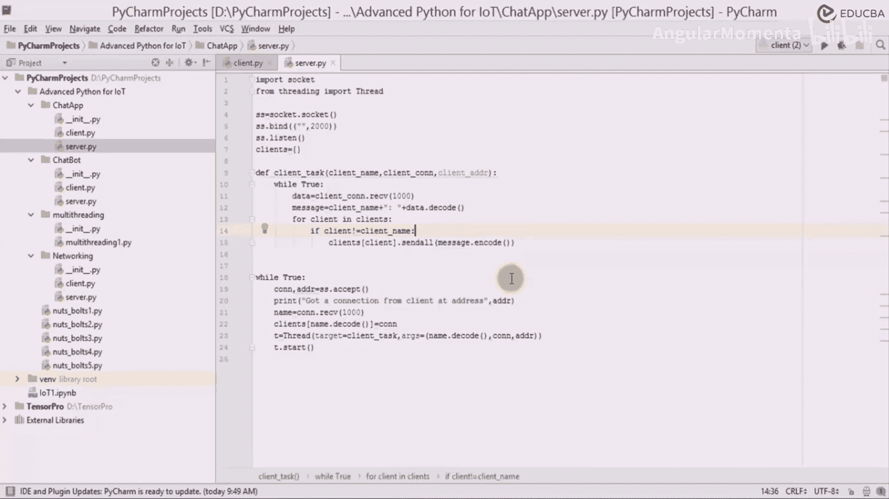
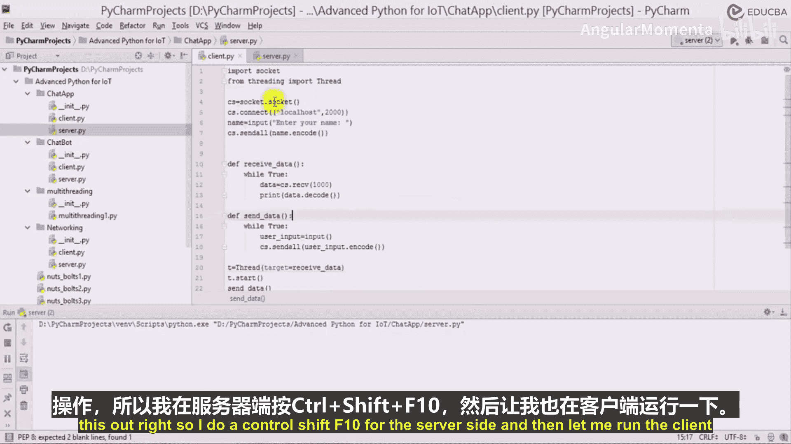
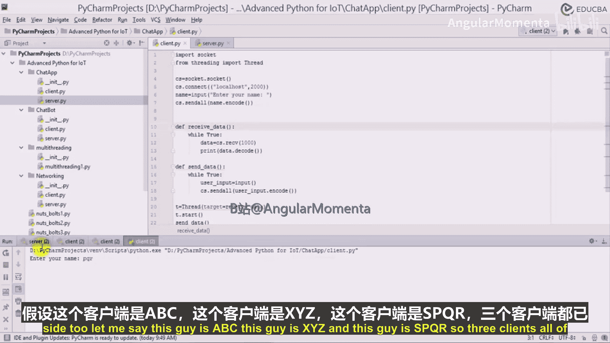
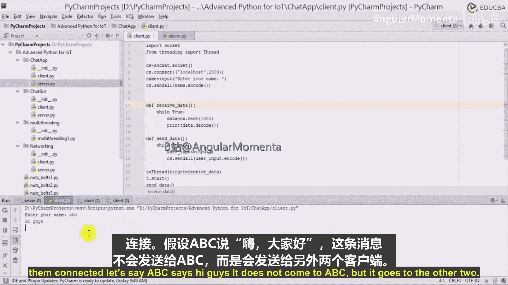
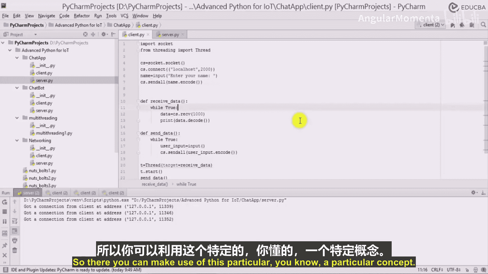
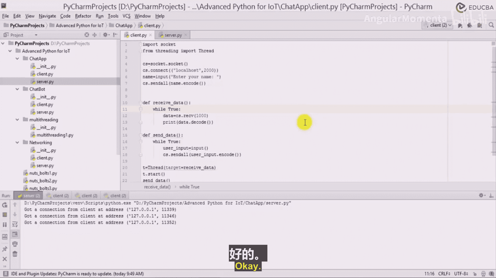

# 【EDUCBA】数据分析高级Python：构建与优化-｜-Advanced-Python-for-Data-Analysis：-Build---Optimize-p19-03_02_03_学习创建聊天应用--BV1nmcKzBEU3_p19-

If they are not equal to client name。 So if client is not equal to client name。

 then I should run this out， right， So I do a control shift F 10 for the server side。

 and then let me run the client side， too。

Let me say this guy's ABC。This guy's X， Y， Z， and this guy。As。His speak you are。So three clients。

 all of them connected， let's say ABC says hi guys。

It does not come to ABC， but it goes to the other two。 That's true。 So P Q RRC is hi， hi， man， so。

It goes to both P Q，R and ABC。 Allright， so things like that， which you。Wwhich you have。

 so you can have multiple clients communicating So here is a chat app and they're all connected via other server。

 So this is how you create a typical chat app。 Hope you've understood this。

 Of course we need to get into multiple levels of communication。

 Now why did we cover this up this is to get principles of treading and socket because when we start up with you know the Io part of stuff and you do them。

 let's say for example， you want to create a simple wkitaki like thing where you have a button to record your voice and then send it across to another person Okay so there you can make use of this particular。

You know， a particular concept， okay？

