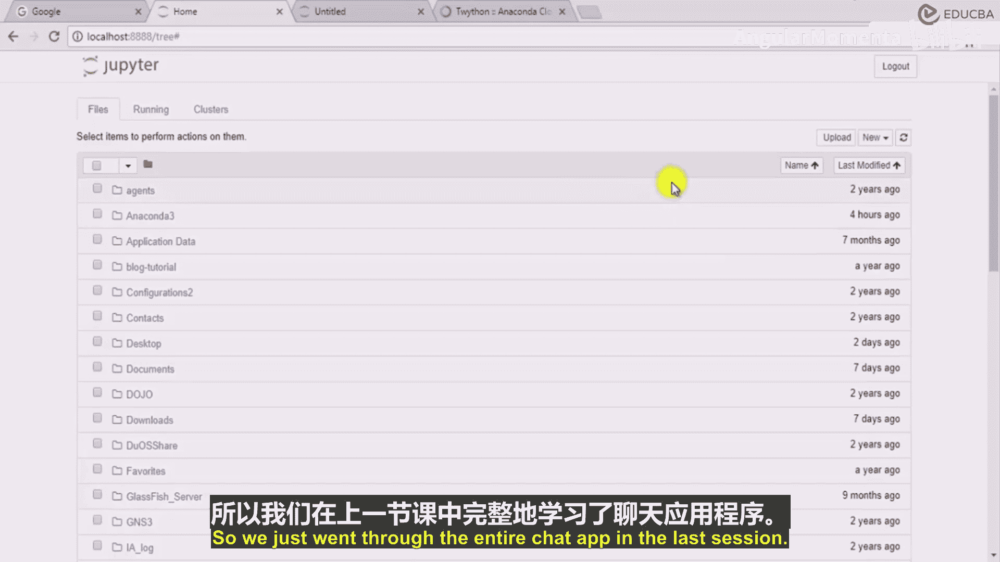
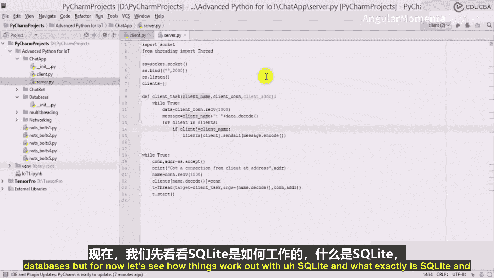
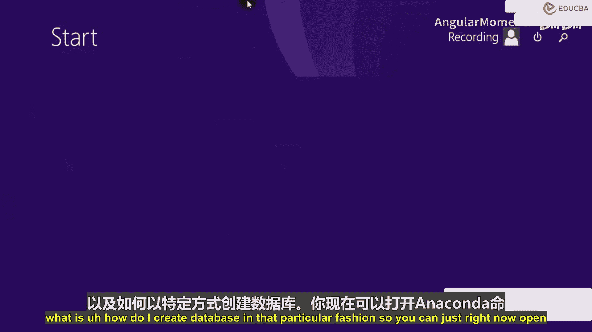
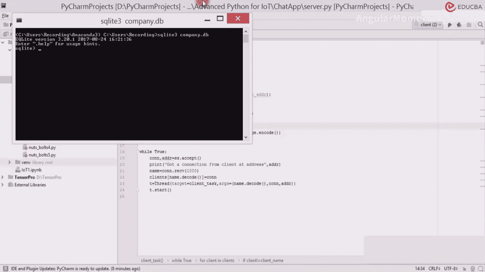

# 【EDUCBA】数据分析高级Python：构建与优化-｜-Advanced-Python-for-Data-Analysis：-Build---Optimize-p20-04_01_01_PyCharm数据库与SQLite--BV1nmcKzBEU3_p20-

So we just went through the entire chat app in the last session so we had done that in Pchm if you so we just open that up in Pchm we had done things like creating a chat where one person sense and it goes to everybody else right so in this particular chat app we also saw the benefits of you know networking and we saw how networking is used in things much more than we could ever think about so basically where a client can talk where multiple clients can talk to servers and using the chat app we did stuff like one client talk to multiple clients so as of now we of course these are the few things that we just did we learned about multithreading。

Learn about networking。 And， of course， we created the chat board and the chat app right Now something else that we can think about or which we can concentrate upon is。

Is things like we would， we would want to。We would want to understand more in detail something called as databases handling databases。

 So why database is required for for a particular program or why is database so very important So be able to create a package out here。

 Let's call it databases and why is this very important for us。 So let's think about it and let's。

Go go much more in detail okay now a database is nothing but where data is stored right so if you have a look at chat app right or in this particular application we had a client so this is the client and we also had the server so the server what was what was doing was it was just basically whenever a client was run so if I ran the server。

 if you remember whenever I ran the server the server was running up and running and client when I ran the client and I said when I ran the client and said ABC okay and and I ran another client and let's say it was X Yz and now let me see another client let me say it was。

P QR so there were three clients each of them were connected and I got a connection from client that address this and address this and address assist right so I have stored now if I say hi from any one of them it goes to all the others with ABC saying hi now comes a question there will be 1 thousand clients in the world right I could have stored I have stored all their details each client details or their connection and their name I have stored it in in this particular client dictionary。

 but what if what if I had to store much more details about。About each client。 All right。

 let's say I want to store much more details about each client。 Let's say， for example。

 I wanted to store the client's name， his， his address， his。

His you know something like his phone number， his email I。 I want to store his email I。

 at least I want his email I to be stored。 and and then I would want along with his email I I want his date of birth to be stored。

 So these are things that， you know every client's data needs to be stored。

 So now making a connection and storing the connection for each client in a dictionary is not enough because in a dictionary。

 you can just have maximum a name connection。 That's it to just two arguments right。

 name Col in connection。 but you cannot have something more than that。 like for example。

 you can't have corresponding to a name his roll number his his entire history you want't be able to have。

 So it's best to either you know， get things into files or either to some kind of。You know。

 do kind some some kind of management。Of files or rather stored them in databases。

 So I could have stored in files， but files stor them in files and accessing them in files are a bit tedious of course。

 because theyre going to be stored statements and you know how to debug these statements how to create you know how to cut across these strings。

 it's very you know it's not that great。 but what if had something like a spreadsheet where all data was there in spreadsheets or something like that So maybe you could have used in spreadsheet for that matter or CV file and Excel file or something like that where we could have done data and this is using pandas but then what if you had to do it with if you had to do it with basic Python coding then in that case let's say for example。

 most of the companies， most of the applications most of them deal with deal extensively currently with databases hence we need to get into databases in detail and。

Fure out how things work and how are databases related to each other and how they're going go ahead and stuff like that So we go ahead with that and as we do it let's understand more in detail exactly how things happen and how things do not happen and stuff like that so in databases one of the database that I'm going deal with specifically currently is the SQI database or that's the very lighter version of the database I might deal with the other databases in the next sessions。

 but for now we are going to deal with the SQI databases where we are going to learn how to how data is stored in SQI databases and how they can be accessed using Python code and how Python code can store stuff So we are going to use we are going of course develop the same application a little more that is a chat app we're going develop this application a bit more by storing a lot of client details in databases。

Long term。Long term goal for this particular session。

 but for now let's let's close all let's terminate all the connections as of now right and let's start with databases But for now let's see how things work out with ecuite and what exactly is escuite and what is how do I create database in that particular fashion。

 So you can just right now open into Anacona prompt。

Open up Anaconda prompt。 and when you open up Anaconda prompt。 If you want to create a database。

 let's say I want to create a database， let's say SQi3 is the one which is used。 SQi 3 is spaced。

 I want to create a database， let me call the database name as company Okay company do D So basically dot D in shows that it is a database that I'm creating so Sqi3 company do D。

 So when I'm in a particular database that is when I'm in company do D over here I need to create some tables inside company do D I need to create something like that。

 So let me say I'm going create a table let me call it as employee。

