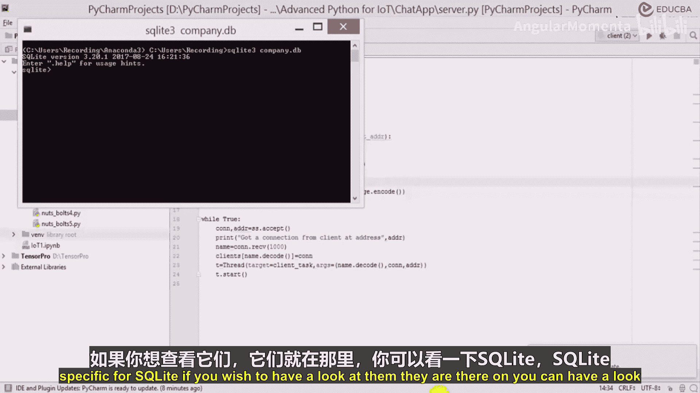
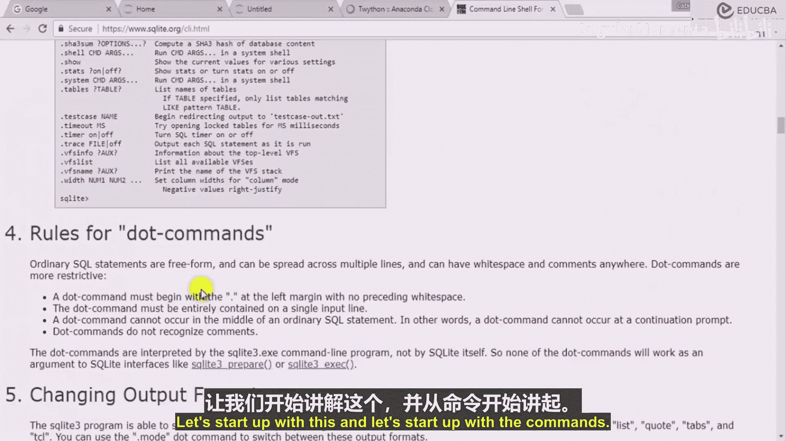
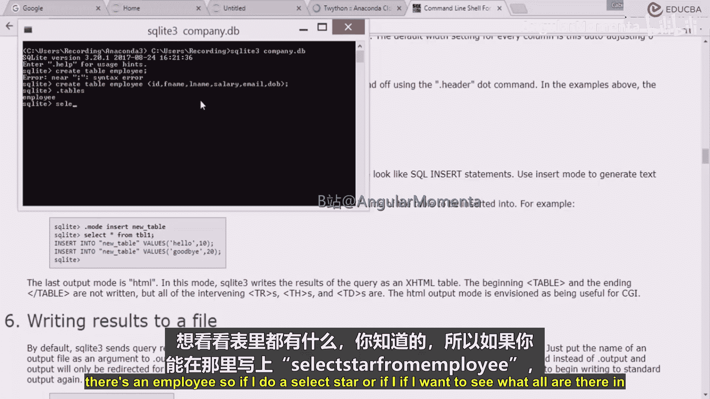
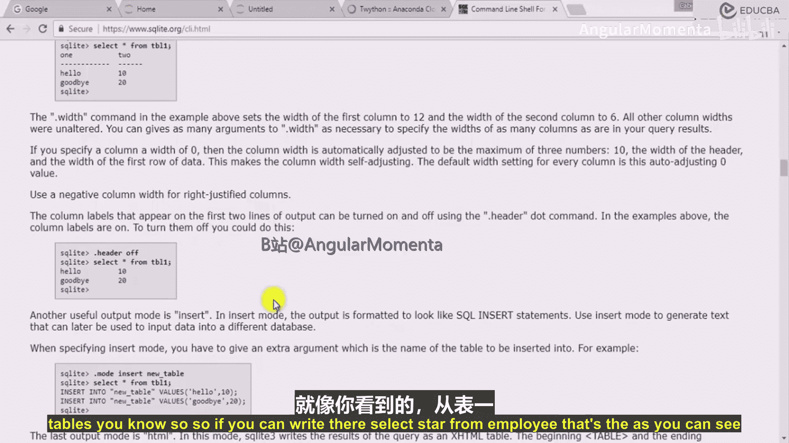
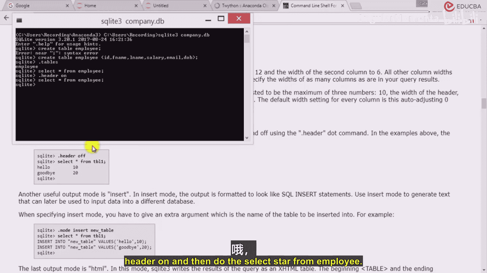
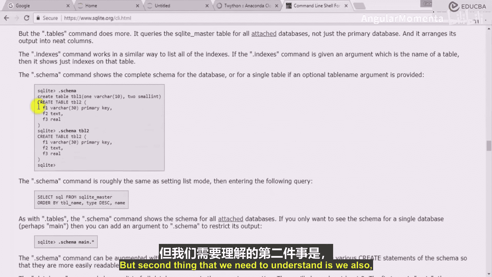
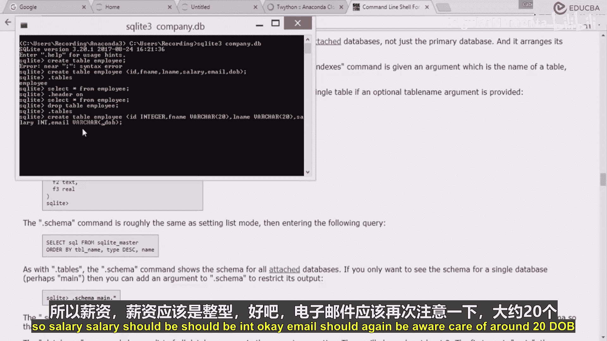
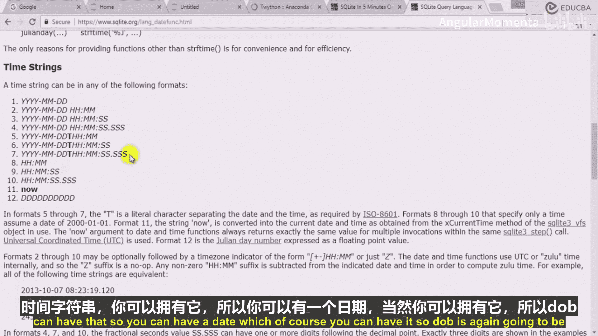
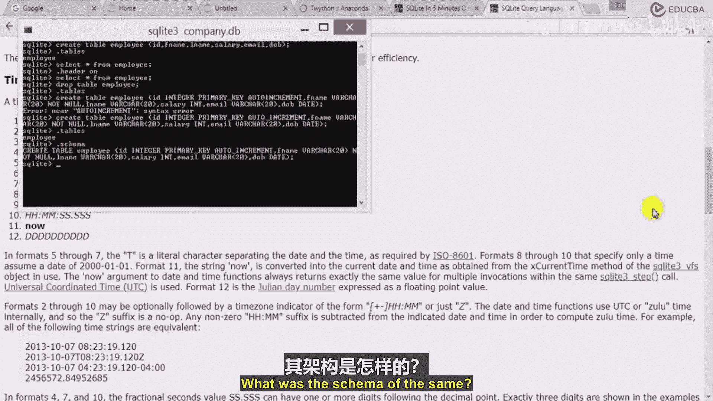

# 【EDUCBA】数据分析高级Python：构建与优化-｜-Advanced-Python-for-Data-Analysis：-Build---Optimize-p21-04_01_02_创建表格的命令--BV1nmcKzBEU3_p21-

That can give me some sort of some， you know， create table。 So these are some。

Commands which are specific for escuite if you wish to have a look at them。

 they are there on you can have a look ecuite ecuite commands so these are the escalite commands that you can deal with tutorial Tos points is one of them which will deal with or you can just go to you can just go to escuite do orG the command line shell for Eqite and it gives you all the documentation for the same where it says if you want you can just create you can just create the table by saying create table and the tables name should be there that is table1 and you should give the name of the columns inside so the names of the columns in that table1 and2 and what is the type of the variable that these columns will hold that needs to be given you a Wca for string small in for something else so you have a couple of things and then you insert into these the values this。

So we are going to deal with that in detail as we as we start up okay。

 so were going to let let's start let's start up with this and let's start up with the commands Okay。

 so we are going to say let me just put it up。

Let me just put it up here out here so in the company do table Im gonna say create table create table wide I need to give a name。

 let me say the name of the table is employee okay if I put just semicol in if you put a semico in after every SQLite statement other than the ones which are dot help or dot exit or dot databases or something like that dot tables now you don't need to put a semicollon for them but you need to put a table for free valid SQLite command so here it says there's an error why because you cannot just create a table but you also need to say what kind of columns are there in this particular table employee so I need to put them in round brackets and I need to say the columns that you want an employ so let me say I want every employee should have an ID every employee should have should have a first name every employee should have a last name every employee should have you know something which defines here。

Salary and something which defines their。 So they have their first name， they have their last name。

 they have their salary。And also you can have something like their things like employee， their okay。

 their email， their email ID stored and and of course there， you can store the date of birth， okay。

 date of birth or date of joining or something like that， let's just have just one okay。

 and let's say if I even if now if I say enter， it will give me an error。

 So it didn't give me an error， but by default， it takes， if you want to see the dot tables。

 you will see the dot tables， there's an employee。 So if I do a select star or if I if I want to see what all are。

Theyre in tables， you know so。

So if you， you can write there， select。Star from。Employee， that's the， as you can see。

 select star from the table one that will give you all the columns， but okay。

 the columns nothing is there， but at least the name of the heading should be seen。

 So you should say dot Eder on dot header。On and then do the select star from employee。 Oh。

 it still doesn't work out there for reasons。

Okay， so here in this case it is on so it gave you the。

 you know it gave you that particular command and it made it on okay， as we go ahead。

 let's understand a few things out here so we created a table and we thats that's one thing。

 but second thing that we need to understand is we also if you want to drop this particular table you have to say drop。

Drop。Table and employee。 I can just say that drop table employee。 And now if I say dot tables。

If I say dot tables。There is no employee table because I just dropped it， but now I want to say。

 and I just don't want to say it just employee， but I also want to say what should be each of these ID should be of what type it should be of type in teacher。

Okay， it should be of type in teacher first name should be of type whereca of around 20。Okay。

 last name should also be wire hair of around 20， right？So salary， salary should be should be in。

Okay， email should again be a wire of around 20。

D OB DB should be of what type you can have a look。

 There are different types of data which is which is given here。

 you can have a look output formats or something like that。 just a second。 you can have a look。

You have text real small N Cs we import， CSV export export to Excel。

 You have a lot of things which you can do to export files but if you would want to have a look at the eqite options where you have different data structures or different you know different things that you can look at so maybe in the documentation you can just just go ahead。

 have a look for the documentation and there are overview documents there are you know the alphabetical listing okay so what you can do is you can go for the if you go for the overviewbe documents it's about the above programming interfaces is escalite in five minutes or so escalite syntax there is the SQL syntax so so the programming interfaces this is what we。

Need to need to know right， So this is instead of the SQl SQite in five minutes or less。

 So we could just talk So we just did about SQite or Db and you have a you have an Sqte for。

 you know， which where you can connect using a C code that's not what you want to do though。

 So if you want， you can just write， you know， whenever you feel you want to command。Escuite command。

 which， which is a query。 And you want to say escalite。Deit。Date time， syntax or something like that。

So if you want something like that， you have a datetime function。

And maybe you can have a look at ScalI doology itself， which takes date。

Okay it supports five date and time functions， one is date itself， so date takes a time string。

 you can have that so you can have a date which of course you can have it so DOB is again going to be something called DOB is going to be date that's it。

 so it's going to be a type date and then。

You might so there are certain things which which you want it to be so ID of an employee is going to be the primary key which will recognize him or which will you know mock him so I can put that as a primary key also I need to say this particular primary key should increment every time an employee comes in or is added into the database I should I should increment it so this must be very clearly stated in the auto increment Now there are certain things which should not be null。

 which means value should be inserted for each of them say for example left name。

First name it should not be null， so you should write there not null。 Okay， Last name can be null。

 No worries。 Sal also may not be here to put in the database for now email also we can say allright。

 not null and D B2 you can put it as not null sorry if you don't want it to be you have to put it not null only if you want it to be compulsory So don't put the not null for email and salary because because we have the choice then of not putting it up it's a last name stuff like that enter So it says there is an error near the auto increment syntax so primary So in teacher you need to say auto increment let's say。

Under theco， yes， you you put underscore score for auto increment。

 and there you have the primary key。 Okay， so these are a few things that you have when you create a table。

 Now， if I see a dot tables。It will give you this thing and if I say dot schema， dot schema。

 it will tell you the schema of the table employee that you just created。

 what was the schema of the same？

