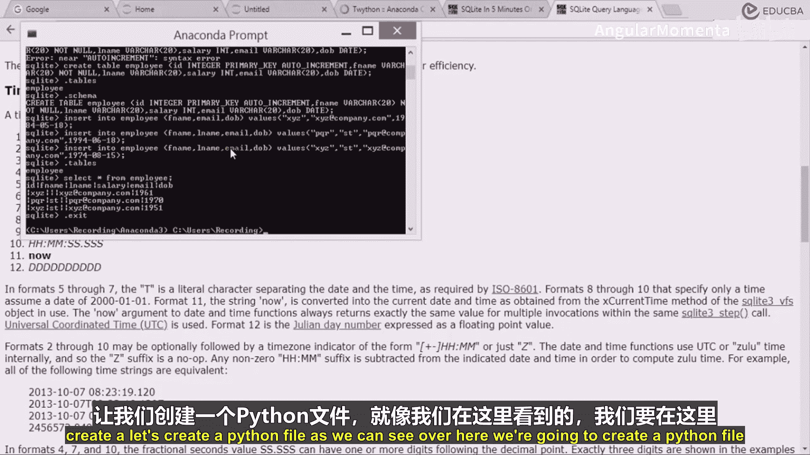
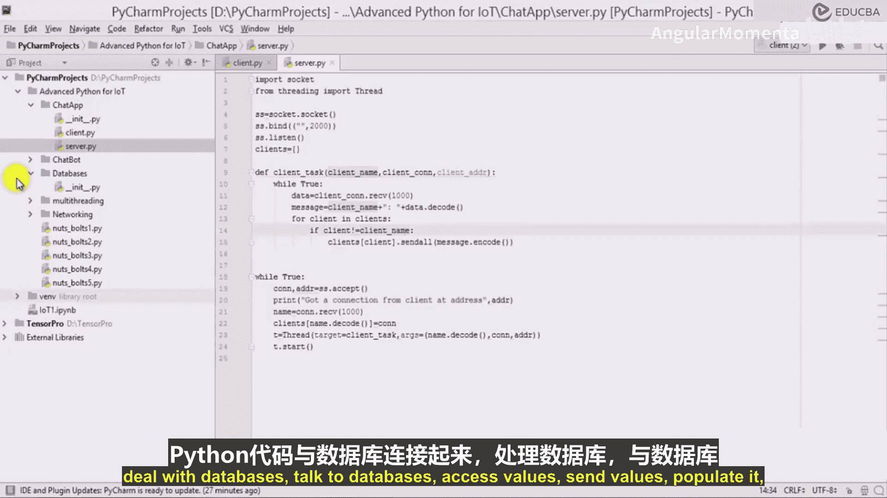

# 【EDUCBA】数据分析高级Python：构建与优化-｜-Advanced-Python-for-Data-Analysis：-Build---Optimize-p22-04_01_03_表中插入数值--BV1nmcKzBEU3_p22-

Now to insert values in in the table， what we can do is we can insert values by saying we can we can just create we can just use the command call insert。

 so insert into employee that is the table name insert into employee and you can directly insert the values if you want to insert all of them。

 but if you just want to insert selectively like say for example。

 I just want to put F name I want to I want to put an email and I want to put the D ofB that's it。

I just want these three things to be put up okay I just need to say insert into employee and I can select these three columns and I can say just say these three columns I want to say what should be the values corresponding to that okay so first name I need to put in string I need to put in double code I need to say that string first name is going be is going be say let's say X Y Z email is X Y Z at company do co right so that's also a string and let me say finally theobB thats the date of birth is going be a date but is going be let's say born in。

1984。1984， you know。18， and sorry， it's gonna be， let's say， May。 So5。And 80。

And then close it up with the semi enter so you first the year then a month then the date。

 so that's how the DOB got stored so that's about one employee if you want to insert another one let's say insert the employee values instead of XYz let's say PQR this time I want to even put the last name so I can put anL name come you know PQR can haveq PQSD right and then this can be just PQR at company。

com right and the date of birth here he was born in 1994。Okay， and yet， you， that's it。

But he respond singlely。 Okay， let's say and。 So now if I， if I say select。

Or let me insert one more insert into employee insert of PQR it's gonna be Xyz。

 but he has the same sort name as the earlier guy only this company email will be Xyz at company。

com and this time he's from 1974 and Mon this he's from8 date is 50 that's it and so now you can just have a look at you know if you say dot tables will just give you the table name but if I want all the columns in that table I should say select star select all from the table employee so I can have multiple tables so as you can see X Yz then it gives you you know nothing nothing and then Xyz@comp。

 co so it gives you the name can you see ID is there F name is your L name is your salaries your email at twoobB is here so it gives you even the heados for each of them。

If you're not aware of them。 So it gives you the T O B D B， it' just putting up the。

It is putting up the year for now that's okay。 So these are a few things that you need to know when you come to SQI databases now after we go on to SQI databases we need to go on to something called this since we are learning about SQI right if I want you know if I want only those employees you know which are which which are having you know something like those employees okay by the way have IDs got auto increment right okay so I just want those employees let's say who did I have two X Yz so that's okay I want you know those guys whose age is about 25 or something like that or if I just want the date of birth I don't want all of them right or something like that if I want to do something。

Where you know， I want to deal with the IDs or something like that then。

I need to deal specifically with with where I can say where okay I can use the concept of where okay here now there's nothing that you can you can probably put up or do or something like that but if you want to you know if you want to exit this particular database you can just say dot exit you can say dot exit and after saying dot exit。

 you can just it's come out of the Scalite so this is about how you can deal with databases and how you can deal with ecalite databases and how you you know go about with them。

 Okay this is quite simple， this is quite not quite complicated and stuff like that。

 now what we're trying to do is we are going to create some bindings between the Python code and this database。

 That is what is our next target we need to create a binding between them we need to create a connection between them try to bring the databases and then get some data from them and send data in such a way that you can store them or you can access them or。

And work on them as and when time comes up Allright， allright。

 so what we're going to do is let's create let's create a Python file as we can see over here。

 we are going to create a Python file out here we've already created you know a package that is database and over there we're going to have a code written in order to connect our connect our Python code with databases。

 deal with databases， talk to databases， access values， send values。

 populated and stuff like that right？😊。

