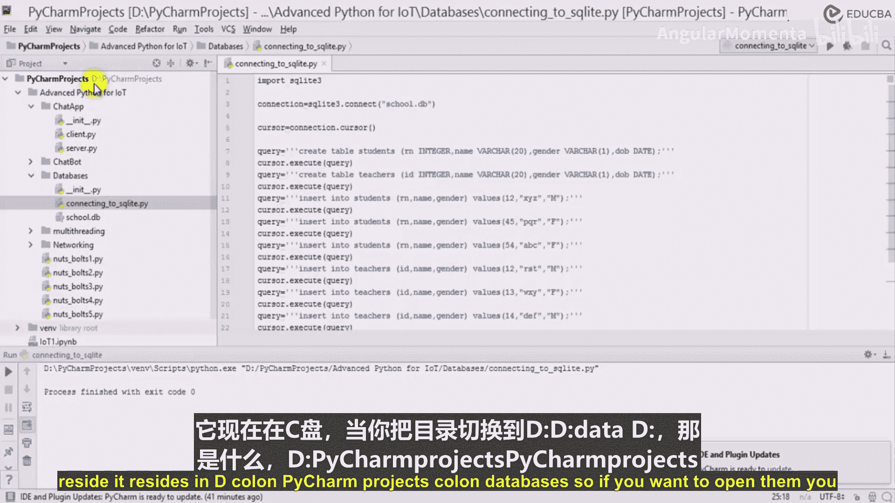
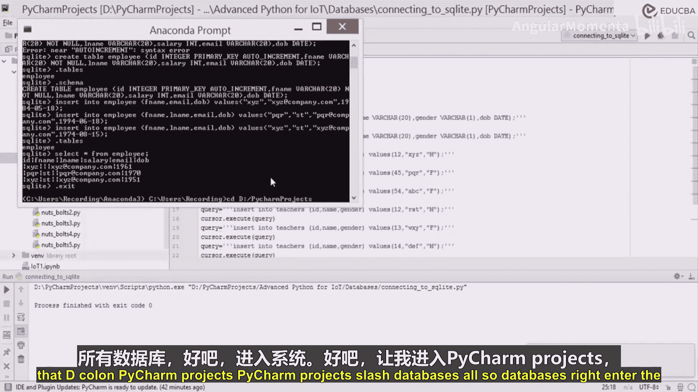
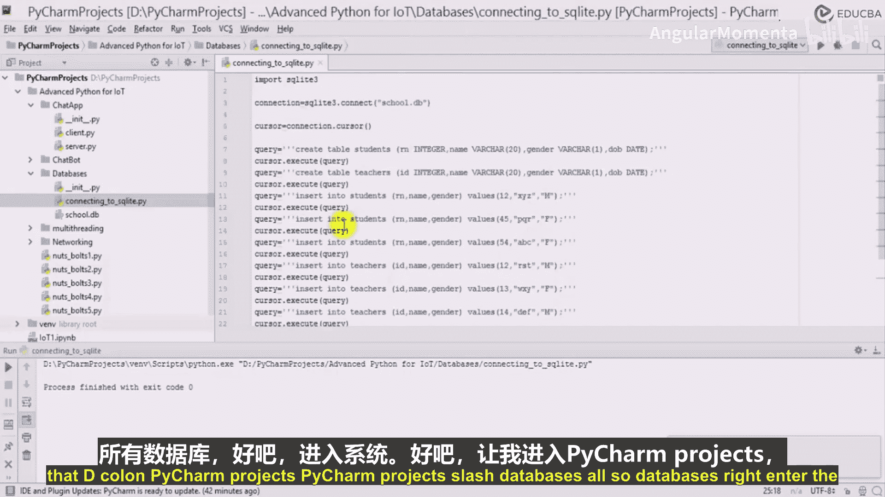
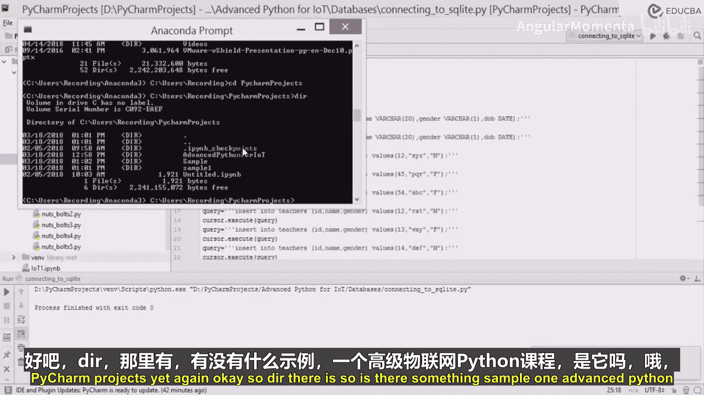
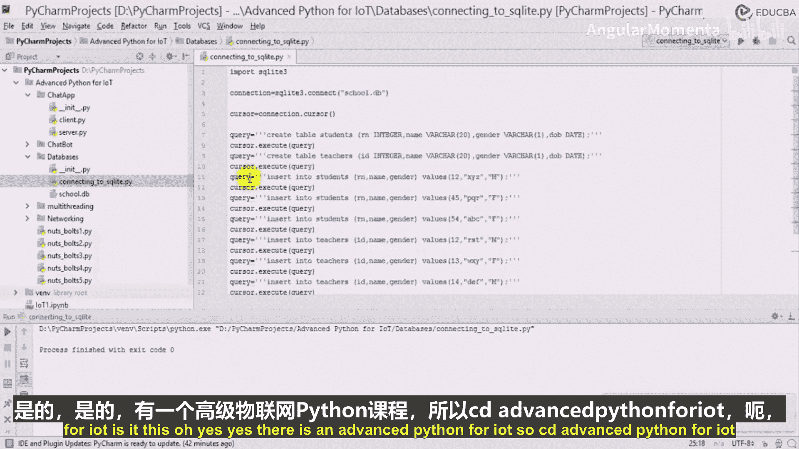
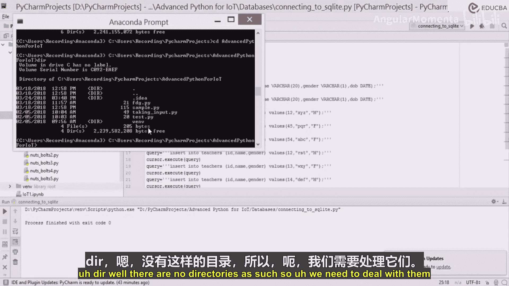

# 【EDUCBA】数据分析高级Python：构建与优化-｜-Advanced-Python-for-Data-Analysis：-Build---Optimize-p23-04_02_01_连接数据库与Python代码--BV1nmcKzBEU3_p23-

We're here to create that connection between the database and you know between the database and the Python code。

 So what we can do is we can create a new package。 let's do that let's say in so we already have sorry we already have the package out here in databases over here。

 let's say a new Python file we can just open it up and say this is for connecting。

To escalite right so we can have that and we can you know， we can just work on it。

 we just we we work on this lineer later， we can just close it up correct。

 So in this particular connecting to escalte what we need to do is before first of all need to import the escalite 3 library。

 So I hope you do that along with me。 So for to import the escalite 3。 and then。SQ I 3， dot。

Dot you need to use this connect， which means you have to connect to a particular database。

 Now if the database exists well and good， it will connect to that same database， If it doesn't。

 it will create a new one。 let's create a database called a student。

Or let me create it as I'm creating you know a database of a school okay I'm just creating so I can create so because I'm connecting I'm going to get a connection which I need to use whenever I want let me say this connection help will help me to get something called as a cursor so you can have a look so a connection dot cursor this cursor will help me whenever this particular cursor which I get from a particular connection will help me whenever I want to point to a particular point in the table if I want to point everything then I get everything to be pointed so this cursor is somewhere which guides me throughout the entire database right or if you want to execute a particular this thing you want to execute a particular queries then the cursor is used for executing it by writing cursor do cursor do execute so that's where you write this。

cursor comes in use where you have to execute queries that we need to fire so let's say for example。

 in school I want to create a database I want to create a table of students and I want to create a table of teachers So what I need to do is I need to have a query so every SQL command is called a query right so I'm going have a triple string。

So that it's a multiline string， okay， so I'm going to see over here。Create table student。Right。

 create tableable student。Where so a student will have a role number will have a name gender okay and let's say gender and something you know let's say it has a DOB that's the data birth so there's something which every student will will have。

 so you create this but then when you say that you also need to say what are the what are the types or what are the data types of each of them role number is going to be an in teacher right role number is going to be an in teacher name is going to be vA。

20 gender is going to be again a vca but a Vca which consists of only one and DOB consists of date right or date or any time you can use any one of them so DOB consists of date so this is the query we haven't fired the query though you've just written it in a string this particular query of course needs to every query and SQL completes with a semicolon Now this particular query we need to fire we need to execute so we need to say cursor that'll execute query。

And you see that cursor not execute query and also through you execute a particular query。

 you can create another query for， you know， one for student， one for a teacher Okay。

 so I create a table one is。Let me create instead of students students and teachers so this time they will not have a roll number but they will have an ID。

 they will have a name， they have a agenda， they have a DOP yeah so these are a few things so I'll execute that too cursor dot execute and let me just fire a few let me just fire a few commands where I need to keep addingtting。

I need to keep adding different students and teachers one after the other。

 so let me say I'll discreet new new queries。So let me say query is， you know， inserting2。Students。

And so the students。Well let me say I just want to insert。Roll number， you know， name。

And gender for now， I don't want their date of birth currently， insert in the students。

 all of these values are going to be， let's say 12 comma X， Y， Z。

Now that's in a double code that's why you need to have a triple code each of single over here as you can see each of these are symbols so so that I can have a double code inside because the name strings and everything in an SQL requires a double code inside otherwise you wouldn't be able to escape it right so unless you put a back slash and ch let's say the first one is male and we can close that values。

And， of course， for a semico， of course， after that， you need to execute it。

 So let's execute the square。 And from now on， you can just copy both of these and keep executing them again and again for around。

Of5，6 times each of them over here， this is students。 So values row number  one can be 45。

 another can be 54。This we can have for teachers， right， so we can have teachers here。Teachers。

Teachers are going to have ID， name and gender， I D name and gender， so。

This is what teachers are going to have。 So we're gonna copy paste that for。For teachers， right。

 So that's about students and teachers。 So here we have all the students being added one of the other。

 One is an X， Y， Z student。 Another is a。B QR， another is a ABC， okay。

 and of course you are having one female or two females as in teachers you have you have a male， sir。

 you know， you have a female teacher and again you have a male teacher。So let's say。

 you have you know， X X UV， W X， Y or something like that。 Okay， W X Y or not X UV is a P QR RSD。

Okay and let's have this as DEF so you have these teachers being inserted each of them have a different work ID 12。

 13 and 14 okay so you're going to execute each of them but after you execute you need to commit that whatever has been done to this particular connection needs to be committed else the changes will not be made connection docom and after you do a connection docomit you can do a connection。

Dot close okay so this is quite quite about about dealing with databases So now if you can run this out when you run it。

 okay， the database is executed if you would like to have a look see there is a school or Db which is already opened in the database you know in the databases folder So where is the database folder reside it does itites in D colon in by charm projects colon databases So if you want to open them you need to go to it's now in C So when you change directory to D colon D colon。

Data D in What that， D P charm projects。By projects slash databases。 also databases。

Right， until the system。 Okay， so let me just enter into just P charm projects。

 Let me see if database is not there。Okay， so you have entered oh in that。

 there is one more Pyche projects。 so you need to go into Pyche projects yet again。 Okay， so D IR。

 there is is there something。

Sample 1 advanced Pon forilty。

Is it this。 Oh， Oh yes， yes。 There is an advanced python for IT So CD， Adv Python for IoT D IR。Well。

 there are no directories as such。 Sir we need to deal with them。

