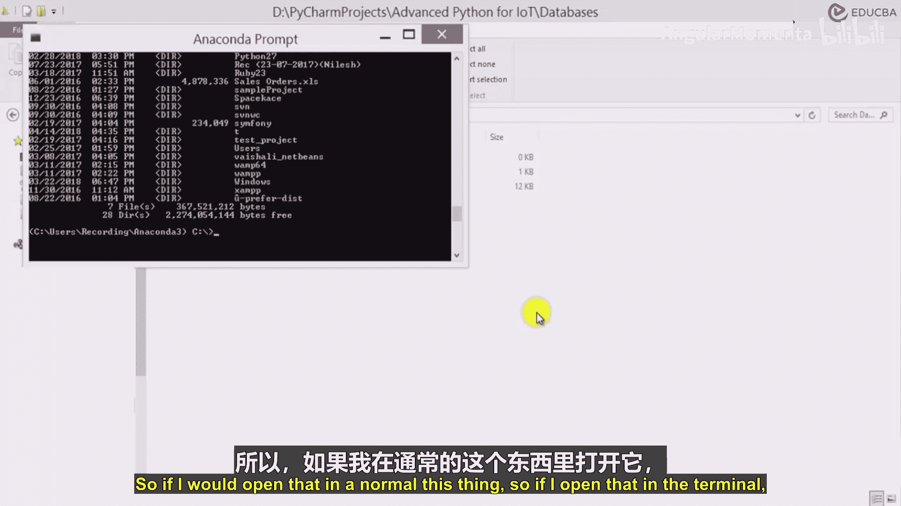
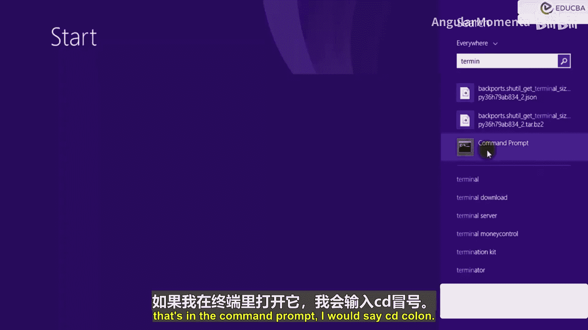
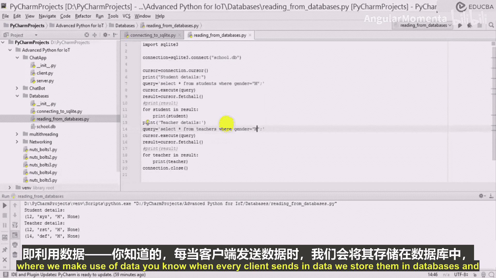

# 【EDUCBA】数据分析高级Python：构建与优化-｜-Advanced-Python-for-Data-Analysis：-Build---Optimize-p24-04_02_02_数据库查询--BV1nmcKzBEU3_p24-

In this advanced Python for IoT。If I write the DIR， it says there are different files。

 but not my kind of files。 So what I need to do is maybe I'll change directory， go back and。

Go back or change directory to D colon。好。Maybe。Right。Okay。So you're allowing me to do that。

It's quite。Okay， so what we're gonna do is instead of creating the database out there in D or in the same list thing。

 I can just。Put a。You know。I'll just put it in。Well， that's， it's quite weird， though。

So allow me to access。Okay， anyway， so I'm just going to put it in C colon。Cco slash。You know。

 slash school Lib。Are you， you know。Let's see if this works fine， Control shift F10。

Unable to open database file。Okay， but。Just want to create one。😔，D colon or。So。

 the databases file is in。Right D。And D Pchanm projects， advanced Python varietyty。Database is， oh。

 there is the database file。 So why I not opening width。O。So if I， if I open up a terminal。

Which is going be quite outer。Okay， so this is a virtual environment that we are working in。Okay。

 let's go。So if I would open that in。😔，And normal this thing。 So if I open that in the terminal。

That's in the command prompt， I would say。

CD， colon。Okay。You not find the part specified。 Okay。

 so so to open it up or let's read it directly using the program itself without having to go through the hassle of whether it's created or not created or stuff like that。

 right So we have created one school school do D right that is already created All these tables。

 all of them are already created Now all I need to do is I need to read them Now。

 how do I read them right， how do I read from each of these databases。 That's my。😊。

Major question so this is let me say in databases， let me say a new Python file I write there instead of so I'm going to say now reading from databases。

Let me say reading from databases Now in reading from databases。

 what I' I going to say is I'm again going to put it out to your import again。

 the same things import SQI 3。Right， and。Create a connection。With the database， that's school。

 TVv and whatever connection that I've created storedor in a variable connection。

And from the connection。Create a cursor。And the Sca。Can be stored。In a variable cosa。Csor thought。

 now I'm going to do execute， right， a query， which is going to be what is going to be the query。

 I want to query， you know。Select。Select。Star。From school。Correct。

 and this is the query sorry I need to put it in a variable query and not right so I'll have this query and I just execute the query when I execute the query。

 cursor dot execute query that will return you know or just execute it the result will be stored when you do a cursor cursor dot fetch all if I do a cursor dot fetch all and whatever the fetching of that will be there in result。

If I print the cursor。After sorry， I print the result。If I print the result。Sorry， result。

And let me say print。Close the connection， connection dot。Close。Right， close the connection。

 and that's after printing the result。Cool， so let's do that control。 should F 10。 no such table。

 score。 So reading from database do BY。So in database Sc dot Tb， there is。

 there is one school dot Tb。Okay， so connect。After you connect okay， just a second co oh。

 select star from school。 there is no such table school。 Of course， there is a school。

 There is a table called the students。 there's a table of teachers。

 So what we can do is we can do both print this result。Sorry， control Z。Let's say print。

Student details and then execute the query to get all the students， then I'll print teacher details。

And let me execute the same thing， except。Except。I will be having。

I will be having instead of select star from students。 I will say select star from。Teachers。

So certain details， all of them are printed。 Okay， but can you see student details are printed one after the other。

 They are in a list of topples。 They are in a list of topples， roll number， name， gender。

 and none is what none is。I guess the TB was not so this is a list of tops so all the student details are there one after the other if you want to print all of them one after the other or if you want to access any one of the student details。

 you need to say for for every student in result for every student result。Friend stood。Right。😊。

So that's how I have a student， or I can also say。Over here， for every teacher。In result。Frint。

Teacher。So if I run that control shift F 10。First， it prints all the students。

 and then it prints the tus of one of the of each of them。

 Now what I'm going to do is instead of getting all the students， I want to you know。

 access only those students who， you know， only the female students。

 I would just want the names of those who are female。Or let's say only the students which are male。

 Okay， I， only the students which are male。 I just want to execute that。 Okay， so how do I do it。

 Then I to say select star from students where。Gender。Equal to。And。

For gender equal to M now comes the question。 I need to put this in。S， you know。

 I can put a single code here and a single code here。 Then I can have a double code there。Okay。

 so now in students can you see only the male students came up right not the female students and there was only one male student and there were two female students。

 only one male student in the first case it was printing the entire result I don't want to print the result as a whole I just want to print each of those teachers or students right so this is a certain detail for male so in the other case I want to print only the females so select star from teachers。

Where。Chhende。Equal to female， so。I need to put this in a single coat， this entire。

So then they'll be1。If I put this as mail， there'll be two teachers。

Which are there or mail R D and D。 So these are the ways that you can use for accessing。

Data from database Now we're going to use the same principle for dealing with the chatbot app and putting up you know data with databases in the chatbot or in the chat app。

 so we'll do that in the next video where we make use of data you know when every client sends in data we store them in databases and Exingly access。

 right。

