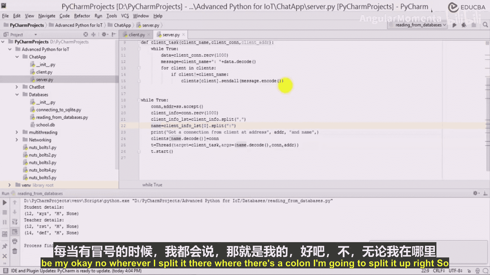
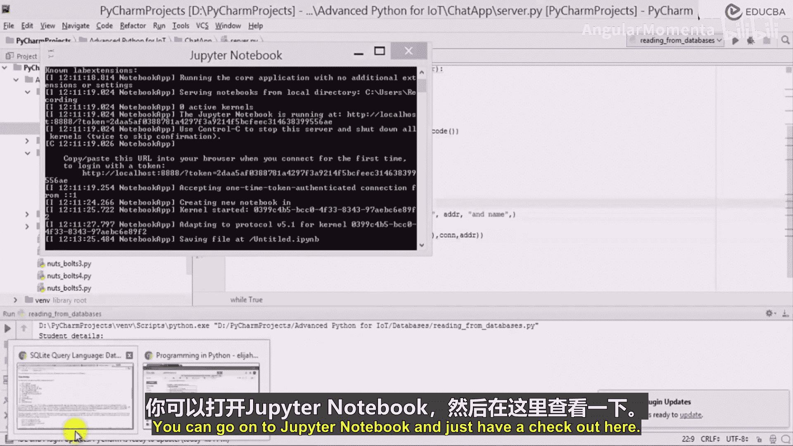
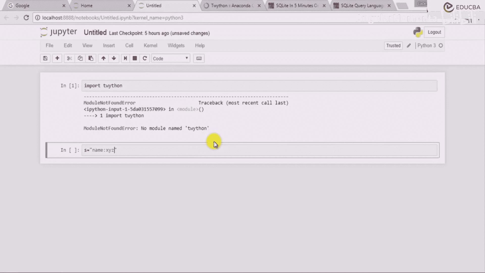
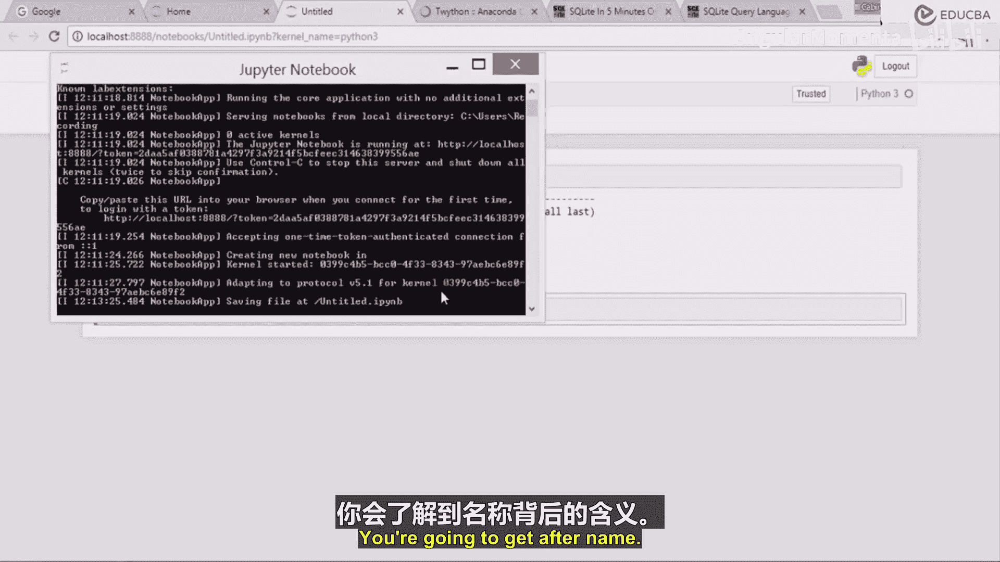
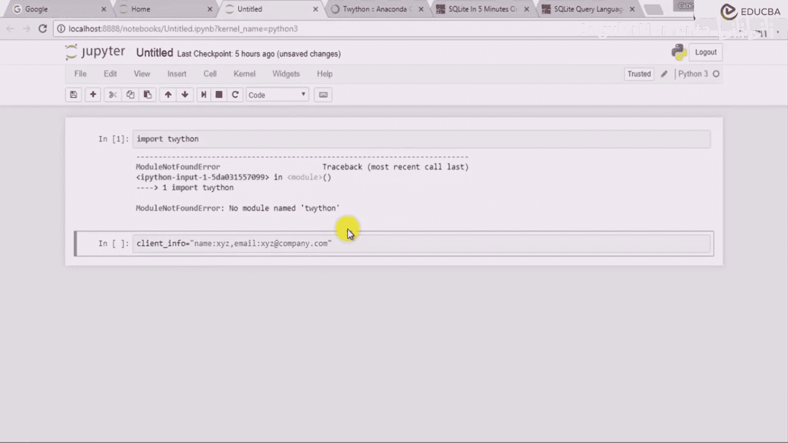

# 【EDUCBA】数据分析高级Python：构建与优化-｜-Advanced-Python-for-Data-Analysis：-Build---Optimize-p25-04_02_03_聊天应用中的变更实施--BV1nmcKzBEU3_p25-

Now， to make the changes in the chat app， we can just go on to the chat app and。

Let's click on the client and the server。 We just want to make a few changes where you only we would want to。

Have things like the database connectivity out here。

Where we would want the data of the client when he comes， not just his name。But his， you know。

 a lot of other details are also sent。 Let's say， for example， you know， whatever he say his name。

And then he enters。 He you have tell him， ask him his， you know。

He he's a client who who was entering， who was coming from some location。

 Maybe you can ask him for his email， so。Input。Enter your email。Right， so this is one thing。

 And let's say， along with email his。I just also want the state of date of bird to be given。

 So let me say input。Okay， forget about data birth currently。 we can， we can deal without it for now。

 but when you have couple of things along with the name and email and。And stuff like that。 So also。

 his I P address needs to be stored。You know， things like that need to be stored。

 So what we can do is。We can just we can just say， I'll create a dictionary。

Let's say client info dictionary， which is going to be。Empty dictionary。

 But when the name is entered， I can say client info。 I'm going to put name。

As one of the arguments in it。Client or name is equal to input entry your name and client or email。

As going to be one of the arguments or one of the keys of plain info。So we can have that， you know。

 taking both from the user， taking both from the client。 And when I send it， I'm going to say。

You know， I'm going to， you know， encode a basically。

Get both of them Cl for name and client for email。 S it together dot and code and send it out there。

 So what I can do is maybe we can just do create a string， let's say。Clanned， finally。

 I create SDR as going to be planned is for。His name。

So then what we do is instead of creating the dictionary because anyways we are going to append to it right so let's not have this dictionary out here。

 let's just have a simple two variables， one is a name and another is a email so I'm going to have both of them out here a name and an email and I'm going to create something like a client in here now which is going to be equal to the name。

And the roll number。 So I'm going to store it in such a way that you're going to have something like Nick's name。

Ningcoin。Name Col， whatever is his name。Sorry， and then add the。Roole， sorry。

 email and whatever this is email I。 That's going to be again， plus。Along with email with a colon。

 and then say。疫没。So now when I send， send it to the server， I'm going to just send。Clined info。

Dot encode。 That's it。 So I'm going to send the name and the email with name calling。

 name and email calling。And after the name， what I can do is I can put a， I can put a comma。

So that there is a。There is a clear distinction between both。Right， so one is a name。

 and one is an email， and both of them are there。 So what I'm going to do is initially。

 when I send it， of course， my server side should。S should be changed in such a way。Okay。

 where's the editor。 So it says name。 all name is here。Name is your and name is your name。

 and email is input。Okay， let's email O， I。Takek。I think there is an error here。That's it。Okay。

 so this is saved and let me go to server in server。

 what I'm going to do is basically got a connection from client add address ADDDR。

 I have the address of the client with me and I have the name so what I can do is when I do a conduct received。

Okay， when I receive， there is not going to be name， just name。

 this is going to be client that the scoring for right。Pint。Pin and score in for。Which comes up here。

 I need to store them。Whenever I require。So let's say client and score in。You know， dot split。

 split at wherever there is a。Split that whether there's a comma that will give me。

That will give me a list of。That'll give me a list of client info again， which is going to be a list。

 right， client info list， client info list。 Now， this particular list， we have to。You know。

 we have to create。There's going to be a list of know， splitting。

 splitting things where there's a comma。And let's say we have this in mind。

And then I need to split them up into， you know， different。Different portions。 again。

 I have the name call this thing and the address， you know， name。

 colon name and have the so I can just print out here， print。A client。By the name of。

A client has connected。Instead of printing it here。8。Okay， so I'll copy this and I'll put it here。

I'll remove this。We got a connection from a client that address ADDR。And name。卡吗？

Client and underscore score in。Okay。I'll have to again split it up， right because。

The client underscore In of list consists of these two things。

So let's say the zero consists of name colon。 so I again need to split it。Wherever there is a colon。

And when there is a colon， wherever I split， wherever there is a colon。

 I'm going to say that's going to be my。Okay， no， whatever I split it。

There where there's a colon I'm going to split it up right， So maybe we can， you know。

 give it a try just a minute on Jupipyter notebook you can go on Jupipyter notebook and just have a check out here。

Let's say this is the string that you're going to get。

So you're going to get a string which says name colon X， Y， Z。

Okay， come on。You're going to get after name。 What's the next thing that you're gonna get After name。

 you're gonna to get。

Email。Email call an X， Y， Z at company dot com。So we're going to check， okay， so instead of saying S。

 that is nothing but clientand info， clientan and score info， right？

