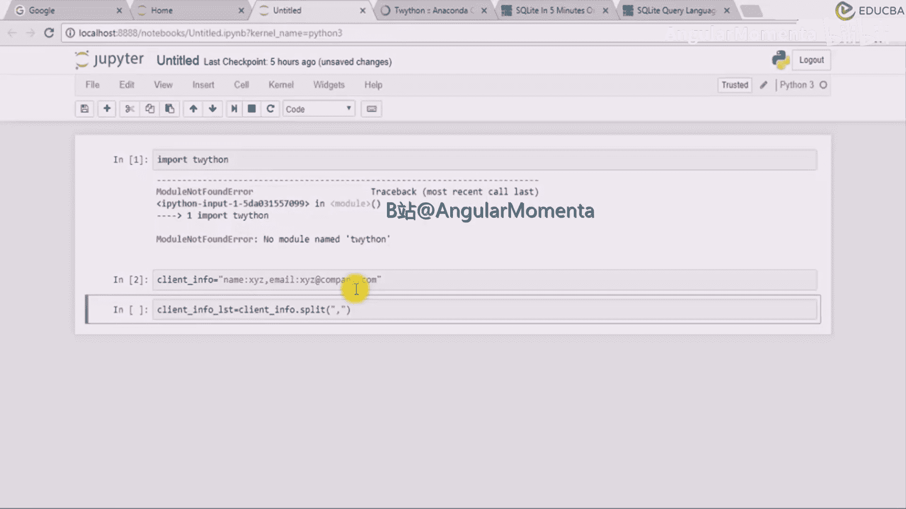
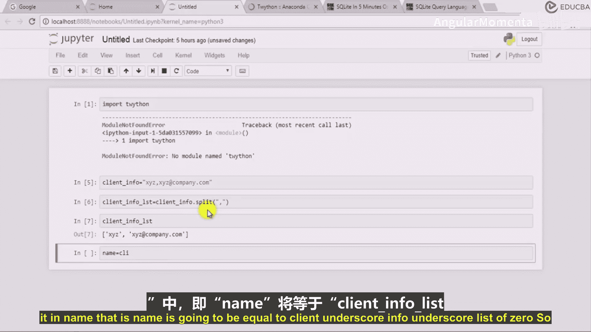
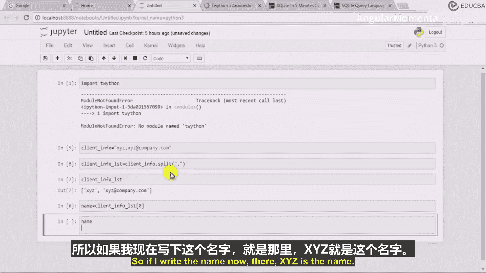
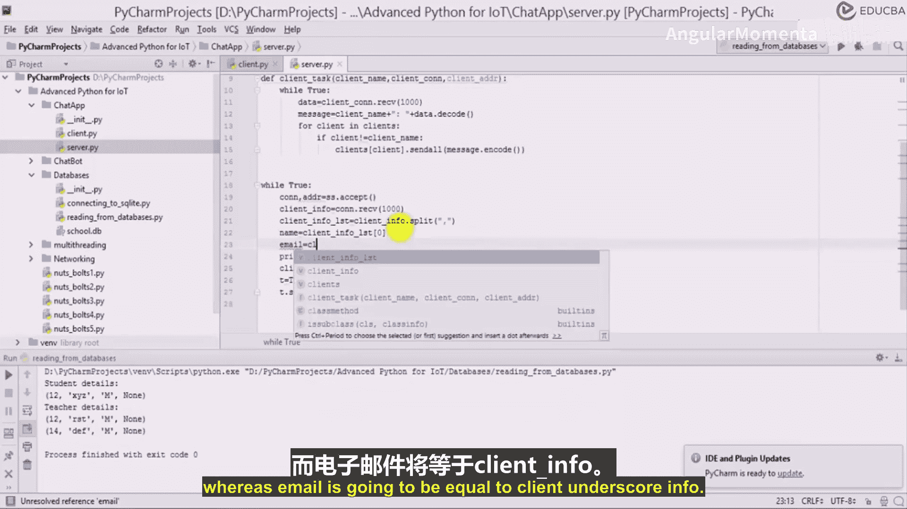
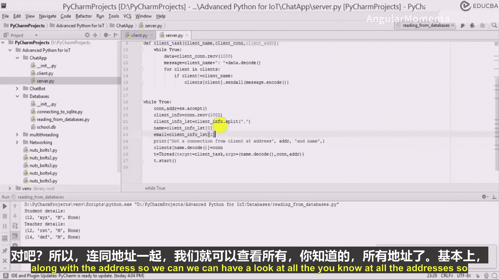
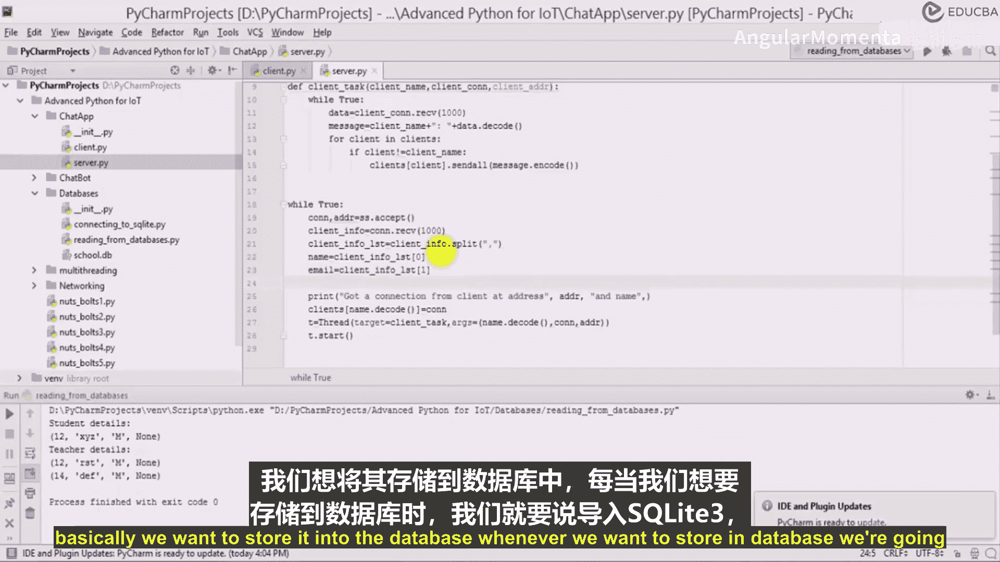
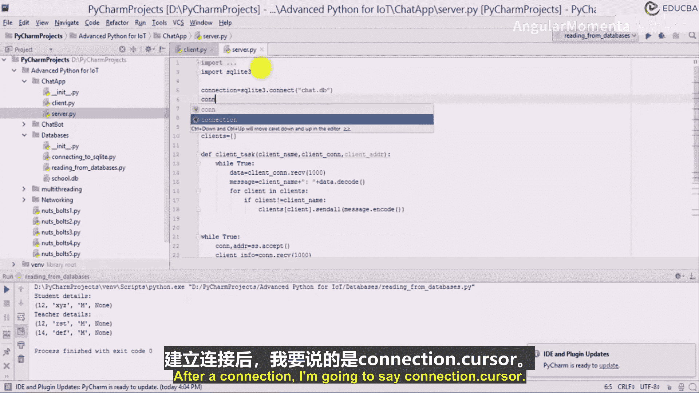
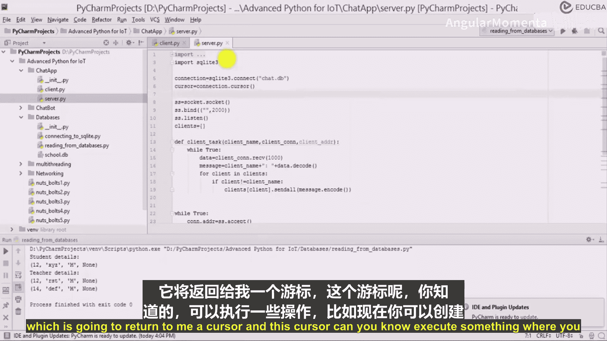

# 【EDUCBA】数据分析高级Python：构建与优化-｜-Advanced-Python-for-Data-Analysis：-Build---Optimize-p26-04_03_01_解码客户信息--BV1nmcKzBEU3_p26-

Now I'm doing a split binary score info。Dot split at wherever there is a。Come on。

This should store it inline underscore info underscore LSD。

Now， if I print。Plinner score info underscore LSD。 if I print that out。

 it will give me a list of two of them。 That is name Col X Y Z and email Col Xyz at company do com。

 I again need to find out from this from name colon X Y Z and email I need to separate the name and the email Okay so basically I want to create a dictionary of each of them right。

 or basically I want to create not dictionary， basically I want to get the name into name and column。

 So name will be equal to Okay so name will be equal to so basically I don't need to send the name colon in the email colon because because then it's it doesn't make sense So what I need to do is I just need to send when I send it from the client side I'm just going send X。

 Y Z and I'm just going send the email So when I do a split， I'll get。X， Y， Z。

 and I just need to store a name that is name is going be equal to clienter score inform score list of0。

 So that's going be the name。 So if I write the name now there， X， Y Z is the name。

 So I'm going change my client side instead of saying instead of appending it。

 I'm just going say name plus comma。 and I'm going send the email。 that's it。 So on the server side。

 I'm just going to say。

Klein anddico Cto is the name Gr。Email is going to be equal to Kers Sc info。

Of list of one。 So you have the name。And the email， now you can store that in the database。 Okay。

 so along with the address so we can， we can have a look at。All the， you know， and all the。

Addresses， basically， we want to store it into the database。 whenever we want to store in database。

 we're gonna say。

Import。Sqli 3。Create。A connection using Escalate 3。Dot。Connect， right， connect database。 Let's say。

 let me say clients。 I'll create。Chat dot Db， first of all， Okay， I'll create one connect。

 which is going to return to me a connection。After a connection， I'm going to say connection dot。

Connection dot cursor。Which is going to return to me acusssor。And this Cusor can， you know。

 execute something where you can just create a， you know， you can just create a table for now。

So， let's say。Personal execute。Create。Table。Clients。

Where you're going to have things like things like， you know， Id。

Or just have the client name for now， client。Name comma， roll， comma ch。Or natural。 Basically。

 what is it email comma。

ADDR， these are a few things that you will get it right。

 so I can store it in that particular fashion。

So， and each of them are going to be。V care。Of 20。This is also going to be where Cat of 20。

And this is also going to be about cat of 20。Right so we're gonna to have a couple of ver。

 So we execute then after we do what Coll execute， create table clients。

All I have to do is， let's say。This time， I want to give his name and his email ID。

 Both of them needs to be displayed when I。Give the message， right， so。I want that to happen。

 So if I want that to happen， because are execute， but。I would have to create。A new cursor in every。

In every new thread。That's。

That's something which is quite compulsory。Right。😊。

All I need to do is I need to put this in the database。

 Have I put the values in the database not yet， So I need run a query。Okay， so。By the way。

 this client got a connection can be done later， but。

Clients of not named at decocode， because。Name is already there here。

But I need to decode this because what I've received clientsrs for info。Is not。

Cline in a screen voice。Is still。The decocode。 So that's a bytes。 I need to convert it into a string。

Right。😊。