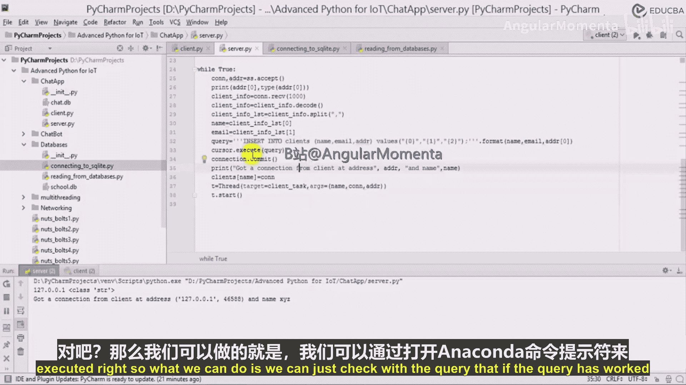
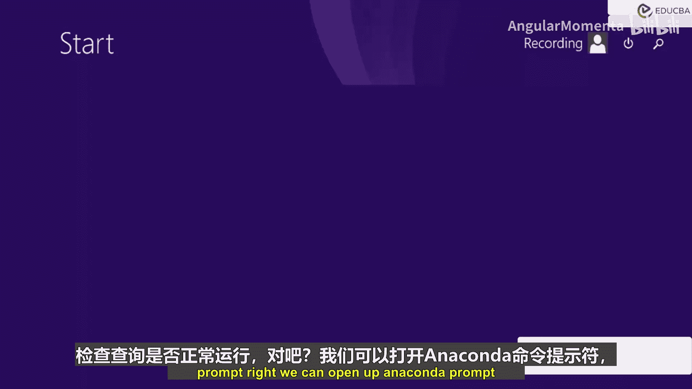
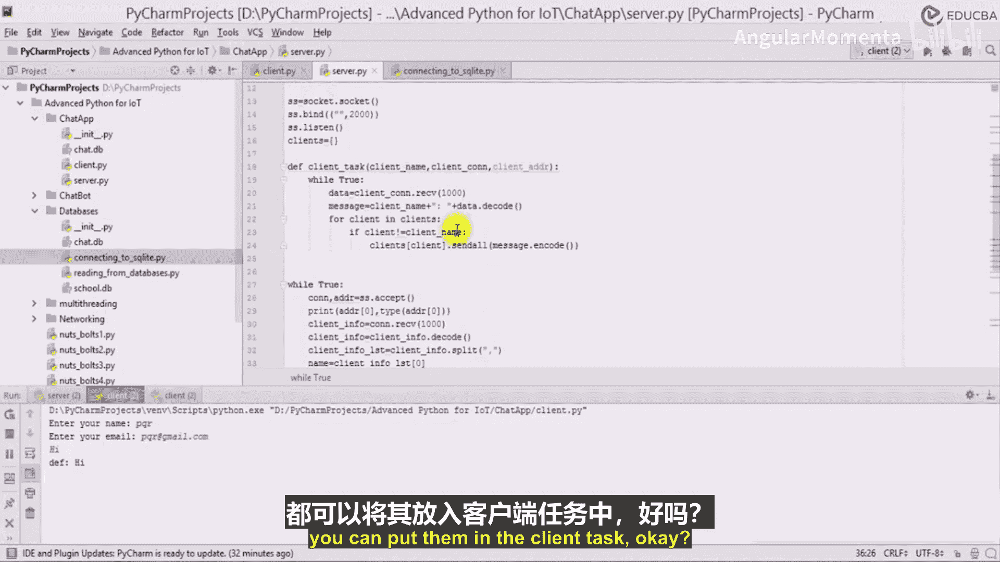

# 【EDUCBA】数据分析高级Python：构建与优化-｜-Advanced-Python-for-Data-Analysis：-Build---Optimize-p28-04_03_03_来自客户端地址的连接--BV1nmcKzBEU3_p28-

And name， okay， so we need to change that too。Got a connection and name and name what okay I need to put over here the name that this is the particular name that we have got it from right。

 so let's say instead of getting this done， let's forget about this because you have a string。

You already have a string that is you already have this address as a string we can store that address because its a tuple。

 So what I can do is instead of firing the query with80DR I can see 80DR of 0。

 which is already a string。Right，800 of 0 is all a string。

You have the address you can file the query now right so lets stop all and just check up what we can do so we can close all and we can rerun it control shift F 10。

And let me say in the server。 Py and let me just go on to client。And let me say， X， Y， Z。X， Y。

 Z at company dot com。Oh， there is still some error。 Oh， there is an operational error near 127。0。0。

1。Right， okay， so let's have a look at what the error is all about。We need to recheck it once again。

 So we have the server Py have a look once again， we need to we have inserted in the second one。

 the 80DR of 0。Which is nothing but， but there is an， there is an error。 What says this。 All right。

 so it is a string。And。Okay， maybe they do not want this let's have a look with this okay so we stop both and we close all rerun because address already has that maybe we'll have a look。

 we'll have a look what is the conflict cost due to the same。O。😊，嗯。We can start up a client。X， Y， Z。

 again， X， Y， Z at company dot com。So there's an。 So near dot zero syntax。 So there is。

 there is an error which which makes you do it again。

 So what I'm going to do is we're going to check it up。And。Tell you what the error is。Yep。

 so the error that we have。So the error that we have over here as we can see is I haven't put this。

 you know， I'veclosed this bracket for values and I haven't put the semicolon which is a part of the SQL query。

😊，Right and now let's run it So that's going to be an operational letter what what they felt right so let's run this up So wait a minute。

 I need to stop all of these first close all let me run this again So the server is running the client。

 let me run that up， let's say X Y z。And let's say X， Y， Z at company do。Come and have a look。

 Got a connection from client this thing and Emix Y Z。

 So things are going fine and this has got executed。

RightSo what we can do is we can just check with the query that if the query has worked fine。

We can always have a look by opening up Ananaconda prompt right we can open up Ananaconda prompt and just check up this is there in right is there in D Col Pch projects okay so instead of instead of going into your or you know you can you can always read it so we had also if you remember we had taught you how to read from database by saying something like this right so instead of saying saying select star from students in this particular code we can just connect to clients。

 Db and just check it out right clients。 Db student details select star from the database name is not clients the database name is。

The database name is Cha Db， and。Select star from clients so we can just fire this up and just check it up and we can close this where we don't need to have the gender Okay。

 so result we can just print the result for now rest all of them can be closed right so I can close all of these。

I can close all of these which are there。 And then there's the conduct close， right。

 so I can just print this result for instead of saying certain details。 We don't do to do that。

 These are the client details。 So I'm going to run this up。So no such stable clients。

 Silic star from clients， so。Is our， is our table clients。Right。There is a table clients。Oh。

 which is gonna be。Chad do Db， and we had created a clients， right。So， we're gonna。Okay。

So we'll make a change here itself。 That is we are going to put。Over here in the server。

 what we'll say is instead of saying in the start itself what we can do is we can make him execute instead of going to that particular file。

 you can make him show all the clients at the start itself to the server who are already registered and the database already created。

 let's say if I make a cursor or execute select star from clients right， select，Star from clients。

And if I do， of course do fetch all。And I say this can be your result。

And let me print the result what are the results of the current database so I'm not adding any clients I'm just fetching from the database at the start itself and just printing it up so it already tells me you x Y Z is one already which is registered and it set particular this particular address basically means this from the same PC right so if you add more you can print more right you can you can always you can always do that okay so now if I want to be printed if I want to be printed you know who all are the current number of clients whenever it gets added you know I can just whenever a particular client comes in I just want to print up all the clients so I can what I can do is I can just copy paste this part and just print it right？

So。I can write it over here， got a connection。 And after saying got a connection， I can say。

Clients registered， I can just print it up saying clients registered。As of date。Now。I can just。

Print these three things， right， so I can rerun the server， so I need to close it， terminate。

Read on it once again。 It says X， Y， Z， if I run a client。And let me say enter your name。

 and I say P QR。And this will be PQR at Gmail。com。And so。It prints all the clients as of data at X。

 Y， Z and P QR， And it also says I got a connection from P QR itself。Okay。

 and if I have more clients coming up， let's say if I run one more client and let me say。

You knowt let me call it as。Enter your name so let me say DF and if I say DF at at company co so you have these two clients over here you have now three clients registered to the database and I can say if I say hi it will of course be printed on DF saying PQR said hi so DEF also says hi and it comes your DF told you hi So these are a few things that we need to understand when we think about database if you want to access the database you know anytime later you want to fire a query you can put them in in the client task okay。

