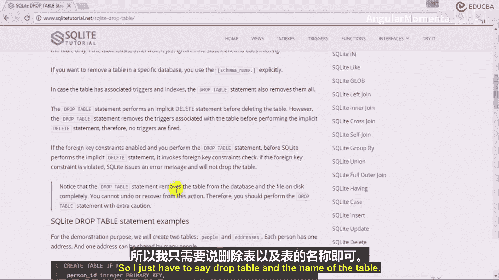
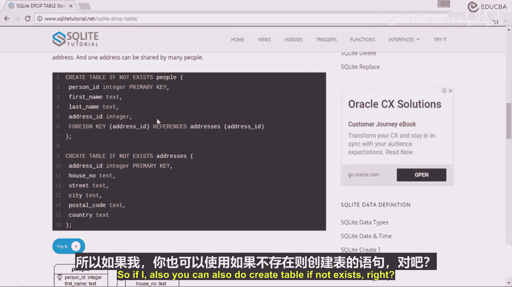
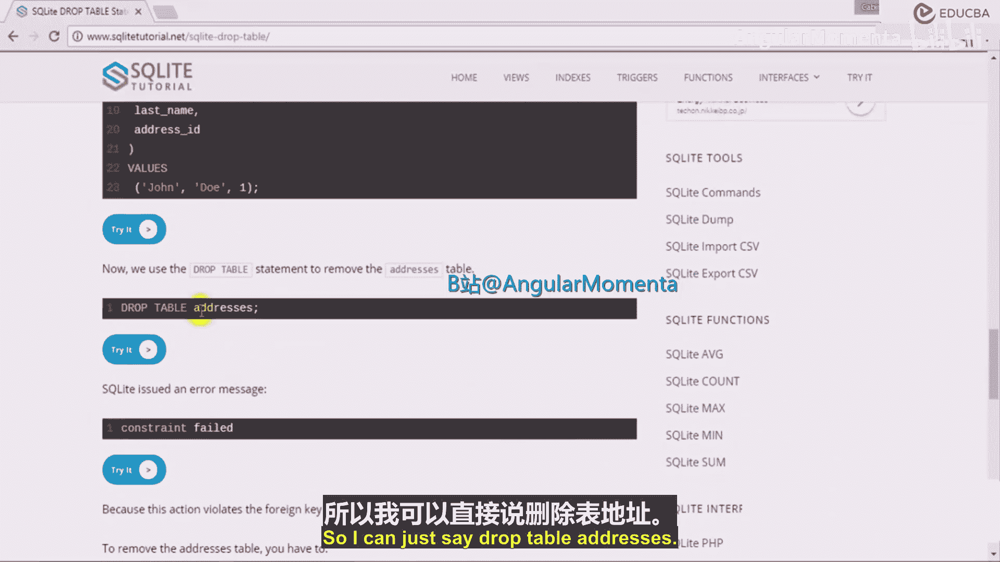
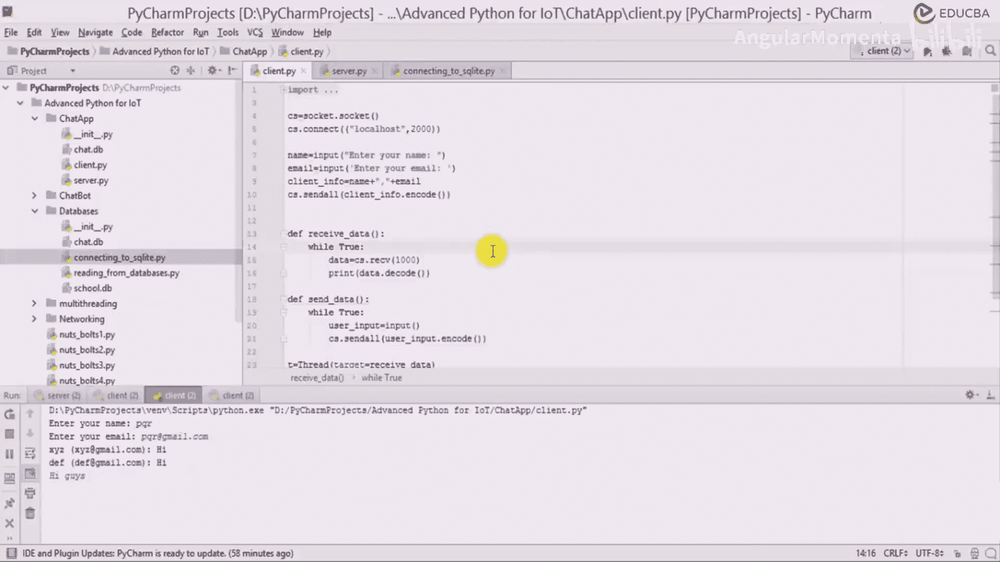

# 【EDUCBA】数据分析高级Python：构建与优化-｜-Advanced-Python-for-Data-Analysis：-Build---Optimize-p29-04_03_04_添加电子邮件与客户端名称--BV1nmcKzBEU3_p29-

Let's also， if you want， you know， we can just access these things。 You know， just when the guys。

Chaath is coming to the other side。 instead of just telling his name， we can also give his email Id。

 you know， this guy with his email I is saying this， something like that。

 if you want to add such stuff， you know， you want to get this entire thing into place then what we can do is we can we can actually state over here before sending the data right before the message the client name plus I'll have to add also along with the client name。

 I also need to add the email。 So I need to hit the database over here。

 So when I have to hit the database， you know， I need to hit the database and I need to say。

Over here， I can again， let's say， I have to say exactly the same thing as Cora executes select star from instead of I'm going to say here。

😔，Select star from clients and I need to say where， where name equal to name equal to。

 and now I need to say over here name equal to what I need to put out there is dot format。

Right instead of the where name equal to what the name of the particular client。 so I need to say。

Client score name so with that， I will get all the details of that particular client from the database。

So once I get all the details of the client from the database。Okay。

 I can say I've got that here and I've got the results here， I can access the result and if I print。

If I print you know， if I for now， let me just print the result now this one thing that I need to say is is because we have。

 you know， we we want to create these clients once again， x Y， Z P QR。

 we can drop them from this particular。From this particular table for now。

 we can drop this entire table and you know。We can create a we can create a new table so what we can do is we can create a table but after dropping the existing table so cursor dot execute I can drop the table and create it once again every time the server reruns so I can say a drop you can have a look at the gasscite syntax。

You can have a look at the documentation。No，m sorry。Can have， or you can just write there， dropping。

Table in escalite so I can drop that so it's just the statement is just drop table and and the name of the table that's it so you can just say that out there so you can have a look so I just have a say drop drop table and and the name of the table。

So if I also you can also do create table if not exist right， so this is okay。

 but then I want to drop it first so I can just say drop table addresses so that's the table name so I can just say drop table clients。

Right so I run that out and then I create the clients once again。

 so what I'm going to do is I'm going to close all of these。Te me all of them。Let me run this。And。

 and let me run the first client， let me say。X， Y， Z。X， Y， Z， at。Gmail。com。

 let me run another client。Let me say P QR P QR@ company do co。Let me say the third line is DEF。

And Df@ company。com once again。No， the server gets all of these registered back into the you know。

 so you created finds registered as of now this is one， this is Kin register number two。All right。

 now if any one of the client sends a message saying hi。

 it's still going to come to other the clients way。

What has happened is oh there is an error out here that's why it's not executing after that right so what's here yeah。

 so escuite objects created in a thread can only be used in that same thread the object was created so you cannot you cannot use the objects of escuite。

In another thread so we need to create a new escalate object once again in a new thread right so we need to create that in a new thread and you know and execute it once again。

 so of course we have to stop all and close everything。Te me all of them。

I need to make that connection once again。So connection。And let me just。

Get that cursor and then do it once again out here。 So basically， I need to。Get that。And of course。

 save it， run it。Let's say。So K one。Ready。X，Y Z， Xyz@gmail。com。Then comes Kin2。P QR。

 P QR at company dot com。So we test one thing at a time。 Let's just go。And， let's say hi from X Y Z。

 let's see if PQR doesn't get it， which means there's an error in server once again。

 says's no such column X Y， Z， where name。Okay， so it says there is no such column X Y Z now Y shall because X Y Z is not a column but X Y Z where name equal to I need to put that in a string right so these are few things that you do it while you you know I need this is a string X Y Z is going to be a string so I need to put that out there where name equal to you know when I put that。

So that's what the SQL syntax requires again， close all， terminate， it's a process which。

This how you build a code with some kind of errors， Keep executing it。

And do it properly enter your name。So there we are。One more client。And let me say。

So high firm client from X Y Z， oh it's coming up here so there's no error as of now。

 but you can have a look got clients registered as of date now and now I have just， you know。

 it gets printed。All the details of the client X， Y Z gets printed because of this line。

It is this line which is printing this particular line whenever that particular guy sends a message。

 so if I send a message from BQR， let's say hi。So it gets printed that particular guy's details in result。

 So what I can see is instead of printing result， I don't want the result to be printed。

I can just print on the server side result of zero。😊，That's the name。I can just say send。

A message for now， that's on the server side。 But I need to append this client name。

 and I need to put。In brackets， right， So I'm going to put a string。And append。 Okay。

 so client name space。 I'm going to put in bracket。 I'm going to put there。Dot format。

I need to put their result。By the result of0 is just going it's a list of tuples。

Its just going to get me to the topple result of0， but I need to get into the into the email so I need just say result of0。

 the first element in the result of 0 and here result of0 and is a result of0，😡，Colin Zdo。

 that's the name of the guy。So I close it and dot format， and of course， I put that here。Okay。

 and the client screen name， Oh， wait。Plus， I add his name。Email and。Of course。Plus deco。 Yep。

 so with this， we are done with the flow of it。The email， lady。Stuff like that。

So we can get the entire thing up and running， so let's close all。

 hopefully this should be our last try。Sver， so server is running fine。Client number one， X， Y， Z。X。

 Y， Z at。Company dot com， right？Let me run another client。P QR at Gmail dot com。Oops， I wrote。

 I wrote a wrong name。Okay， no worries。Okay， I'll just close everything。

 It's going to look a bit weird。Let's rerun it again。Right。And once more。So you have three gls。

 three of them registered。 Let's say hi from X， Y， Z， What comes up here， X， Y Z with thezimi ladydi。

 Col in hi， and that comes to both。 Let's say hi from here。 D F with the Zmi ladydi， Col in hi。

 So you can and over here it's X， Y， Z send a message， D F send a message。

 If P Q R also sends a message。 Hi， guys。That goes to both of them with PQR's message and also PQs and a message comes in the server。

 So you know， yeah， we can even add a client and enter the chat。

 So here you have a group chat and that's awesome。 We' are going to develop this further。 hopefully。

 okay。😊。

