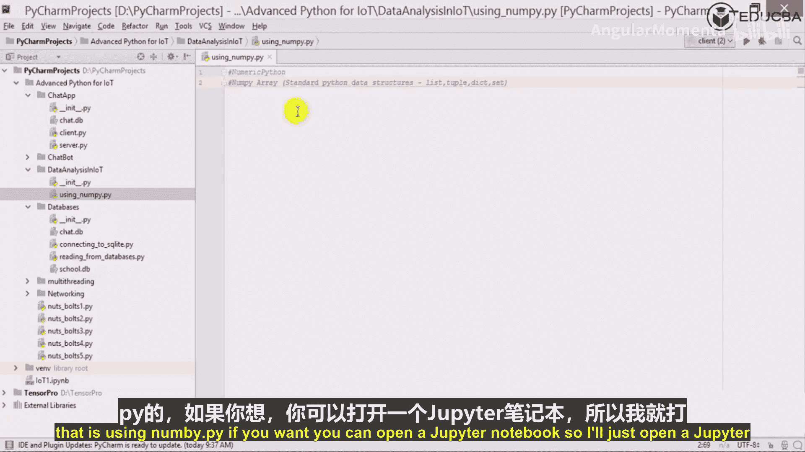
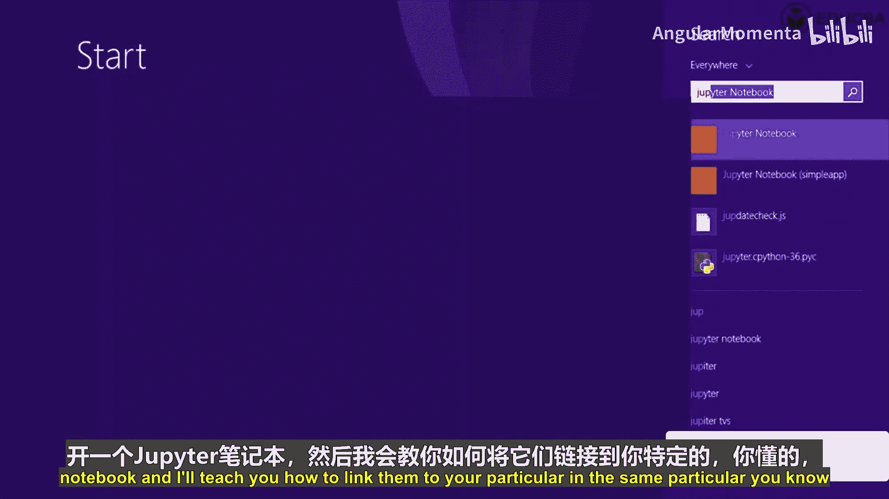
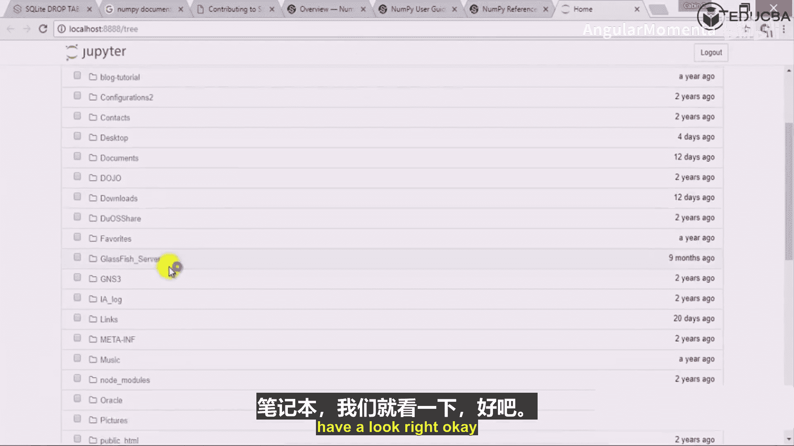

# 【EDUCBA】数据分析高级Python：构建与优化-｜-Advanced-Python-for-Data-Analysis：-Build---Optimize-p30-05_01_01_分析数据集--BV1nmcKzBEU3_p30-

One of the important aspects in IoT is we might have to analyze a lot of data which we keep getting from different sensors。

 of course it's going to be huge， you know， it's it's not at the initial stages that you're going to use but。

Maybe in later stages where we have to analyze a lot of data。

 we have to do some numerical calculations， we want to work on really huge data sets let's say for example。

 if you're going to have around you know there's a company which say whirlpool or some company which sells washing machines and air conditioners。

 now washing machines are almost used by almost every person in the country if you can think about in that particular manners or not every person at least if youre not at least 50% now if you think about 50% of the country if they use washing machines。

Then you can say that can be around they can be around you know lacks or billions of you know lacks of washing machines or crers or washing machines which are there all across the market now that can be just not just one company but it can be multiple companies of course but let's say for example if you want to if a particular company decides to put a bioT you know an IT device within the washing machine in such a way that it can monitor data from different sensors。

 it can keep monitoring data in such a way that it can it can analyze it can put you know it can figure out how the customer is going to work and how it's not going to happen and a lot of data needs to be you know analyze and stuff like that if that's the case then you know you want to see lots of data。

 you want to see lots of data happening on your on your server side if that's the case then you would have to go for something you need to go for the data analysis。

Libraries so we're going to have a look at them， which is quite important。

 so we're going to create a package completely which we are going to call as data analysis。

I can just say data analysis。In IoT so that's what we are that we are trying to do so for data analysis in IoT we are going to have lets let's have completely you know new how can we do them in Python。

 so let's start up with the first library that we have which we are going to use for analyzing data。

So we can use the library called the library that I'm going to say is the first one that we're going to use is the NI library so that's what we're going to use so or I can just say using NI so that it ist conflict right and it's quite easy to remember so you have been using Numpy that's a particular file we can close all the other applications which we are not currently working with now coming again once again to data science and data analysis using Python right so what exactly is data analysis it is a science of managing analyzing large data sets or big data right so you need to have the tools transform and model data and Python Python has evolved over the over the years to give a very effective effective solution in handling different components as well as entering into the data analysis fields by providing。

Liries like Ny Skypepi pandas and matlolib and stuff like that Matlolib is especially used whenever you want to plot plot data on graphs or something like that so that's exactly what we are looking at when we come to Ny。

Let's understand what about what is Numbai Numbai is an acronym for numeric Python。

 So this is the acronym for Numby。 So numeric Python that's Numby。

 It is an open source extension module for Python。 This provides。

 you know the Ny library read provides fast。Precompiled functions so for doing any mathematical numerical routines also Numpy can enrich the programming language python in such a way with very powerful data structures so there is a data structure which we are going to look at which is going to be called as the Ny array and this particular Ny array is you know this is such a powerful data structure which helps in efficient computation of multidimensional arrays and Metriis。

😊，No。You know， we， we have already seen the other data structures in Python， the others。

 So in standard Python data structures。Standard Pythin data structures were， if you remember。

Structures are the list， list topple。Then you have the dictionary and then you have the set so these are a few data structures which are there instead Python but Ny comes up with a concept of an array which completely defeats the entire or not defeats but it takes Python to completely higher level of how things can work with in in an Ny array so that's what we are going to deal with and that's what we are going to look at you can also open if you want a Jupyter notebook and work with it so that you can have something written out there so these are a few things that we need to want to stand right。

So now let's get into Ny and that's you have， you know。

 this particular implementation of Ny is aimed at very huge metatri areass。 Also。

 this module provides a very large library of。High level mathematical functions to operate on these mid scenarios you can just have a look at their documentation a bit。

 so if you have a look at the documentation， you can go for the nuy documentation and you can have a look how vast their documentation is so if you go to talks。

 Skypeby do org where you can go to Ny。😊，And Skype by documentation。

 you can just have a look at Numbai manual and then you have the user guide and you have the reference and it it's really huge So Numbai setting up is all about the user guide for the reference。

 let's say this is the array objects。That you can deal with。The universal functions。

 the routines that are there。sarchings， sorting， searching counting statistics， set routines。

 polynomials， padding areas， input output， linear algebra， logic functions， financial functions。

 functional programming you know data type routines， daytime support functions。

 a lot of them string operations a equation routines。

 its it's just so huge that of course we are not going to cover all of them。

 it is going to cover just a few of them and then go on you know people building thirdpart applications on Numby NumbI on Numby you know Skypepi is built up on Ny and then then you have。

And then， you have the entire。You know， so if you want to go for this S developer guide。

 you can go out here。And of course， you have documentation and you can have a look at how things work。

 you know， with your entire programs。 That's about Skypi。

 Then we have something called as the pandas， which is also quite inflammatory。

 So pandas is something it also is built on Numby， It's built on Numby。

 the pandas is built on Numby in such a way that pandas makes use of the data structure that is array and builds its own two data structures called a series and。

Data frames， which are so encompasscompasing， you know， the entire fund of how things work。

 And that's that's beautiful to figure it out。 So we're gonna have a look at into into all of these in detail and as we go ahead we'll see how we can develop on the same。

 Okay， so you have one that' is using them by that Py。 if you want， you can open a Jupyter notebook。

 So I'll just open a Jupyter notebook and I'll teach you how to link them to your particular。

In the same particular， you know， in this。Same thing。How will you link them？

 So maybe we have to open this Jupyter notebook book。 We'll just have a look。Right。Okay。

