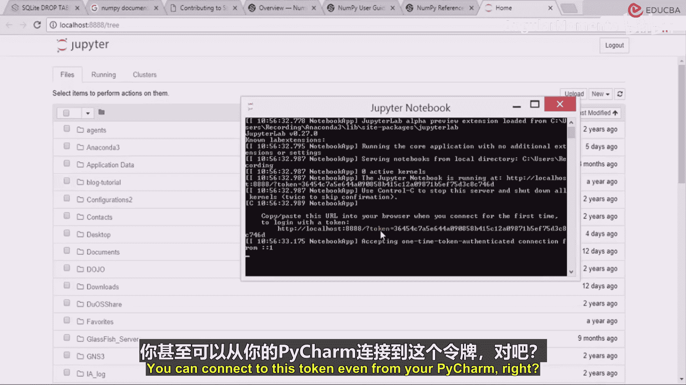
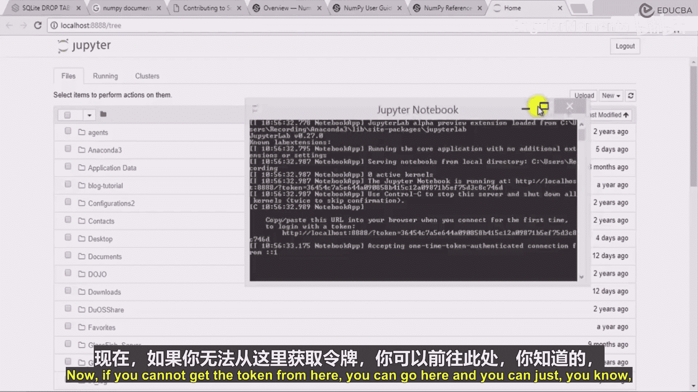
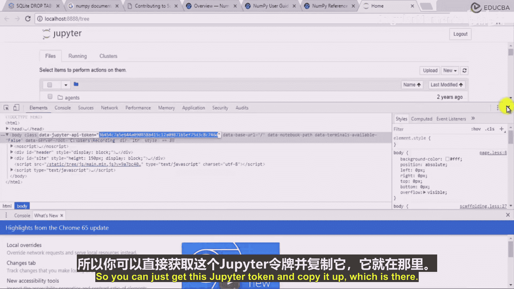
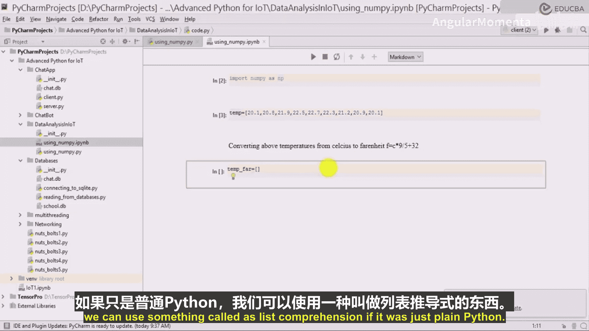

# 【EDUCBA】数据分析高级Python：构建与优化-｜-Advanced-Python-for-Data-Analysis：-Build---Optimize-p31-05_01_02_温度转换编程--BV1nmcKzBEU3_p31-

You can connect to this token even from even from your pie charm right so you can you can connect to this particular token Now if you cannot get the Coke token from here。

 you can go here and you can just you know， there's something。

Where you have in more tools that is something called inspect element。

 What you can do is you can just press function F12。 sorry， I think it's just F 12。

 Yeah in F 12 you have something where。You have this particular token that you can get from。You know。

 from here， it's the inspect element。 So you can just get this Jupiter token。And copied up。

Rich is there。 Co it up and then come back to your pie charm。

In this particular， create a new Jupyter notebook。Name， let's call it nuumpy。

Are using Nai once again， but this is a Jupyter notebook， So it's not a big deal。That I Py and me。

For now， I'll just print hello and。Stop。😡，Check if it runs。

So it'd last me for the token to space that up， whatever is the token that I got。And say， okay。

 connect into Jupipyter notebook server。 It's connected and it printed there。

 So you have the using Ny。 You can run it out here。 and you can do stuff here itself。 All right。

 so in this Jupyter notebook let's start first of all， what I want to do is an import import Ny。

 I want to import this Ny module as n。 let me check if this works is works fine。

 shift enter is a one which I'm using for running shift enter or you can even press this that will run it。

 So you said see you see the it's given up there just up there in thearrow it said shift enter。

 So you can run that by using shift enter。 So you have to run each line of code。

 So let's say import Numbi as np。 and then we can proceed in that particular fashion。

 So we have imported Ny。 the particular module。 Now you need to create the Ny array。

 But before we understand the greatness of Ny or Ny array and how things work with Ny。

 We need to understand。The difference between a N array and a list so let's say I have a list of temperatures which I've got in Celsius so my temperature sensor which is there somewhere in a remote location in a particular environment is sending me constant temperature values which I am I am recording and let's say the values that I'm getting temperature okay I have got them in in Celsius okay so I get temperature values in Celsius so the temperature values that I get from。

😊，Let's say the the temperature sensor out there they in Celsiuselius。

 and let me just record them for now。 Okay， so I'll record them in， let me say it's 20。1。20。8。21。

9 or something like that。 It keeps increasing，22。5，22。7。22。3。And then it keeps decreasing 21。2， 20。9。

 20。1。So there are a couple of temperatures which are there。

 and this is what I got these are the temperatures that I've got。From an I to device， okay。

 or I have them all in a list。Now let's say I want to convert them my task is。

 I want to convert them into into temperatures in， so I'll just put a mark down。Converting。

About temperatures。Temperatures of。From Celsius to Fahrenheit。

 I want to convert them from Celsius to Fahrenheit， which gives me some kind of stuff。

 So if you remember， temperature in Fahrenheit is always the temperature in Celsius multiplied by。9。

 divided by5。Right， divide divide by 5。And plus 32， that's the particular temperature in such。 Now。

 I need to get。Let me just have a new。Let's say over here， I need to have。A temperature。

 I need to have another。List altogether which stores temperatures in Fahrenheit for each of these elements I want a corresponding temperature in Fahrenheit I need to convert each temperature in Celsiuselius to a corresponding temperature in Fahrenheit that's my task right how do I do it。

How do I create a new list which consists of temperatures in Fahrenheit from a list which consists of temperatures in She。

 That's my task。 How do I do it， We can use something call us list comprehension if it was just played by the。

