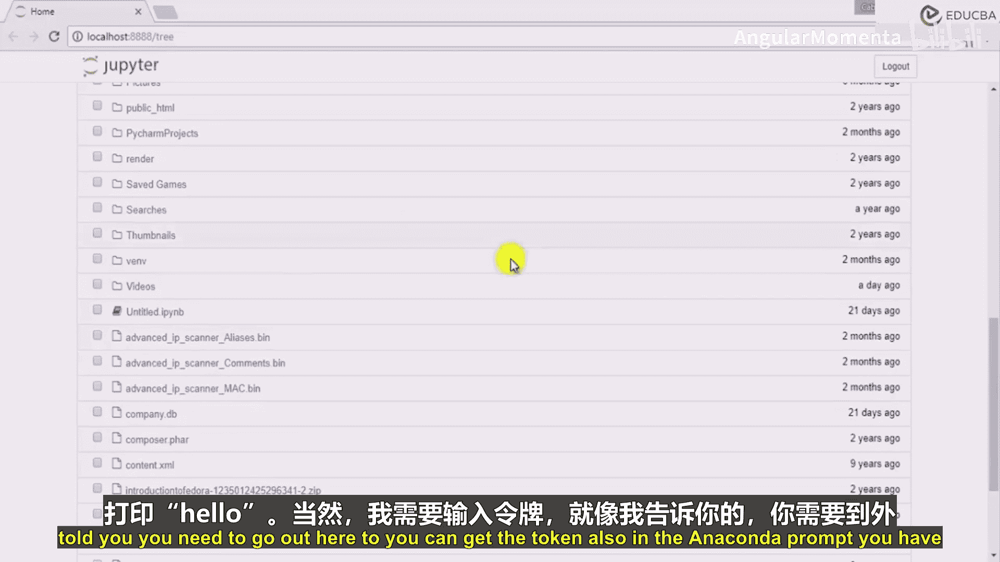
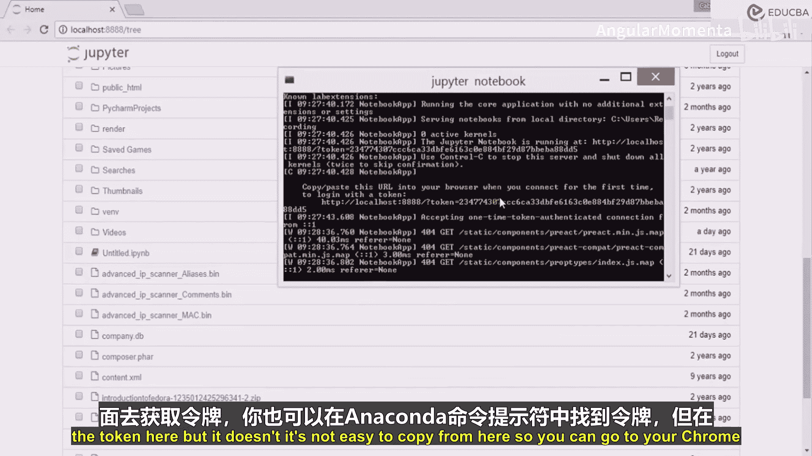
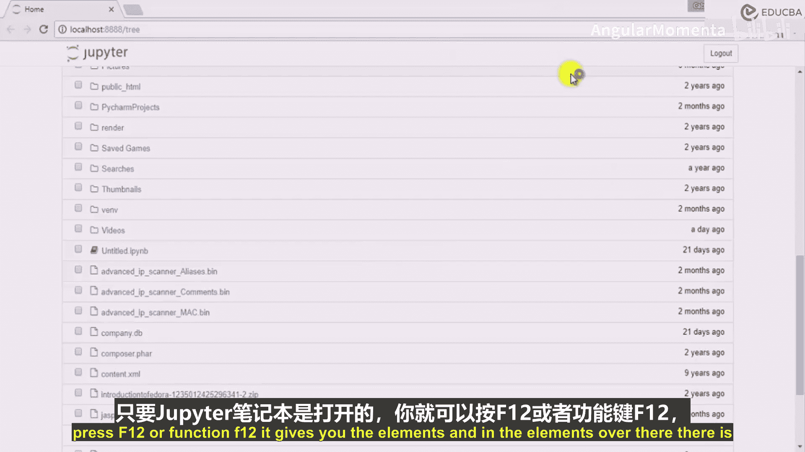
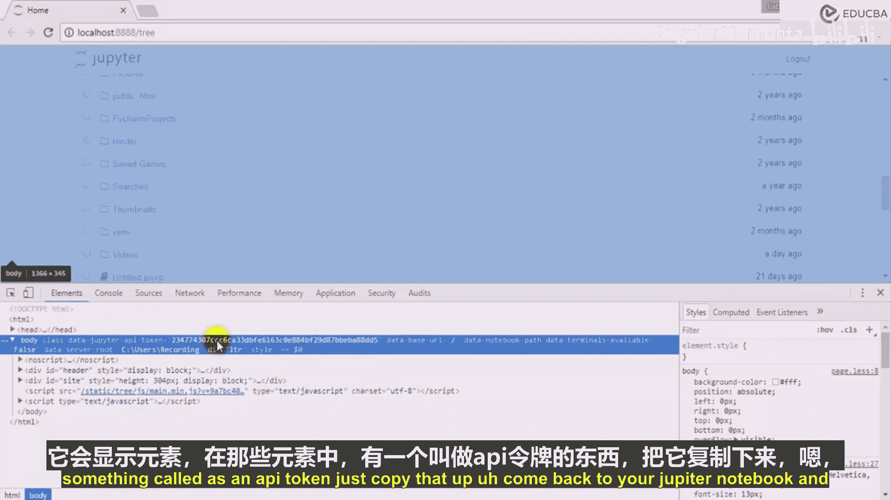
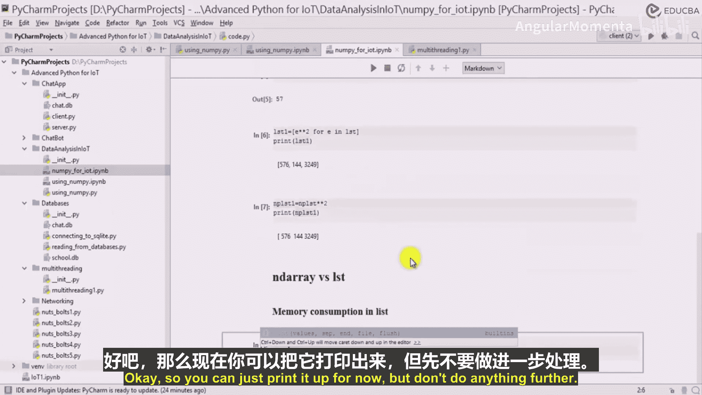

# 【EDUCBA】数据分析高级Python：构建与优化-｜-Advanced-Python-for-Data-Analysis：-Build---Optimize-p33-05_02_01_NumPy入门--BV1nmcKzBEU3_p33-

We're here to continue up with the data science libraries out here and now we have something that is the Ny library that you're going dive deeper into we saw last time we saw Numby and then a Matlolib library as we can see out here Allright so this is quite what we did last time but we can now begin up with something more and and dive deeper into Ny as a whole so we can start up with a new new file let's go on to data analysis and IoT out here maybe I can begin of course I can use the same using Ny IP by Nvy for now but when when I run it I'll have to give my Jupyter notebookbook ID or the token ID that we need to do it alright。

 so maybe you can do it here or if you want you can just start another one。

 let's say you know I'll open up a new Jupyter notebook and say Ny。Numbai。For Iot。Yeah。

 so I'll open up that and then maybe I'll just just for checking if everything is fine with a Jupyter notebook I can just print hello and of course I need to put the token and as I told you you need to go out here you can get the token also in the Anacona Prom do you have the token here but it's not easy to copy from here so you can go to your Chrome wherever it's open the Jupyter notebook is open you can just go on to your to yeah you can just press F12 or function F2 it gives you the elements and in the elements over there there is something called as an API token just copy that up come back to your Jupyter notebook and paste the token once that is done just say okay connecting to Jupyter notebook server with that。

Ths are up and done。 and we have print。 Ho， right， So that's how we begin up with Numbai。 Okay。

 for now， we can， of course， we are gonna modify this。 We you wanna hello out here。 Alright。

 let's make it as a markdown。 And let's say Nai and。😊，Numby and dive deeper。 Now comes a question。

 So if I'm going into Numbai， why a Nai， when a list is already available。

 What is the benefit of using a Ny Ny Ndi over a list， right。

 Like if you remember LSD LSD is going be equal to let me just define a few numbers out here。

 let's say 24，12，57。 Okay， this is a number， which is， which is a list which is there out here。

 And of course， if I print LSD And if I print the type of LSD， it's gonna be。

It's going to be a list than of course it says that it is a type of class list correct。

 but if I if this is about the list， can I also say if this is a list。

 I can also say that from this list now I'm going to do something more that is I'm going to create anumpri and if you remember I had done last time as import I'm going to write here for creating anumpri I had an import nuy as NP and then I had gone on to and then gone to saying NP dot。

Dot what dot dot array so that's already there NP do array I need to pass the list。

 let's pass the list LSD so once I pass the list of course this is going to return to me nuy array let me call it as NP list Okay so one is a list and another is an NP list that is nu list Okay let me print the NP list and print。

The type of entry list。Right， okay， so once I print that up， okay， I'll just。Say shift enterter。

 and then it runs out there。 Yep， so as you can see， this is one。

 this one is a class numberumbai dot in the Addey。Right so this is a nuied do ND area which is quite which is quite very similar to the list。

 so both look same except for the commerces， that's okay。

 but both of them can be accessed just as you would access the list。 so if I say N LSD of 0。

You would be able to access it the way I would access it access a list or if I say NPLSD of minus-1。

 even that would be very much perfect because that would be the same way as you would access a list so whats the great thing about Nier was a list we discussed that last time al right so in the last session so we discuss that if in a list let's say LSD I would say LSD if I had to manipulate each element of the LSD I would require a4 loop I would require a list comprehension where I would say LST1 would be equal to would be equal to would be equal to for every element in LSD I would want to do some manipulation let me say sorry element element square so element square is list one if I print list one this would be done if it is for a normal list but for a nu array not so you can directly do it with with。

As I told you， I can have a nu by error by saying NP LSD 1 can be equal to NPLSD。Race22。

 And if I print NP LSD 1， I would have the same answer。

 So this is the great thing about nuy area over the list， of course。

 this is the first thing that we saw。 but there are huge， there are multiple things happening here。

 if this was the only thing that is happening， of course， we would have maybe we would have gone。

 we would have stuck with our list because， you know， basics。

 but let's discuss two other major concepts where a nuy differs from a list。

 so I can say nuy versus our list or instead of saying nuy。

 I can say N array versus list because NP nu a are。😊，Out of type nuy do ND Ar， right。

 So let me just call that up。 Let me define it as a markdown， run it shift enter。

 So you have a small topic out there。 And the Ar was this list。 Now。

 the first thing that I want to cover in in the ND Ar was list is the memory consumption。

 So if I make it another one。 and let's say memory consumption。Between， you know， in first。

 let's discuss in a list and then we'll discuss the memory consumption in a nupy array。 So of course。

 I'll define this as this as a markdown and。Shift enter so that's a memory consumption in a list and let me go on to say。

 okay， so how do I get the memory consumed by a list。

 let's understand if I say from I just closes up yeah from cis I need to import a method called as get size off So there is a module called as cis and in that module there is a method called as get size off and I'm going to call the get size of whenever I refer to it whenever I call that function I'm going to refer to it as just simply size okay now let me say my list is already there my list is what my list is gonna be my list if you remember is is already。

You know， 24， 1257， okay， so you can just print it up for now， but don't do anything further， okay？

