# 【EDUCBA】数据分析高级Python：构建与优化-｜-Advanced-Python-for-Data-Analysis：-Build---Optimize-p38-06_01_02_不同维度的NumPy数组--BV1nmcKzBEU3_p38-

Now we are going to begin with creating a few。

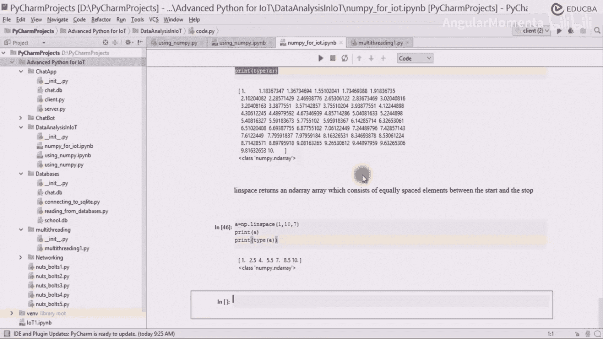

Different dimensional a in in Numbai。 So let me just put it up as a markdown and let's say different。

Dimenssional。Ains inump。

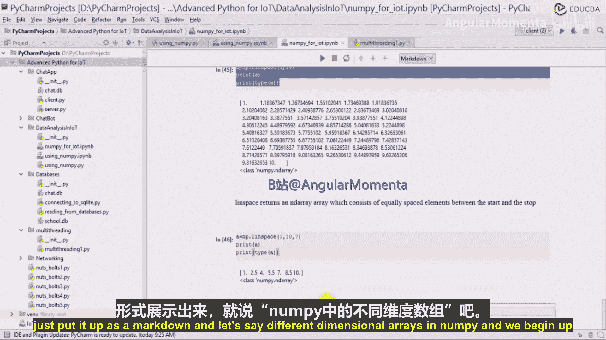

And we begin up with， first of all， the。The first dimension that being the zero dimensional la。

 so let me say zero dimensional la and。Of course， that's what we are going to do。

 What is a zero dimensional array， by the way， zero dimensional array is nothing but if if I may say。

 it's nothing but just a value。 So let me say I look and， let me import nu N P and。

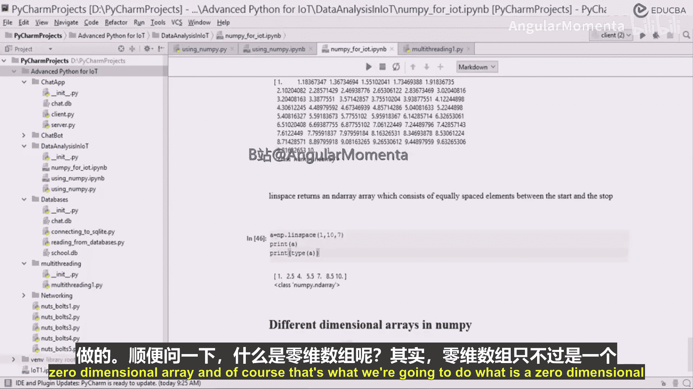

Of course， I have using the NP module in the NP module， there is an array method。

 which we already saw。 I'm going to say just if I say 42。

 So NP do array and I say 42 is just to value the report， correct。 if I say array and。If I print。

Next。Print。Type of X。Print。The dimension of it。So I'm going to say dimension of x and then I say comma dimension of x can be always done with a particular in NP module that is there is a method called S you can have a look。

 there is a method called as endm okay so you can go up till oh you can go up till n so you can see lot of methods in N so you can just go up till n and endm so you can see endm right so if I say NP dotendm and I just need to pass。

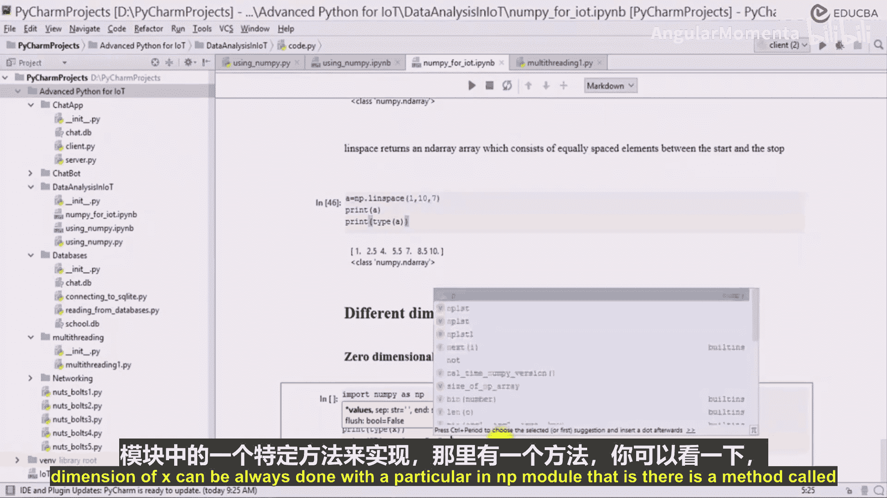

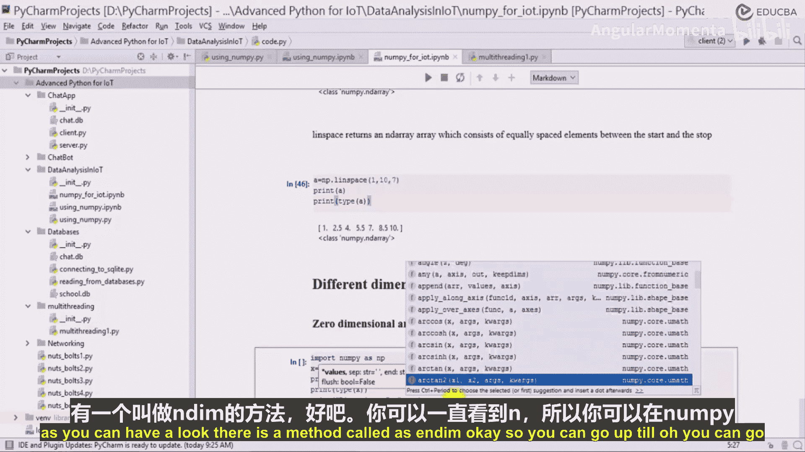

Dimenssion of which variable you want to see， right， shift enter there you are。

This is 42 the value of x is 42， the type of x is class nupy and Ndiari and the dimension of x is 0。

 so that's the dimension of x so you can just make an equal to or something like that。

That's about it。 So this is something which you need to understand about0 dimension la。 Now。

0 dimensional la， of course， we are not going to use them much， but let's go on to more dimensions。

 more dimension laries currently。 So let's say in a markdown， I'm going to say a one dimensional la。

One dimensional array and in this particular array what we are going to have is a list right so something of that kind so one dimensional array and we are going to have something where I'm going to say my let me just define you know。

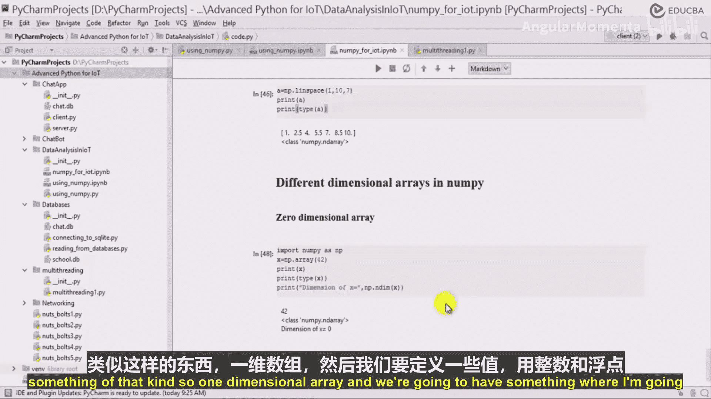

Let me just define a few values in in integers and in floating point values right so let me say a is all in impteger。

 so I'll say NP。 array。I'll pass a list within this， I'm going to say one comm，2 comm， three comm。

And so on。 So this is an impdati。Let me say B is equal to again NP dot array， and I'm going to be。

Let's go。 So this time it's going to be floating point valleys。 So it's going to be 1。1 comma，2。

5 comm，6。3a。Right。So I have And B now。I can， of course， print A and print B。And。Print。

 if you want to， you know， you can always print the type of the array。

 that means the type of all the elements inside the array by saying a dot。

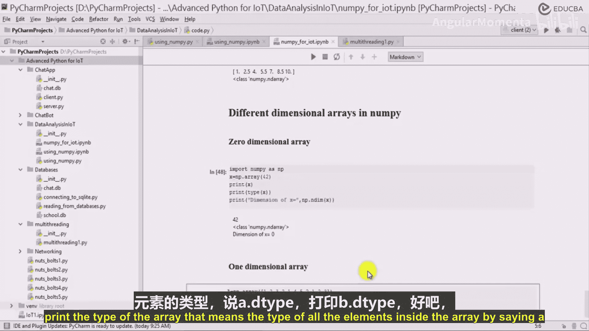

De type， print。B dot D type。😡，Okay， so just have a look at that。 So you have， as you can see。

 the first one is a， which is all inte， which is an in 32 type rest B dot D type。

 it's a floating point D type So that's about a 1 D array All right now if I go on after the 1 D array。

 let me go on to two dimensional array So sorry for a one dimensional la itself how do I come to know whether it's a one dimension la I need to also print the dimension So how do I print it。

 let me just print the dimension print。As I told you， NP dot endm。

And I need to pass what I need to pass。え8。And I will also print。NP。endm。

And this time I'll pass Bombay。

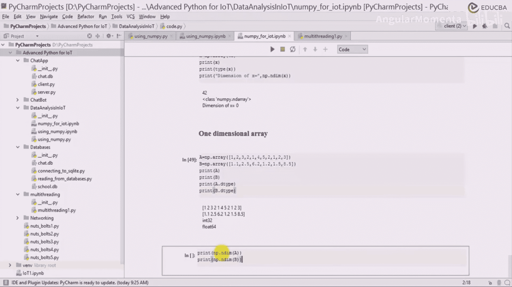

Right。😊，Cool， so it's a dimension of a。 There is another way also to get the dimension。

 So if I say print a dot。

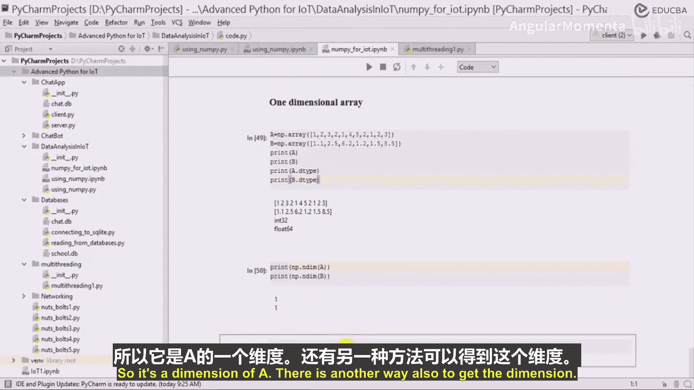

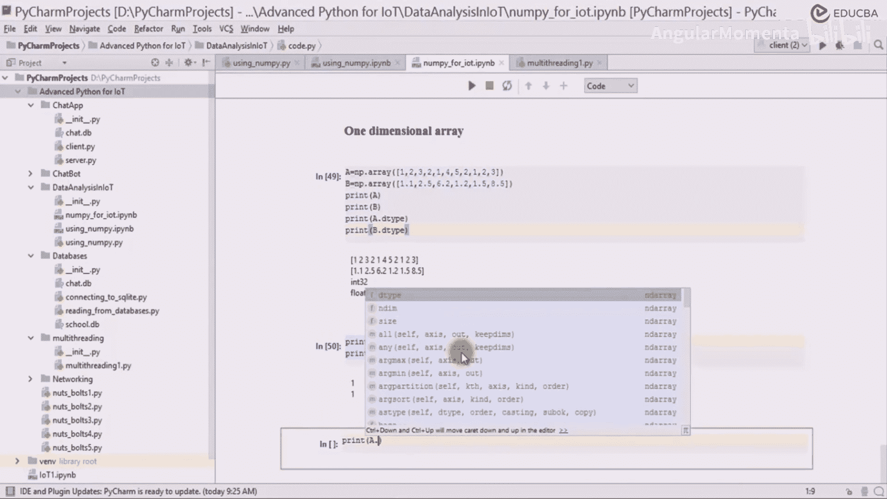

You know， there is something called a dot if I directly say endm。

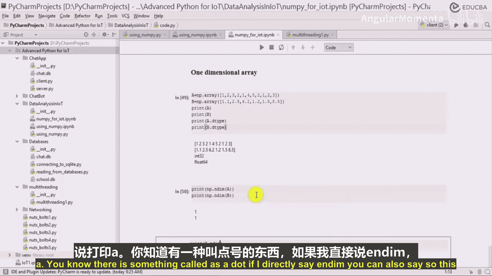

You can also say so this is by using a method of that class where you can access it with the object name。

 This is with a class name， you can access the functionend them。Okay， but you need to。

 sorry the the module with the module name， there is a function called aendym in that module in which you need to pass the object。

 So there can be two ways。 So one is the object dot it's a particular。 this is not a method。

 by the way， This is just this is just an attribute or a property。 right？ So this is about。

This is about number this is about one dimensionary。 Let's have a look at a two dimensionary。

 Of course， you， you know， you can of course do it well if you are creating a documentation properly。

 you can always say， you know， dimension of a。That's always good whenever you're learning something for a documentation。

 so that's the reason why we use Jupyter notebook， right and dimension of B。

Coma and without in dim of B。 So this time it was going to put that so you can just put even an equal to or colon。

 and that's it。 So you can also say this， you can this is also another way of printing dimension of an adding right now let's go on for。

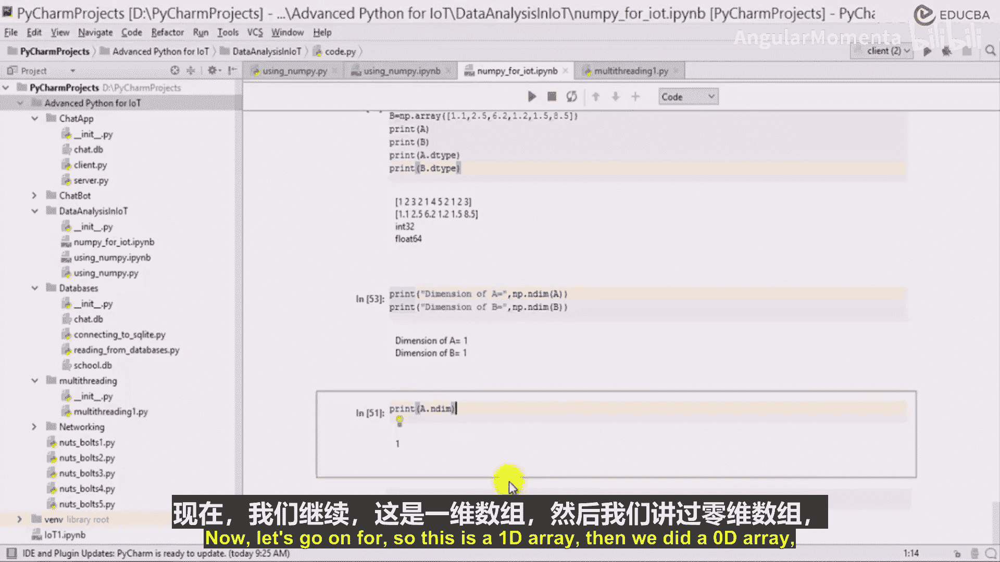

So this is a1 D array， then we did a0 D array now we go on for two and multidimensional array right so let me just say two and multidimensional array markeddown。

So that's about when we have more than one list。And it we're going to see how to define them to when multidimensionalality。

 right， so I'm just going to。llGet some more。Right。Wait a minute。 Yeah， so I have quite some。

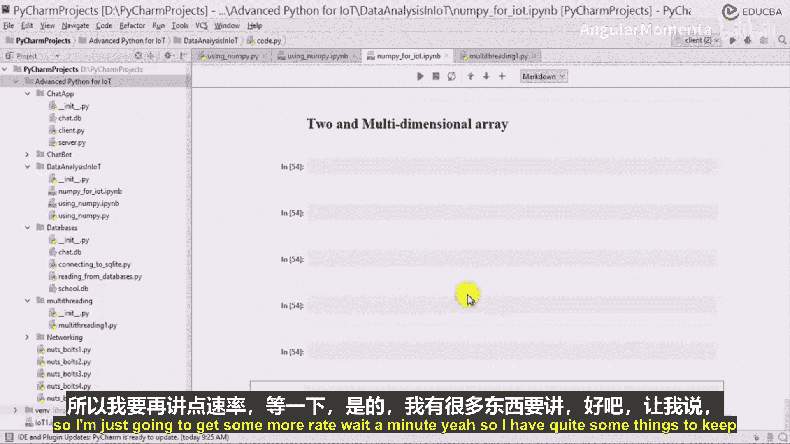

Things too。Keep。

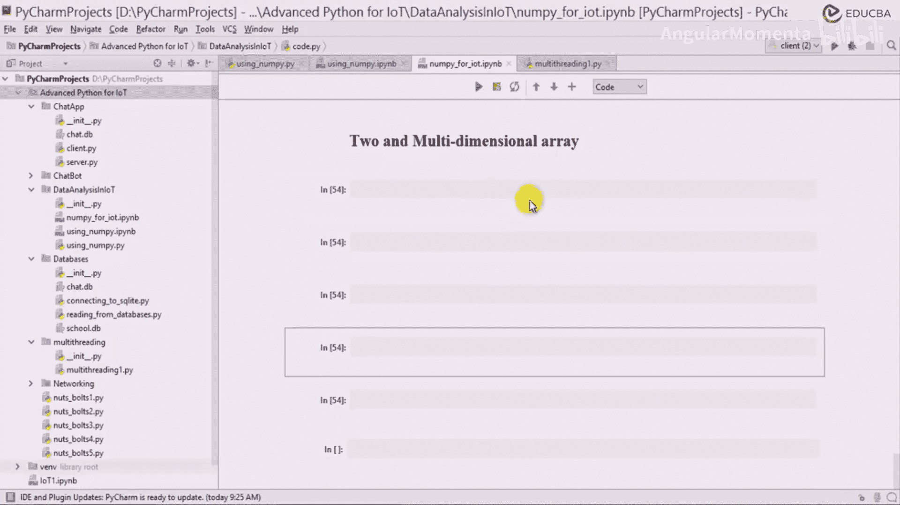

Cool， okay， so let me say I was starting with this 2 D array。 Now， what do I need to do here。

 I'll say a is equal to。 I'm going to say N dot array。

A is equal to NP array and in this particular array this time。

 instead of instead of just passing one list inside the list I'm going to pass more list inside the list I'm going to pass list list within a list。

 so let's say one list。

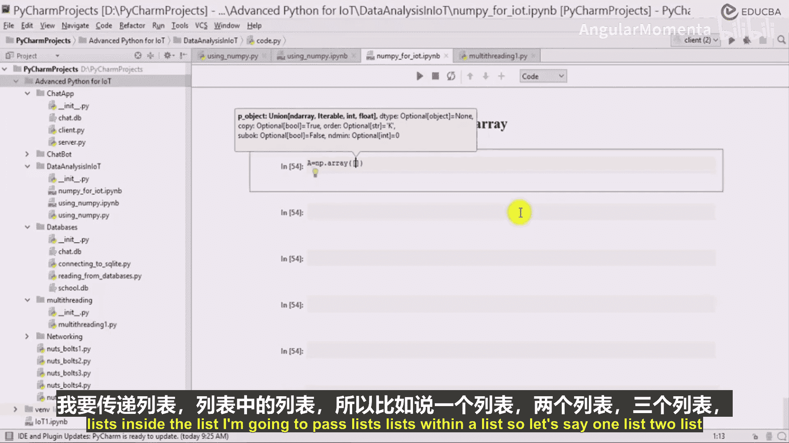

2 list，3 list， three lists within a list。 So after this list I can just put an enterta after this list。

 I can put an enterta， and this is your main list right， so your main list closes up here。

 So in each unit of the list， I'm going to put some values。 let's say one comma 2 comma 3。

4 comma 5 comma 6，7 comma 8 comma 9 right， that's your NP p adding。

 and all I have to do is print capital A。😊。

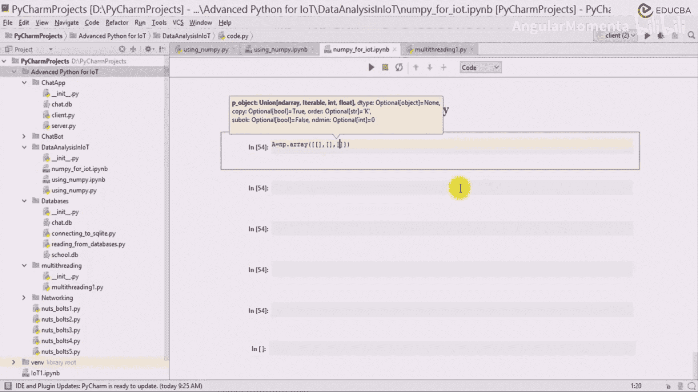

And print。Dension of a Oh， sorry， dimension of a。Is oh。

 I need to put them in double code and say equal to or colon， what is a dimension of a。

 it's going to be a dot ending。All right。😊，So with that， of course， we have。Dimenssion of a 2。

Can we have a 3D error？😊，Oh yeah， we can have a 3D area。

 but that's going to be very complicated Still， if you would wish to do it。

 what I'll do is I can just copy paste this and in another。

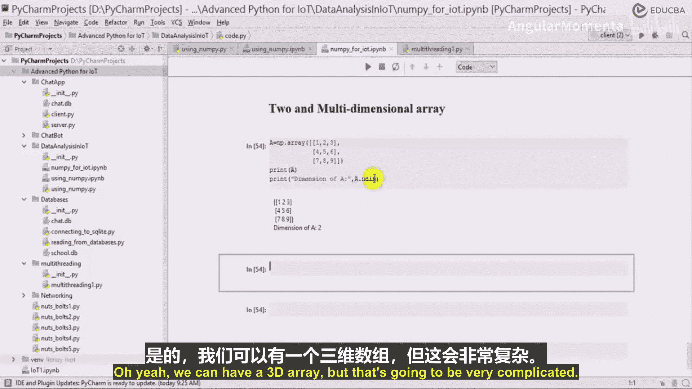

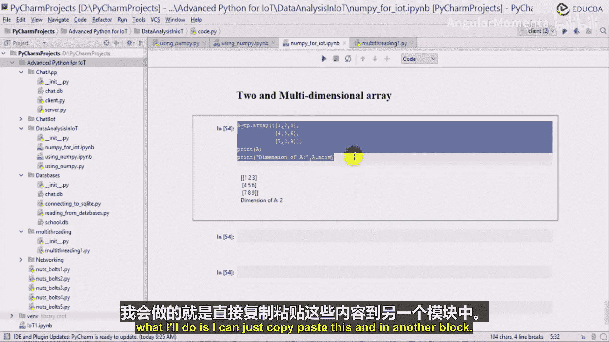

Block。😡，And。Each of these， each of them， I am going to put them。You know， each of these values。

 I'm going to put another list within the main list。 So it's going to be one comma2 is one of the。

Elements in this list and。You know， in this， I'm going to say three comma4。So。

 so this is going to be a bit。5，6， comma 7。I can keep putting lists within lists within lists right so that's what I'm doing currently7 comma 8 and 9 comma 10 within a major list Now that me see what's the type dimension of a3 because you have within you have a big list right so this is your major list the bigger list is here so what I can do is let me just make a classifications out here so this is your huge daddy list right and then you have inside this there are going to be two lists。

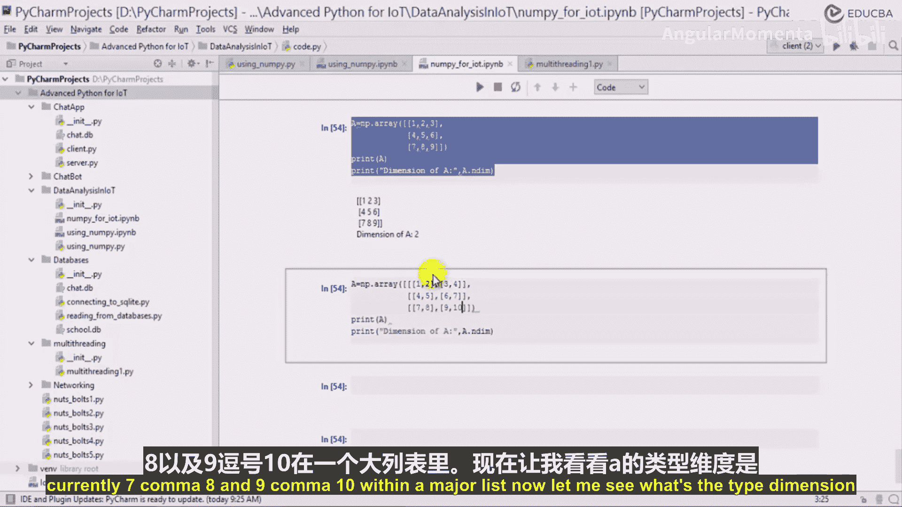

Correct and so that's that's the same pattern for all of them so here we have one and here we have another and here we have one and here we another and then closing up with this list and then closing up with this list。

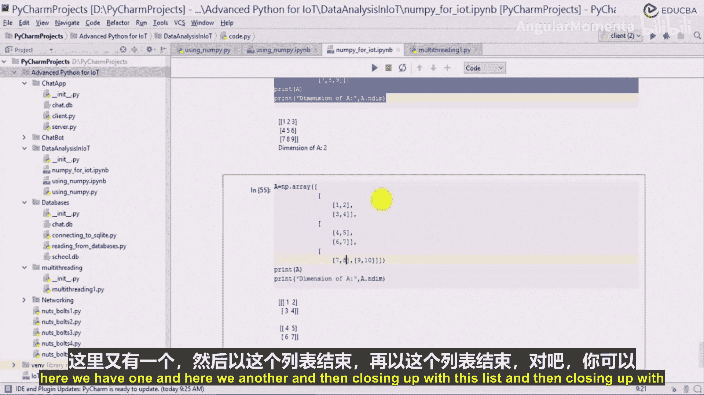

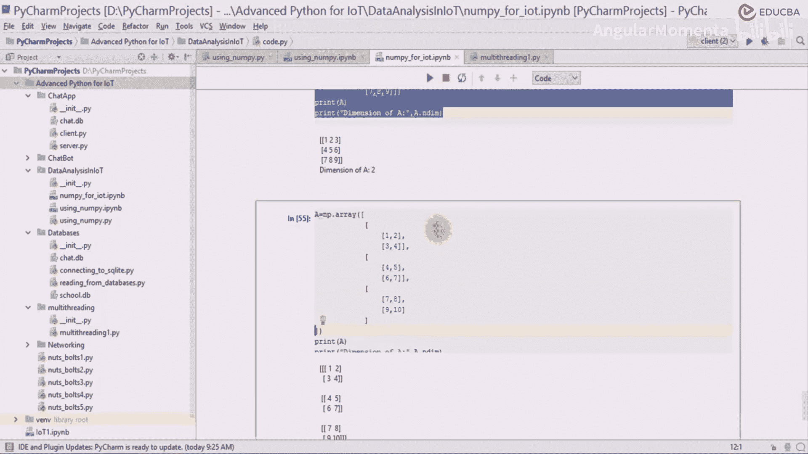

Right so you can have a look so this is a bigger list， this is the huge list， this one right。

 this is a huge list and in that there is another list。And in this list there's a third list。

 So you have3D arrays out here。 So that's a dimension of a。 that's about3。

 So you can you can probably understand how we go to go。Ter and deeper and deeper and deeper。

 So that's about a 3D addingtic， Okay now。Now let's think about this is about the dimension。

 What about the shape of the array， Let's have a look at how shape of the array would work out and stuff like that。

 okay。

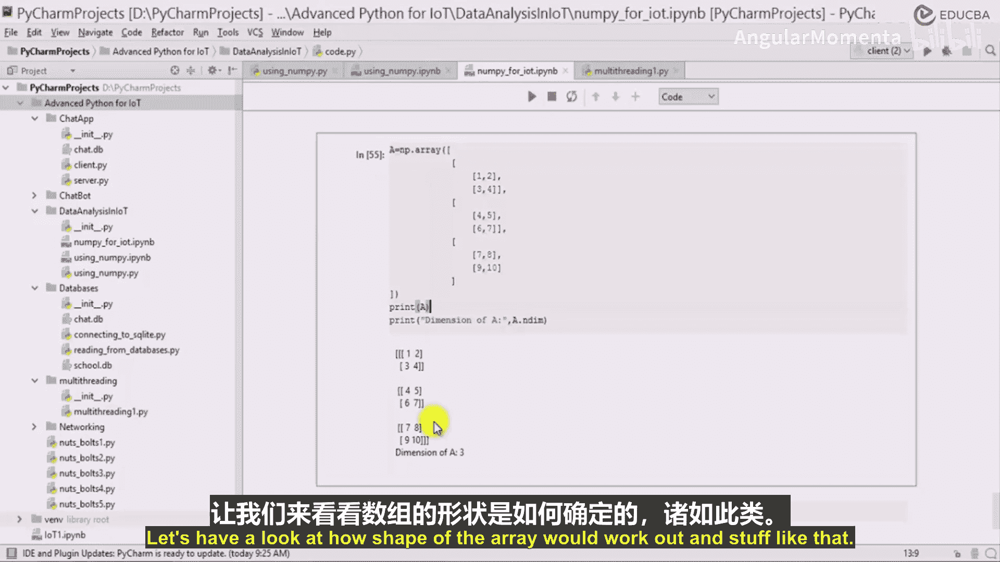