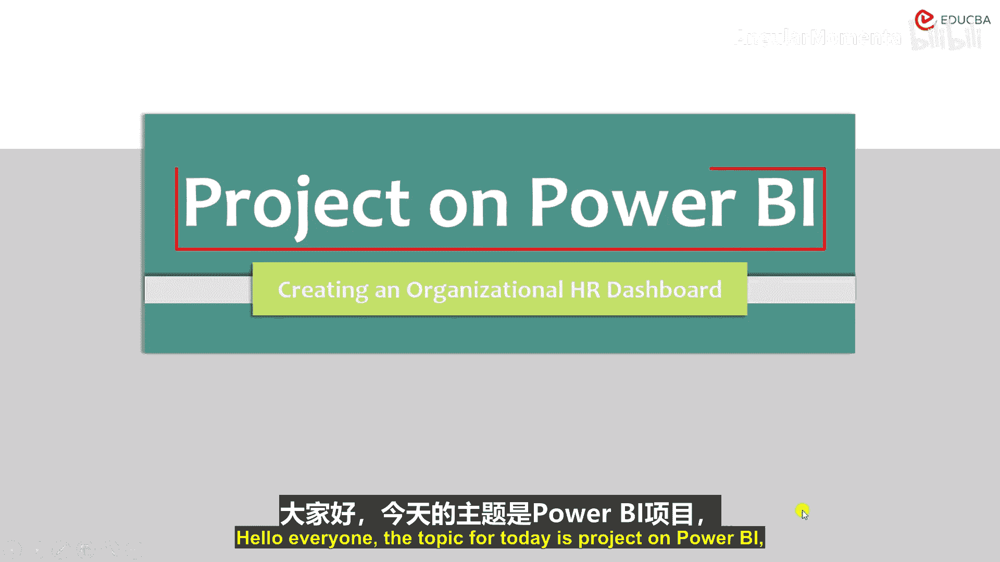
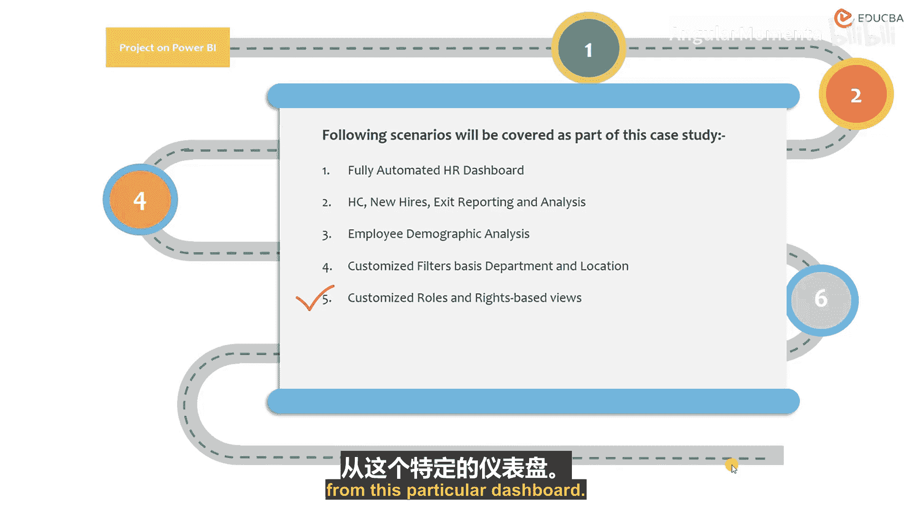
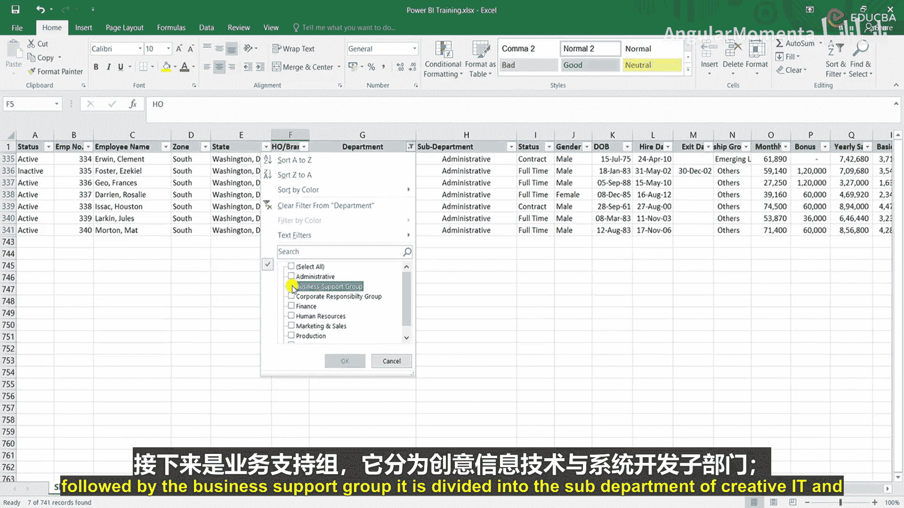

# 【EDUCBA】构建用于商业报告的交互式Power-BI仪表板--Build-Interactive-Power-BI-Dashboards-for-Busin-p01-01_01_01_项目二导论--BV1NCFoznExD_p1-

🎼Hello， everyone。 The topic for today is。🎼Project on Power BI。

 creating an organization HRR dashboard。

🎼Difficulty level， intermediate。🎼To do this project， you must have the following skill sets。

🎼Basic knowledge of a chart。🎼And basic knowledge of power PI， So both of these combined。

 we will complete this entire project。🎼And also， of course。

 a mindset tech for learning the tool as well。🎼Project objective。

🎼Participants will be able to design HR dashboards。Get hands on exposure to Power BI。

🎼What will you learn in this project？🎼Of course， creating dashboards where we'll entirely concentrate on how to practically create a dashboard。

🎼And of course， learn intermediate level of power BI as well。

🎼Are there any project requirements or prerequisites？🎼Basic power beyond knowledge。

🎼Basic AA knowledge are two things required to entirely create this project， who are the T students。

🎼Aspiring HR analystlys want to become orR in the field of HR analytics。

Postgraduate HR and Analytic students were currently pursuing the field of HR Ana。

🎼And also anyone wants to learn to create dashboards in Power BI。🎼By the end of this project。

 you'll have the following skill sets。🎼Handone experience regarding a practical scenario of creating dashboards using Power PI you'll get a practical。

 youll have a life scenario of how to create from scratcht a good dashboard HR dashboard and Power BI。

🎼And not what's the case study about。🎼So an FNC company has decided to analyze and report its employee information in a continuous manner to its board of directors。

🎼So as a part of the case study， you are required to create an automated ajo task。

🎼So that is when an FMCG company or FMCG company wants to create analyze its employee information。

 so for as a part of the project we need to create this dashboard。

🎼Following scenarios will be covered on this case study。

 a fully automated HR dashboard will be created， which will be linked to an Excel or a text file。

🎼We'll show headcount new as exit reporting and its analysis。

🎼Employed demographic analysis will be shown over here。

🎼Customized filters based department and locations will be put in Power B so that continuous filtering and sorting of the data can be done by the viewer himself。

🎼And customized roles and right space views can be created。

 we also try and create customized roles and ride space。🎼From this particular dashboard。

🎼Now， let's start。Now first let's start and get to know the data so because before creating the dashboard you must also always understand what the data is about from that only you have you will be able to draw meaningful insights so this is the functional part of HR where you are trying to understand the data and combining that part of the technical aspect where you will create your entire dashboard for the viewer。

So let's start to the first part， which is basically the status。

Which is active and inactive Okay so this is the status of the employees。

Followed by the employee code。 So there are 7，41 employee codes。 So a total of 7。

41 employees are there or were there a combination of。Current active and inactive as well。

 the second part is of course employee name and with regards to there is also a first name aspect。

 so currently we can ignore the first name aspect。We can delete it from here。

 we just need the employee name， so that is what is required for the data。

Followed by zone zone is basically then followed by that as divided into state。

 so if I go and just filter your zone。If I just filter zone from here。

It will have its state accordingly， similarly if I go and。

Filter other zones in northeast as New York and New Jersey。ASo。Has Georgia， Washington， Florida。

 Mississippi， Tennessee。And followed by West which is the last which has Arizona and Colorado。

 so this is with regards to the company and where its branches are there。Okay。

So followed by state is the head office or branch， now let's see what is the head office。

 head office of the company is in Washington DC。And all other。Offices are specifically in the branch。

 so all other are included in the branch now we will move forward to the department parts in a similar way department and sub departmentparts are linked。

Lets see what departments are linked to what administ department is linked to admin so sub there's only once department sub departmentment under admin。

 followed by the business support group， it is divided into the sub departmentpart of Creative IT and systems development。

Followed by corporate responsibility group。Which again， includes three aspects。

 which such as environmental compliance， environmental health and safety and green building。

So these are the department names of the company finance as， again。Two teams。

 which is the account management and analyst team。Followed by human resourcessource。

 which has a training HR operations and professional training group has their sub departmentpartment。

 followed by marketing and sales， which has another three aspects which is market branding。

Media and sales。Followed by a production， which has ADC facilities， engineering。

 major manufacturing projects， manufacturing and product development。And the large aspect。

 which is the research and quality group， it specifically has。Another three， four departments。

 which are quality assurance called control research center and research and development。

 So this was about the department and the sub departmentpartment。

 Now we move forward to another aspect which is status。 So how the employee is working。

 either is full time contract half time or early So these are the four bifurcations whether is paid on a full time basis on a monthly basis on hour basis half time or a contract。

Then followed by gender， which is male and female with this company。

DOB is specifically date of birth of the employees from which we will also be able to analyze the demographics。

 so gender date of birth helps us analyze the demographics， which is also our main tool。Hiring date。

 which is the hiring date of this company till 2012。

 so the data is on the basis of 2012 so well analyze accordingly so this is an example data obviously youll have your own set of data so you can take the views and the analysis that Im creating and applied on your own data。

Similarly， exits are also for the year 2012。So the exit higher date 2012。

Followed by the next part which is the leadership group。

 so these are the four leadership groups which the employees are divided into advancing leaders。

 emerging leaders， others and senior leader。Now followed by as we move on we'll see the salary breakup of the employee so this is the monthly salary。

 this is the bonus he' is getting this is basically the yearly salary。

 so it's basically it to 12 nothing more than that it is basic multiplication。

 basic salary of the employee， his house rent allowance， his conveyance allowance。

 his special allowance and is the retis， so we can just write this as retiretis。

And a last but not the least is job rating so as you can see this is the main data that we have which is basically starts from the employee status。

 employee code， name， zone state head office his branch， department sub department status。

 gender date of birth higher date， exit date， leadership group， and a lastly。The total of amounts。

 which is monthly bonus yearly salary of the employee followed by its distribution between basic salary。

 house and conveyyance， special allowance， retis and job rating So this is the basic data that will be using to basically create the entire dashboard on power B and we have the cuts and analysis from this data itself currently the data is in Excel。

 but in some instances you might receive data in text format also that can also be linked to power B of course Excel can also be linked to power B one good thing about it。

 it is that if I keep an active connection between the two even if I update something it will automatically get updated in power B So that's one good thing about this connections。

 obviously can also connect power B to the system itself the system which has the data So there are multiple ways to do it of course I'm using the way of the most popular method of Excel to power B which is used major by all corporate。

And also quite a lot of employees are working on Power view。

 so that's what I'm doing and obviously you can use your own methodology to create the dashboard。

