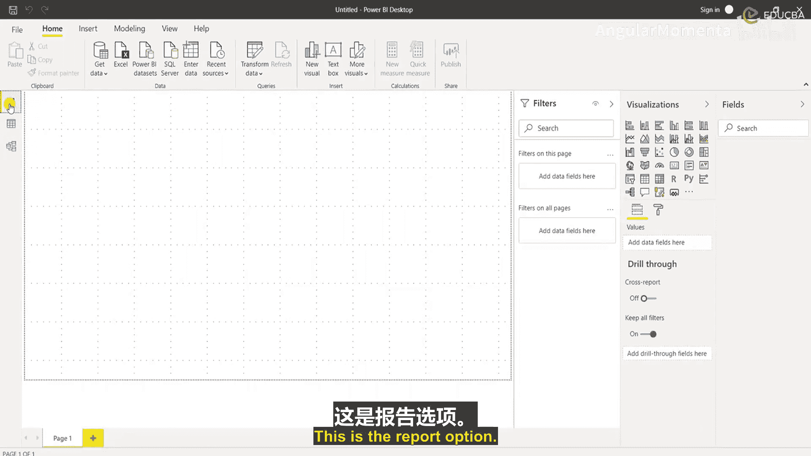
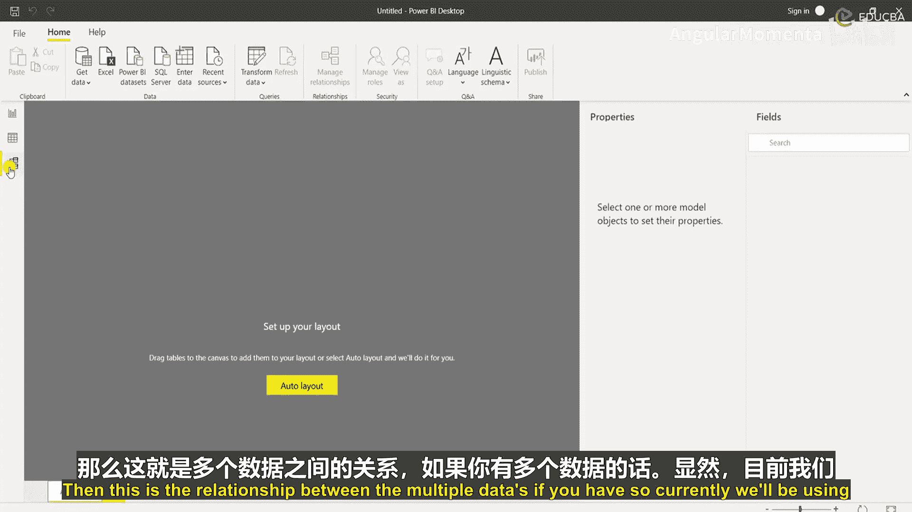
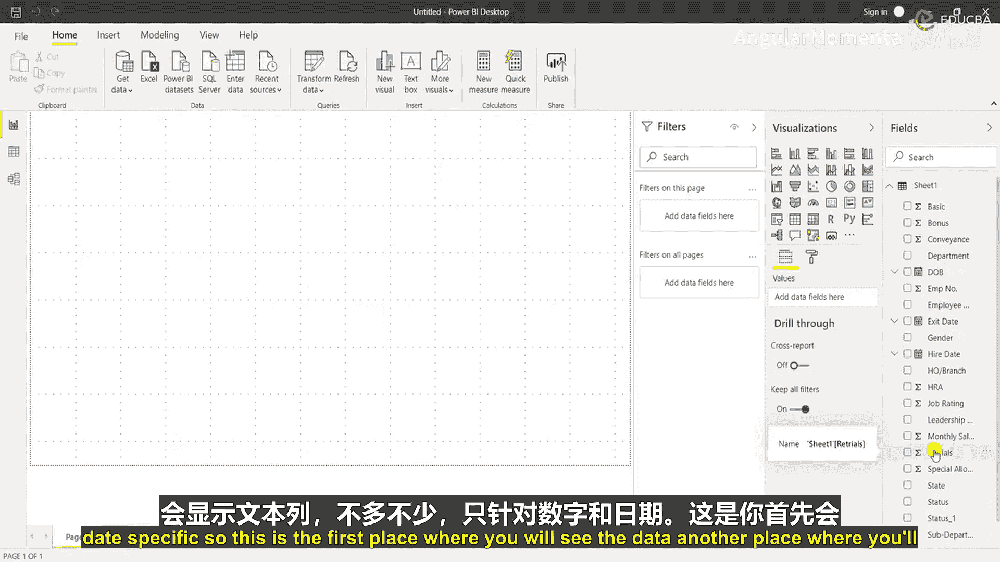
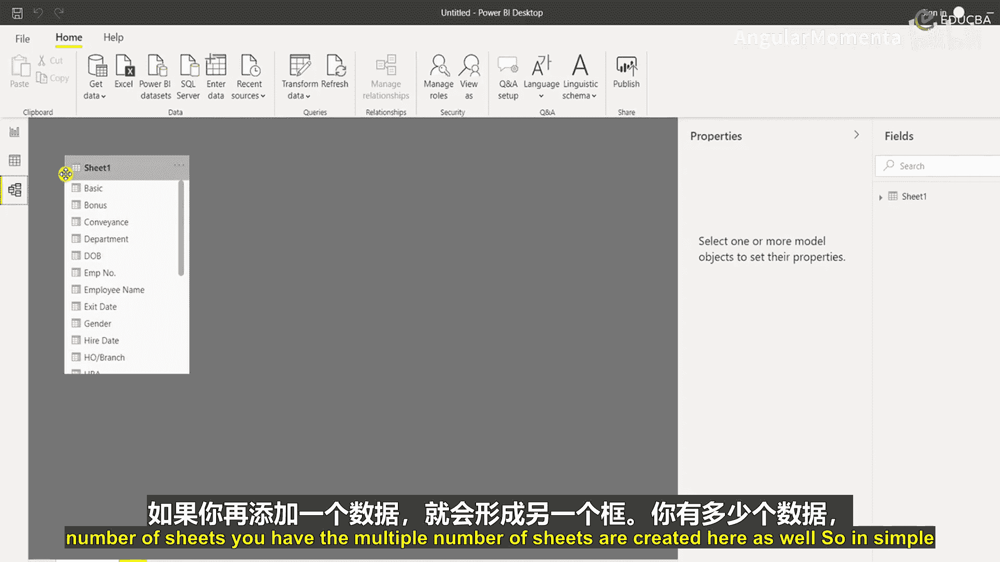
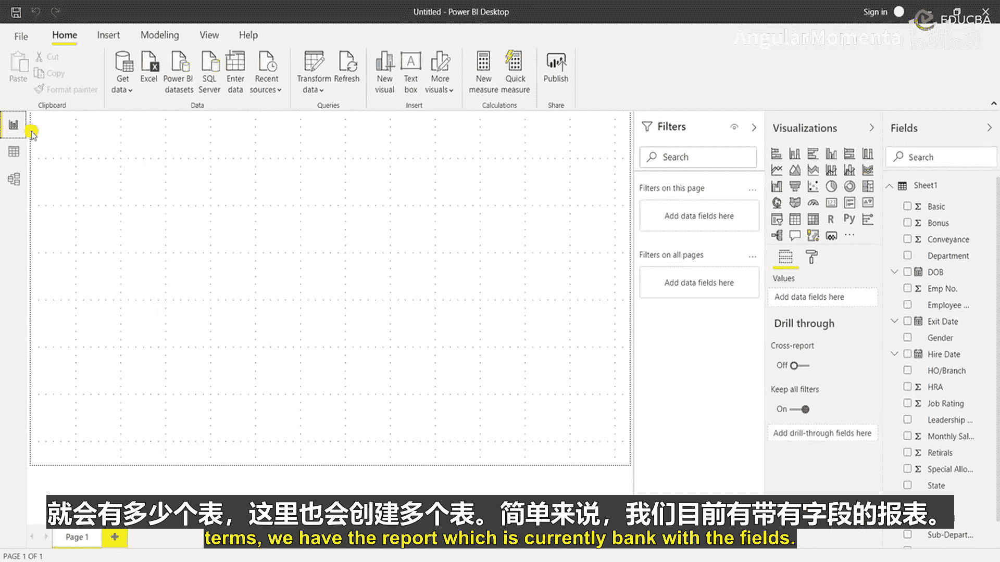
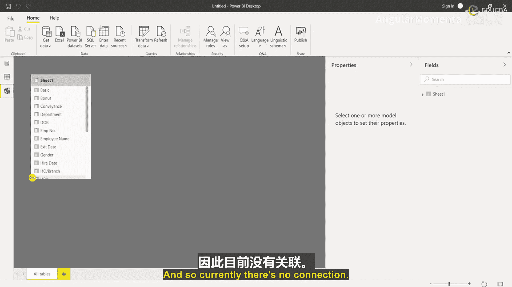
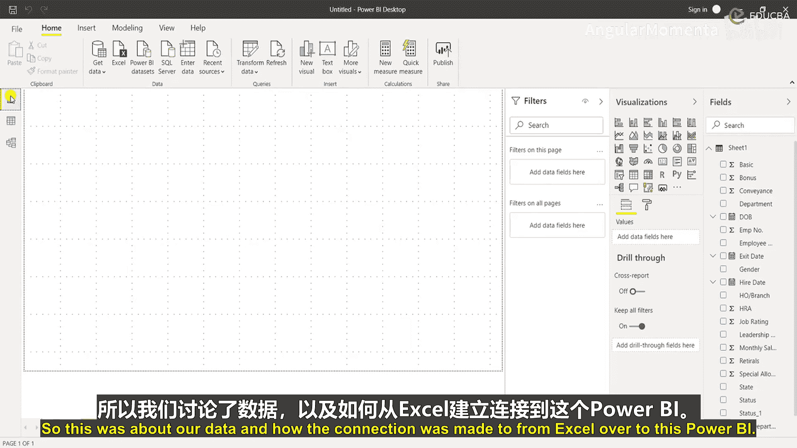

# 【EDUCBA】构建用于商业报告的交互式Power-BI仪表板--Build-Interactive-Power-BI-Dashboards-for-Busin-p02-01_02_01_权力基础导论：项目管理入门--BV1NCFoznExD_p2-

Moving on to the next part to the power bi So once you open your power bi you' will get a view something like this。

 Ill just quickly take you through this entire review of Power B。

 then we will basically start with the project so followed by the above part which is basically where you can do save and you can do the sign in of your own ID。

Which is like the main header part， followed by the。Main headers， which is file file， of course。

 is where you can do your basic stuff like save， get data， import， export， etc。

 Also a help tool of get started is over。All the save files will be shown in a file。

 so it's very similar to Excel。So where the fair file tab contains all of the essential parts。

Followed by home， home is where you can basically add your data and do various calculations from it。

 so the first part of course is clipboard which is basically cut copy paste which is common in Excel and other MS tools as well。

The other part， the most essential part is the data part that you see from there youll have a better understanding from where all we can get the data once you click on get data。

 you have multiple options like Excel power B datas， power via data flows， SQL servers。

 analysis services text CSv web or data feed and blankqueries obviously Excel is the one that we be using a powerbe B data datas are interconnection between power B similarly that is data flows as well SQL servers you can connect directly to your system Ana services similar text and CSV are basically the notepad where we get certain reports in text format which can be only opened the notad which can be directly linked over your web services of course through your all web services。

O data fee and blank a query， which is currently not used as that often。

 so obviously we will be using the Excel part。Also above。

 if you see on the right side are the options which are in the dropdown as well。

 basically Excel powered via data SQL server， enter data and a recent sources。

Followed by so this was the data part then followed by the queries part where once you get the data you would obviously in certain instances you would want to edit the data like if you take the data from the system。

 sometimes the formatting and the dates are in numbers etc there are some problems that so you must you have no option but to do certain changes to the data before analyzing the data so for that powerbe particularly put a tool known as of transform data where you can basically transform the data as per your needs and save those steps and once you do that whenever you import a new file automatically those steps are run on that file。

 for example the data is a numerical format youll put inside the transform data basic recording of convert this into data so whenever that data is imported it will automatically converted into data without your interference。

Mdual interference。Then followed by the insert box。

 which is nothing but the visualization where you can add new visuals， you can add text box。

 you can add more visuals which are from the app source or from files which you have saved calculation is one of the also one of the most interesting parts which is basically the formulas of Powerbe these are nothing but the formulas it is known as measure quick measure which basically helps you add formulas inside the data once you get the data obviously you will have to do some churning for that purpose it required to put some very basic formulas。

 which I will also show you with this record， So once that is calculation is aspect is used for that purpose and the last part is nothing but sharing where once you've created the entire report。

 you will share it be basically will save it and then share it to your concerned stakeholders be it your HR heads be it your business heads be it any specific functional heads that you want to share it too it can be all done in a very simplified way with roles and write。

Unlike Excel where this is very restrictive and also if you want to do that you must put some very good macros and some very good locking to the cell so that it doesn't get my but here it is very simple once you created you can share it according to the data that is there。

So one good thing about Power BI is this， of course。

 where you can analyze the data in a very nice way and publish it also very quickly。

Now the next part， which is basically insert where we will you will see various aspects like inside visuals you have obviously have the new page where a new page will will be added below so like you can have multiple pages similar to Excel ones where you create a dashboard have multiple aspects of the dashboard in the street sheets distributed below new visual obviously available on the。

Home tab as well。Also， there are quite a lot of AI visual that can be done through key influencers and decomposition trees。

Also one more aspect is that you can so inside Microsoft0365 you can connect all apps together Power apps is one more very powerful platform where you can create your own app and host this power B entire dashboard on those apps and the peoples can install the power apps where you have multiple power B dashboards inside one also not only that you can have also multiple M flows you can have MS forms inside that etc cea。

 It's like a one app for Office 365 that you can create for your own organization。

Followed by the next part element， which is a text box button shapes and images if required to basically create the dashboard followed by modeling where you can basically create relationships between two sheets or if you have multiple sheets you can obviously create two three relationship calculation is again which I told you formulas。

Page refresh is refreshing new parameter is basically what if analysis you want to do some new parameter analysis you can do that security is as it states manage roles and view as security you can manage role and write through the data Q and a setup is language and basically schema so this is just a question and answer set up。

Moving to view view is obviously the themes that you are using the scale to fit very basic things that are necessary grid lines if you want。

This is very good so always keep the grid line so that you can properly adjust your data over there snap to grid options is there automatically align objects to grid which is also very good because you can automatically it fixes over there and log objects one set that lock all objects in place so that they stay put while you are giving a presentation or interacting with report elements certain options which are very necessary then followed by show pans。

 we have filters we have bookmarks， we have selections。

 we have performer analyzer and sync analyzers which are also there。

Followed by help which is basically the help tools of power B Microsoft Power B so this was about the it been send tabs on number。

 but what essentially makes power B different than your normal usage of Excel is on the right hand side you will see a very interactive tool which will be using on a container basis while creating this dashboard a tool of filter visualization and fields So once I add the dashboard entire thing will be populated over here and from there it is just a matter of drag and drop to create a very basic level of dashboard so in actual terms if you want to create a very basic level of dashboard and power by it hardly takes 15 minutes so that is one of the most crucial aspect。

This is the platform or this is the region where a power bi comes to its own。

Advantages more than Excel on the left hand side， you will see small boxes where you will see three options。

 This is the report option。 This is the data that will come over once we added it。

 Then this is the relationship between the。

Multiple datas if you have so currently we will be using only one data。

 obviously we will be doing certain calculations， we will be doing certain measures we will be adding filters。

 we will be adding some visualizations so a lot of things for you to make a very good decent dashboard for presentation。

Moving right to the next part where we will be adding the data。

 so very simple just need to come to home， click on Excel。

 then a pop up window where you can then go to the file you want to see select Power BI。

So I've already created the data， so data is already there basically I'm just connecting it to the power BI。

So once said do that。You will have some loading time。

Where you have a list basically so I have only one list one sheet that's what it's coming if you can have multiple sheets so you can select the sheet you want to connect to。

 so this is the only sheet I am having。So once you do that。

 the entire data will load the data in the previousview has been truncated to size limits due to size limits。

 so basically this has been reduced due to size limits。

 but that's okay that is a function of RbiI where it tries to reduce the size of the file so that it is much easier for you to basically work on and the speed is very fast。

So once you do that， you check the data once， okay what is coming？If something is amiss。

 then you can obviously want to trans move to transform data and transform it。

 We just have a view at the data first so everything is looking。

In lines with what you add in the Excel， obviously nuliier is 0。So that is also the case。

Other things are in numerical wherever I want， whatever is there， also ratings are also coming up。

So obviously there is nothing to be changed of as， but that's why I'll go ahead and load this data。

So there will be some loading time that will be done， loading data model and。

The data has been loaded successfully so how do you get to know the data has been loaded two places firstly firstly it was blank or initially if you had viewed this was entirely bank once I have done it it will calculate everything and give it to me over a good thing about power B is it tells you what specific field is what format so like basic salary is into numeric that's why it' is coming as numeric date birth is taped that's why it iss coming as data birth。

So obviously like a lot of aspects to that as well so if you see and click on date of birth and guns more go below you have the all factors over year from year to quarter to month to day。

 so this all is everything is automatically calculated in Power biI nowadays a similar aspect is also available in pivot tables in Excel a parallel comparison for you to understand very easily。

So it shows you the date it gives you the whatever it is like quarter year month day， etc。

 Similarlyly if a text is there it will always show text column nothing more nothing less number and date specific so this is the first place where you will see the data another place where you will obviously see the data is on the data sheet completely as you want to look at at it in the Excel way。

So right from you have the status。A simple filtering is also they are very。

 very similar to Excel employee number。A followed by so employee number if so this is the employee number So ascending if I do ascending。

It has been done as per so initially it was as per active inactive that's why the sorting now Ive changed it to ascending as per employee code then followed by zone state branch。

 just look at the data if something is amiss always look at the data if something iss amiss if something is amiss obviously the connection was not proper hence the data or a particular field was missed out。

Foled by we have departments sub department status 1。

 so status 1 is specifically coming over here because we had two statuses thats where the status has changed to status1 automatically done by power G you did not I did add nothing actually。

Followed by date birth， higher date， exit date， which is blank is coming as blank That is good。

 because that will be required for me to put the formula followed by leadership group。

 monthly salary， bonus， year salary， basic HR conveyance， special allowance， retires and。Job rating。

So anything that if you want to change or year， obviously you can change your with respect to the data if anything you want to change。

 so that aspect we understand how。Sp aspects are noted over。

So obviously if you want to change the spelling of it can also be done because a notice dish there is change the spelling for res so that is what Ive done and it gets change automatically So like simple changes you have the data here you can do the changes whatever you want。

Similar to Excel as well， Im moving on to the third part which is basically the connections。

 so your sheet one is connected， obviously if you had one more data another box would have found the number of data you have number of sheets you have。

 the multiple number of sheets are created here as well。

So in simple terms， we have the report which is currently bank with the fields。

 we have the data which looks perfectly al right。

We have the connections which looks good to me and so currentlys theres no connection there's only one sheet so which looks good and nice to me。

So this was about a data and how the connection was made from Excel over to this Power biI。

