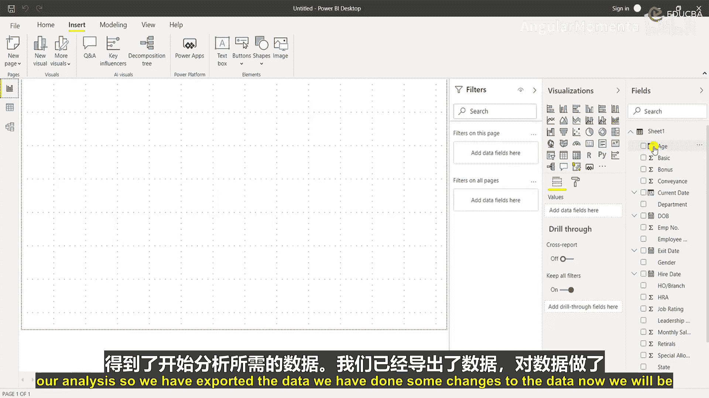
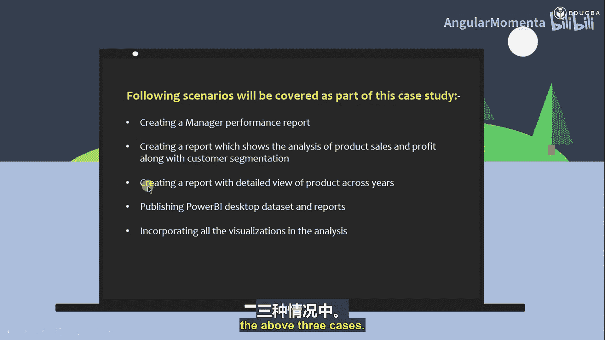
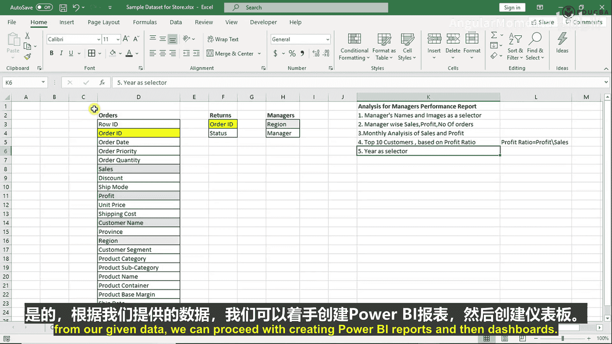

# 【EDUCBA】构建用于商业报告的交互式Power-BI仪表板--Build-Interactive-Power-BI-Dashboards-for-Busin-p03-01_03_01_Power-BI-中的公式化列--BV1NCFoznExD_p3-

Now， moving on to the next part， So as we have got the data over。

 we will now move on to the next part where we will try and create。

And edit the data that we have received。 what we'll specifically do is we will create a new column。

 as we've got here the。Daate of birth and the higher date， we will like to basically。

Create a new column， which is basically which tell us the date of birth。

 which is the age of the employee and the tenure of the employee。 So what well do is。

We will create a new column。The new column name， Firstly， you can。C the new column name。Just so your。

 we are basically。Adding the new column to the data。So the new column name that will keep is。

Of course we will keep so you want two age and tenure。

So what we'll keep is the first one is tenure you can keep。So here， what we'll do we try to。

Subtract the exit date from the higher date and divide that by 360。So， exit。Date。Minus the。

Higher date。Divide by 3，60， let's see。So as you can see， we have got the data over here。

Which basically。Tell us the。Tenure， but what you can not see here is if a person has null over your。

 then what would the data be so here we have only got till only the employees who have basically have the exit date。

 but we want to also subtract the same data from a said data which is。Basically。

 if the employee is not there， then what is the active date。

 the current active date for that particular employee so as you can see this is minus over your。

So hence， what we will also do is we will try to create a new column。Which will， basically。

Tell us the。Current date。So。And you can basically write the today formula over directly。Yeah。不起。

So it will give us the entire current date from the data。

So as this particular data is for specifically。Before like eight years， so it is around at 2012 data。

 so you can always do that straction of eight years。 so always you can simply do minus。8 into3，65。

Now let's see what happens。So what I've done is I've directly shifted it to 1 October 2012。

 we don't want it to go so back， so I'll basically keep it at。ISa 200。

13 because this data is of 2012， so I am trying to alter the data as per my requirement hence moved it to 2013。

 what you can do is obviously once you are the tenure is over。

 you want to link it to the current date。So hence you have got the two factors。

 the tenure and the current date。So for this specific factor， we will also you can use if。

So it clearly states checks whether a condition is met and returns one value if true another value if false。

I'll do the bracket open， so I'll basically say if exit date。Is equal to signal nu。Is equal to null。

 null or 0 or weak lets say。None。Then。😊，Or is equal to so is not equal to 0 or equal to not equal to 0。

Then this， if not equal to 0。Then what I want to do is if this is not equal to 0。

Then this date should come， if not， I'll put one more formula。

 obviously we have to do some permutation and combination for the formula to work so that's what you are doing here so if you will the current date。

It a have from the sheet。Minus the higher date。Then divide that by 365。 Now， let's see。Okay。

 just working on it。 Now， let's see if it's working。

And it is working properly because as you can see， this is blank。

And what numbers I've got over year is basis the current rate which is 2。6。

 so it is working accurately the column of tenure。Similarly。

 you can always change the numbering format from here。Yeah。So if you want to keep one number format。

 two number format， so it automaticallys the gives you that as well， also this。

 the formatting of the columns can also be changed。

With regards to the format which is available over， if you want a simple format DDMMYY。

 it will show you。So in very simpler terms， what Im trying to do is basically add two three more columns through a new column just to understand and help you analyze the data。

So this I've got current rate。 I've got tenure now。 That's good。 Now， one more column。

 which I want specifically is。Another new column that I want to create。Which is known as the age。

Age again would be similar to what we have done with tenure， I will just take the current date。Minus。

 we have the D O B。So the we have to basically type the column name and will come a sheet1 DOB as simple as that enter and you have called the the minute。

Minus this， so this is the formula。Now， and that。Working on it。

 and we have also created the age age here is coming in the date format。

 We will specifically have to change it。Because we。Wund this in the tenure format。

 So this is so well do by 365 divide by 365 because we want the years。

Now it is coming specifically into the number format and we'll keep it at。one decimal。

And it gives you the proper date of the age of the employee。

 so it is good because like this data is for 2012， I am closing it but to 2013 to make it more accurate。

So hence that factor we are taking， obviously， if you want to close it at 31st December 2012。

 obviously you can change this current date。 So here what I've done is if I multiply this by say。8。

 then it goes back to 2012 from there then on， obviously， you can also add the factor of。

The remaining days you can add so that also you can do otherwise you can use the date formula to manually calculate the date。

 so there is one more formula which basically is the date formula which you can specifically state the date you want if I want 201212 month and 31st date it will change everything accordingly。

So as you can see， this has been changed to 31， 12， 2012， and all the dates are in accordance to。

31 2012 which is the current date， so why I am doing this 31。

 2012 specifically because our data is still 2012。So obviously every data depends on the data set that is there and the joining is also dependent till 2012。

 hence I'm closing it at 2012。And which basically tells you the reason obviously you have the if you have more current data。

 you can obviously do that and you can analyze the data basically your own data with the formulas that you want so very simple thing that I've done I'll just quickly take you through that Ive added three columns over year which is  tenure current data and H tenure column being very simple what I've done is if the exit date is not equal to blank then take exit date minus higher it to add 365 which is basically a your f formula in a very simple manner again if so obviously the other ear formula also available if you want to see that。

If that is equal to 0， then current date which I haveve put as 31 total to total minus higher date2 by 36。

 I've got the 10ure。😊，Ive put a simple date formula for current date and H formula is again current date minus D2 by 365 very simple formulas。

 how do you do that， you come inside the data part， you come into table tools。

 there is an option of new column which will basically calculate the column through the formulas that you are putting。

And give you an answer for the same。 So once you do that and come to the main data。

 what will happen is certain things will change， especially what changes is tenure as you can see。

 is added over， the new columns get added automatically over your age is been added。

 Also current date will be added。 And if it is a formulated factor。

 you will obviously see one different sign， which basically says its a formulated。

Column hence that sign appears automatically。So we have got what we need to start with our analysis。

 So we have exported the data we have done some changes to the data。

 now we will be creating a dashboard out of it。 Hello all I welcome you all to the project on power B where we are going to look into a component of power B which is a power B desktop Now power B desktop is a free application which we can install in our local computer and use to visualize any kind of data This project on power B is basically used to create。

Manager's performance report using Power biI。 Now this is a case study which we will look into detail as we proceed with our project。

The difficulty level， the difficulty level of this project is mainly aimed for beginners and so the only skill set that you need for this project is a mindset for learning the tool。

And the power B I desktops free setup up。 Now， this free setup is basically in two ways how we can download。

 One is through the Microsoft's web store and another is Web link。

 We'll see briefly how we can download from both the cases。The project's objective。

 the objective of this project is that the participants will be able to get hands on exposure to power BI using case studies Now the focus of these case studies will be on building dashboards so well see how once we get a data how easily and efficiently we can build dashboards using power BI。

Yeah。What will you learn in this project in this project you will learn how to create attractive and visually appealing power B dashboards and you will learn advanced reporting topics of Power B Now the advanced reporting topics which we are going to look are mainly DAX expressions Now DAX expressions are data analysis expressions which are a very important concept in power B to develop simple as well as a slightly complex concepts。

 we are also going to see how we can use custom visualizations from Market as well as how we can use built in visualizations of our power BI Lastly we will also see how few concepts of data modeling can be used through our case study dataset。

Are there any project requirements or prerequisites， Yes。

 the only prerequisite for this project is the tool requirement， which is free and open source。

And obviously， you need the passion to learn power B I。

Who are the target students， Well anyone and everyone who wants to learn the power B I tool can be a target student for this project。

By the end of the project， you will have the following skill set。

 You will gain hands on exposure to a practical scenario of creating reports and dashboards using power biI。

So now let us look at the key study。 a company from a retail sector wants to analyze the performance of its managers。

 Now， this is considered to be a very important report for most companies。

 as generally these companies use this kind of report to understand the performance of its managers and also decide on their yearly performance rating。

 They also want to analyze the following the product sales。 How did each product have a sale。

 which product had the maximum sale and which product couldn't get that much of sale。

 What was the profit and profit ratio for each product customers， etc ce。

How did the customer segments perform across various years。

 and we see detailed view of how the products performed across years。

So let's help the company to perform the above mentioned analysis using Power bear。

Following scenarios will be covered as a part of this case study。

Well create the manager's performance report where through a certain KPIs or key performance indicators。

 willll see how did each manager perform。Well create a report which shows the analysis of product sales and profit。

 along with customer segmentation。Will create a report with a detailed view of products across years。

After all these three reports are created， we'll see how up。😊，Per P I desktop is published。

 and the data sets and reports can be viewed。Well see how we can incorporate all the visualizations in the analysis which are needed for all the above three cases。

I hope everything is clear till now， so。

Let's get started。Hi， now let us look at the data set， which we are going to use for our case study。

 Now， the data which is being provided to us is the sample dataset set for store。

 When we receive this， we first look at how many sheets do we have We see that we have an order sheet number one。

The second sheet that we have is returns sheet， which we see number 2。

And the third sheet that we have is manager sheet。 Now for power P， each sheet will serve as a table。

 Now， let us see what does each sheet or table has。

 Now what we generally do is once we receive all these sheets we create a new sheet and we paste all the columns which are present in the sheets。

And paste it in under new sheet。 Now this is what we have done the orders table。

 the return table and the manager's table， all the columns we have transposed and put it over here。

 the benefit of doing this is that you will get a one short analysis of what does all the columns hold and will also help us determine the relationships for each table will look what is data modeling and how each tables model themselves in power bi。

 but let us do our analysis first。This is the order table whose granular level is an order Id。

 We have order date， order priority， order quantity， sales， discount ship more profit， etc。

 many columns。The another table that we have is a return table。That has an order Id and a status。

The third table that we have is manager table， which has region and manager。

The next step is to identify the common columns in between the two tables。

Let us take order table and return table。 Do you see any common column between them。Yes， order I D。

 The moment we have identified the common column， we are going to highlight it。

So we now know that an order stable and return stable have a relationship in between them。

 which is an orderite。 Next， let us look the relationship between orders and managers。

Manager has column regionion and manager。Do we see any common column between orders and managers？Yes。

 region is present over here and over here。 So we highlight it。Once this is done。

 we now know the relationships which exist in between the tables and how our data model should actually be created in Power BI。

After this relationship analysis， what we do is we will list down all the questions that our manager's performance report wanted。

😊，The first analysis which our manager's performance report wanted was to get the manager's names and images as a selector Now do we have this information from our existing data。

 let us see manager's names in the manager's table， we do see a column of manager。

Let us see if the column has the manager's names。Yes， we have the manager's names present。

Images do we have images anywhere No， so we will see how we can get the images and use them in our power PI report next analysis。

 which we are going to see is the managers sales profit and number of orders。

 Let us see if we can get this information from the existing data。Seals， do we have this column， Yes。

 well highlight it。Profit。Yes。Yeah。Number of ordersarders。Is there any direct column present， No。

 but we do have an order I D and by confirmation， we have come to know that number of orders well is nothing but the count of order I D。

Next analysis that we want is a monthly analysis of sales and profit。We have sales。 We have profit。

Do we have any month column over here。No， but we do have an order date column。

 And from a date column， we can create an order month and a year。 so for the monthly analysis。

 well see how we can create month column using power peer next analysis。

 which we want is a top 10 customers based on profit ratio。 Now， customers。

 do we have that information。Yes， we have customer name。So， we highlighted。Profit ratio。

 Do we have profit ratio over here。 No， so profit ratio is one more column which we do not have。

 and we may need to derive it in our power bi。 What we do is we ask the calculation for profit ratio。

 which is equal to profit upon sales。 Do we have these two columns。 Yes。

 we have profit and we have sales。 So we can create profit ratio。Lastly。

 they want a year as a selector。Do we have year over here again， No。

 but we can derive it from our order date。This is how the entire analysis we can do。

 and now we have come to a conclusion that yes， from our given data。

 we can proceed with creating Power BI reports and then dashboards。

