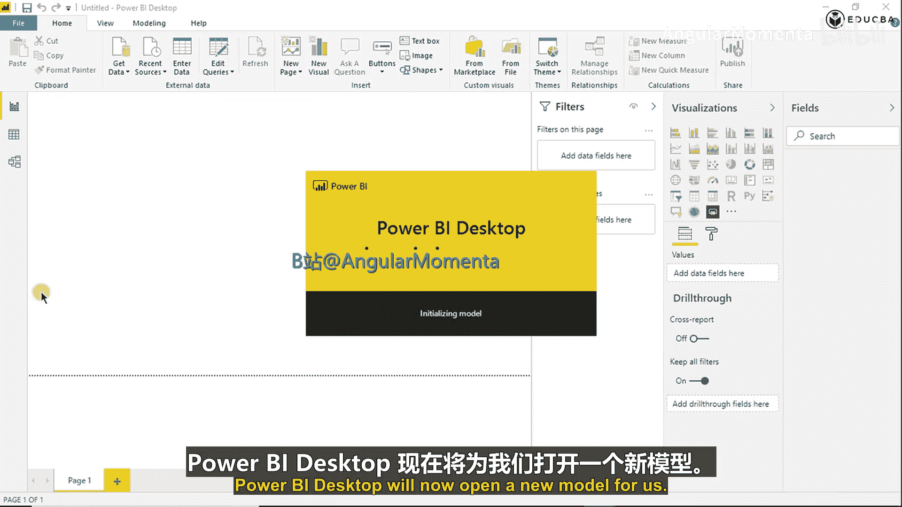
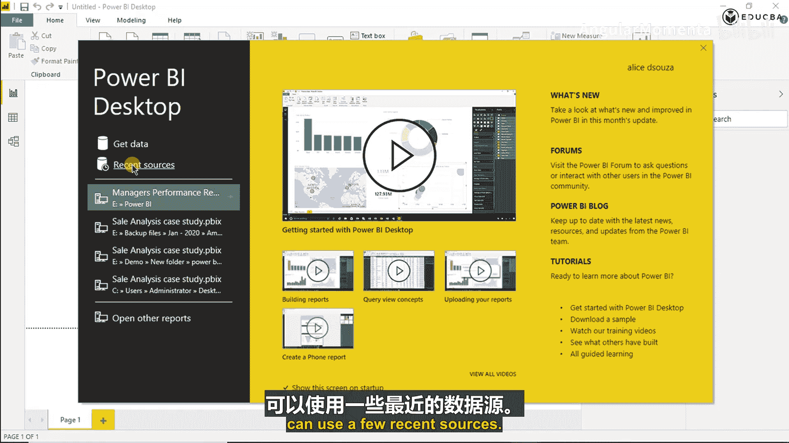
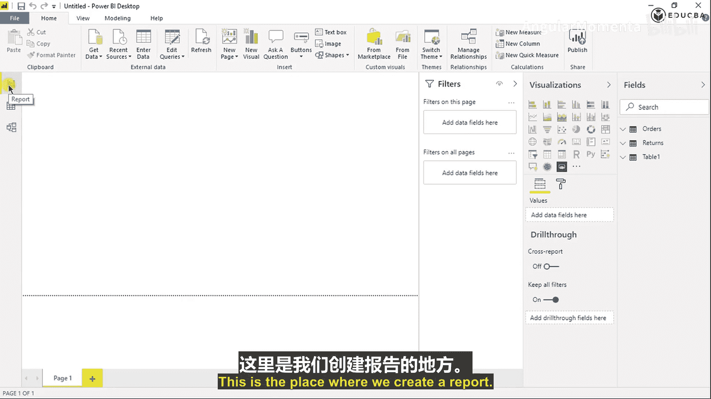
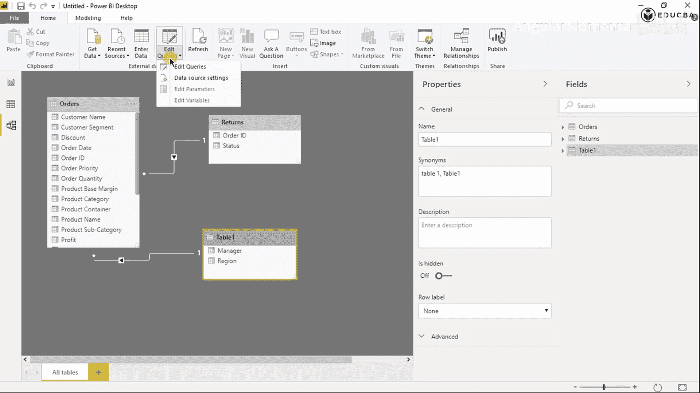
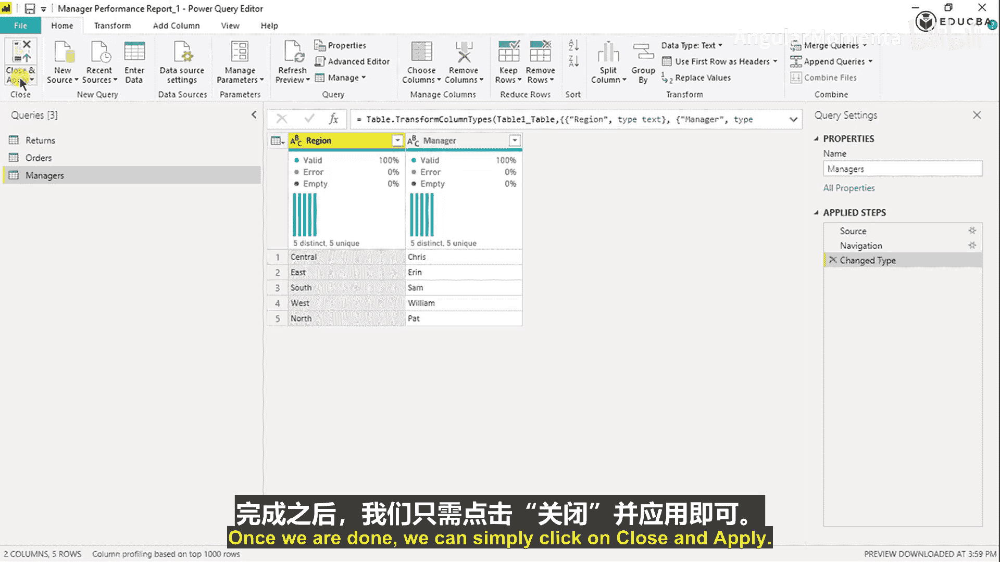
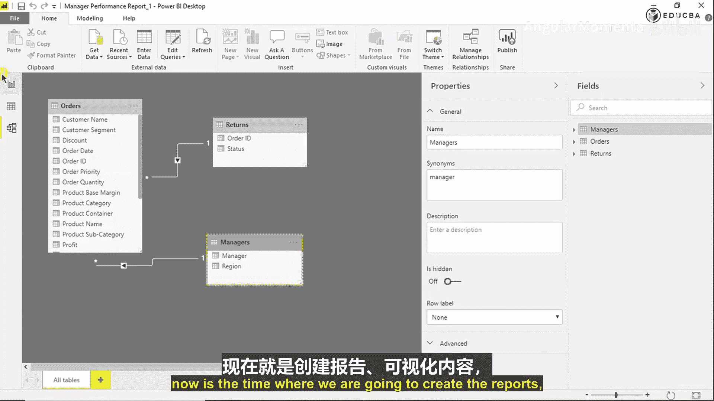
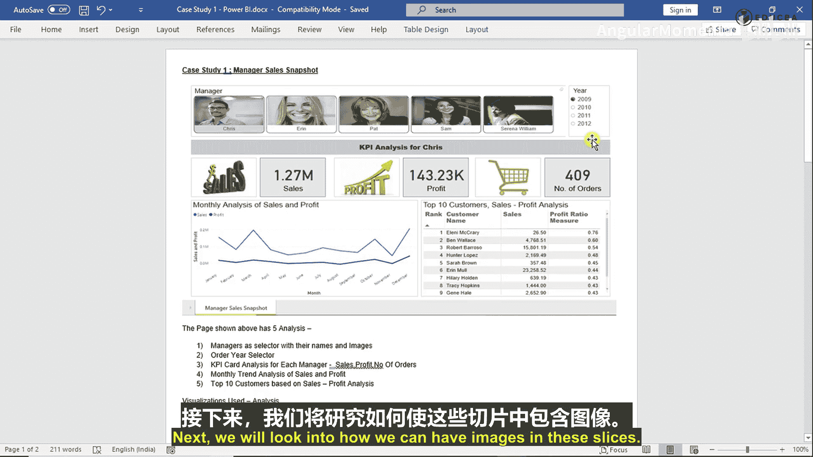

# 【EDUCBA】构建用于商业报告的交互式Power-BI仪表板--Build-Interactive-Power-BI-Dashboards-for-Busin-p04-02_01_01_导入数据--BV1NCFoznExD_p4-

Once we have created our own analysis and our own relationships between the tables。

 we are now ready to import this data set into power BI， so we will open the power PI desktop。

 This is how the power BI desktop looks like。Let us do step by step。 We'll go to file。

Willll click on new。Powerpiia desktoptop will now open a new model for us。

Okay。Here is the opening page of the Power B where it has given us options to get data as well as we can use a few recent sources。

Well click on get data。Notice that we also have a get data option over here。

We can also get data from this option。Let us see all the various data sources which Power BI has and gives us the flexibility to connect to。

In general， we can connect to a file， we can connect to a database。

We can connect to a power platform that is all the power apps supported by Power BI。

We can go to Azure and connect to any of the Azure data services。

We can also connect to any online service。And some other list。For P。

 we have been given option to connect to an Excel or a text， XmL Json， if you have data in a folder。

 you can import metadata from a folder， if you have a PDF then also we can import data from a PDF。

 or if you have a SharePoint folder。There are basically two ways in which we can import data。

 one is generally importing a data into a power BI desktop。

 or you can have a live connection live connection can be to a database or an online source。Now here。

 for example， we can connect data to a SQL server or an Oracle or an IBM DB2 database。

In a power platform， we have the following options where we can connect to a power BI dataset set。

 notice the pop up given it is g saying。Create a live connection to a Power BI service where we can use an already created data set of a Power BI。

We can also use an already created data flow over here。

Dataflow is nothing but a collection of entities or tables which has been already created and we can modify to our own needs。

We can also use a common data service of power App。Or we can use power platform data flows。

There is a very slight difference between Power BI data flows and power platform data flows。

Which is an advanced concept， but for now just remember that a power platform data flow is always much more faster than a power BI data flow。

Some of the Azure services which we can connect to are listed who were here。

Some online services and famous ones are like the SharePoint online list。

 the Microsoft Exchange Online， you can connect to sales force objects， Google Analytics。

 Adobe Analytics， Facebook， LinkedIn sales Navigator， etc。

So myriad of data sources have been available for us to connect to。For now。

 well take the simplest use case that we can think of， which is an Excel。We click here。

 click on connect。It gives us an option to select the data set， well select。

Now see over here on the left side are the list of all the sheets that we saw earlier。

The manager sheet， the order sheet， the return sheet。

 click on them and you can see a preview of the data。Sheheet 1。

 which we had done for our own analysis， we don't need to import it。We need returns。

 so we'll click on the checkbox。We need orders， we'll take on the checkbox。

Notice that we see a table 1， and a manage。Both seem to be similar， but in the managers。

 it didn't identify it as a table。 See over here。 column 1， column 2， region and manager。

The heading starts from here。But in a table form， region and manager have been identified as a column header。

 just like in orders， and in returns。This is a thing which power B generally does。

 and in case you arrive in such a situation， simply select table 1 and proceed。

 you can also select managers where after you have selected managers all we need to do is ensure that the column1 column to get removed and the first row is taken as a header we will see where that option is present。

As of now， well proceed with table 1。Now be once we have looked at all the data and selected the data sets that we need。

Well click on transform data。Once we have clicked on Trans data。

 this is a power query editor which has been opened now this is the kitchen where all the data modeling and relationships。

 etc have will be identified。This is the place where in case we want to add a new column we can do if we want to transform an existing column。

 we have many options present。Or if we just want to view a data and view a few analysis of the data。

 this is the area where we can do。Notice that each steps that you do in your power B query editor gets saved over here。

 and you can navigate to any of the applied steps and go back to the previously applied logics。

 What did we mean by this we will see in future。No。As of now。

 if you are not confident as to what all analysis you want to do， then just click on close and apply。

It is creating connections in the model， it is loading data， it is detecting relationships。

This are the three areas of power biI， this is the place where we create a report。

This is the place where we view the data。And this is the place where we do a modelling。

Let us see what model did Power BI create for us and does it match with our created model in Excel？

We have orders， we have returns。We have the table 1 manager region。 We would like to rename table 1。

 Can we do it over here。No， but we'll see where we'll do it。

But the important thing to identify over here is。That power B I identified the relationship between order and our managers table。

But it did not identify between orders and returns。

 It does happen that sometimes power bi is unable to detect the relationships between two column names。

In such cases， what to do so we can click on any of the table。

Click on manage relationships Now in this Man relationships table。

 we see all the relationships present as of now， the only active relationship that we have is orders table region column。

Table brackets column and table1 region column。We can click on auto detectect。

It has found no new relationships。However， we do need a relationship between our orders and re。

 orders and return table。In that case， we'll click on new。We'll click the source。Yeah。Order table。

 we need will click the final destination table， which is the return table。Order I D， order I D。

 these two have been highlighted。Now， we will select the relationship。

 Why is it that we will select many to one because。

If we see there are many orders which have been repeated and rows over in the order table。

 but the same order ID is present as a single row in the return table。

 and that is why the relationship will be many to one。We will click on。

 make this relationship active。It is a single direction filter。And we click on， okay。

 this is a security filter related thing。Now we see that all the relationships that we needed have been identified。

 we'll click on close。Yes， so now order ID has been identified。

Next thing that we would like to do is rename this table one。 how to do it。 We'll go to edit queries。

Click on Edit queries。We again came back to the same power query editor。We'll go to table 1。

Here we have the option to rename， so we'll rename it。We will do a。

There are pending changes in your queries that haven't been applied， do you want to apply them。

 apply？Here is the place where we are going to save our Power BI file。So。Now， it has been saved。

Once we are done， we can simply click on Close and Apply。

Once we have created our data model and have identified the relationships properly。

Now is the time where we are going to create the reportss， visualizations。 and finally。

 our dashboard。 Once the data model is created in industry， generally。

 we get something called as a mock up。

Now， a mockup is nothing but an image where we have come to know what are the things that we need to build and what visualizations are acceptable and appealing to the customer。

Here we see that a year has been provided to us as a single select。We have the manager's images。

Which will use some other images and see how we can use images as a selector。

Some KPI analysis through some KPI cardss。Iine graph for monthly analysis。

Top 10 customers in a tabular format， with profit ratio measure。

This has given us an idea of to how our dashboard should finally look similar to this。

 So let's get started。First we can start with the year selector， it's up to you。

 whichever you find convenient in starting now for now well start with a year selector。Now。

 the years elected that we saw is actually a slicer。How do we create it， Let's see。

 click on the slicer。Here it appears。Now， what we are going to do is we will search for if we have any year column。

Yes， power B I is such an amazing tool that automatically it identified that there is a date column。

😊，And in case we have a date column， we may need a year column as well。

 So it automatically created a year column for us。 Let us pull this to the visualization。

This is a default slide which is created by power B I。 However， as per our mockup。

 we saw we need something like radio button as options， we have a few options present over here。

These are very small letters， right， so we can expand them。 This is a better view。

We will click over here。 We will click on list or drop down。

This is a list visualization that we need to create。Notice that these are check boxes。

 A check box is always a multi select。 We need a single select。 So for that， we will go to this area。

 which is the format area。We'll go to selection controls。And we。Stick on single select。

Now we see a check box got converted to a radio button。

 the more detailed level of formatting well do later。

 what we generally first aim to do is create the basic visualizations。

 create a basic layout layout and later formatted。Once this is done， we will temporarily place it。

To the please that we finally want。We will size it a little bit。Again， changed its position。And。

Seeve it。So。This part has been done。 Next part that we want is a manager's images as a selector。

They want that if I click on a Chris image。Then this entire data should get reflected for Chris。

 If I click on Erin， then this entire data should get reflected for Er。

Let us see how we can do in Power B。Now in Power BI。

 these are the list of visualizations which are already built in in Power BI。However。

 from amongst all these visualizations， we do not have that visualization which will help us not only act as a slicer。

Or a selector， but also get the image for that particular manage。 However。

 power BI has given us a custom visualization which we can download from its marketplace。

Let us see how we can do it。 Click on from Market place， custom visuals。From Market。

Here here we can search。So we have come to know that there is a chit slicer and what this chid slicer does is it displays images or text buttons that act as an in canvas filter on other visuals。

This is quite similar to what we want， so we will use this chit slicer。An ad。

The visual was successfully imported。All the custom issues that we are going to download will appear in this area。

Takeick on it。See what happened。 It transformed our year to chocolate slicer。

 Always remember in power B I in case a visualization is selected。

If you click on another visualization， it will change itself。

 So it is always preferred that you click outside and then change your visualization。

We want to undo our change。 So we click over here。And our change got reverted back。

First thing that we'll do is click outside。Click on Chilet laser。

A visualization poppedpped up over here。For the time being， we'll place it over here。And pull。

Managers。Ning。We know manager's name。Is present over here。

So we got a chocolate slicer with the names of the managers， Chris， Pat， William， Er Sam。

Let us keep it like this for now。 Do a little bit of sizing。And， see it。

We have achieved this much of part where we can have the names of the managers as a slicer。Next。

 we will look into how we can have images in these slices。

