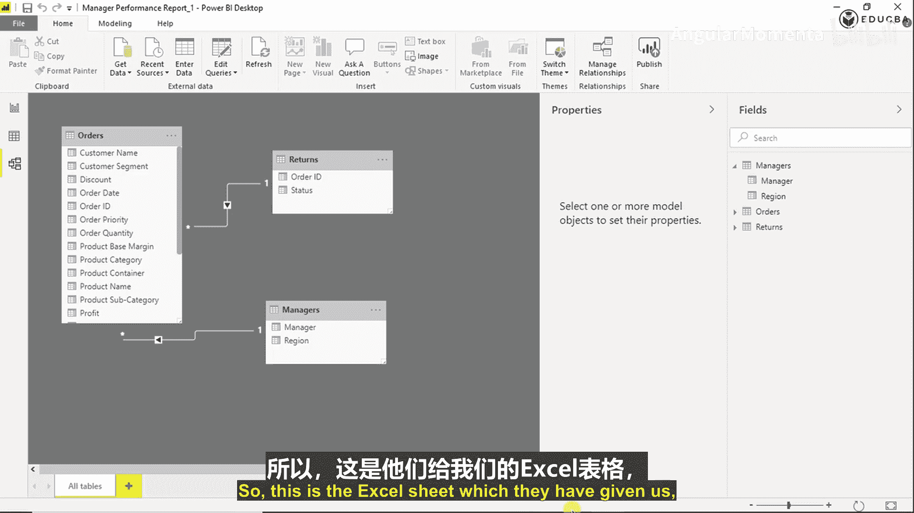
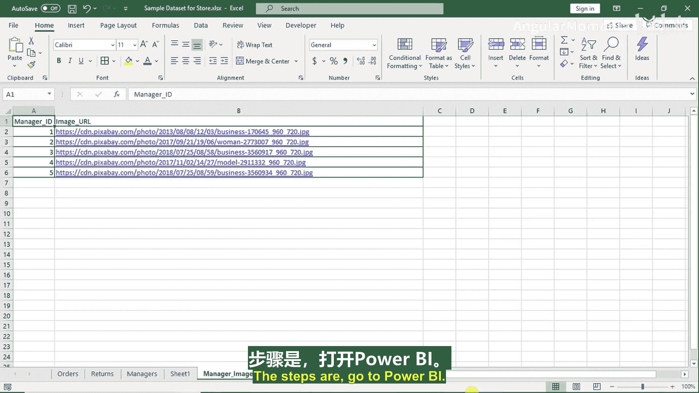
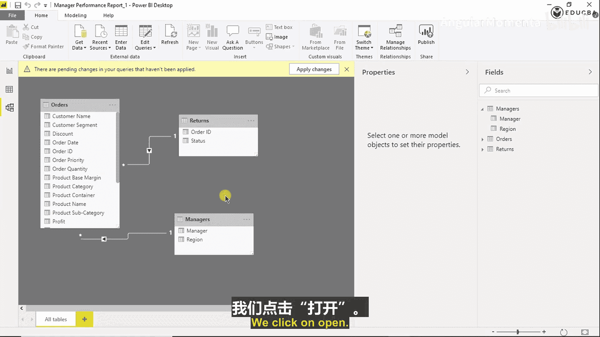
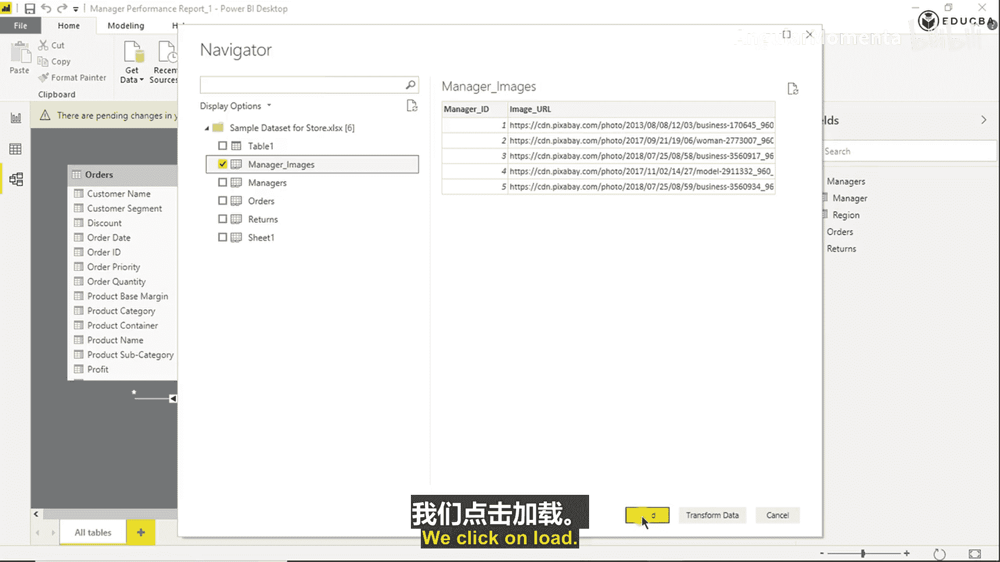
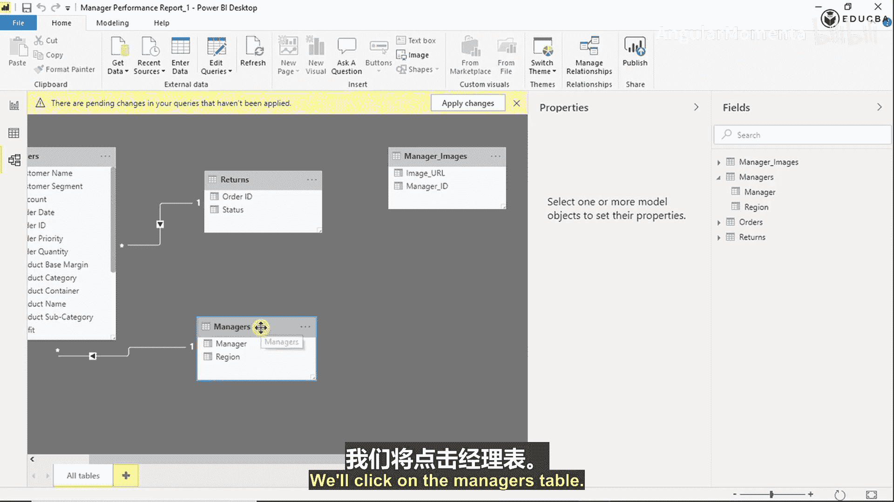
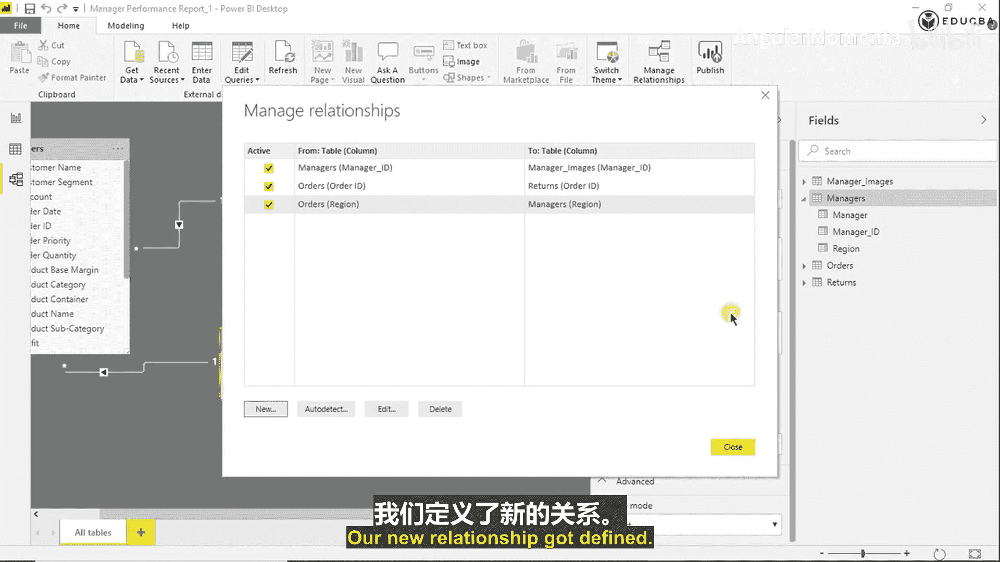
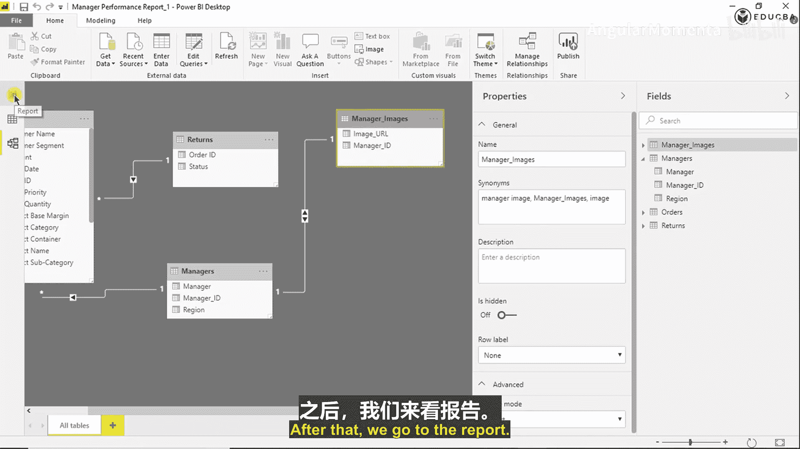
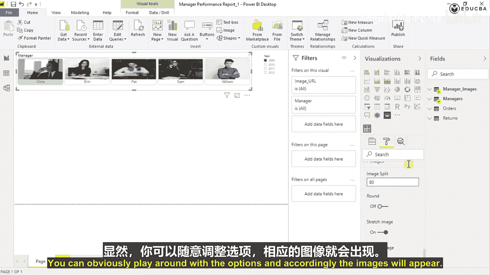

# 【EDUCBA】构建用于商业报告的交互式Power-BI仪表板--Build-Interactive-Power-BI-Dashboards-for-Busin-p05-02_02_01_切片器中的图像--BV1NCFoznExD_p5-

Now， let's imagine that we have been given the images for managers in the fall of an Excel sheet。So。

This is the Excel sheet， which they have given us， in which they have given us manager Id and the image URLls for each。

Now in an industry， it's generally a good practice to always have an ID column with respect to a manager's name。

However， till now we didn't have any manager I D。There are two ways to approach this。

 Number one is to ask them for a manager name column in this new table so that we can join with our manager's table on the basis of name。

お。😮，Since we have very limited data over here that is just five rows。

We can ourselves add a separate column in our manager's table in power B I with a manager I D。

 We'll see how we can do it。As of now， let us import this data into our power peer。The steps are。

G独バビア。

We go to the modeling sheet， we click on Cat data。Click Excel。Click on sample dataset at first Do。

 We click on open。

We click on manager images。This is the data that we want。We click on load。

Next thing that we would need is to define a relationship between these tables and these tables。

 Let us see how we will do it。We'll click on the manager's Ste。

Click on Edit queries。Go to manager Stebil。Now we need a manager Id column。 How we'll do it。

 We'll go to add column。Duplicate column。Will name it does。Manaaged。系り。Now。

 since we do not have any information whether Chris is equal to manager I D1。 So for now。

 well assume that Chris is one。 However， in real life。

 it should be an information which is given by the client。So we gl values of Chris with one。

Be the place values of Ed with two。We replace values。Of sum with three。And similarly， the others。

Done。😮，We will click on close and applyly。You see， we have got a new column manager ID。

Now we can define the relationship between them to do that。We click over here。

Click on Man relationshipss。Click on new。Select the store。 So stable。Select the target table。

Select manager Id， select manager I D。 These two have been selected。 This is a one to one。 why。

 Because here we had five rows and here also we had five rows。We click on okay。

Our new relationship got defined， we click on Close。

So now we have a relationship between managers and manager images。After that， we go to the report。

We already had this chocolate slicer created。 Now let us see how we can get these images。

We go to the data values field tab。We'll go to manager images。

Well click on image URL and drag it to the image section。Ba， we got the images over here。

Each of the images have come as a selector。Weekly conceive see。This part has been done。Next。

 we will proceed with the other visualizations。Hello， before proceeding for the next visualization。

 we would prefer that well format each of these current visualizations so that we know as to how much space we have in this existing page。

 so well start with the formatting of this。We'll go to the format section。

And one by one will go into each of the sections， so in the general we have its orientation。

 so this is the orientation of this chi slicer。So we can see we want a horizontal one so first we'll change it to horizontal then we can see that here first three images come and then the two images come in the next row。

 however， we want all the images to come in the same row so we will make this as five so that all the five come in one。

Next we keep rows as0 here you can check and uncheck if you want multiple selection or single Select will of the multiple selection for now4 selection means then you have to make a choice of a particular manager and you cannot proceed without making a selection。

 so if you want you can make it a first selection so the first one will automatically be selected。

As a rule， we generally put exposition as 10 by position as 10 for a properly formatted dashboard。

With as of now， we'll put some absolute number， say 11，0，0。We can change them obviously later。

 And for now， we will keep the height， as say 200，200 seems a little bit large， so we'll keep it 1。

80。 We'll obviously change it later。 as and when our visualizations grow。

Then header header is the title of the manager will format this will increase the text size。

 make the color。Little bit darker， you can choose any colour that you want。Then outline is this area。

 we'll go to Chilets。Tex size is this size。 So in case you want a little bit bigger slice。

 we can do that height of each chilet。Selected color is the color that is selected。

 we can see it's matching。Hover color is when we hover over it。Unselected color。

 disabled color outlines color that is this so we can make it a little bit lighter。

Paddding is the extra padding， which is given。We have various outline styles present over here that is we can make it as a rounded one。

 or we can have a square shaped， so this is basically the shape of this chit。

 so notice that we have done it square so this is a square shaped if we select as a rounded。

Did you see the edges became rounded。We prefer that in images arounded one looks better。

Now these images look very small and look to be very towards the top so well need to format these images image split as a general practice we need to play around with the numbers so that we get the proper image split that we want as of now I made it 75。

 whether you want the round images or normal images， whether you want to stretch the image。

Bottom image is something which will make the image go down and the name go up。

75 looks little decent for us so well proceed with 75 split you can obviously play around with the options and accordingly the images will appear。

