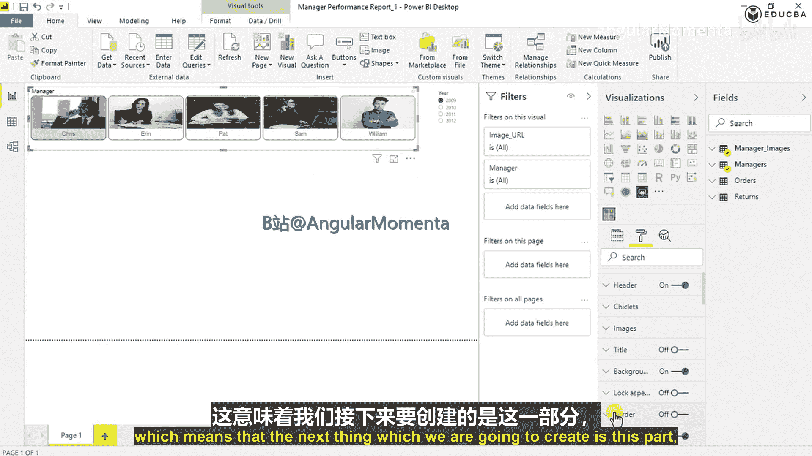
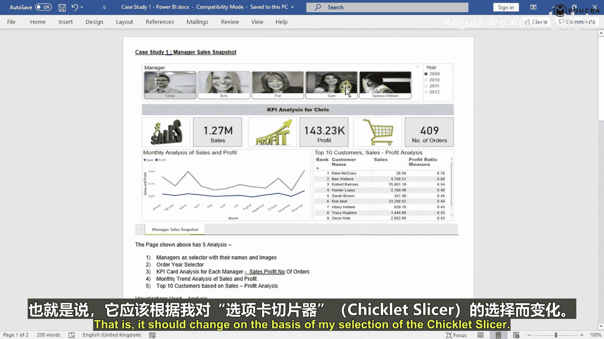
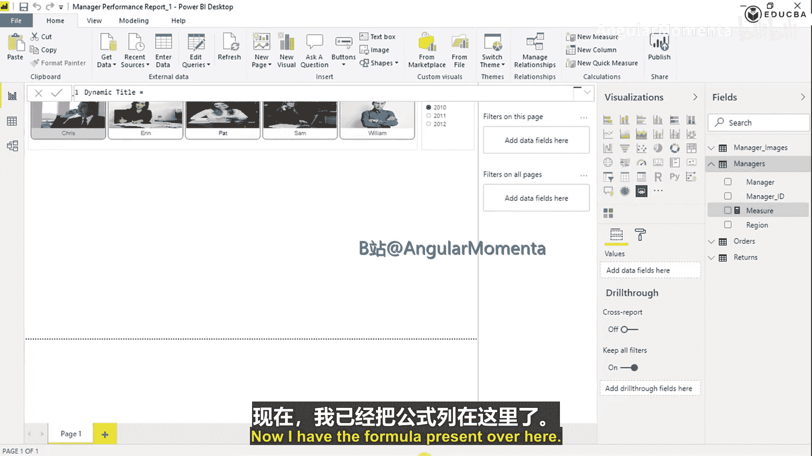
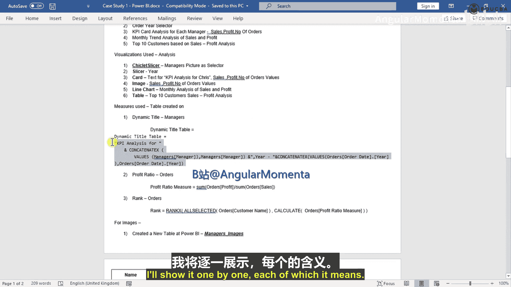
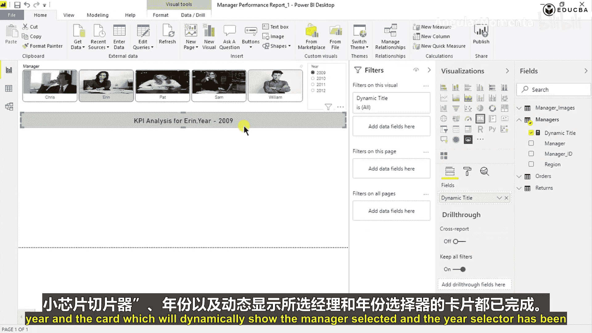
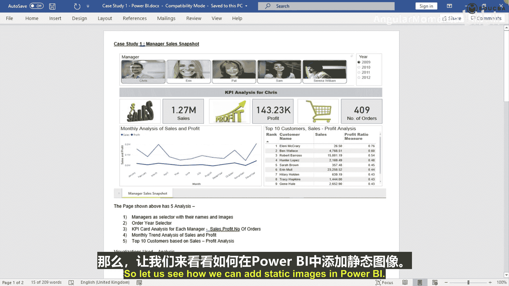
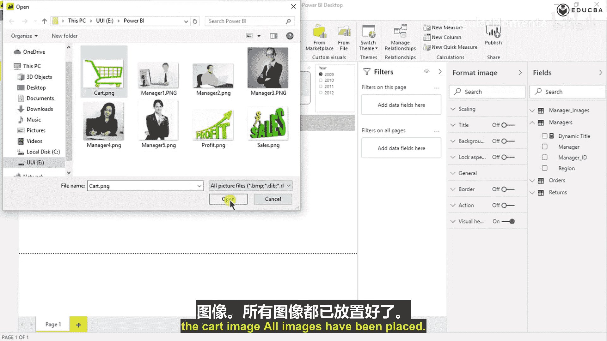
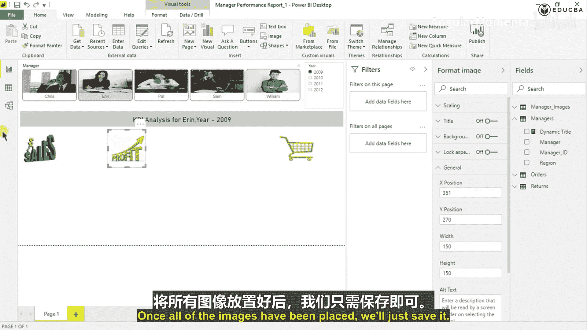

# 【EDUCBA】构建用于商业报告的交互式Power-BI仪表板--Build-Interactive-Power-BI-Dashboards-for-Busin-p06-02_03_01_动态标题--BV1NCFoznExD_p6-

Next we come to the visual header section where we will see what does visual header actually mean Vi header is actually with respect to all the options which are present over here。

 So if you would like to see what all options we have generally in power B you will notice that when you hover over a particular setting you will be able to see what it means so we can see it is saying select to turn on the visual header。

 changes to the visual headers' visibility will only be applied in the reading view。

 which means that all these extra options that we get over here are with respect to the visual header。

 so you can play around， say for example， if you want the background image to be a little bit lighter。

 you can select as light blue as we saw the background image changed。

Then you can select a transparency icon。 You can select a visual error icon。

 That is it will give an error when there is an error in the visual， when there is a warning error。

 Do you want that warning to come。Whether you want an extrad information icon to come。

 you can just switch it on or off。Whether you want to drill on a drop down or not。

Whether you want the pin icon or not。 So if we off， then the pin icon will be removed。

The focus mode eigen， whether you want or not， So if we offer it。

 then the focus mode eigen will not be shown any more。Similarly。

 we have many icons like that so the more options icon if is currently on if we select off。

The it will remove the more options icon， the filter， icon， etc ce。

 So you can play around with these all these options， which are present for visual headers。 Also。

 you have an option to completely disable it。 We will save our settings for now。Next。

 we will proceed into formatting of this slicer， so as a rule we remember that we had selected 10 as a width for y axis for this slicer。

 so we will put this as 10。This is more of a mathematical calculation related thing。

 which means that say for example， the exposition is 10 for this chit slicer and the width is 1100。

 so 1100 plus 10 is 1110， which means that this entire width from x axis is 1110。

 we would like to have a space of 10 in between so。The year will have an x axis of around 1，1，3，0。

Yeah。Yeah。You can again play with it， like in case you feel want。

That the year should start a little bit from here。 You can go to general。1，1，2，0。

Why position will keep it as 10。B we make it as1 hundred0。

Height will make it as this year selector similar to this height。

 So well see what is the height of this。1iti。So as of now， we will also make the height as quantity。

 Obviously， we can change them later。It looks like the year part has been cut。

 So what we will do is we increase the width little bit。 So let us keep the width as 1，50 for now。

And keep the height as 1，80。Next we come to the selection controls。

 whether you want it to be a single select or not， whether the slicers header you want it to be on and if on。

 then what is the formatting that you want， we remember that we had done this manager title as a 12th so we will keep the consistency and make the year as well in the 12th as a font。

Pone family you can select， generally we prefer to keep it as an aial or vertana。

Items is all the items color that you want。 We may make it a little bit darker。Yeah。Text size。

 if you want a little bit larger text size， you can select as a larger text size。 We have headers。

 who will not switch on the title。Background， if you want a specific background border， Yes。

 we'll keep a faint order for our years， slicer。Will select this for now。And thve。

Detail formatting can be done always at a later and when all the visualizations are in place。

 however， we always prefer that whenever you add a visualization do little bit of formatting on the go so that you understand the space which is available for you for the next visualizations。

Next， if we want to have over here， see a text box type image which shows us the KPI analysis for each of the managers that we select。

 as well as the years that we have selected。Which means that the next thing which we are going to create is this part where well get a text of KP analysis for Chris。

 similarly if the user clicks on Er， then it should show KP analysis for Er。

 which means that this text should actually be a dynamic text and not a static text。

 that is it should change on the basis of my selection of the checklate slicelicr。

 so let's see how we can do this。

First is this is something which is related to managers， so we'll go to the manager's table。

We go over here。Right click。We create a new measure。Let us name itaz。Dynamic。大的。No。First。

 we need to have the text of。KP I。Analysis 4。Now I'll show you what does。

The concatenate x function that is DA X function mean first let us create the syntax。

 and then I will show。Okay。完毕。Yeah。So for concatetnate we have two options present in power biI one is a concatenate and another is a concatenate x Now in power biI remember whenever a function has a particular x as a symbol。

 then it means that it actually goes in iteration， which means whenever we have an x in the function。

 it will loop over a list of values which are present。

Which means that when you pass a particular value in a column of values to concatenate x。

 it would loop through the list and combine them together into a single string。

 What do we mean by this， In short， a concatenate will just concatenate two static text。

Whereas a concatenate X will evaluate the expression for each row and then return the concatetnation of those values。

 even if they are separated by a specified delimiter。

 delimiter is something which is generally space or a comma， So if you want。

 say two values to be separated by a comma， as well as concatenated。

 that is when we need to use concatenate x。Remember， when there is a static concatenation of text。

 we use concatenate function。When there is a dynamic need of concatenate concatetation。

 well use concatenate text。 click on this First we need to select the table that is present。Next。

 we go to the manager's table。T click on any of the column， Click on new measure。

Will give a title as。Dynamic。Title。Now I have the formula present over here。 I'll show it one by one。

 each of which it means so。

So we wanted the text of KPia analysis4 in the front， so we will write it in double clothes。

 KPia analysis 4 put a little space。 Next is we want to concatenate this string with a set of values。

 Now these set of values needs to be dynamic which means that if we change the chit slicer。

 then the values should also change So KPia analysis 4 should give after that it should give me the name of the manager。

 then it should write year， and then it should give me the year which was selected in my slicer。

To have this dynamic concatenation， we have a function present in power bi which is called as concatenate x。

 so basically in power bi we have two functions present， one is a concatenate， let me show you。

Now remember concatetnate is used whenever you want to join two static text which means that there is no role of the text being changed；

 however， for our case we want a dynamic text that is our text changes with the selection and hence we prefer to use concanate X。

In power B I always remember that whenever a function is has an x in its end。

 which it means that the result will actually be in an iteration。

 which means that it will be in a dynamic and it will loop through a set of values whenever we have given this x present over here in the function and hence in concatenate x there is a particular format which we need to follow。

So， concatetnate x。Values， first， we need to give the table that is managers。I the table。

 Then we will write manager， which is the column name。

So this is manager's manager will form the set of values that is the table which we need to refer。

And the set of values which we need to concatenate with KPI analysis。

 so first it will go to the table。Get the value of the manager manager。

 which has been selected in the slicer and concateated with KP analysis 4 Similarlyly， we want year。

 so we'll have an ampersand ampersand is one more symbol for concatetnating two text。

 so we'll add ampersand。Then we will add year。Then again。

 we have concateex because the year is a dynamic value values， orders order date or year。

 this is the part which forms the table。And for each order's order date year。

 we want the value of order date year。So this is the entire syntax for concatenate x。

We'll click on it validated。 We'll do a save。Now we need to get a card format type of visualization。

 so we'll go to visualizations area。Select where card is present， click on card， then。

Pull dynamic title to the field section。We see that the text showing over here is KPI analysis for Chris year 2010。

 let us change the selections KPI analysis for Er year 2010 When I change the year the year over here changed so this is how we can achieve the concatetnation of two texts based dynamically based on the selectors which have been selected。

Let us do a little bit of formatting now。Let us first do a little bit calculation first。

Which means we'll go to the chilist slicer。We'll go to general。By position is 10， its height is 180。

 which means 10 is over here， 180， which means total is 190， we'll keep a 10 gap over here。

 so we'll start this from 200。Exposition will keep it as 10， similar to this。For width。

 we will go over year now， this needs to extend till here， so well go to the year。

 we will see what is the width。 It is 1，50， and what is the x， which is 1，1，2，0。

 which means till here our calculation is 1，1，2，0 plus 1，50， which is 1，2，7，0 and the 10 part。

 So we will make this。With us。1，2，7，0。Since this completed the entire part， so。嗯。

We'll keep ten0 difference from here。And reduce it。

Now the x and the y position and the width has been set。Let us set the height to be around 50。

We'll have a small border， a faint powder。Tool tip if you want any tool tip to appear when you hover over it。

 that is when we have the tool tip present over here。If you want a particular background。

 if you want word wrapping to be on， which means if we reduce the width of this card。

 then it will move to the next line category， if you want so。Here。For now。

 if I show category is this the name of the category， which is showing here as dynamic title。

 if you want， you can keep it， we do not want it， so well remove。Tta libbel。We will format it to be。

At owned。😔，Yeah。How does 20 look。Little bit。Smaller， youll make it 22。Yeah。

We'll put a little bit of background colour。 A light gray， maybe。Yeah。And we will save it。嗯。

So as of now， our manager's Chi slicer， year and the card which will dynamically show the manager selected and the year selectedor has been done。

Next， we need to show。The seal value。Notice that these are actually images which are present。

 so let us see how we can add static images in Power BI。

We go to Home section。 Here we have an image option to click on。Image。Yeah。

You can select all the images that you want， so first we'll select sales。Then we'll select Pro。清。

And then we'll select the cardage。

All images have been placed now let us do a little bit of formatting so that we can place them appropriately。

This needs to have an X axis of 10。 So it took an X axis of 10。

Now let's decide the why position for this。Now this had a y position of 200， its width was 60。

 so 260 and then 10 width， so it will be 270 for this。그。룩소。We will set by axis for this。And for this。

Yeah。Now we need to reduce the width of this， so for now we'll keep it say。

 let's see how hundred looks。Too small。1，50， maybe。Yeah， looks decent。 Let us set for this， as well。

And for this。Now let us decide on the height of it。150 looks decent。

 let us keep 150 and we'll change for all。嗯。嗯。Once all of the images have been placed。

 we'll just save it。

