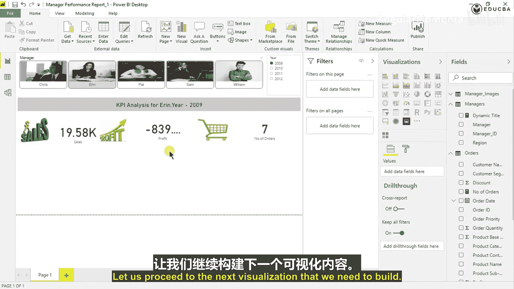
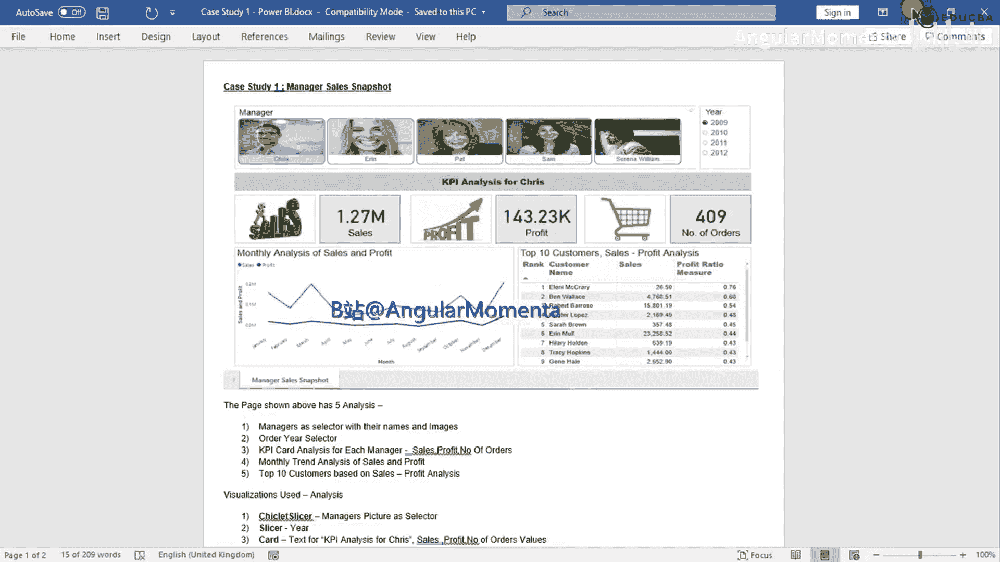
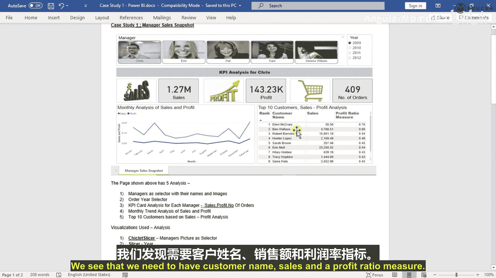
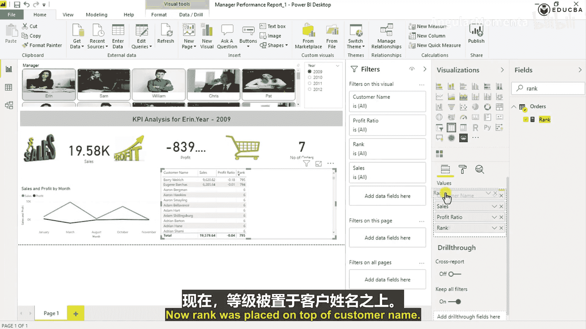

# 【EDUCBA】构建用于商业报告的交互式Power-BI仪表板--Build-Interactive-Power-BI-Dashboards-for-Busin-p07-03_01_01_折线图--BV1NCFoznExD_p7-

Now once these images have been uploaded over here in Power BI。

 next we need to show the KpiI is present in front of each of these images so。How do we do this。

 We will see the set of visualizations which are available over here and well use the card visualization。

 notice the card visualization is the same visualization which we used to show the dynamic text。

So we have the card visualization placed over here。We will drag up。Seals。不。

We'll format all of them together， let us just first complete all the KPI cards present。

Similar to this， we need profit， so。We'll go to visualizations again， click on card。

Please it randomly。嗯。Go to profit。And please it over here。没。Then。

We want to show the number of orders。 Let us see if we have any number of orders present。

 We see we do not have any number of orders present as a calculation in our data model。

Now number of orders will be nothing but count of distinct of order IDs which are present。

Which means if I show you in the data tab。The total number of orders。

 which have been present for each manager， will actually be the number of orders for each manager。

 So we need to create a new measure for number of orders。So we go to the orders table。Right click。

New measureja。Numberロ。Orders is equals2。Count。Now these are all the functions which are present for power BI in count。

 we need a distinct count， so we'll click on Dis count。

We need to have the column name so the column name is orders， order ID。Close it， click on yes。

A number of orders has been created。So， we'd click on card。Drag number of orders。

So we got the number of orders over here。We will。Please it randomly。Okay。Yeah。And see it。

We'll do detailed level of formatting for each of them later。

 let us proceed to the next visualization that we need to build。

This has been done。 This has been done。 This idea has been done Next。

 what we need to show is a monthly analysis for sales and profit。We see that this is a line chart。

 so let us see how do we develop a line chart in Power BI。

We click over here， go to visualizations。Click on line chart Now for the access。

 first we need is a month I， so we need an order date month I， so we'll click on month。

Next we need is sales and profit。So， be。Select sales。And。We select。Profit。

You can drag it over here or place it over here。So we see that a line chart got created for us。

 we save it。So let's start with creating the grid format。

 which we saw that is the top 10 customers sales profit analysis。

 We see that we need to have customer name， sales and a profit ratio measure。

Let us see what all columns we have over here。First， we will pull the table， which we need。

Do a little bit of formatting。First thing that we need is a customer name。So we pull customer name。

Then， we need。Seals。So， we put seals。Next， we need。Profit ratio。 Do we have profit ratio over here。

 no。Which means that we need to create a new measure on asking the client。

 we have come across a definition which we create now。So we name it as。😔，嗯。Profit。Rio。

So profit ratio measure is a formula of sum of profit。So well select order of Pro。😔，嗯。

Divided by some of。Seals。So in case of situations like this。

 when we do not have the particular column or measure present in our data。

 that is when we approach our client， ask what is the formula needed and accordingly develop our Power Bf。

Now it is always necessary to have a aggregation function over here whenever we want to have any values present in a measure。

 and that is the reason why we have used a sum function。We will validate it。Now。

 our measure has been created。 Let us do a little bit of testing whether the measure that we created is right or not。

 which is the focus mode arrow， which we can click whenever we want to do some testing。

So we saw that this got expanded。 We have customer name sales。 Let us pull profit for now。

 you can pull it over here and let us full profit ratio。Let us do a little bit of testing。

 which means that the value say for example 0。38 is coming correct or not。We will open calculator。

 and we will write zone 93。80。Divided by 248。26。Po377 which is rounded off to 0。38。

 Let us do a little bit of testing for another value， say we take this value514。07 divided by 1285。

37。399 which is approximately 0。4。 so now we have come to the conclusion that the profit ratio measure that we created is correct。

Will remove profit because that is not needed for us。

 We will save it next that we want to create over here is a ranking metric。

Now we know that rank is not present in our data， so this is again a measure that we need to create。

So we'll go to orders table right click。Create new measure。Yeah。We name the measure as rank。

Now we will see what are the functions present for us for ranking Now we have two functions present over your rank dot Eq and rank X。

 Now rank X returns the rank of an expression which is evaluated in the current context in the list of values for each row。

Now in earlier I have mentioned that in power BI， whenever x value comes。

 that is when we want the rank to dynamically calculate on the basis of each row。

 and that is what we want for each row we have a separate sales and a separate profit ratio and we want the ranking to be done for each of the row present in our table。

So we click on rank X。Then we need to select all selected。嗯。

Which means what does all selected mean it returns all the rows in a table or the values in a column。

 ignoring any filters that might have been applied inside the query。

 but keeping filters that come from outside which means that if we have any filters that are coming from outside that is over here we do have a managers and a year。

 so it will keep all the filters that come from outside， so all selected。不楚。Here， for we want。

In the table。 So orders customer name。그。And then we want to put the calculation on which the rank should calculate。

 So we'll write， calculate。Or does。Profit ratio close the bracket。 So notice in power B， I。

 it gives a green shape marking。 Where is the bracket being opened and bracket being closed。

 So we need to put one more bracket。 Our brackets have been closed。We will put。

 so here we get an error too few arguments were passed to the rank X function。

 The minimum argument count for the function is2， which means that what it is saying is that an all selected that rank X function should actually have two values。

 which means that all selected should have the closing done over here。And。😊。

We should remove this from here。 So did we understand。

What it was saying was rank X needs two parameters to be passed。 Now。

 the two parameters for our rank X is an all selected one。 This forms the first parameter。

And the second parameter is the calculate one。And hence。

 our brackets that were coming over here was erron。

This is how generally we decode errors which are present in Power bear。

 so I hope you have got a hang of it。 Well click O。Will kick save。Let us test。嗯。嗯。嗯。

What did just now happen， We see there are lots of 6，6，6 that came。 Then 5 has come。Way。

 let this see。First， now the ranking is based on profit ratio。

 so first we will sort all of these on the basis of profit ratio。Now we see that1，2，3，45。

 these rankings have come correctly， however we noticed that all of these are6。And why is it so。

 Because for all these customers we do not have any value present in profit ratio。

 so for a rank measure， a blank value is same， so that is why the ranking for all the blank values has been kept as6。

Yeah。We do a save。We do back to the report now rank was placed on top of customer name。

 so we'll pull it over here。

