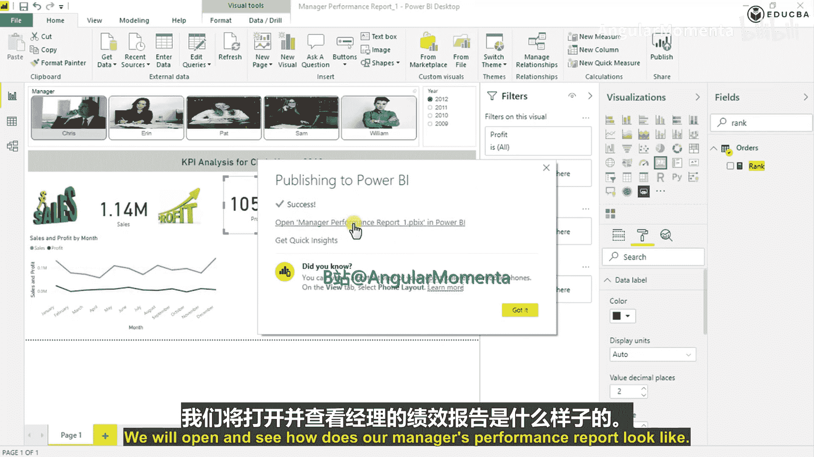
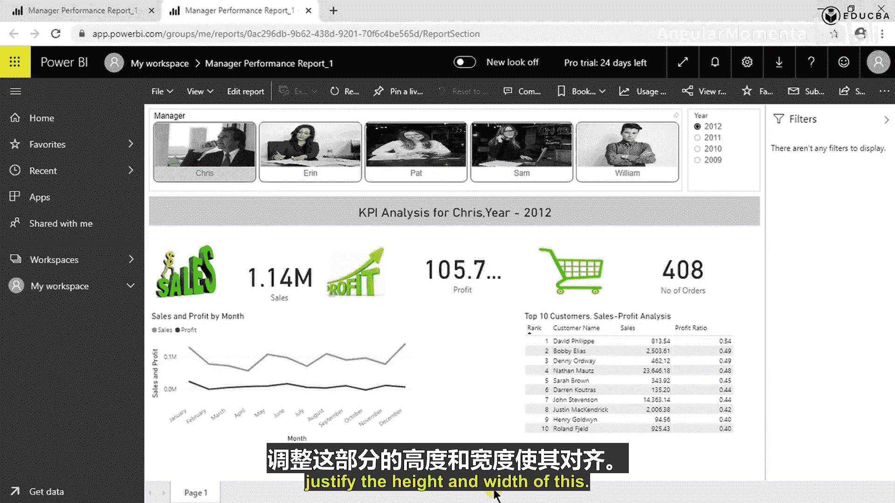
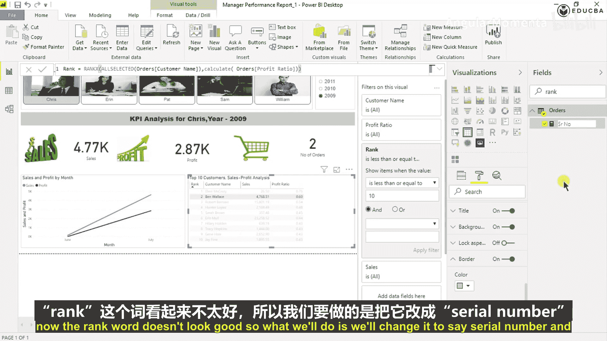

# 【EDUCBA】构建用于商业报告的交互式Power-BI仪表板--Build-Interactive-Power-BI-Dashboards-for-Busin-p08-03_02_01_嵌套过滤器继续--BV1NCFoznExD_p8-

Now， we want to see the top 10 customers sales profit analysis。

 which means the ranking should limit it to top 10 values。So over here now。

 remember that power BI is a very sensitive dashboard。 So if in our previous few seconds。

 we saw that when I pulled rank， something got disturbed over here。 So always remember。

 even in a drag and drop case whenever your dragging and dropping over here be very careful where you are dragging it is always a best practice to drag it over here in this section。

 so that you do not disturb the existing ones， as we saw because we dragged it over here。

 our existing visualization got disturbed。As we can see， Val rank has come over here。

 which we actually do not need， so we'll remove it。Now let us limit this to top 10 values。

How do we do it， We have a filter pan over here， and this filter pan is for applying all the filters that we want。

 which are visualization specific， which means now here we want to have a rank 10。

 So here we have rank over here， we go over here。Is less than or equal to 10。A pfield。

We saw that all the customers got restricted and the total number of customers that we have finally got is 10。

We will save it。We'll do a little bit of formatting over here。First of all， we do not need total。

 so well offer it。Then。We have profit issue measure。 We need a title。

And the title that we need is top10 customers sales profit Ana。We'll do it safe。Now。

 once all the visualizations have been placed， we'll do a verification with what was the mock up which our client gave and whether we have completed the basic development of all the visualizations that we need。

 So let us start the comparison。 The client asked us for having a manager's Chilet slicer that is it will click on the image and the entire dashboard will get refresh。

 Let us see。So we have a managers ticklet slicer and when I click on the dashboard。

 each of the values are changing。So this part is completed。Next， we see they wanted a year selector。

 so we see that we also have a year selector。 However。

 if say a a client wantsns that the year should be sorted on the basis of the descending。

 that is 2012 should come in front。 So the option to do that comes is first expanded。

Click on the top three dots over here， So descending。

We saw that 2012 came in front and 2009 was in the last。Generally。

 whenever it is this kind of managers snapshot report。

 clientsient generally prefer that the latest year should be present on top。We will do a save。

Next we'll proceed with our testing。The client wanted a KP analysis for Chris card over here。

 Do we have it， Yes， we also added a little bit of feature for the client where we also mentioned that you can ha the year which you have selected over here。

 Next， client wanted sales， profit and number of orders。Which we have over here。

Clleient wanted a monthly analysis of sales and profit。

So monthly analysis of a sales and a profit is being present and developed over here。And finally。

 it wanted a top 10 customers sales profit analysis based on profit ratio measure。

So these also have been created。So now we come to the conclusion that all the visualizations that we needed for our manager sales snapshot。

Dashboard has been created。 The last part is the formatting where it should where we have to do the entire dashboard's formatting in a very visually attractive manner so that the client feels more compulsion to use it。

So we will save it。And start with the detail formatting of the dashboard。

Now that we have completed with the placement of all the visualization。

 the next important step that we have to do is formatting of all these visualizations so that our dashboards look good。

However， to finally understand how where dashboard will look， we need to publish our dashboards。

 So what we'll do is we'll first click on publish。MyBookspace， select。Re please。Success。

 we will open and see how does a manager's performance report look like。

So this is how it is looking， and we do understand that we need to format it appropriately so that they look beautiful。

As we can see here， the manager text and the ear text are not in sync。 Similarlyly。

 we need to reduce the width of this。 Mo these to the top section。

Justify the height and width of this。 So let us start。 Got it。

 We'll first make this similar to manager。

Okay。Yeah。So we'll see what format did we give it over here。So text size was 12。Yeah。

And the formatting was a simpler one， and the manager T title wasn't black。 So we come over here。

Yeah。好。We click on title will remove the slicer header so that all of these are in sync。

Bill right here。You。It is black。嗯。Generally， we prefer aerial or aerial black depending on whether you want pulled or you don't want pulleded。

 so you can select on aial or aerial black。Thank。Now we'll increase the font of this。

We'll go to items。Looks better。Next we go over here。We change it to aerial or aerial black。

 whichever you prefer。Will reduce the text size little bit。Yeah。Okay。

We can select a very a lighter background for this， so either of this looks a little bit dark。Yeah。

Or if you have a hash hex code for this， you can also get the lighter version of the gray color。嗯。

Next， we will add a little bit of border to it。Okay。We already have a border for it。

Now we'll place the top for each， so we'll reduce the height first of this。See。Okay。Looks。😔，Chru。See。

 the。Ruce the height to How does 50 look。Better。40。Looks a little bit more， so will。😔，Freeze 50。

Now the width this 50 now will again come to the calculation part， so the height is 50。

And y position is 190， so 190 plus 50，240 plus 10 so this will be 250。For this， also it will be。😔，2。

15。Yeah。For all it will be y position S 250。Yeah。Yeah。嗯。

So I hope you have got a gist of how generally a formatting is done and how the calculations are done to achieve a perfectly formatted dashboard。

Sve。Believe this for now and go over here。Now， let us do a little bit of more calculation where we'll see what is the page size。

1280 is the width。So 1280， we keep a 10 over here， so 12，70，1260。

 there will be a 10 in between so 1250， so 1250 divided by2 should approximately be。Around 625。

 so we have got the width that we need to set for our these two visualizations。 So we click on this。

Go to general。Yeah。With this。😔，Let us keep it as 624 now。就。1036，26，36，40。

 So as should be starting from。Yeah。6，40。And。Yeah。Withth to be around，6，20。

So we see we do have a little bit of space left， so we'll make it 625。6，30。Looks better。So。

This and this has been done， now will I add borders？The glad brought us to here。Now。

 the rank word doesn't look good。 So what we'll do is。😔，Willel。Change it。To see， serial number。

Yeah。And see it。