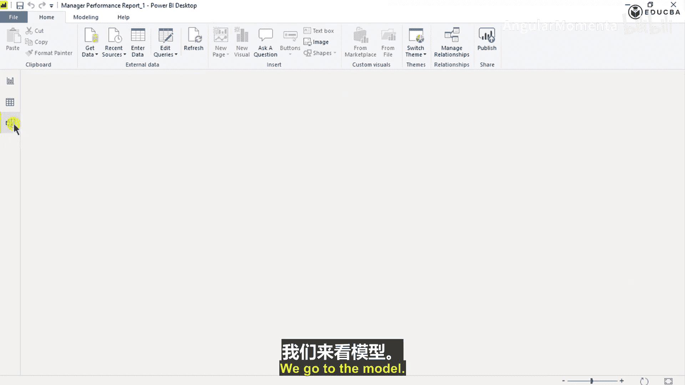
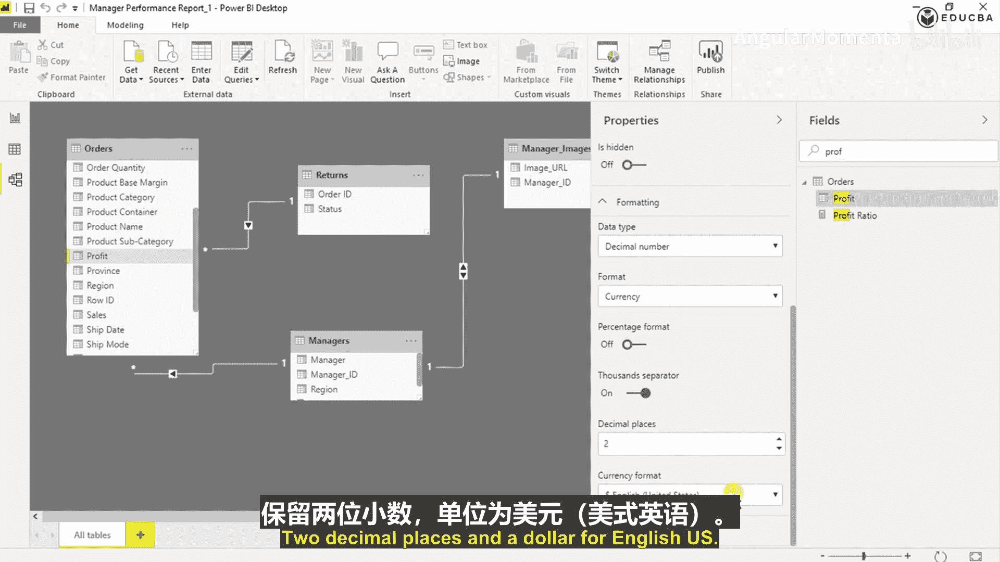
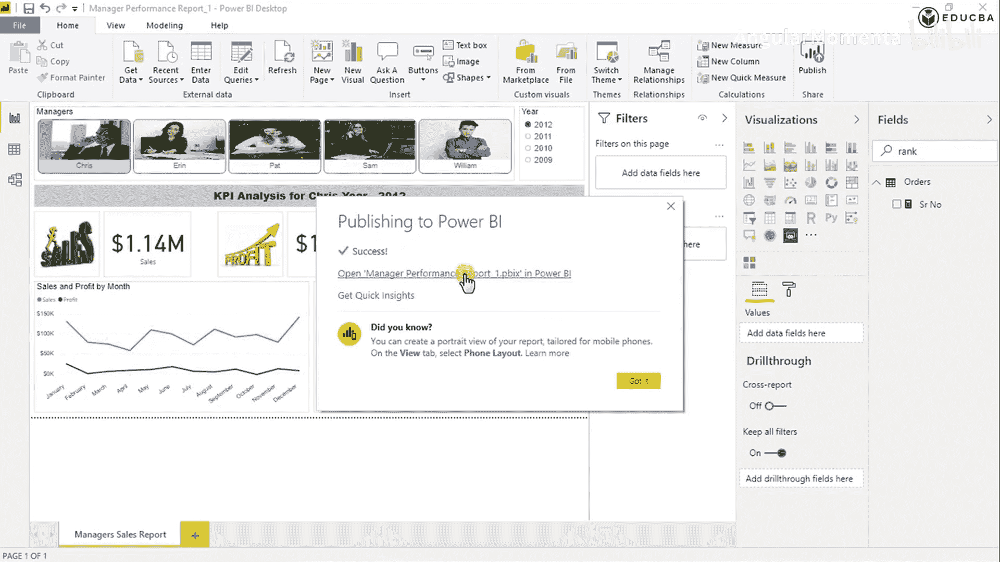
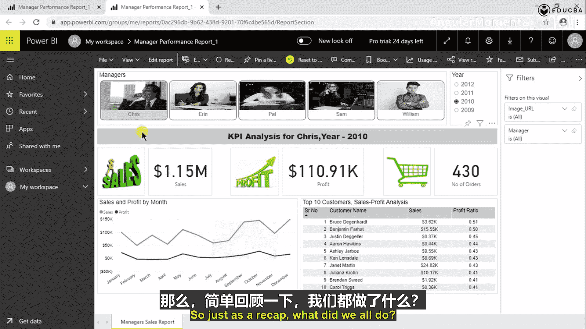
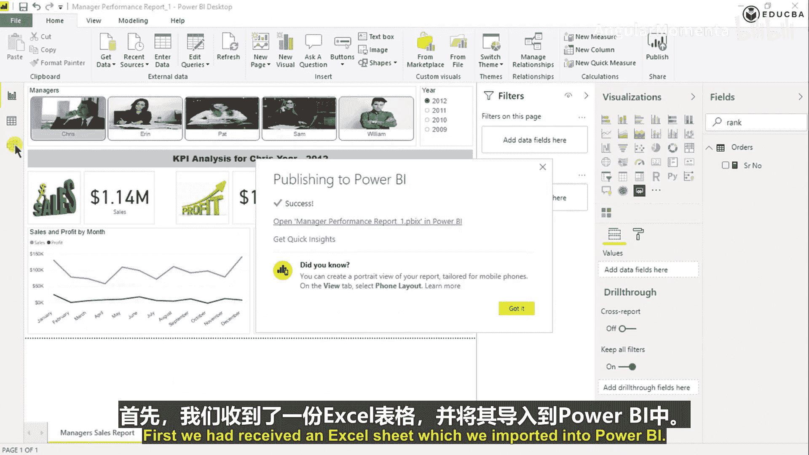
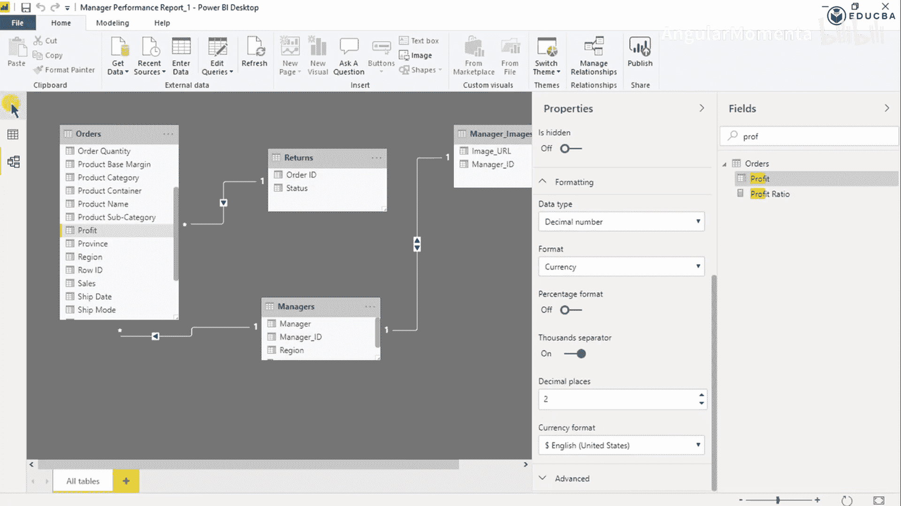
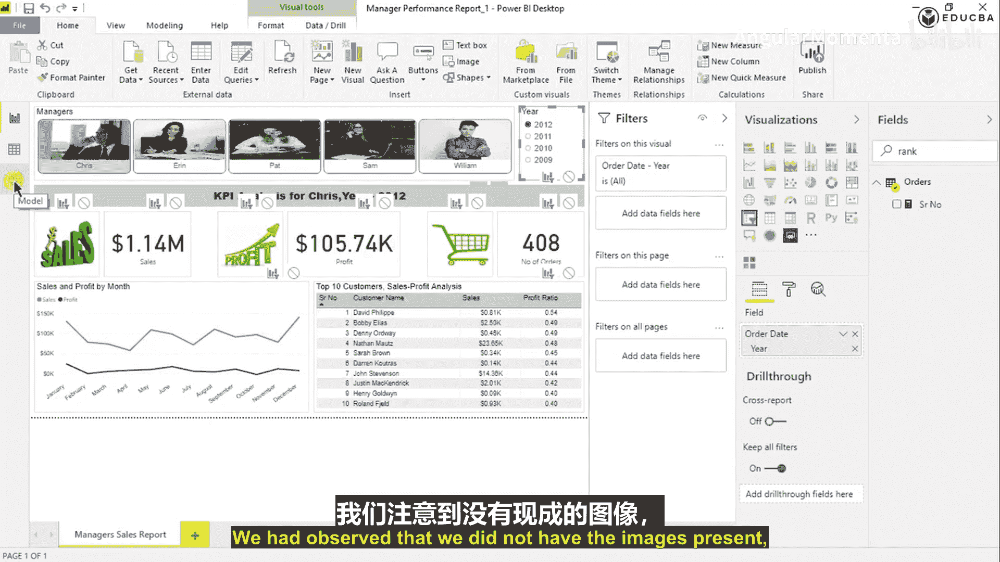
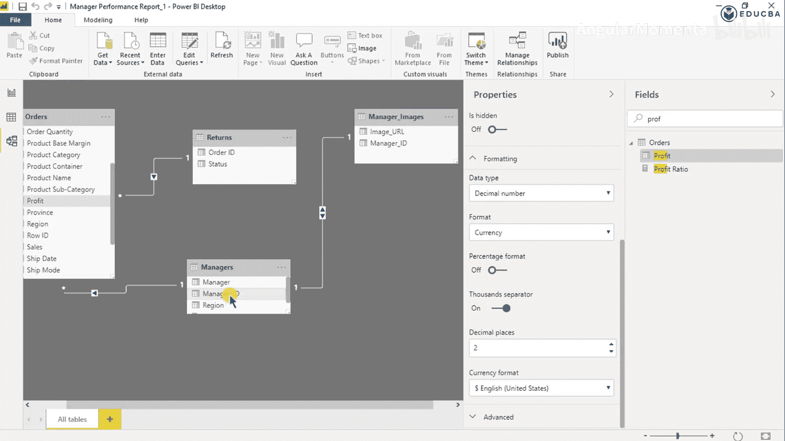
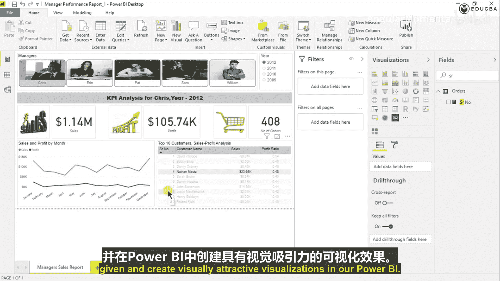

# 【EDUCBA】构建用于商业报告的交互式Power-BI仪表板--Build-Interactive-Power-BI-Dashboards-for-Busin-p09-03_03_01_格式化继续--BV1NCFoznExD_p9-

Notice that when I clicked over here something happened。

 that is the interaction between this visualization and all these visualizations appeared。

 which means that if I click on a particular customer name。Notice that these values have changed。

Now this is a feature in Power BI where all the visualizations are automatically targeting all other visualizations。

 so in case you do not want this kind of filtering where if you click over here all these values gets filtered out the next thing which we need to do for this is go to format tab。

 go to edit interactions。This is when we select what on what clicking on this particular visualization。

 which oil value should get changed。We want nothing to change。 so we will click on this block icon。

Block， block， block。😔，Nothing will be changed。Now we click a save。Yeah。

Notice that even though I am clicking on values， these are no longer changing similarly。

We don't want any filtering over here， so。For edit interactions， we do a block。그。그。Yeah。Yeah。Yeah。

For this。Again。We do not have any interaction present。

This we want to be affecting all the places and this we want to be affecting all the places。

 so we notice that there is no block icon in a gray format for all these visualizations。

 so we click on save。Yeah。Then you go to home。Now， even if I click on these。Value doesn't change。

Now we'll do a little bit formatting of this。So this is a serial number。

 so first we'll go to the title。Fing。Our color is black。It is。Cidil number。

So now we need to format the headers。So we go to column headers， black。Ial。

And if you want a bigger header， you can select 12。No。We want the values。Okay。Font color is。

 as you want。嗯。Yeah。예。Values。Go over here。You can select a darker color。And we change it to ael。Yeah。

녹 속이。Now this field formatting is the area where say for example。

 if you want a specific format for your values， that is where you come to the field formatting。

 say for example for sales we want a dollar sign to come so in that case what do we do。

We go to the model。

We find the sales column。We go and it is a decimal number。

 so we keep it decimal format is it is a currency format。We want 1000 separator to come。

 Decimal places， max decimal places that we want us to。그。Yeah。And a dollar of English US。

 we do a save。Similarly， profit， we want。In that dollar format， so we'll click on Pro。

Format will change to currency。Thousands of on。Two decimal places。And Toer vote English US。

We do a save。We go to。We can see that the dollars sign for sales and profit have come。嗯。

So we see in field formatting。In sales， if you want a particular format to be selected C for sales。

 you want the values to be present in thousands， you can click on this and all your values will start being displayed in key format。

Okay。We'll do a little bit of。Pment。And finalize our dashboards。

 So formatting in a general scenario formatting is the one thing which takes the maximum amount of time and the decision of the colors。

 so these are the two main things which come after the development of a dashboard。

Once all the visualizations have been placed and the formatting has been completed， the next step。

 which we have to do is publish it and show it to our client before that。

 let us rename the page of it。Managers。Fes。Report。Yeah。Save it。And publish it。Yeah。Select。

Replace an open。

Yeah。2。This is where we will finally see how our dashboard is looking。Managers， we have year。

 We have it descending， sorted。 keepy analysis for Chris year。All the filters are working fine。

The values are present in dollars and in million and K format。

 the total number of orders are present。 We have profit ratio。

 We have top 10 customers always the whatever manager I select。

 always the top 10 customers are shown。The sales and profit are changing based on the manager that we have selected。

 Also， the months are sorted on the basis of our month's description。 That is January， February。

 March， April， May， June， July， August， September，2 November， December， as we want。So post this。

 I hope that you guys have understood and got a ha of how a power BI dashboard is created from scratch from an Excel sheet where。

Each of the parameters that we have derived over here have been developed。 So just as a recap。

 what did we all do First， we had received an Excel sheet， which we imported into power B I。

Then we did a data modeling where we created the relationships between all the tables。

We had observed that there were certain tables which did not identify the relationships。

 and that is when we had to manually identify them。Next， we wanted a chit slicer。

 which was a custom visualization which we had imported from the marketplace。

This is the place where all the custom visualizations appear。

 a checklet slicer is generally used when we want an image to be used as a slicer。

 We had observed that we did not have the images present so we requested the clients to give us an image URL。

This is how we had got an image URL and a manager's ID。

We mapped the manager's ID with the manager ID over here， now manager ID was not present initially。

 which we created through a custom column。

。Finally， we created a checklist slicer and the images formatting we did from the format section。

Next， we used a slicer for year。Next， we saw how to get a dynamic text paste on the selections using a measure which we called it as dynamic title。

Next， we imported images into our Power BI， which are static images by clicking on image。Next。

 we saw how to create a card visualization for a KPI where this is the visualization which we need to use for any KPI card related information。

Next we had to create a line chart， so we created a simple line chart over here based on sales and profit。

Finally， we needed to create a top 10 customer sales profit analysis where profit ratio was a measure which we calculated in our Power BI。

 the rank metric also we created in our Power BI。And we pleased it accordingly。And finally。

 we wanted a top 10 filter， which was achieved from the filter panel。

Then we also saw that there were interactions between these visualizations and all the other visualizations。

 and we made an on and off selection for all these filters from the format editit interactions。你不是。

Okay。I hope now everybody will be able to create a simple power BI dashboard when an Excel has been given and create visually attractive visualizations in our power BI。

 Thank you。

