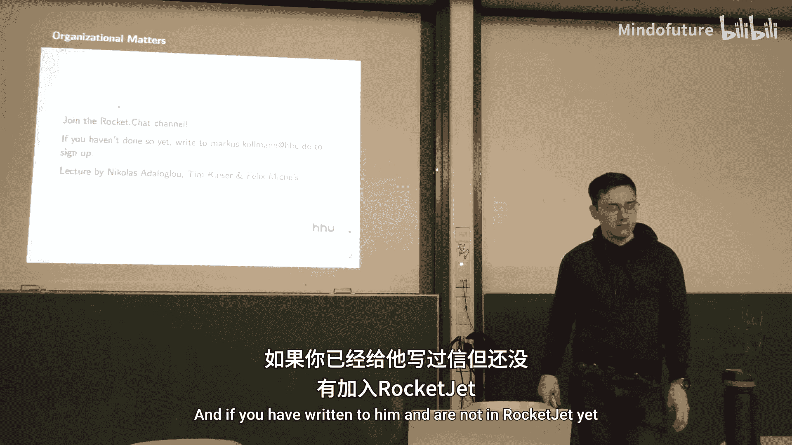
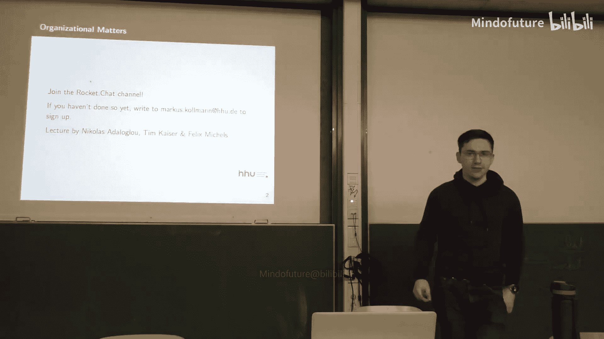
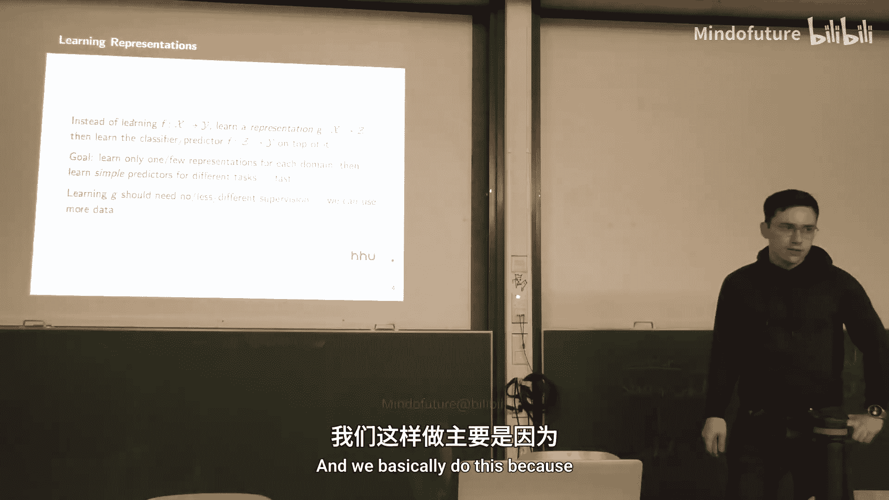
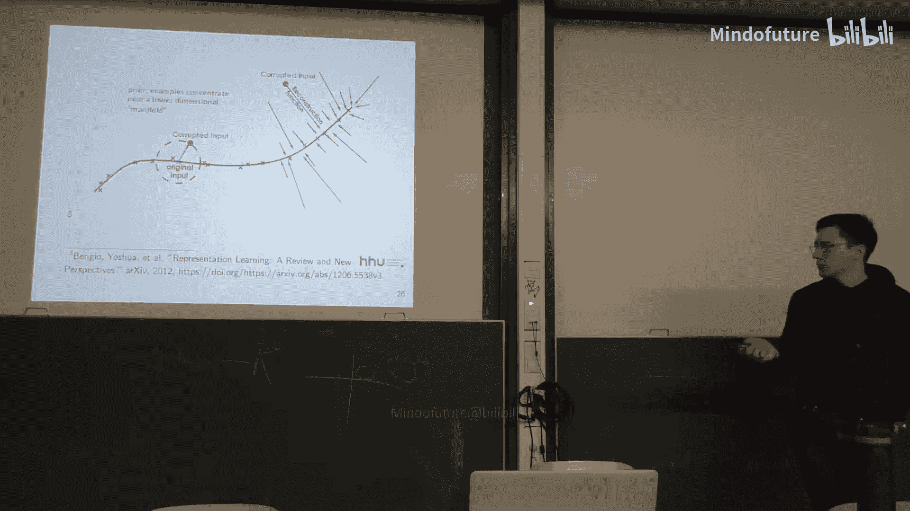

# 【Hhu Dusseldorf】表征学习 ｜ Representation Learning Msc Course Ss2023 p01 P01_W01_表示学习导论 -BV1RPZwB6EJZ_p1-

OK。and welcome to the representation learning lecture， as you can see this。Lecture is recorded。

So I don't know very sense。嗯。But that's my thing。First some。Organization stuff。

 I hope most of you are in the Rock channel by now。Anybody inの？Al。If you have。

Not written to press a comment to sign up， then do so。And。If you have written to him and。

I not a rockett yet， then you will receive some rockethead invitation。sometime唔算。

Today today hopefullyfully。

Otherwise， most of the materials will be in a seabo folder， and we will send you。

Be link to that pair mail， just to be sure。So。Everything you need to know is in the seabel。

 but just to repeat， there will be an exercise。Each week， I know。Which three were。Great。

 the first exercise for。Come out today and well be due next week。

The exercises will make 20% of a grade。But we are nice with grading。

 so if we see that you made an effort， you will get four points。嗯。Yes， so the lecture is。

This semester is by Nicholas。Tim， who was standing back。And myself， Felix。嗯。I think that's it with。

Organization。Unless someone has some concrete question。But yes。So like one or zero or。走以。

Is the for the exercise。That他。good like per task is， I think， he said。上去。We see对。

Probably you have some number of tasks per week。Like three or four tasks。

 usually for each of the tasks you get， I think zero or one point。

But it's more depending on the effort and not。If if it's really correct on not。

I want to say one more thing to the exercises for those of you who didn't have a lecture before with Professor Coleman。

 the idea behind this correction is that if you solve the exercise entirely。

 you'll get the point independent of the quality of your solution。That means。

If you leave on significant parts of the exercises。

 let's say like 20% it's very unlikely you'll get the point or at least the point of this task。

So all we want to see is that you try basically， it doesn't matter if you have some kind of model if you' like trained and it does the wrong thing。

 everything， what you want to see is that you like set down and spend some time on the exercises and that's the main criteria for getting the point。

Also as so the。Exercises will be， I think。Exclusively programming exercises， maybe some questions。

Go in there got almost exclusively programming。So the deep learning course is not like a former。

Grement for this course， but it's highly recommended。So you should know some pythage。嗯。

And like the basics of training neural networks。We'll go over some introductory stuff later today in the exercise class。

If you're interested in that， but if you're。Already comfortable with Pytor。

 you will probably not see anything new today in excess class， at least。So just so you know。And。

Was that set。We can't actually start with。Representation learning。

And today I will basically talk about what is representation learning？

Why are we doing it And then some。More classical approaches to representation learning。That are。

 honestly。Not吃。Use that much anymore。 But I think are still important for the。Well。

 I don't want to see historical context， but。Just so that you understand the bigger picture。Allright。

So， usually。We have some。懂没。The book works。可虑X啊。Could be images， text， whatever。

 and we want to learn some prediction on all of that。

So why is the space of prediction here and could be images where we want to detect an object and want to classify the object。

 so we're mapping an image to a class。Is there a cat a house， a dog or something。

Or for text difficulty sentiment analysis， which is also like a classification task so you get a sentence and you want to classify what's the general mood of this sentence is it？

Positive， whatever they're talking about or negative or something like this。

Or speech speech recognition you want to。Transcribe some speech to text or something。

 and then maybe demo that。And。Or like amino acid sequences or DNA。

 And you want to know what's like the。Three structure that these sequence will fold into。

 which we'll also talk about a bit much later in this lecture。And of course， it's domain my。

It's not really clear cut what is the domain or what isn't， like if I say images。

It's the domain of images that are like taken outside。

A phone camera the same as medical images taken with the CT machine， not exactly。

 but there is some overlap， so it's not really clear cut。All right， and so usually machine learning。

 what you did in the deep learning course and machine learning course。

 you learn like a function like this。From the domain space directly and to the space that we want to predict。

So and now instead of doing this directly， we learn a representation function G in some intermittent space。

 Z， those's called it also like the representation space or embedding space or。Lnt space from。

Drop in morning。And then we train the classifier on top of it。And we basically do this。

Because。Well， the goal is that we train one or a couple of。Representation functions。

 G for one domain， and then we can train a lot of different tasks just by some simple model on top of that。

So question A， but of you can interrupt me if you have any questions。Yeah， so the goal is。

 for example， you have one representation functions for images。

 and then you can train a simple model on top of that to predict。Animals or to predict numbers。

Or to predict if a person is smiling or whatever。And so this speeds up training because you only have to learn a big representation mode at once and then only have to train small models。

And also， it enables us to train with much more data because if we want to learn。

If there's a smiling person image， label the data。And we don't have that much labeled data。

 but if we learn like a representation function。You can learn it with。

No labels or different kinds of labels。Or a mixture of some labels on all levels。

 So we get over that button the just we will be able to use much more data。

So here are some quotes from。The Paypal write representation learning。Which are encouraged to reach。

 There's a lot of stuff in there。 that's not really。relevant for you anymore。

 but it's important important nonetheless。 so representation learning means learning representation of the data that makes it easier to extract useful information when building plus bias or predictors。

So I think that's the only really clear cut。Definition of what you want。

But there are also like more abstract definitions and terms that could go over。So， like here。

TheAI must learn to identify this tang underlying explanatory factors in the observed。

Low level sensor data。 So the sensor data is the stuff that we actually observe。

 So the pixels of an image。我 need。Sound based or the words and texts。Thanks持。

The exary factors that what basically。I a cause of this， but I' would get deal with this。So that's。

所以。There are some terms that will get here from time time。

 like explanatory factor of vector variations， which are like very。Similar terms。The idea is。

 basically。That there are some underlying factors that explain why the data is the way that it is。

So for example， in images that would be what is even what's the object， the focus of the image。

 is it cat as a house a dog， whatever， or which quotation is the object？

Or is there a shadow or witch shadowd， how much lightning is lighting is there？

Or is that much grainy or not grainy？And。Of course。

There is no like clear set of actual expenditure factors。 is just something more。

You imagine there is and not every factor is relevant for every task。

 So if you just want to classify。Once the animal is in a picture。

 we don't care about the light or lighting。Well， we don't care about lightning either。

You don't care about the rotation or whatever is needed。Is in the。Image。

 but there are still the reasons。Thats。Caususe the image to look like what actually looks like。

So there's another term extending away that's sometimes thrown around that I wanted to mention。

And that is the。Phenenoom when when some different expplan factors。Can become。Depenent。

 given some observation。So here we have the scenario， we have some security system in our house。

 and we are away from our house， but the security system can go off and we get some graification。

And there are basically two reasons why it could go， so there could be a burglary。

They are robots in house。What we want to know， or they could be an earthquake because it's somehow sensitive to that。

And。So there。One sensory input， one data box as one form of data basically。

 and either the language goes of or not， that's what they actually observe。

 and there are two underlying possible factors that could explain this observed data。

 either it's an earthquake or it's a burger。SoAnd both events by itself are。Qu quite rare。

 And we assume that they are like independent。 I mean， work class definitely don't cause earthquakes。

 and we assume that。An earthquake won't stop determined rubber from going to your house。O。

 so now the alarm goes off。And but you also get some other form of data。

 you hear in the news that there was an earthquake in your city or your house is。And then。

This basically explains by the allowance。😡，And therefore it's less likely that it was actually a burglar。

 so you're not worried anymore， you know it was most likely just an earthquake。

 so the fact that an earthquake came off explains way the other underlying factor。

So that's the basic idea of it。That's。There are some to that gets thrown around sometimes in some papers I also thought you。

Shouldn't at least have heard。All right， so now we have that。I want to go over some aspects of web。

Makes a good representation of what you optimally want function of a representation。And after that。

 we'll finally get into。What actually。How to go on representation。Okay， the basic one should be。

Smooth ination marks。If the two input points are very close together。

 then the representation should also be very close。That's like the most basic prior that。

That machine learning models have。I can argue that it's not really necessary to even include and it's not really relevant for every type of data。

So。For text， it's not really relevant because it's like discrete data。

But so that's basically given because every model。Thats this。On their own， we not everyone。

 but every model that we will discuss。Okay。Then we wanted to learn representations in a less or differently supervised case。

 so I already mentioned this before。We want to use all the data that's available。 I mean。

 there are like so many unlabeled images on the Internet， or images with。

Caaps that might might not be wrong。我。And we want to use all this data somehow。

So a good representation learning method should be able to deal with。

Unlabeled data or maybe a mix of data。And we will discuss some。Meths that can do that。Okay， then。

We want our designation to be have some kind of invariance with respect to the input。

Which is kind of already related to the。First官。So， for example， if the input is some kind of。

Time series。复杂噶啦。Like we measure。Parts or like EKG data， out rate data。

Then the representations of two。Points close on time should be auto similar。

Or like more domain specific for images。If we rotate an image slightly or change the color slightly。

 we generally want to have。And similar representation。Okay， then。Natural clustering。

So lots of kinds of data are somehow connected with some categorical variable， so images。

 you could say there for most images， there's some prominent。Objects。In the foreground。

 not for most images， but for some data sets at least。And the category would then be。

What objectject is？And goods。A representationpresentation model should somehow separate this。So that。

说。So if you have some have two D。Representation of。

The hammer only sees this black qua right wherever。

I don't plan to write too much on techpot today anyway。But if we have some representation。

 G from like。Images to。啊，秋。I mean it's probably not a very good representation because you have encode and whole image in two real numbers。

But people choke then。That if you apply this。Representation to a set of images。

Some kind of cluster of。Dogs。s some master of。Ts。And you have something at it so that。

Representation of points that share the same variable， the same label are close together and。

The rest is somewhere else。It's also like the basic idea because we humans。

Give things names because our brain， somehow through evolution。

And culture and whatever have learned statistical differences。In stuff。

 So that's what we call this a bottle and this a piece of chalk。And。

We basically want an optimal representation model to be able to do the things。All right。

 the next one， multiple explanatory factors。So。Each task doesn't need every factor。

 so like I said before， if we just want to classify what's on the image。

 we don't need to know is it big， is it small， is pointing to left or right。

 whatever it is on the image， we just want to know what is on the image。

But for another task it might be important。So， we want to。Recover many of these underlying factors。

And， of course。We don't。Want to recover every factor， because there's some factor like。

Likeectctor images like a camera noise， every time you take a picture。

 they have some noise on the sensor。And。We don't care about that。 That's not relevant for most tasks。

Or maybe its relevant for some task if your task is finding out with which type of camera your picture was taking。

So it's not always exactly clear what kind of factors we are actually want to。Recover which we don't。

But。Where this depends on what kind of tasks your insurance to do at the end of this。

 so there's generally not like one perfect representation that works for every kind of task on this domain。

 just for like a lot of tasks。And。Continuing with the underlying factors。

 we want to kind of disentangle him。So that each dimension。包。

The late variable corresponds to a meaningful variation in the data。

If we don't map to like our two but to like our 100。

 or we have 100 late dimensions and we are embedding。Pictures of faces。

 then we would maybe want like the first。dimension mentioned to be。

Which direction is it looking looking left or right。

 and the next dimension is is the person looking up or down， next direction。

 is there wearing glasses or not next dimension， see smiling or not or something like this？

So this is nice that you want like an interpretable representation。Usually we don't get this。But。

Like an optimal world， I would say it is an desirable property。

Something that we also don't get is some form of hierarchy in the representation。Well。

 I not directly at this。诶。So， there are。More abstract features， for example。

What kind of animal is it and more low level features？Does it have fur？

 Does it have four legs or six legs。And the low level features can't explain the more high level features。

And it would also be nice to have the。Representation kind of reflect this hierarchy。Buts。

None of the methods that we will talk about in this semester really do this。But。It would be nice if。

This was possible。Furthermore， sparsity， so。Again， the online factors。

If we want to classify animals again and one factor is fur color。

 that's not relevant if the animal on the in the。In the picture is a lizard， for example。So。

We have different factors that are not relevant all the time。

 so we basically only want to turn on or some of the features。So what this basically means that。

好ello。It might be sensible， not always， but it could be sensible that we want that most dimensions in our representation vectors are zero。

And finally， and maybe the most important。The factors in the representation should have some simple dependency。

Because you want to learn a simple。More than on top of that。So嗯。Most of the time， linear on。It's。

Doesn't matter if our representation reflects all。诶。The underlying factors， we cannot learn。

With a simple one laptopoff。And some kind of example of more engineered representations are like units and physics。

So。For example， you may know that fourth equals to mass times acceleration。

But force and mouth and accelerations are also only like representations of the actual physical word also。

They finds a new variable， which is like。4 squared plus 3 or something。

 And then we don't have such a nice。Connection between the variables anymore。

 even though it has like the。Same information。So the physicists engineered basically these representations so that I have。

先プ。De penencies， well， sometimes at least， and we want our model to be the same。O。

Now we have all these criteria which are kind of wishy wasy and more like abstract。

But how would we actually know if one representation is better than another？And one of the most。

popularopular ways is linear probing。So。We learn a representation on， for example。

And then we take another data set， maybe smaller data。But they said that is labeled。And then。

 you just。Train a small， linear edge on top of this。So yeah with the。

Usual cross entropy determined W is just a matrix。So。

I hope you all are kind of familiar what I mean when I say linear layer and cross entropy。嗯。

But that's basically it， and then we may just measure another accuracy on the test set and we get a better accuracy than its episode representation。

Maybe。Because it always depends on what kind of tasks we are。Interested。If we are training on。

Images should be then。Do this linear grbing on Inet like the big high resolution label data set or something small like Cypher 10。

Maybe one model is better there， one model is better there。Who knows that's what task depends。

What's important is。You can't really say anything from me， training loss because。

Because if you train your model on your representation model， G。

You are also will have some kind of loss， and some models will have lower loss on the data。

 and this match helps you to find some。To do highly character to。

 but it really doesn't tell you anything if one representation is better than another。

So some huge model might have。Tin loss on your presentation。Objective。

 which I will tell you about delivered to what they could be。

But does doesn't mean it's actually better in like this linear growing metric。And。

It doesn't have to be a linear probing， there are other ways which are popular like can nearest neighbors。

But in general， you train some simple， small classifier on top of the representation。Alright。

 that was。All the。Definition stuff， now we can start how we can actually。Learn representation。

Any questions so far？Like now I will go through some different viewpoints or objectives。

That you can use to。Learn representations。So the first one maybe think was an important one。

You you keep learning。Then some maximum likelihood methods， Al codes， which will be the。嗯。

Topic of this week's exercise and then what。 Yes，Usually the case that the representations are like lower dimensional or like embedding so Yeah。

 usually I would say it is the case， but not always necessarily。

Because learning on low dimensional data is usually easier。

That's why we would prefer this and it's also faster。But it's not necessarily always the case。

This is one of the first time。いり。是そ有い。No， I mean， it would be nice and there is some work on this。

But usually this is not like the main concern。Uually， unfortunately， all dozens。He them by itself。O。

 so。It was as an autumn codeas will be the topic of this week's exercise。

So that would be important than entirely got moneyifolds。And mutual information maximization。

 not today， but this will be important later in。Three weeks or so。

So the most important thing today will be really about all decors， the rest is more。Context。

Like I said this these I like。Different viewpoints of how to do representation or they're not like。

Uually exclusive and they are like it's not the exhaustive list。

 you can think of representation in different ways， these are just some。O。So。Since I hope。

 like I said， most of the have heard deep learning， you know that。In deep learning。

 our models are just a sequence of smaller， similar models。Behind each other。So， F1。And so on up。

Just come on。 and just lay us。And every that is a number of layers。And what we can do。

 we can train some deep learning models， some deep neural network。On some task， for example。

 classifying images on Inet。And then just cut off the last layer and turn we have our representation function。

So because deep learning inherently learns the representations。It learns。Representation spit off。

Important for this task。 So in this example， important for object classification。

But it turns out if you actually do this。So if you learn a classifier on imagegen and just shop last day off。

 there are also a lot of other information in。In this。Layer before the loss， depend layout。

That you can use for a lot of stuff。So， that's basically。Transporing what you're doing there。

 we are learning on one task list fakes。And then we appliess to some different task。

Class maybe also classified images， but maybe different types of glasses。But there's also， of course。

 requires that we have。Label data to train our model in first place。So here， and你们。

F we have for image it goes into the convolutional neural network。Often， it be。

Use images for input use some form of computer network course I always like。

Pasion transformers are getting very popular and。You will close two in this lecture。

But then there are some。Linear layer at the end or maybe multiple linear layers and we just。

Shop them off and use little layer in the middle as a representation。

And it's like really important to know that this doesn't work for every kind of machine learning model because。

Right now。Probably most of you if you think of machine learning， you think of deep learning and。

New networks that， but that wasn't like always the time。 There was time like pe machines and。

Three models were like more popular and then you can't do that then these models are not just a simple sequence of layers that you can just shop and half wherever you want。

So， that's really in。Important property of。Your networks。as also the idea， basically。

 if you choose a lower level layer， so one that is close at the input。

 then you will get more less abstract features。So right at the beginning， if you take a layer。

 the features you might get are the edges or which color as the German images。And。

If you take a later layer， you might get some more meaningful。你给开始么表。Okay， but like I said。

 you still need some task with label data to learn。有二0饭吃。

Or maybe you don't maybe just make some task up and train on that。

 So this will be be the topic of the next。Two weeks， pretext tasks。How basically。Can we train。

Your networks without。Any task， one example would be like。Rotation prediction。

We rotate some image and the。Our network should learn。In which direction we have rotate hazards。

Because most like natural images have some kind of。Next to a rotation。At least like。If you do like。

Deree rotation， and if。A network learns to correctly predict assertsertation。Then。

The hope is that it has some has understood the data somehow。But we would get go。

More in detail this next year。これクらス。Now。三摩。Maximum likelihood estimation methods。

So usually assume that we have。三。Data distribution P of x， so that's not written there now。

 but thes assume P of x like our data distribution。

And we want the distribution over our lake variable over our presentation to have some fixed distribution。

Some fixed similar distribution， for example， just novel distribution。

That's something that we can just choose。Because。Of course。

 depending on what kind of representation we learn。We could get a difference。

Distribution is in a space， but for now let's just assume。

No we will not assume let's basically require that our latent distribution。

This give like the normminative solution， for example。What we can do we can。

Parametertry is some kind of decoder， some kind of functions that takes the latent。Varable Z。

 the underlying explanatory factor。And。Generates basically the data。Or the data distribution， rather。

So the idea is， F Z is。A line factor， like what kinds of animal is an image where how it rotated。

Then。Our model P Theta with a parameter theta takes this latent information and turns it into some。

Distribution over images actually。And then， at least。Mathematically， we can write down。对 in歌。

I hope you are familiar with like the basic。Probity woods。

AndOtherwise you can youre going do something about this in the exercise I later。

And then we can just maximize this。And then hopefully there's some information about the data structure learned by our encoder P Theta without the need to any letters。

There's just two problems。How do we actually maximize this？And。

How do we actually get representation from this because。PP的别。

This likelihood function basically maps from z from latent space to x to the input space。

 and we basically want to have the exact opposite of that。So we want for Syria。PZ give next。

 so the shot will also be a feature here because it also depends on the parameter feature。

And we can use space rule and write it down。But we cannot。Cannot compute this， generally。

And even if we could compute this， then this is just probability distribution。

 we in reality we really want a function that takes an X and maps it to a Z。

 so how do we turn our probability distribution in a function so there are a couple of ways but the most。

In two to one， maybe we just take the arcm。We take the Z that maximizes this learn procedure。

 or maybe we can even take the expectation。ここです。Well things that are not easy to calculate it。So。

 for some。For some distributions。P x given Z， this can be actually computers。It's。We have here。

Really small models with a couple of like two linear layers they actually race to compute this analytically。

They post shared everything even even then， it's still very complicated。But the problem is。嗯。

This function MD somehow。Very expressive。So we have our simple latent distribution。

Where the underlying factors are supposed to be disentangled and nice and similar relationship。

 and this is supposed to turn into an image which has like really complicated relationships shifts between its damaged。

And this won't be possible with like a small network。So， this needs to be some。被告方生。

model by some big network， and in this case we can't compute these。Any more。So。

These are read difficult problems。Even though like statistically。

 it might be like the most obvious way to just maximize likelihood。I mean。

 you they have come from like a more statistic and less deep learning。Background。

 this might be the obvious approach， but just。Really hard for our data we actually care about。

What we could do is。Do some variational approaches。So like a variation option code on。

I don't want to get too in depth about this， so I thought I think most of you have probably heard this in deep learning。

The basic idea is you replace your posterior。With some different functionss。

 with different parameters。And then you can。Maximize an approximation， a lower bound。

Of the likelihood。And if you choose these parameterizations queue in a nice way。

Then you can get some form of representation of this。You can do this。

And there are ways to improve this conversation learning。But。It doesn't work that well。

So but that is a way how we can learn knowledge encodeco。

So this might be interesting because usually when you think about auto coders， you think about。

Generative model， you will want to use it to generate data。

 but we can also use it the other way around to embed data into a low dimensional space or a simpler space。

And then up， right， see。So。I hope you are a PCA principal component analysis。Shorts， recap。

If you have data。Like this。BCA finds。The directions with the highest variance。

And then we can just take these directions and。Ignore the rest。

 So I talk about PC A here because there's like ribbon and tape。

Exterpretations from different viewpoint。 So you can interpret this as。Probabilistic method。

 you can view it as a manifold learning method， or you can even view it as an auto code method。So。

 but now。For all of you here are doing it S day。AProbbil a statementigma。

So you don't need to know how ACA works in detail。Just important to know。That it's。

Learn some matrix deep。Consisting of some eye vectors from the data。

 and then you just multiply the transpose of this matrix。就 get your Z。So how is this probabilistic？

我了就开。To separate this。You say the posterior。Yes。Just zero cent normal distribution。ba啲。

Vararianance is the extra variance that we get。If you buy thisH or later。

And oh likelihood just keep them like this。And then。嗯。

The V from PCA will actually be a opt solution for this。So。This likelihood is really simple。

 It's just。Linear dependency， so it cannot learn much。

But this is just one of the cases where we can actually solve this analytically to get the posterior or and then the。

Expectation of Coa。And if you're interested in that， you can look up。

Explainatory impact analysis and there's a whole bunch more about this。

But I just it to have like PCA as a kind of running example。

And there are a bunch more probabilistic methods。That you really don't need your know。

 like re parts machines and deep belief networks。And they all use some kind of fancy statistics and sampling。

To compute the procedures。And so on， but my point is just。Lli methods are really hard。

 even if they're like statistical nice， nice idea， just maximize the likelihood。

They are hard to do in practice。What you can do， you can mix likelihood methods。With deep learning。

 so you can have some auto reive models， so for example， some kind of R end recurive neural network。

That learns to like， predict the next next word in a sentence。

That also learns some kind of representation。And then you just can again cut off the last layer。And。

You have some form of representation， so not the best kind of representation we talk more about。

Text representation in two weeks， but that's generally something you can do。

Or you can learn any kind of generic model you could learn like a gun。

And take the discriminator now whether。Take the discriminator and just cut off glass layers and you have some form of representation。

Is it very good， probably not。But in theory， you could do this。O。No， auto codes。Again。

 it' is important because the exercise will be about this。嗯。

So I think you all have the basic idea of what an autor is， right？We have two networks this time。

Encoder function D， which will be our revisitation function。

 paraed by our parameters P and some Dder function D with different parameters。

And we basically want to be able to reconstruct the image。

 or doesn' have be image can be any data point。So it gets encoded by G and then decod again by D and it's supposed to be similar to x。

And here again， we have some kind， some form of。Distribution on our latent space。But this time。

 it's dependent on feature。On parent of the encoder， if you have a different encoder。

Then you will have the difference。Differentiff。Distribution on lake space。

And in the section before with the maximum length of estimations， our distribution was fixed。

So this time， cannot do。L you maximization。This won't work。 I mean，Exceptions， of course。

 like variation auto decocoder is the form of auto encodecoder where we enforce the distribution of latent space to have some specific form。

But generally。If， if the decoder changes， then also distribution on。啲啊。On the Lake space train。Okay。

 so how do we actually learn it and how do we stop G from just learning identity。Because。

If G is the identity and D identity function。Then it can always reconstruct the input perfectly。

But it hasn't learnedt anything。Okay， so what's the most simple way to prevent this or re headers？

Yes， you both。如何。Yes， that's one possibility， but just like from the architecture。

 how should the space Z be？Yes。やりましょ次ぜ。Wesstern， yes。Exect。So this like the most obvious。

 easiest one， if x is like couple of thousand dimensions， maybe just make the 100 dimensions。

And then it has to squeeze all the information in the。100 dimensional space。

So we just minimized this function here。我括我这张。Where some kind of reconstruction loss。

Could be something simple like mean spread error。Or any other norm or any other request loss that's appropriate for your kind of data。

For all of the exercises it will be in squared error。And。Look PC a back again。

PCA can be seen as a form of an knowledge encodeder if we say that you both the encoder and decoder。

Must be。林玲。And if we say the function， the loss function。

 the reconstruction loss is the needsgan error。Then， PCA。

Then the PCL will actually be an opiment solution for this loss。Or to be more precise。嗯。

If G is linear， then the weights are some of matrix， right？

And this matrix then will span the same subspace as the。开是。I some PCA。

So now we have the same representation methods， PCA bus。Vied in a different way。Okay。

 so but there are some problems with this。There are lots of。

Information about that that we don't care about like low level pixel information。

How where exactly is the image is a little bit more left or more right。It's this function。

This method has problems with learning these invaris because re construct everything。So。啊。Okay。

 before we talk about this。😊，啊。Or maybe O， for。So a different version of。

An code are dennoising autumn code。First， we put some noise on our image。哦呃 form of data。

So the simplest way would be we just add some caution。Nice on there。Little bits off。Yeah。

 no I don't know any different words。And youve tried to reconstruct。The original image。

So you have the image， put noise on there， encode it， decocode it。

 and this then should be your original image。So the encodeder decoder stack must learn to denice the image basically。

So how can we think about this geometrically？If we think that our data lines in like a low dimensional manifold。

 so if our data line on this black line yeah。If you put random noise on there， then it will probably。

Be pushed away from the slide。And。Our encode of Dakota has no way of knowing。

Where the original Qantus。But a good guess basically is to just move it。Back onto。

want two with the manyifold。So we basically learn like a vector field that points towards。

The manyfold that points towards regions of。H like you。And actually， theres some kind of。

Connection to like score matching， so in statistics yes。score function。第嗯。

Brareiant of the look like yours。And some。Very specific simple cases。

You can actually prove that the encodeder decoder stack。Will learn exactly this function。

So you learn the direction in which the likelihood logic goes up。嗯。And this。Is obviously nice。

 And you can also choose。Which kinds of？Noise we put in there to kind of control what kind of invariances we want to add。

 so we can just in the easiest case just put like gauther noise on there。

 but if we want to say you want a representation that is invariant to rotation。

 you can instead put a on rotation on there。Or some common noise。

So that's a lot of nice things that we can do with denoing。发正。going back， they also。Spas out codes。

They're not terribly important right now， but I mentioned before that a good representation should be somehow sparse。

Lots of zeros to representation， and we can just do this by penalizing。嗯。

Your representation with some kind of function omega。嗰别第湾的。Or something else。嗯。

And which is important about。Both sparse， autoenrs and deno autoenrs。They can learn features， even。

If we have an overcomp。Or a blank space。 So before I caught a d thing。

But if the dimension of delayed space is little lower。We call this undercomple。

So then basically it has to learn to compress data somehow。

But now we could also choose an overcomplete settings。

 so where the dimension of lengthnt space is actually larger。And。If we put enough noise on there。

 it will still learn something meaningful。Sometimes it does make sense to have like a larger dimension there。

 because it could be that the input dimensions。Are not very many。

 but the dimensions are like very complicated。Related。

 and you need to somehow project them in the higher dimension， so。That to become simple。And。

We're a linear relationship。a kind of artificial example would be。We have like 2D data。Where。

But two classes so you have。So could see it and。Crosssses。Aron。And。

Is this a good representation of the data it's not perfect because we cannot learn a linear classifier top that will separate the circuits from the。

From the。Cross。But we could learn some kind of projection in 3D space。 So basically where the。

Xes are like， pushed away from the backlog and the。Dots circles are pushed in bots。

 and then the blackboard would be like a nice linear separator。

 So sometimes it's like necessary to move to higher dimensions。

So that we can have linear relationships。Of course， we can also do。Is。Basically。

 map the axis this way from the blackboard and the。

So if it' image to the blackboard and ju just keep this dimension。

 then we have a nice single dimension representation。Well that's no perfect counter。

And there are lots of more different ways to penalize sparsity。But they really important went now。

 so the most simple one is just the air norm。We just at the absolute values of the norm actors of the。

Representation thicknessness。And there's also something another nice type of what called the contractive auto and conduct。

Which actually behaves very similarly to。A key noise an auto encoder with caution noise。

So what we're doing here， you're penalizing the the copian matrix of the。Encoda。So。

What does mean to have a small appropriate matrix？If we think about what happens if G is linear。

 G linear， the Jacob matrix is just。Do you1 basically or like the。Mattrix that represents G。

And if this has a small norm， so the FTF stands the proven norm， that's the。That importance。

That basically means that。Points that not very close。Even closer in coding space。

 so that's what means to be contractive。It puts points together。So what will happen if？We have。If we。

so basically。If we have some input in this red region here， it wants to pull them all together。

To like a single point which results in them being on the manifold again。

But the difference to what thes in what is。That we can kind of compute this here。Gically。

 or with like， auto。Gt and Pyth。 I mean， it's。Slow， if the。Network is actually big。

 so we don't do this。But。In theoryor it's possible and could be faster than the tin noise in ocean。

Because if we train our genome as an autoenr， they will actually have to sample the noise， right？

We take an image and we sound the noise。And then， we minimize this。

And we might have to sample lots of noisy versions of the same image for this proper work。

 and this could take a long time。And the contractive auto encoder。

Learns this without any randomness and it iss a nice thing you have Also we have like a parameter here where you can have a trade of between a representation。

And how。Insensitive is supposed to be too noise。And in the genomes and Al encoder。

 we don't have a trade off directly， I mean， you can control the invoice size。be竟啊。Control the sigma。

 So if you put more noise on this。Then the reconstructions will be worse。

 but will have more invariance。All right， it's about ocean encoders。

And we're already at our last very small topic。关i photo。嗯。If是。But you burning like I acceptable。

 taking time today。You heard about the manifold hypothesis。

 So the idea that actual real data lies in some kind of。Lower dimensional， much lower dimensional。

Money from。Which is。On the one hand， the idea that there are like a smaller number of explanatory factors。

So an image might have actually millions of dimensions， so millions of pixels。

But the underlying factors are maybe a couple of thousand or something。

 so that's one half of the manifold hypothesis。But the other half is that。If we wear these detectors。

 we get some nice geometric。Soface like thing。嗯。诶 at the n p就 p a。Learns a linear man。

Our data actually lies close to a plane， let's say if our data is three dimensional。

 how about the points lay close to a plane， the PCA is perfect because PCA learns this plane。

So the prior of PCA is that our data lies close to a linear uniform。Which， of course。

 is usually not the case， so we need something else。But嗯。

Learning about Manifolds is nice because we can think about like tangential and author directions at one point。

So。If we have one point here， we can basically move with the。Money hold completely opposite to it。

And if you move a formulagon， so like with this。Yeah， with this in this section。

 we move away from the Myphone and we get data that doesn't appear。

But if we move in any tangial direction， the idea is。That。

Will change the online factorss of variation。So if we。Have。

Images of faces and we just literally move anywhere， then we don't。Get a nice different face。

 but the idea is， if you move along。The money for。Then the images of the faces will interpret。

Will basically move from one phase to next phase is slightly different。For example， I man smiling。

To the same man not smiling， and then if you move a different direction on a myphone。

 you get from a man smiling through a woman smiling or something like this。So。

How do we actually learn this more what time spaces？For you can kind of approximate。

We had time in spaces and then actually do this。So this was actually done using contracted auto codes。

 but it's not really important how。So they took heist and for a input point， they learned。

We ask the selection of the manifold and then move along the direction and see what we get。

And it turns out that we actually get。Recognizable digits， which is nice to know。

 which kind of means that。This might be something too money for to practices， at least for amnes。

For highers you we can't do this anymore。Because we don't have enough data to actually learn anything meaningful in this way。

If we move along the tang， we get。We get the same image， but like。Very somehow。

 whereas we just move in a random direction。We just would get a noisy image。嗯。

And this is usually learned with some some kind of。

No parametric methods with some kind of neighborhood scrap methods。 you have data。

 And for each data point， you kind of compute your。嗯。

N neighbors and you have kind of drafte and then can do stuff on there。Like localbeddings or IOab。

You might have heard of some of these。And you can use them as。Dimenssional reduction methods。

 but they are difficult to use as。Representation learning methods because you don't actually learn a function。

You learn a mapping from a training set to a low dimensional space。

 but it's not easy to like to take a new point and。P it in there。So， I。

Just the QP moneyifold stuff for。Completeness， but that's。

Really not terribly important just so you know。That's the way to think about it。

 and there are methods that assume that the data lies on a monitor phone。

So the word moneyi would definitely come up again later next year， I think。

But these specific methods， ismap， local linear bedding and so on。And not呃。Terrmy。

So most support today were like the。Autn code like the under completele autumn code and the。

电脑 is我 code。I'd say this one you should。Oh it's no little。谁以。That's。It's with the topics for today。

 Are there any questions。No， which。W sweet be or really good， and I don't know if it's second one。嗯。

Like there were a lot of more abstract concepts today and a lot of overview of stuff and next week well definitely focus more in depth on a single topic per week。

So yeah， I guess the question is not directly connected to the lecture today。

 but do you have some literature that you would suggest？Which could be useful to eat。Like books。

 yeah， like books of papers So good question。Definitely can put something in the rock checks。系。

Don't know anything like on the top of my a thats like specifically。Good for this lecture。

Because information are quite often quite scattered around。

 so nice and there are definitely some stuff， some blockss and some important papers that you can link to use。

嗯。对呀，我觉得。OK。So。We can。We could end election now and wait for half past。Five to start the exercise。

But if you want， you can also just do like a short break of。5 minutes or so， And then。

Who wants to stay can listen to the exercise。And otherwise， I think we just cut the。Lecture shortly。

 if there are no other。Questions。Okay， then in about five minutes。Let's start the exercise， and。

Thanks for this time。十分。ぐら。嗯。たぞ。我。Oh。