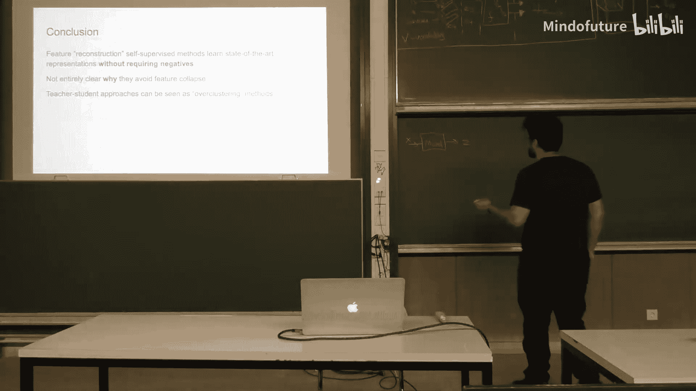
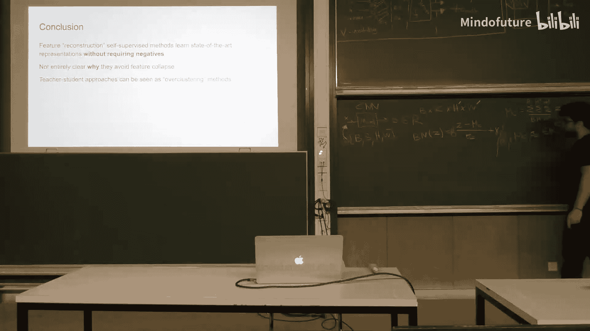

# 【Hhu Dusseldorf】表征学习 ｜ Representation Learning Msc Course Ss2023 p10 P10_W07.1_无负样本的自蒸馏视觉表示学习_BYOL__DINO_第1-2部分 -BV1RPZwB6EJZ_p10-

Okay金。Today I promised you a small overview。It goes you ask。

How all those different lectures we had so far in the course are connected between them。

So we decided to slow down a bit。Try to focus more on understanding what we've already seen rather than。

Giving you more and more information。But in the end， we'll end up with a new topic。

 which is the next step so far we have reached。All about how sinceclr works。

And this loss function and the bad size and correspondence to negative samples。

And I will go one step beyond that and see how is the state of V art met the latest year。

Do selfupvised presentation learning。On the visual domain。

 but without being dependent on the bad size nor the negative sum。So the first part， okay。

 some credits， this presentation is based from some partially and some slides from a CBPR workshop。

From spiritual and and。So we'll begin with a small overview of the Sunupervised methods we have seen so far in vision。

So we saw the pre staff。Of auto encoding。Denoing specifically auto encoders。So we have the data。

 we had some noise， and then we tried to reconstruct the。诶。They initially must。

So thetuition was that this intermediate representation between the encodeder and decoder。

 which is called bottleneck representation or intermediate representation。Will help us。

 which will let some underlying compressed version of the data and we can use this as a downsuit task。

Even though the concept looks。第cent。In practice， it's very hard to learn any important and relevant representation for different downstream tasks。

Why， because we cannot guarantee that the model will focus on the high level information or otherwise all the semantics。

Which is staff dependent or even specification。The the class。 So here are the D。

So it's very hard for the model to distinguish between what is the actual。

Noise in the data and what is the signal？And as it saw in the slides。

 we say that low level statistics or cues are sufficient to distinguish between these tax and reconstruct visit。

Okay， then we switch to more。Hight tasks。So we saw polarization and the gene task of predicting the actual values of some parts of the。

诶。In painting or。Yeah， you can find it as in banking。So here we ask for the model to do a much， much。

 much harder task， gene task。So we remove some part of the information and then we are trying to predict this information。

Orim we predict like a square or any mask based on the amount。

And we saw that the L2 reconstruction loss， so the mid square arrow is always producing。

He's not even performing when。On the generative task itself， it's produced these blurry predictions。

And then I present some methods with gene avers networks and additional loss function where you can。

Make the predictions more realistic。But it doesn't guarantee anything related to the relevant features that we will learn for this task。

And most importantly。We ask the model a very hard task with a lot of useless details regarding。

Predictive learning like regarding the next step would be the downstream task we use these representations。

 but these representations。Have a lot of useless details。

 so the model needs to extract color boundaries and all this stuff， but for the downstream task。

We don't really care about this， this is a generative task。So model these methods。

Were initially proposed， but never reapplied in a big scale， why。

 because the underlying learned features do not correspond to any understanding of the image。

So first go there any questions？Then we say， okay， aliens applies some transformation and try to predict this transformation。

 we saw the best one with a wider applicability was this rotation prediction task。From 2018。

You also implement this in the exercise。So the situationtuition here is again that we learn to recognize some high level。

Concepts like nose， eyes， hands。呃。But， also。There is no guarantee， there' is no theory behind it。

 there's no information that this will lead to actually as a depending。And for。

Around onema is on the wide， maybe this rotation doesn't even make sense you can think of ennemas with an orN。

 for example。sliceliced oranges， no matter if you rotate it and you can predict the rotation。

 doesn't mean that you learn anything about the oranges。

So there are a lot of counterin intuitiveitive examples。

So then we delve a little bit in the information theory and how we can approximate maximizing the neutral information between two or a lower bound of mutual information。

We we， we saw that。This contrastive loss or annexed。And extend。你是。Like one objective。That。

Pushes together a pair。So instead of trying to。看ま。Different taskss。We create fair。Okay。

 there's how do we create the pairs？We think。Views， we take the lays。This elephant， for example。

 and we create。Two different views。Areby applying different？Sttoastic transformation， we saw that。

In this regard， cropping and littering are the most important transformations。

So we moved to the pair level and then we played with the basicallywi。In the feature space。

 so in the output of the encoder。We have all of those features coming from。Positive pairs。

 so views from the same image， and then we try to pull them together。

And we saw that these results in a feature space that all the images are uniformly distributed。

Much more than in the supervised case， and in parallel that the views from the same image are pretty much aligned in the feature space。

So the views from the same months after training this model for。Quite many apple。

These features are aligned in the feature space。The positive。Bs。So they're used on the。Yeah。

 recommendations for the same units。So what is the limitation。

 which show a lot of limitations regarding the batch size and the negative samples where we saw different techniques。

To come up with solutions like this。Momentum and code approach where you have this。

Ce this dynamic dictionary with small batch sizes。All right。So the program here。

 as it shown on the right， there is impossible to know。诶。

What are it's very hard to define the negatives we randomly sample the images in the buts or in the cube。

 but we cannot actually guarantee that these images are negative， why。

 because we don't have the human annotated information to tell that too。Explain to explicitly tell。

You should push away。This pair of views of a dog。With respect to。

All the images that don't have this label like cuts。Airplanes or trucks。ok。We saw this spark。

 then we touched upon another topic， which is known distillation。

So this seems a completely different direction from the last lecture and I can definitely understand why。

So what is known distillation？We have a case one model， if we have one， it's usually a big model。

And we have。And we try to distill this model to transfer the knowledge of this one model into either usually one smaller one either。

We have like one big model or as we call it an ensemblble， so a collection of different models。

 and we're trying to transfer this information to one single model。So this seems completely。Distance。

 distant from in the beginning from what we saw him。How it is related to contrastive learning？嗯。

We saw four different approaches and I won't go too much in depth。

 so the first equation is from Hton， which basically takes the cross entropy。

Between both between the real labels and the soft targets。

 which are soft targets are the predictions。From the teacher model。with different temperature。

 different weights， and then the second one is what we did in the exercise。

 we opted for k and divergence。With the sub targets。

With different ways between crossenttropy from the real labels， divergence。From the。

From the pretrained teacher。So this is the most。General。

 a simpler way to use knowledge defffillation， given。

A pre traineded teacher with a head that outputs the number of classes that we want。

Then we saw that we can also do contrastive learning， even with one or multiple teachers。

 So instead of having。Views like augments of the same events。We now use the， let's say。

 the teacher and the student we push their features together on the feature space。

 This can be implemented with one or multiple。Pter。So it's again， the exact same objective。

 contrastive learning， but now we don't push together。Views from the same image。

 but the representation from the student and the teacher or multiple teachers。

 and then we just sum them up。The third was really the two latest approaches that I saw。

Focusing depth at the moment。 It's just that I want to。

Reemphasize that it's particular to vision transformers。

Where they find out this finding that we don't take the soft targets。

 so output of the teacher plus soft match， you also take you only take the arc max。

 so the output distribution that is the output from the teacher。Again， with the supervise。地址。

And the last one， we will see this more closer to。The latest state the art supervised learning。

 but for the moment we look folks on that， it， it's called master us modeling and we'll see in depth in the next lecture。

It's also related。Specifically to vision transformers。All right， so now we have these two。

Initially unrelated topics， and I will try to bring them together some supervised learning and knowledge selection。

Yes。So。冇。At this one， the sites are the same。And why start taking right。

Special opinion about this student， because。size is the same it's just another that rotate be different it。

Yes， if we have one teacher， it's typically a bigger teacher。Otherwise， if student and teacher help。

It's exactly the same network。We have seen that。By simply taking multiple random of initialization from the same model and trying it for n times。

 you get a significant improvement on your data and then you want to。

To transfer this improvement to one single model so that during inference instead of having to take。

To process these image end times。As many details as you have and then take the average。

 you pass this information to the student。Any other questions regarding knowledgevic ftillation？没。

So let's try to imagine。Let's try to draw some connections between knowledge distillation and self supervisorvis learning。

So now legislationation assumes that there is。A pre traineded teacher。

 either a supervised train or Sunsupervised train。And we take this contrasted lot but let's say in the beginning。

 supervised pretrained teacher is there and we try to pass this information from the teacher to the student。

 that's why the sizes here are different so the teacher looks bigger。

And we saw these different loss functions and approaches。

With cross entropy from the soft targets or k divergence。And then you have to balance。

Between the two loss functions。🤧。Another thing is that the input to both models。😊。

Is the same either if we use augments without augmentation， so both models。See exactly the same。地板。

我没你在哪。嗯。The student is typically smaller。And。Students are classes teacher。This。

This would be the ideal case， but it's not really happening just ignore inspiring。

So now let's go to selfupvised learning。So， here。We haven't talked about any specific approach。

 but we will， but here we assume。That there is no access to a pre train model。

 so there's no teacher to begin with。But we will。Our purpose trial will try to create a teacher in parallel with the student。

 this is what we saw， what was happening with this exponential moving average。If you remember。

So this is a very like a very important principle of selfupvised learning without negative samples。

🤧嗯。And here， the student and the teacher have access to different。Information。

 so the teacher has an advantage because it typically receives a larger part of the information。

 even if they have like。Different stoholastic transformations。

 different augmentations that teacher typically sees。More of the eight months weeks。

It can be more confident and more has more information to predict。What the actual output should be。

And。By。Working on like by a comparatively having like a slightly better teacher。

 the student improves and then there is this dynamic that the teacher improves a bit。

Because the teacher is in international moving average of the student。

 and then the student also improves， so we try to create this dynamic where both models are improving through training。

 even though they have the same size。So now。What we're going to do next。

We ignore everything that we learn on the contrast of learning。

 but we still want to do augments of the same image， so just the input is the same。

But here we define two networks， the student and the teacher， in the case of CCLR。

 this exactly the same network， so there is no difference。If you remember on the list。

 was the features。Z I and Z J， the loss function come from the same model。

 so there's no distinction between student and teacher unlike now。And here we have to decide。

Which those function should we use？What teacher should we use， I gave you the answer。

What would you use as a teacher？Now that there is no pretrain teacher。It's a difficult strategy。No。

 we use this exponential moving average of the student wage。

Of the parameters of the students will act as a teacher。

 even though it's not like a real teacher as a knowledge distillation， but it's pre。

 it's like a dynamically beat teacher。I can mean。Over the different student weights。

 over multiply duration。And then the question is。What loss functions to use。

 how to make the student outperform the teacher？嗯。And so。So how to build the dynamic teacher。

 we take the exponential moving hours over the parameters。This hyperparameter alpha is usually 99%。

 and the larger the alpha parameter be the more。We up。The previous mean。And down weight the kind。

Iteration so for the current mini pad， this is the update from each iteration for its mini pads。

Any questions here？Yes， sorry there is no teacher， but we are just establishing that we。We call。

The teacher， the dynamic teacher， is an exponential moving average over the parameters of the student。

Yeah， what are some typical value for also？Thank you9。5。So the teacher todays the same。

 stays almost the same。The parameters of the teacher face the same。

 but the information the teacher sees is。Better so he can probably have some better prediction。

 but there is this dynamic， I would like you to understand that this dynamic that both networks are improving。

The teacher is improving because the student is improving。I also have some plots regarding that。

 so you have to imagine that both networks。Iprove。Otherwise。

 we cannot have this ideal dynamic modeling and this relates to some literature。

 I have some references that says that model outing or mean teachers。

They to show improved results and there are different applications。

In other massive deep learning domain like reinforcement learning。

 some colleagues of mine told me that this idea of exponential movie gathering produce much more stable results。

Okay， I can read this one。And we also already saw that in the case of this momentum encoder， moco。

 so exponential moving out， momentum encode， momentum update。Everything is the same。

 it' just this the previous equation， the connaser moving out it's over the bar。

 it's just people call it with different names。So we also saw that。

Here where we have this dynamic set of keys in the previous lecture。

We also need to have a dynamic version of the encode there， otherwise this method didn't work。呃。

So a dynamically built teacher。It is enabling us to do much more consistent and better predictions。

 this is like the bottom line。And this is the dynamic that I tried to explain yes。

We ought to go to take some languages， but if the teacher is large effort。

It's not a large network of it's the same size。In to do in order to apply this formula。

 both models need to be identical in terms of that。We take average large。担啱先。No no。

 this would be knowledge legislation so I'm transitioning from knowledge legislation to selfupvised learning so now the teacher is the identical architecture randomly initialized exactly as a student。

But the。It's updated using this EA。And this is our efforts that。

Shows that this technique produces improved results。

So this is a dynamic that I was trying to convey to you。So even though we start with two models。

We give some small advantage to one of the models， so the teacher。

 even some initial small advantage in the prediction。The student can use this type of supervision。

 this signal to copy its predictions because the teacher sees more information。But in the end。

 only the student model is updated with batch propagation， like if we break it down in three steps。

For each mini box， for each iteration， only the student。Is improved with gradients。

So with back propagation based on the loss function， I haven't talked about the loss function so far。

And then in the third step。😊，These two steps is happening for each iteration。We update the teacher。

Okay， if you have any questions about this dynamic？This is what we call self distillation with。

These teacher among those yes， is then any point if the student gets？the teacher perform wise。

Even after。After training yeah or after doing the extension moving averagebriage and updating the teacher still I have some plots regarding this dynamic but they both improve yeah the question is do they always improve like somewhat？

symmetrically， at one point if this student is just much better than the teacher。

 would you maybe just switch roles。Did you say like okayy。

 the student is far ahead and we just kind to spot now now the student is a new teacher and yeah actually the student。

It really depends on the specific metal we have to talk about specific metals。Very generally。

 the student never gets significantly better。It does that。Both networks improve。

And with this parameter alpha that controls。How much the teacher is updated， it determines。

How fast this involvement happens so with this hyperparmeter， of course。

 if you set alpha to 50% it would be very unstable you know in the beginning。

 but even you know from an alpha of 99% to 98% this this。

This equilibrium of this dynamic would be even much more unstable。The lower this hyperpar is。

The faster the training happens is dynamic， so there's a connection between this hyperparmeter。

 this dynamic。But we'll see this in practice， but for most of the approaches that I'm aware and I will present today after training。

 if we want to use the presentations of these two models， we use the teacher。And。

So we'll talk about two main approaches， two main favors。

 so this one is called bootst your own latent， late in means basically embedding space or representation space。

Or in short the version is B all。嗯。So here there are many things happening。So so far。

 this part is exactly the same as CLr， we have this。Pretrain backbone。 We have this projection hand。

 and here we will compute the。The contrast loss。Or without stopping the gradient and everything。

So here they do， let's say we use CCLR as a baseline。We we performed three changess。First。

 we have this momentous EMA。😊，So this equation again exponential exponential moving out over the parameters。

 both for the projection and the backbone。西讲。Okay， yeah。 of course。 the teacher has access to。

More information。Third， the teacher is not allowed to learn。

 so here you could do how to dot detect or with torssnogral type or whatever。

And we have the projection， we have this output here。

And the third or fourth change is that they have another MLP。So explanation moving out。

A second MP on the student side。And stop gradients is the first。Method。Sorry， yeah。

A Park teacher has more assistant formation。し。Thes， yeah。

 we can define that if let's say around drop， that the student can see or。From 5% to 30%。

And the deterancy from 30% to 100%， this is what we would do in the exercise。

 but I think in this war。They just do two random groups of the same size。

It' just that I want to give you this indication of。The advantage of one the models。

And even starting from parameter of initialization。

 they saw some initial improvement in this dynamic， this is not the late。The latest approach。

 but this was the first one that showed that。We can do directly。

Se supervised learning without relying the negative sound。And contrast loss。

What is not shown here is here we have L2 normalization。

 and here we have the min square or cosine similarity。As we directly。Optimize。This objective。

 which would collapse in the case of Scl。Okay。And other things that。Here， they also。

 since they load this data in the memory， they also switch the data。

 they perform forward pass and then they calculate similarly and then use the average of these two losses。

Li really원 테크닉。And why is the second。培养的。唔三。We we'll talk about that。

The short answer is that if you remove。This component， okay， if you remove this component。

This stop gradient and you enable gradients here， this will collapse。The same for these MLP。

And there are。Contradictive opinions to whether this is necessary or not。

In the initial work here that was published on Europe。

 they say that this is also the third component that doesn't let the model collapse。

 but later some people removed this part。你我就变人 collapse。

So the top gradient around this the second MLLP， this creates like this asymmetry。

So it so if this doesn't exist would be an identity。

And this would lead to collapse and this is since around to we initialized。

It will never have the identity as an output。You know， in the beginning as it's trained。

And the short answer is that these two components enable。Enable you to avoid。

Collapsing all the all the representations to one thing So all this its a bit like the centering。

you have in the paper Yeah， we talk about that。挖0里。They achieved the same outcome。

 but with different ways。Another very。Tricky component is that inside these MLPs。

 so we saw that MLPs like linear layer activation。linearar layer， so typically2 layer。

There is also a one dimensional bus normalization。So， even though。These two representations only。

Refer to those two images and there are no negative， let's say， in the loss function。

Some information regarding what's happening on the miniba is incorporated inside this path normalization block here。

And there are many works that removed。Again， contradict opinions， but if you remove this。

B normalization。Inside this MLP， this model will collapse again。

 there are cases where it can easily collapse。Insofar， there is no theoretical work unlike CLR。But。

It works。It worked， I don't have the results。嗯。So the first component is again。

 the exponential moving average that slowly evolves。The features。We already answered this question。

 the main components are here， you can see on the table they try different combinations and in these three scenarios there's usually only one difference。

So here they remove the target network， so the target network in their paper is this。

Additional MP as co predictor。好啦。No predictors is this one targetrget network is the teacher。

SoSo here they remove the teacher， so the experience are moving average collapse。贴了一部的。

The second MNP。With an exponential moving average， so compared to this model that work only one difference collapse。

And then， both。个蓝水嘅。嗯。Anybody here。So we as symmetry。

Refers to the additional MP what's happening here。Not theoretically。

 but in practice doesn't allow the model to collapse。And this is what they write in the paper。But。

The teacher is not updated。With respect to the loss function。And this。

Kind of give some situation why it doesn't collapse。Even though there is no overall。Understanding。

Understanding theoretical justification。🤧。Any questions here？O。嗯。So so far。

 let's say there's no advantage between the two meditationation pipelines。Do have any？

You have two augments。To two view， you create two views。

You pass this information from student and teacher。Then their corresponding projection。

The first time to speak。For this one， you have another MLLP。

Then you do L2 normalization basically cosine similarity or mean square error。

After aloonization plus mean squared error， which is equivalent to cosine similarity。AnyQu so far。

know。So the conclusion here is that even though。Without explicitly。

 explicitly requiring big bad sizes and negative samples。

We can train by reconstructing the features from the teacher model。

 which is the exponential moving average and learn much better representations at SLR。Second。

 even though。We don't require。你嗰啲。This method they present called beol is still。

Sensitive to the bad size as simple， but in much smaller。

Bat sizes so you can even train this model with a much smaller batch size。

 so it's less sensitive to the bat size， but it still requires a sufficiently large batch size。

 like 512， yes。N what do you refer to negative。So negatives in the case of the sameLR loss is the denominator。

 so basically all the similarities that do not correspond to views the same image。

Even though we don't really know。小凡儿。At least from the theoretical perspective。

 why collapse is avoided。We still need the baths。Because as I explained。

 there are some modules inside the MLPs。Essential bus normalization。诶。Baby could be nice， okay。

Does everybody know how bad normalization works？UI。We get this information from the whole box。

So we have motion。嗯。Okay， let's discuss the case in both a convolutional neural network and an MLP。

So if this is a convolutional neural network and this is an image。

 what is the same here of the output？So。We have。B size。Times。Some space dimension。Save hate。

So in the beginning， this is a CNN。So。The original hidden width。

ItDoesn't correspond to this high and。Of course， the spatial dimension are reduced。

But there are still。There。So each convolutional layer。Lly reduces the spatial dimension。

 increase the tunnel。To use this format。Let's say I would use this。

Notation to distinguish from the initial。Space as they mentioned。Here we have font size。

Breaks on it necessarily because we were talking about natural limitation。ok， how。

Do we leverage bats information for bat normalization and what does it do？So bottomization。哦。谁。

Would be。嗯。ビは？诶。So here we have some first order statistics， the mean and the standard deviation。

That are computed from this。单就。ok。嗯。So the question is。Which dimensions？

We use here to compute these means and standard advantage course we use everything。

It's a single mean， but here I have the index of C。

 which means that we only take the average over the baths and the spatial dimension。

 so if we have here 128 channels， we have 128 means。So I were shortly right， but。故意。You buy。是谁。

So here we get since we don't take the average over the channel dimension。

So basically here we allow each channel to have different means。

 so we don't want to mix information from these different channels。

From the convolutional Internet network。你是。Common technique until the latest years。So this M of C。

And these hunger deviations is concluded respectively。涉隔别咁。So they are vectors。

And its dimension has its style has its own mean， and these are the same。The same shape。

They have the same shape， these are just trainable parameters。

So based on these mean and this standard deviation。We use the information from the bats itself。

Inside those blocks。So these two blocks。Okay， the backbone， if it's a resonnet model。

 it also has some personalization， but even if you remove the personalization from here。

The model state collapses。And。This is how。The notion of negatives is ejected。But it doesn't happen。

 It happens explicitlyliically， so we don't。Really have a loss function that has any negatives by itself。

 but in order for these two representations to be computed。

These Q of Z and these two representations。Are dependent on bus normalization here。And thus。

 there is some connection to the mini boxs。Is that perfectly clear now， any questions？

to the last part。So now we talk about。Specifically。

I think two years later after this initial protocol called be all。

That was proposed from a Facebook AI research called Dino Distillation Without labels with no label。

呃。And how they managed to。Adjust the previous method。嗯。So instead of having a second。I will be here。

They modified the teacher side this time， but both approaches just try to create this asymmetry to avoid collapse because if you。

Just exclude all these parts。The model is。It's going to collapse。

 it will be like one presentation all the time for only。

So we removed this MLLP that was called predictor MLLP。诶。And the second thing。hi was very。

 very counterintuitive when this paper came out， was that instead of staying in the similarity between features。

But since I was doing， what we all was doing。诶。Even with or without negative samples。In any case。

 both approaches worked。On similarity of positive pairs。And now。诶。为。Let's say try to。

Classify of the features in some sort of。Classes。Yes， I choose remember。Yeah。

 we talk about that as well。诶。the short answer is the sum。

Over clustering of the like some multiple of the real number。Of ground truth classes。

 so if you have like 100 classes。Somely of。你是说单。I was about to ask the same question。So here。

Instead of having an MLP。Or whatever network。And maximize similarities in the feature space。

We have a soft Mac which means that we need to assign。Features。To glasses。

So this is how you can go from BO the previous method to what is called Dynno。

 so first you need to remove the predictor here。Second。

 you need to add cross entropy instead of min square error， again。

 min square error with normalized features is exactly the same as ofine similarity。Yeah。Here。

