# 【Hhu Dusseldorf】表征学习 ｜ Representation Learning Msc Course Ss2023 p14 P14_W09.1_多模态表示学习__鲁棒性与视觉异常检测_第1-2部分 -BV1RPZwB6EJZ_p14-

ok。Today， we talk about。Multtimodal learning， so far we have seen how we can learn representation from natural language。

利的。Without labels。And also， we spent a couple of weeks。Emphasizing on contrastive learning。

specifically for natural imies， so we show how we can learn。Theyre quite good representations。

And natural advantage。So some of you may be wondering， is just vision and language the only domains？

Aren't there like other domain verifications？诶。Yes are。And you can apply。

Different types of like bird style retraining， so basically masking sequences。On all the obligations。

So even though we only stay on vision and language， these are like white。

Generally applicable domains to other。就 other。Et based domain。some example。三千万。percent。

And I've in the last weeks。We will also transfer the ideas in principle from natural languages so plain。

Human generate text。Model biological sequences such as proteins and RNA。然后。These ideas。北。

So today it will be something between the two world， so we're trying to combine information。

Comppare data。We call multimodal， so in our case it would be combining information from natural language and vision。

But in。This approach can be applied in any domain where you have like。

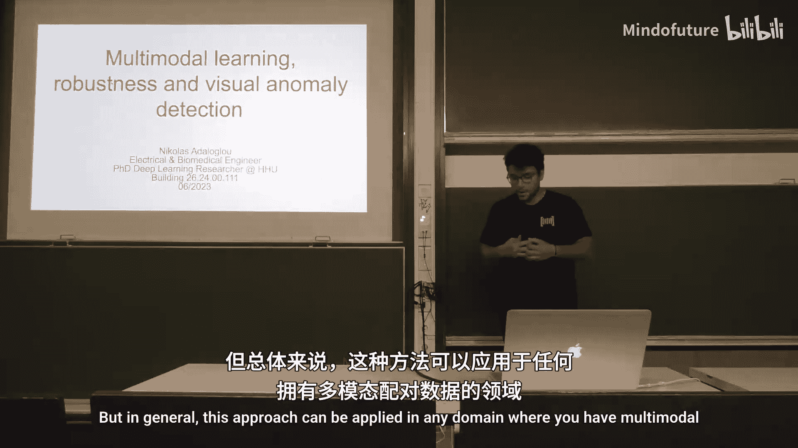

Model paired data。嗯。And in the next， in the last part。

 we talk specifically about visual animal detection。Like a new duck。So far。

 we have seen three different approaches， so the other one was called Dyno and you have like this。

Disriminative based task。By the last in the last lecture。

 I also presented some math based approaches for vision。But now we to do something different。

In order to give you some motivation， I would like to emphasize again about the discrepancy between。

Taking to pretrain models and evaluate their learn representations using linear probing。

Which is a plot on the left。And using fine tuning so basically training both the last。

ML be of last fire with the pretrained backbone。Reデ。And there is a big discrepancy between。

These two evaluation metrics even on the same task。ifying。One even like the。

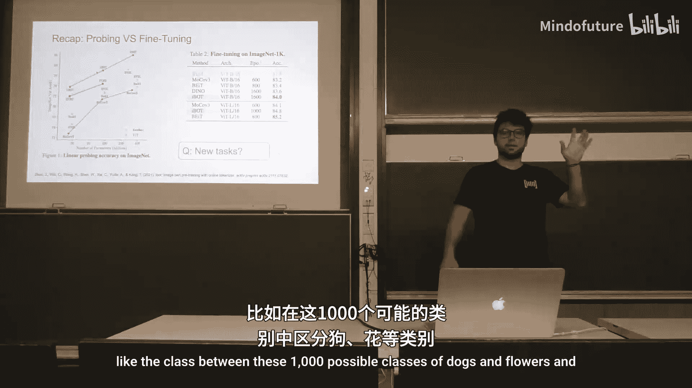

With1000。Cllasses of dog and flowers。我这边。So， this motivates us to。

ItMotivates us to ask ourselves a question。How generous。Is this。

The presentations that we learned for this specific classifier， okay， it works from emailma's depth。

But how general and how applicable would be to other domains。ok， we have some。Evaluation。

We want to know more about。the models layer。We also talk about a lot about the investigating learn。

So based on that， we will make a small B tool。Well talk about。嗯。三诶。不然。本。

Different topics we will define。Also even for the periodview。

 let's try to introduce some ideas over robustness and some different。

Data sets that are more challenging。So let's first start from robustness。

 this term was also really no Qity。In the beginning。So robustness。some vision。

It applies to it's a more general idea。So robustness is。A way to argue about。How the models。

 how their presentations？Are they meaningful？And there's some sort of perturbation on the data。

And here I have some examples。So let's say。during difference。

We are dealing with some data of the either mask blurred。Or with a very different data。

And the one that the pre training data is。And another thing we not emphasize so much is adverial attacks。

So， this means。To have like a very high level over。That someone who has access to the model weight。

见诶。Therefore， the same way we perform back propagation to update the。The model during training。

Given that they have access on the model weight。The same model that we want to deploy on notification。

They update not the weight of the model， but the input data， so they manipulate。They input data。

 the images or text。As to， instead of。Minimize the loss to maximize the loss。😡。

So they try to manipulate， for example， pixel information that is invisible to the human eye。

And in this way， they can re fool all these classifiers。That we tried so hard to learn。

So perturbation by itself doesn't mean anything。To define it with respect to some。So， sorry。

Or always defined based on the type of perturbations that we have on the data。

So we can define robustness towards occlusion。アネトマス。From vastness towards。Amentation。

Probustness towards。啊对。natural and shared。And robustness split per of times or robustness。

Is how much the performance drops。For the model， given that we apply some perturbation of the images。

 I that clear Any questions。So why we want to。Why we care about your bosses in the first place？

You can see all these are these kind of。Robustness documentationation。

 so theres some study from 2018。Let's say hang hold for the big layer。But you can already see。

From the bar lots。 So these are like three。For networks。The y axis indicates that。

Me correction error。So we corrupt payments in this way。We have these samples。咯。And you can see that。

So these three models are bigger and more bigger versions of like scaling up the model。

Not only gives you performer boost on Ima said like 1002。Percent。But it also。Reduces。

The corruption error towards only site of perturbation。So we can easily argue based on the metrics。

This larger version of renets。They are not only better。find the data。

famous as as well that sent by one or 2%， but they are also。At the same time。

They acquire the capture features that are。怎吧。で最こら。Any question？

This is really important for representation learning because the idea nows。To train and modern。

One a large and very diverse data。But actually train only once with a lot of compute。

And then reuse the same model。For。Hundreds of different applications。So this is。Thisす the。

The tipping point from the last years。Five years ago， things didn't work like that， we had't like。

For each task。Some sort of。Specialize。Was meant to be the best approach。And train from scratch。

but now they have。Big models they are also called foundational models。One year。And we trained them。

让他的就是。讲见。They train them once。Da the computer。And then， we。We tried to leverage。vic。

So we want these models。To be robust。All these type of perturbation， ideally， Yes。

 the nurse here like limited to a specific domain me。Dealing with natural images， on the same domain。

 but on hundreds of different tasks like instant segmentation。

 we talked about sematic segmentation on segmentation。诶 sent out。

Acounting or personal identification。食交 doesn。Ba。We didn't find Congress with us。え？Here。

It is different。哋。On the different rows indicate。上不。From images of bananas。Different。Distributions。

 as we say， on different data sets。That constructed in such a way。

To be significantly different from the ones on email'snet。走一声儿。These are。

I would present this is like different renderings， this R corresponds to rendering。

And this is also some more diverse data sets。And。If you pret this re 100 one of a very large model。

Trained from scratchs with supervised learning on E。It took perform。Poly on the other here can see。

なです。We usually measure the before。Dereation， so an idea model would have the same score over all these data sets。

Because it's a model that needs to classify bananas。就啲一啲一啲嘢都会必佢。76。2 hyper。嗯。

And the worse the model gets。The less robust we say。

So we know that supervised pre training from scratchs leads to very bad。

Led to very poor representations。With respect to distribution。Because the model is incentivized。

To learn everything that that exists on the data set， just to classify。The current emailで。

Any questions？So these are present also in the end of the previous。

 so these are some very special type of images these are all natural andial examples。

So adversities that the model has a very hard time to record。三。But they are。

Natural with respect that we don't manipulate the pixel of those images adversarial。说。Areation。

你想 the model has never see。带住便问。实的例。他水。Andma this is the area real class， so it's like the photopher。

And the model is kind of always。But as the classifying， as Z hes with a very high。And this is。

These are two data sets called Ima and OMA that are really。Dic。Especially for supervisorvis。え。

This is the different renderings indicated by the descriptions below the linked。

So this's not the area glass it's just the different types of rendering。

So the model needs to bevariant。Two rendering， top， two different rendering。ビえる。没个人。This case。

This is the models we have presented so far in the course apart from the top ones we talk today。

 so this is a mass enboder， this is a dno， this is the iPo2 takes。

Die on the baseline and add this mask not modeling。

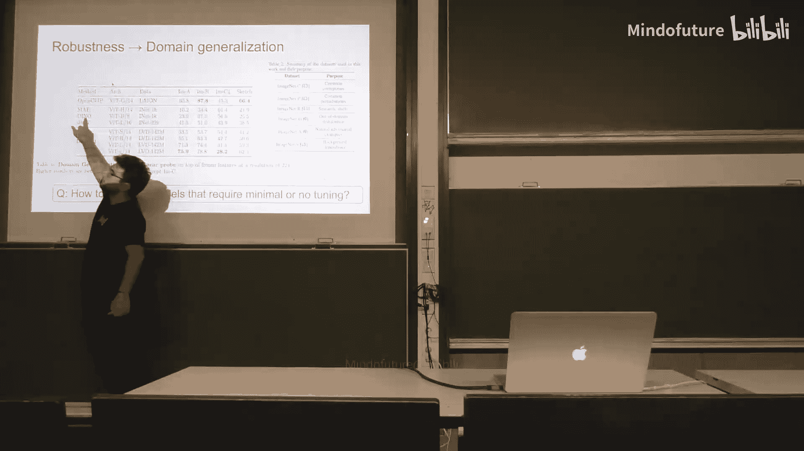

The parts level， try to。We must some parties let me try to。Reconstructive features。

And this is the latest state of the art model thatlies only on the visual signal。So。

 the second question is。Okay， we have some basic that， but we also want to know。

We also want to argue about this diverg。Between training。Lar Pro can just glass fire on top。

This's just fine to me。就叫我哋翻医生。But必是。Terminology。So the first one is called F short learning。

 what does it mean？

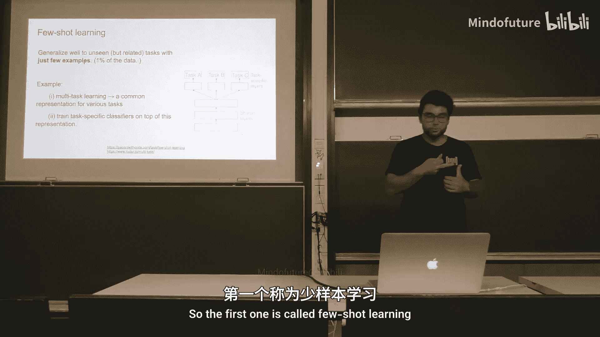

So it means that for the downstream task， we have a very limited number of examples。

So instead of having the whole key of。We have 1% of those data available。人。1% of the data。

So this enables us to argue about how these representations can transfer even with。

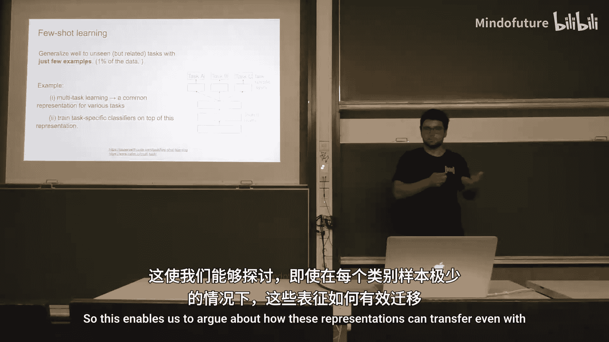

Samples per class。And。你卡唔到几时多。One very common approach that they have。Would be to。

Use this kind of pre training where you have this multitask learning so you have like。Some images。

 you can imagine the education of autonomous driving where you want。

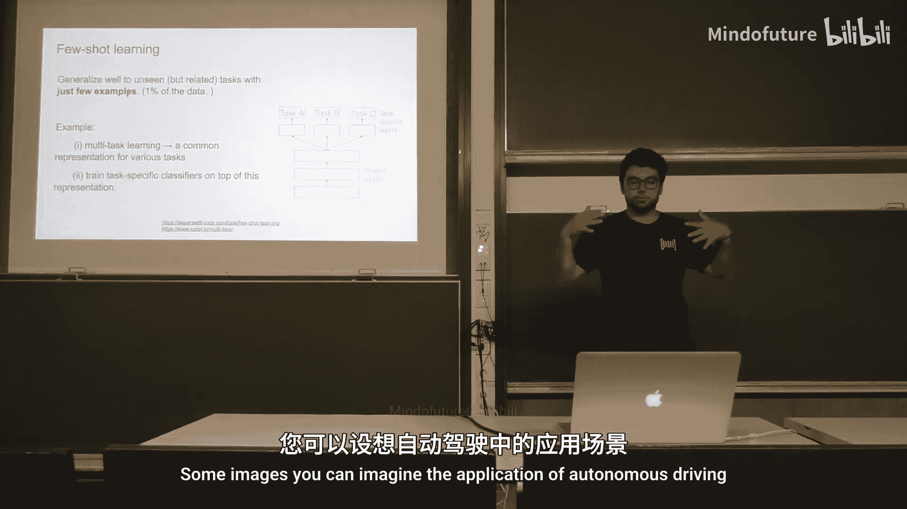

Identify stops。 you want to identify pedestrians you want to。Segment objects。

 You want to have the road lines。 So this is a type of。Mtiitas betraying。And。

You have some amount of daily date and you pre train on。Those costs。And all of those different heads。

You see here at Cascade as big as C， which are like specifically specific classifiers for its。やった。

S some layer。This is like there。I they all the way。我翻译。And then we have the zeros of learning。

So this is a bit more tricky， so you have again， a model in general that traineded with either supervis。

Sa supervisorvis。which has seen some。Specific number of classes or images。

And then you want to use this model without any cuning directly for testing to unseen images。

To do so， you need some additional information。As we will see。

 and this used to be in the past years and providing some context for。

so you need this auxiliary information。For example， anybody goes on the right。呃他Q。什 month。

That you try to mockp those images。So， if I要。One。On this。Indicate that thisus has a tail。

 and then you try it。come up with a way to。馒头差。2 classes。But in general， super。

Both supervised and self supervised。Stragging with。所 learning。

Whi is the way is what I think would present on multimodal。不少了。

So the approach we discuss today called P。This is the abbreviation in this。

It means contrastive language image。Language image it means that we have two domains。That's your。

Contrasive stands for the contrastive。You have seen already。え。

You can also find these in the literature as natural language。Explain how。你边嘅先啦。Or weak superly。

所 Iこに。关 me。看好。没得有责任。做睇点啊。Supervis learning。 And we have。看。

So this is a supervised case in the unsupervised option supervised case， you don't have this。

So in by naturalural language supervision。What we mean is that。We have诶。For balance of sent。

We have a syntax that refers to these demands so that they are paired。We don't know exactly。Where。意思。

With respect to the events， it just some。Description of one or two sentences。

It referfers to these emails， but we don't know exactly。If there is a class。等一下。Motivation。呃，理 that。

As you can imagine， this type of data sets in order to create this curated data。

You need to isolate the objects in the image。 That's why all these this image based。Da个 없。you say。

 so usually there's an object most of the time。And even on these data sets， you have a lot of noise。

 so usually you can have。Andimmas with a cut。Lying on the doormat。結か。明下。小蚊。

And then you have to give a single label， so you have to decide if to annotate it as a cat or as a doormat or as a cat。

So you have the site。You need a lot of workers， so these data are contains。TheThe largest。

Plic key available data。就是对。Has 14 million images。So imagine how many people need to war。

To an babies。Data one by one， like human， like manually allocatenotate all this data。

Apart from the fact that they have a little credit。对就少 glass。嗯。

And this is just the beginning of the problem because you will pre trade on this model with supervise learning。

でこいつか？defineine。Your own data， you need to build your own data。Traing out。

So the presentation is not readily available， as we say， you need to have like also downstream tasks。

Some data for the task， train ahead or。Like innerrovbing or fine tune in the whole model。

So this is a big motivation。And the second idea is。

The difference with respect to scaling between natural language and vision。水 natural language。

The scale of which we can train models across。Thousands of CPUUs。Billions came。

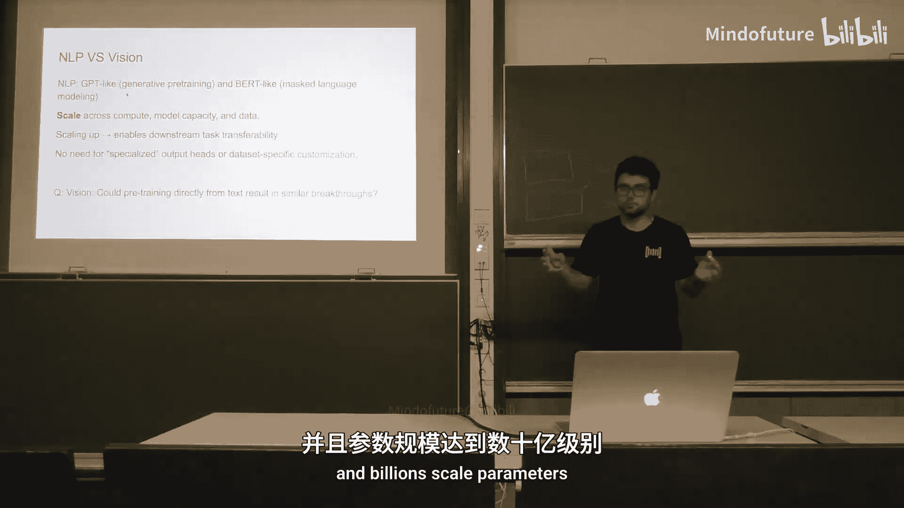

ビキ 바람。培样。I think that largest just。Model is more than。发应毕景不让。And even publicly available。

Why in vision？Just recently， there was a first video skate model。So the idea。Here is。How can we。

What would be a good way to move to go to scale up in terms of。冇得。By leveraging this。Nature data。

This type of data sets maybe will help us。Sca up the models even further for vision。

So， the idea is。Let's find pair data， we cannot have this type of supervision。问哋啲 we are going into。

As we say， images is on the wide， so imagess there exists on the web。来你。flicking。However。

 instead of a single class， a single object。😊，These images have sentences corresponding to。So。

 for example， here。对。We算的。It's like a description about somebody what wrote。

Do you have any about it for them。

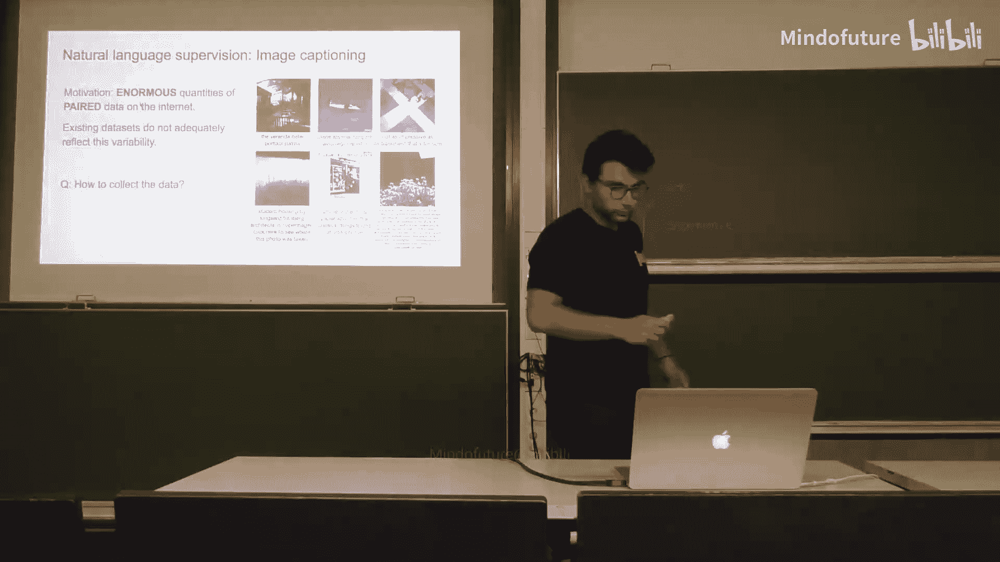

So we know that they're abundant。Daタ。But we can find。And they are pair， even though they are not。

notationsThat' why we call them weekly supervised data。Not really language。

And the additional benefit is that。Here we have a lot of diversity or variability on those things because we collect them on the wine。

We will argue about them very a bit later。So what they did in this first paper from Open AI in 2021。

次やるの。嗯。They found on Wikipedia， the most frequent。Querries， so the the people the。

The concepts that people sense more。几啊。500，000 topics。People sense。Wkipedia and based on this text。

They searched for images on the web。That include。These facts。No， you。Just pure sense。

And then they just sampled。一加六。Those data security say。We。搞搞。开闹声。P datata。ペ事書と。

They consider the queries all the topics that are。但是。in the Wikipedia， so what people。ok。

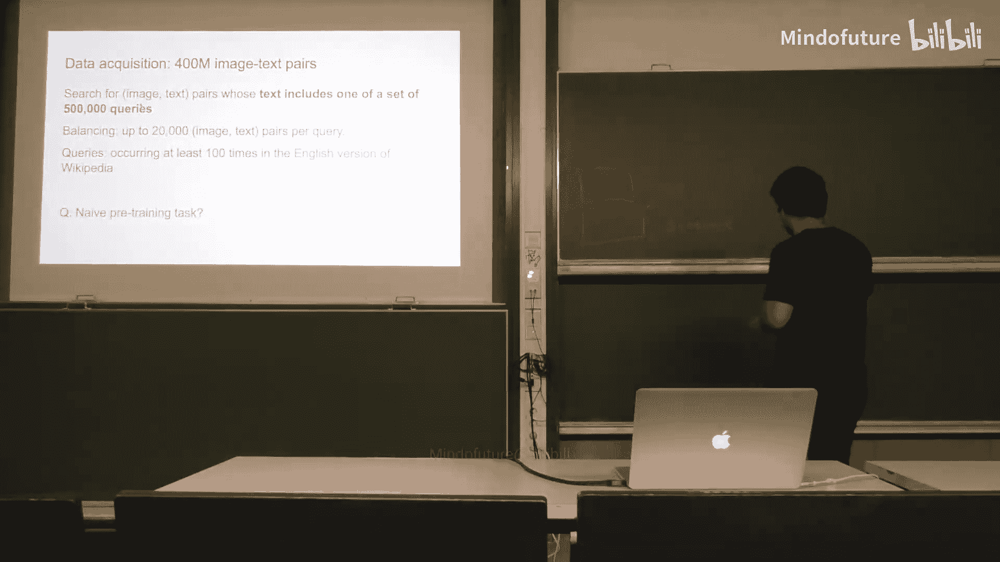

So let's say we have the data。What do we do。关关机咧。Biesiest cost，siest。Prett tasks to create。老地噶。

Do you have any idea。系。So the easiest task to be just to take the events。

Come up with some other or you talk about it and try to predict。对 the sentence。

This can be done again。You need to add some sort of。Different。Okay。

 you need to pass to the maximum sequence length。And then here you have。I board for the。

Where the maximum number of words is a vocabulary。have some vocabulary。

 and then you try to predict for example。Maybe you girls。So this would be the most。Niveively。でて。

So this solves the problem leveraging the data。We still have a model that predicts some classes。

And then we probably need to find un that some way for some dancing。So this was one of the problems。

上 the literature。This task is called image captioning。It's a very interesting task for。

People working on computer television。 So there are many people who don't want。

Have like a single class。Well meant that they want the description。そ域のとまり。To make different things。

 so ideally。You can imagine an application in medicine， medical illness is where you。

Ptomatic produce。Not这。I'll put the class。我论主目嚟嘅。Brain MRI MRI。Right， but we can actually。

Autommate the report。These models are usually encoded to。プologies。

There is a lot of literature on this task。Any care about any questions about the captioning us？嗯，他为根。

In the approach， we'll talk to Dave。う？不ろ。确定。The三。We directly work on the feature space。And user。

The weather families。Objective of contrastive learning or infency。所以第。就。

Initially randomly initialized encoders。No the go there。The开ature。

So the text encoder takes a sentence。As a sequence， so it's a small data transform model。

Vi transformer。For language and produces。诶。Prepresentations？一つ。Separate。Where。

So they more than basic。Presation would you like。Any in go。You can think of like a resume or。

we gives you。啊 sorryor。关你哋嘅事得。These different representations are for。

We only use one thanks for reservation。For the whole sentence， we don't have。Worwise。Preation说D1。

Corresponds to the first sentence。On the mini pads， T2 corresponds。The whole sentence。

So we want to aggregate all their presentations。How can you choose any。ですけど。Any mean us。The but size。

Okay， if this is a being transformer， this would be the output of a CS token that kind of has like an aggregated representation of the whole War。

Of all the wars in the center。So， we have。Different。

Tt the presentation which correspond to sentences。And different。Represent base。

Different images on the mini box。8。And then we compute the similarity matrix again。你这是。

We will need to redefine what is the positive and what is the negative。I indicated。

 but can somebody try to。Imag what is the positive， what is the negative， how many classes we have？

悲风。What do we want to maximize。て 빨리 the。To maximize the of day I don know want to。Toush together。で今で。

Emaages and texts that are paired inside the minipa dimension。

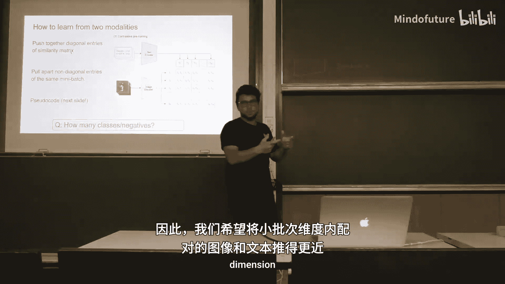

So the diagonal here are all the positives， let's say。And we。P诶 we pull apart then on。So， when I。

Z all on the element。你 you。Nomaring。He must taxpayers。I it clear。I don't know for those。

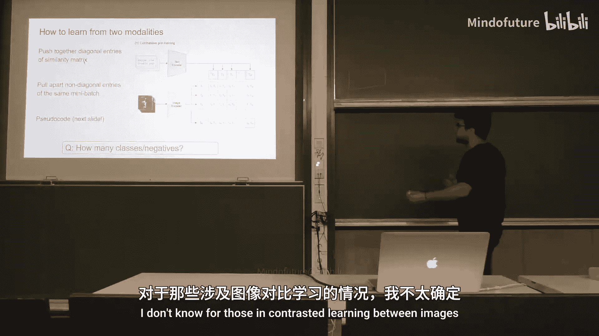

In a contrast of learning。びにませす。We excluded these elements。

Because this was the representation from I1。说的这。youは。And we find the specification possible。

Where we want to push together。Theresation from email。Different use。ok。If we go back here。

How many glasses。You know， contrastive learning， which kinds of contrast learning is basically。Right。

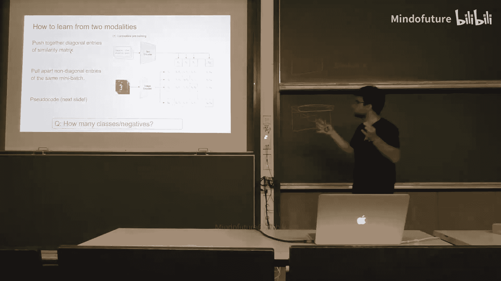

So let's try to much this as like cross central like acidplification task。So instead of load it。

 so the loadeds here would be again to the similarities。So one can be。继续打。For these roles。So。

 from one to。We can。 You can。 You can imagine that this is the。

Across central of the classifier where the， the correct class。In cross Central。

 if you pass the index of the query class here， we you pass the index。0。

 let's say it's like zero index。Yeahep。Ne to make sure that。A plus happens only once in the bench。

Can you repeat。you have only one image of a dog。And one ticks talking about dogs in the batch。

 So you match those and。Yes， and this would be the positive and this would be the negatives that we push away。

With contrastive learning， you can remember the denominator。There may exist some images， Yeah。

 there may be exist， but they don't share the same text screen。So yes。

 you still have the problem of the negatives。But you use a very big bad size to kind of。バラス。

You need about of 2000。The causal problem with contrast。So。BackTo the image encoder。

 this is a classification done。For each where we。We try to。

Like the correct class is the diagonal element， so from zero to。😊，えマ one。And for the tax encoder。

State of task with respect to the colons。So we want to match the facts。In the， in a feature space。

So this feature space also needs to be shared， we need to have the same dimension in order to take the dog。

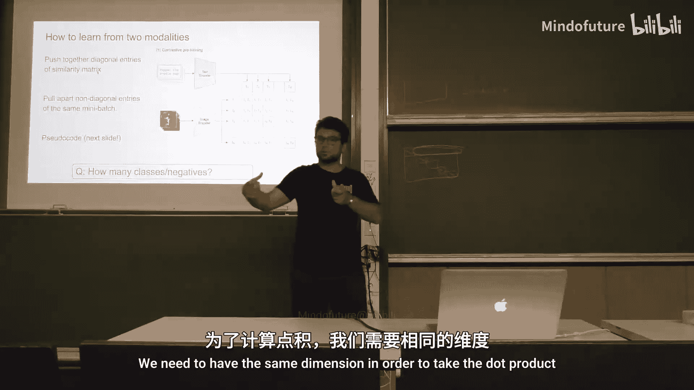

So independent of the image encodeder and the text encodeder， we need a projector。

You remember from CCA。看的。This was then go。And this was the NNP。

Where they need all these ads so that this is beneficial， and this was called projector。Z。

 so you minimize the lo here。But then you use those representations。So in our case。

 this would be the Amazonaz text encoder we want to use a。And here， instead of an MLP。

 they just use the linear layer because they didn't find。问你看。Different domains。

The domains they found that it doesn't really matter。有。

So in case you want to see the paper and the pseudo code， that's why you see this。Ccent be defined。

 So you can imagine this crosscentropy。With respect to the roles and the courtroom。

want to take the code。 and I also include。DP implementation in。See how they start implementing。

In practice。So one of the findings is that they did like a small finding essay say that they use a linear layer instead of penl P。

So the critic or the projector。just。So this enables us to use。

Different types of models and sizes for the text and Emmas encoder。So the baseline。So。

 here we go back to。Evaluating how data efficient。Model and how does it convert to different baseline length。

 So in research。Orpose something you already need to have like existing baseline。And for that， they。

 they use this。反能です。A train with with a task of fema captioning。 So directly predicting。

The sentences。就在。两忘然。Line correspond to。In 2016， that predicted。The exact sentence。This one。

Another baseline not really useful。 They just try to。Train the morning。That is this your life。

FromFrom natural language。And they don't provide a lot of information。W is more than how is。3。So。

 the bigger。This is this。4 eggs。是。On the on thearrow。So they argue that。

When they change the objective from predicting the actual text。To the contrastive objective。

 where you。Push together things on the feature space and pull away the positives and negatives。

It's the exact same objective that we use for natural limitss with different augments。

Instead of here， instead of having two views。For many version of an emails。

 we have the images representation and the text。现在是是。And we pulled those together， is up here？So。

You can see here how this model scales up。When the model is much more。Efficient。

 like sample efficient。The more。You go。upper left。Cs the curve， the more data efficient。So ideally。

 a model that only see， so here we have the process images during training。所以呢一啲。You know， you could。

双。You could train a model with seeing just a couple of thousand images and it。D啲。

There are follow up works。嗯，21个。They main profit。Is not the objective itself。

But the diversity of the data。So this4x data efficiency with respect to the captioning is really questionable。

I'm also not pretty for because they used a baselinetime from 2016。

 while they could use something more。Compistic。AndE's captioning。嗯。

So we have a data that isn modern in any case。This is the first。Motivationally。

 I said about scalingating up the model of the data， using more。

And the second advantage of using this contrastive learning。被熟了。

Is that you can directly use it without。Training a model thought to do zero shot。ラしけ査。好。We discussed。

等于啲心。Auxiliary information。You landing。So here， the auxiliary information。医三。ゆに？

So for its ST specification task。You just need to know the label。Okay。

 and what do you do with the labels， You have the deck and。You pass。Exactly the label as you see。

 but this kind of you compared all the different label or class names。😊，A photo over God。

 a photo over playing and stuff and so on。And using this auxiliary information of the label names。

You you don't learn you do inference from the text encoder。So a very well trained text encoder。

So I don't know if you understood that both of these networks are optimized during pre trade。

So after portraying， this next encoder has seen thousands of texts。

Are very likely to include the label names of the downstream dataset set that we care about。

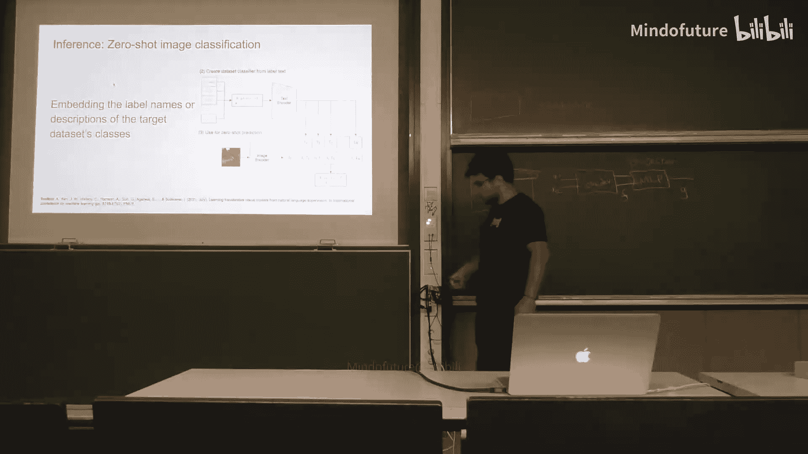

So you dig the label names。You do some sort of。落先咧。like having some of this。So， thiss fine。

This is called。B。You've probably heard about it。lot recently with all these T T models。

Which is basically you have。Moel， and you try to find tricks。ToForte the task。

In such a way that the model can give you the best post answer。In any case。

Using the label name to get these additional。微信。Pation。嚟。You find the one with a closest similarity。

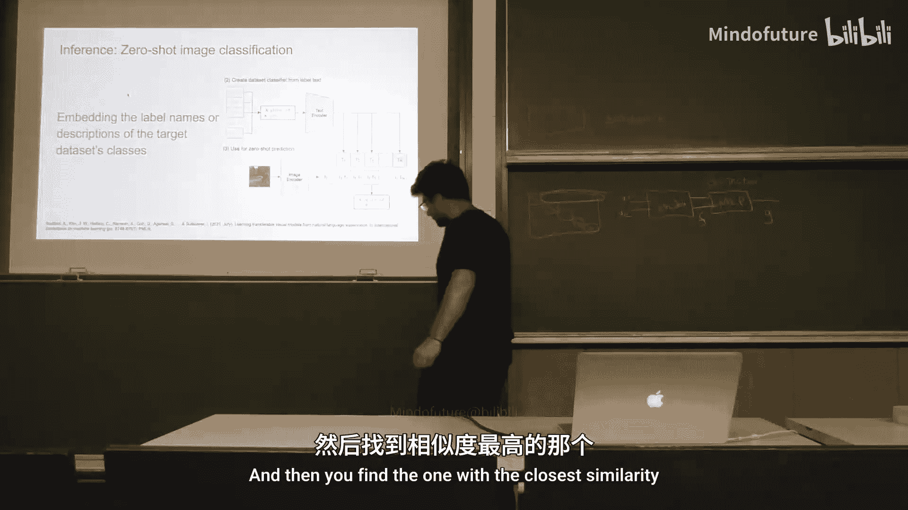

You take the payments， the test payments。And you see how the test demand。Basically， yeah。

 the highest similarity between the testing， much of the different possible text。

From the down street classes that the network has never been explicitly trained with supervised learning。

 So there is no。Had no classifier。

This is a presentation。This is their presentation。And you see the one with the highest。し来。

And then you can argue that this is the real label。对。We predict the class。

Without ever being training a model or fine tuning anything。Is it clear？So， this is。The core？Advans。

 I would say of using this type of multimodal learning with。点靓。W in this case， when we。

Where would predict。Description。To be very hard to。You pre traininging。You predict。The sentence。

 it's very hard to。You need to fine tune again the model and that， so I want really quick emphasize。

Like 100% care， what are the advantages of using？And here are some results。So this。Cars。Respond to。

The greenla responds to a very well configure prompt engineering。 so they play a lot。

How they provide information。SoFor example， a data set with flowers。They provide a description。

Ennemas of a label I， of a flower。A satellite photo of。没。Im from fine。我尔。A photo of the small。

Under then the label， and with these type of tricks， they are able to increase。The model perform。

And you can even combine。Different prediction。In a way， similar to model andems。

Different predictions。 And then you try to。Different bags from。Different things。

And then you combine their predictions。So this is some sort of。More than than sand。And you经。

We can have like a lot of improvement。So some 5%。Without even training anymore all。On the other hand。

This model is trained on or images that exist online。

If they are not representative of all the possible。One we come for the down that。And， for example。

 this one this is the。This is a difference， so this is like a bar cloth。

And it shows the difference between a supervised。We supervise。Reant， I think。There zero salt cake。

So this type of independent is a transformer。这这一年的就。以上し。

It wanted to see where this model performs poorly。Is that this type of satellite images？

This is a data where you have to predict how far away our。

