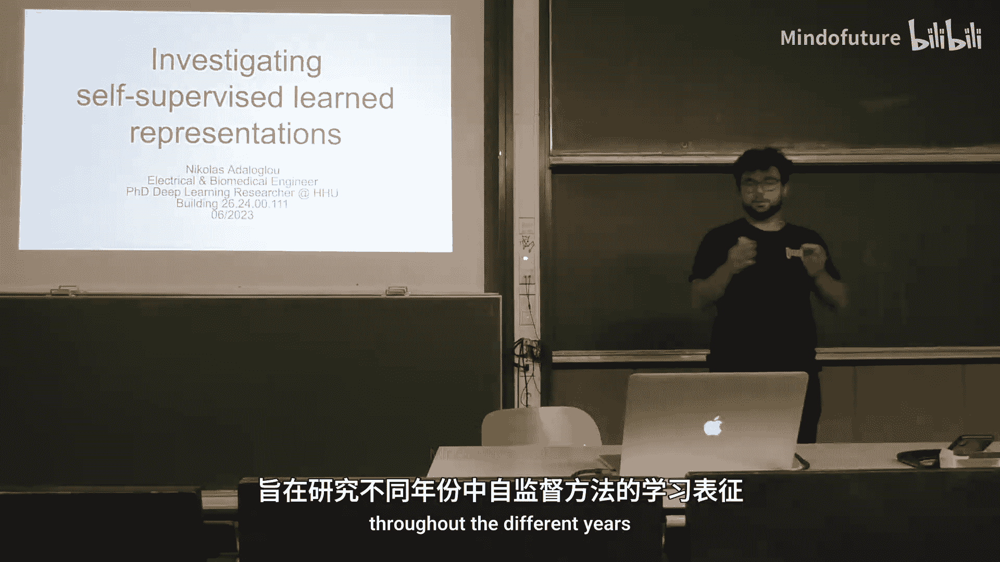

# 【Hhu Dusseldorf】表征学习 ｜ Representation Learning Msc Course Ss2023 p18 P18_W11.1_探索自监督学习获得的表示_第1-2部分 -BV1RPZwB6EJZ_p18-

Okay， let's begin。呃，lecture。不都。Like a small recap， we presented some， we tried to investigate what。

These keep based models or keep stands for contrastive。Language must be traininging。

Are actually learning and how can they generalize across different tasks？And how robust they are。

Different databases with different。Different sizes of data sets like cartoons and sketches。

And then we switch to supervisor learning。咳。So in the last part of the literature。

 this would be like mostly again centered in vision。

Will be to investigate and learn representation of C supervised approaches throughout the different years。

And then next week， we will move to biological based datas like proteins。And in general。

 biological sequences for those who are interested in this。representation learning on those data。呃。

So one small thing that I would like to emphasize， there is some recent evidence。

About the limitation of the contrastive language of portray traininging。

 so contrastive laws between different domains。So we present all the good things about the robustness and the analysis。

However。Recent research has。Is able to illustrate some limitation of those models regarding how much they understand。

呃。The text description， so they did some very small experiment playing with a text inside the sequence。

诶水近嘅。The position of the a team in the now。Or in this example。

 instead of the horse hitting the grass。The， suite is the next description。

With answer hitting the horse。And the model is not able to distinguish between these two and makes a lot of errors regarding this。

啊倍。And the reason is that this contrast pretraining。

 this contrastive loss is kind of optimized more about retrieving。

Hems as a downstream task and doesn't need to。It doesn't need to understand。

It doesn't need to understand the composition of languages that composes the text， so the sentence。

Because if you remember it aggregates。The whole he takes a series talking of the text encoder。

 the transformer。Which is kind of an aggregated version of those tokens。In the sequence。

So below what presentation for。For the whole text description， for the whole sentence。And last time。

I also presented。I think it was two weeks ago。嗯。So they have this type of。Baseline， so this was keep。

And if I remember correctly， different points in the plot indicated different。And。Different。

Let's say ats per training。So， here。Sa some。行。And here， say zero short performance。On你们ね。

On the image validation set and this was key and this was the baseline about the image captioning baseline。

 so they had a baseline of what I said with resonances regarding image captioning and they showed this。

非城时。Its a straight line。They show that these clip monitor are much more s efficient。

But there isn't the evidence shows that this is not actually true。So the reason that these。

These numbers were correct， what they presented， it was because this baseline were based on Resnets。

 smaller training schedules and other architectural designs。

 rather than the objective of Is captioning。So he must catch。呃，否则主动每个。

It's like instead of having the label。为其是内。B sister。

So this would be image classification and image capturing is a task。Where do you try to resist？

The tech description for E email， for example。In this case， we can have the horses using the dress。嗯。

So recent evidence shows that you can get comparing results regarding sample efficiency with pretrain based on image captioning。

And in cases where the downstream task requires this， as we say， compositionality of language。

 try to understand the order of the words。It's even。It even solves greater。

Like downstream capabilities and clip like contrastive base between。嗯。But today， as we said。

 we move on the ph of supervised learning team。Close with all the different pre trainings where you can learn a presentation。

This was just a small parentis。🤧。So let's start from the beginning。

 we have to consider between some some self supervisors supervised transfer learning。

 so transfer learning or less representation learning。So just want to exercise。

Based on different studies from 2021。When should we consider supervised learning as a good candidate for our program and our task？

Does anybody want to make a guess？对。To answer these。We will always think of。The free trainings。

Let's take downstream。Training data。多大。So the answer is that first。

 the domain seefted between the in supervised learning。

Then we will switch to self supervised learning。So， the first。

Based on multiple experimental results we would present is that you always need to consider how far away are these two distributions。

 so if you have like a very similar distribution，There you have like a lot of。

Reasons to consider supervised transfer learning。 So for now givenet。Ptraining in them。Scipher SN as。

But downstream， let's say， training based。In the other region， the other。

Incentive that you might need to consider supervised transfer learning。

Is that when you have very limited data samples？Or your' downstream task。So then they showed that。

Started from 2021。That this is like。Still a good。诶新活诶 let say。

It's still nice to consider supervised transfer learning。And we'll present some results。

So the second question is。How these self supervised， okay。

 they considered only convolutional urine networks。With a of standards。How do these pretrained datas。

 how they perform， not just on Ima specification on Imasnet itself。

 but on different downsstream tasks。So， we want to try to。嗯。

So let's say the preing distribution is imnet， so we fix the pre traininging distribution。

And we change the downstream task， the downstream data and the task。

 so we want to see how these features。As we say， transfer， not just a different distribution。

 but also different tasks。Because in vision， when we say computer vision。

 we're not interested just to classify images of adults， we're interested in many applications。

For example， the most common ones are retrieval。Object detection。Sematic segmentation。

 and we'll try to。Provide some intuition for different。Downstream tasks regarding this matter。嗯。

So the the general。Trent。后s。So for Is classification， it's the imagenet。So the performance only Mad。

Really gives you a very good indication of how the model will perform by classifying other image methods。

Natural images。However， when you switch to different tasks。

Especially the ones that require localization， as we say， for example， object detection。回事。

For companies who want to say that they'll take。呃。Draw like a bound box inside the da so we require some sort of understanding or localization of where the object lies in the image。

So this sort detection would look like this in practice。呃，你们。You have four coordinates， so usually。

This。2 points。So you have x1。啊。So this would be the。

If you're planning to work on these kind of tasks。So these two points。W to to indicate this。

To coordinateors here， so one can draw downing goals。And there seems to be。

A relatively low correlation on how these learned selfupervised features。

 at least the ones that they considered in this study because it's from 2021。

 so it was published in the area of2。The beginning of 2022 most of the big sensor from 202。

They found that there is a low correlation both for。Object detection and also for semantic even day。

Doesn't anybody know maybe from the deep learning class， what's the task of somatic computation？

anybodybody want to。谁 do that。Yes。是。从来都。Yes， so yes。So you have a segmentation map， usually。

It's called called dance predictions， So for each pixel。You have， like a label。

So it is great label from。A set of classes， say1 different classes。是比。你边我哋得。嗯。

So for this type of data， not data， so these don training data distributions and tasks。

There is a low correlation。Okay， and the last question， which is still an open question。

 it's just that there is a reason that they didn't find like。

A clear winner between suchupvised methods。So the answer is that there's no like one general。

Representation， even on the scale of those considered data sets。呃。

Even though the latest papers we presented the previous weeks， this Dino V2 version， for example。

Lets spray train on a lot of data with two objectives based on both。嗯。This crossantropy。

Of different views。And also for this mass image modeling objective。

Seems to be like quite universal for different tasks。So the last question is。Okay。

 we have some images。So we have a set of images here。一们。你们哎。稍微下么。Yes。对。So we have different models。

 so in this case we want to compare。Send supervised and supervise others。And we want to know， okay。

Here we get some representations or embeddings for those images。But how are those。

 what are the features left how does these features compare to the one that we learn from？

Supervised learning or from natural language supervision。

So this is still an open area of research and it's very hard to quantify how these features。Der。

That's why we need to find some downstream tasks that say maybe there these features work better。嗯。

So it's clear like they have all the existing evidences that there is no。

They learning complementary information， even though it's not hardly established。

And in this specific study， they also do some analysis based only on res。

And they say that the such super features are not just more transferable。

They are also more calibrating。This uncertainty technical alib。

 so the model is not so overconfident as the case of supervised pretraining。So they also argue。

With some small experiments that。These features tend to discuss some information related to the color stat of those gymes。

Can anybody imagine why the the subupvised features？M。Discard those。Called this color statistics。

Compared to supervised learning doesn't have this incentive to discard this information。Okay。

 I will use the answer， the answer probably lies on the augments because we distort the color statistics and then we maximize the information。

说佢冇得了。Learns to ignore this part of the information yet。Yes。

 but not as strong and the objective is not to maximize the similarity between those images and the features。

Maybe you distort the statistics of the image itself。

 but in the end you want to classify the image so you just want you are incentivized to learn features。

Enough sufficient features， so as to classify the humans， for example。

 lets say a convolutional one of the 1，000 evolutionvolutional features。

Kind of understands this some。Let's say face based features。

And this is more than enough to classify the。They just want to give you like。A very。

Her idea about the complementarity of those learning features。In any case， they did some。

Small analysis。是内。Instead of。Using the feature for a downstream task。They use those features。

And they trained another model to reproduce the images。

To reconstruct basically the amount based on the features。Nowadays。

 we have more recent baselines like these generative networks like the Fuion models。To do that。

 And they have much better results。 But even with all their。The construction based。Methods to create。

 to reconstruct。Then from the compressed version of the matrix is the features。

Reconstruct theign implant。嗯。And they present this spark lot。

Where the green one is the score of the supervised model。

So at means square means the longer the better。And the blue box suites correspond to the predictions of different such supervised models。

And they saw that for the three different channels。

 the supervised model can reconstruct the image much。

 much better given this framework when its not the most recent optimized one。

So this is the main results they present。So the top part is classification on different。

Downstream datacent， this one is calledex， its semantic implementationation。speaks and wise part。

 and this is object detection and in both of these tasks。You fighting the whole network。

 This is also important I will emphaizing。🤧。So even though it's like a really nice and black scale analysis。

The literature is not。There are not so many。Extensive and large scale research regarding selfvised。

 what self supervised models learn compared to。There is the illustrations that I presented last week from。

The teeth based models and the。And the supervisor。So this result might change in a more recent study of considered vision transformers and we'll see some similar results。

 so I just want to say that there is no。Clear winner between the transferability of the features in the scale of those。

 even in the same domain or in different domains。诶。Okay。

 when you switch to it out of domain or as you say like a safety domain。

The exist even the existing res not were known to be have like。Not good。

 not as very generalizable features to answer distribution。

 already with self supervised learning you can get better as。不是在让里提。So out of domain。

Even a few short。To have。Iroved。Represent like more relative and informative representations on your features with self supervised learning。

🤧。Okay， now we switch to vision transformers and we want to investigate。

Not just self supervised learning itself， but self supervised vision transformers。

So by asking what they learn on their own， it means what are patient transformer learning with self supervisorvised？

So the first study。was just applying this contrastive learning training with this momentum and。

 this exponential moving average。And。First， they found out that smaller parts size。Thanks to help。

helello。By on some supervisorvisors and transformers。

Does anybody remember the overhead by reducing the path size？Only vision transformer。

So we have ennemas。And then we have to decide what are these parts that we will。Project as。

Features that will be the。The dos， so the elements of the sequence。

We design basically how many we will have based on the bad size， so we design we。

Take is gone overlapping patch of。14 by 14 or 16 by 16 or eight by8。

And the more we reduce the back size as they arrive。The more we increase the tokens。

 the elements of the sequence in a visual transformer， which will huge impact the complexity。

Because we， we discussed that。The complexity， the computational complexity is。

Depending on the square of the elements of the sequence， so with n elements。

You have n squared complexity in the self attention layer。So when you reduce the pot size。有唉。So哎。

诶 hi。哎，所以。I size square。So， you can see。The impact by reducing the path size of the computational complexity of the model。

收。Roughly reducing the pad size。呃。Like using cards with the font size。We give you， at least。F times。

More memory。So you can imagine it's very hard to。Implement stuff。

And another observation is that they can match and sometimes outperform reites。first study。

And the last one was that。And the positional embeddings。So when we have the sequence。第三者。

And audience may share the bad projection。For。We usually啊。Another representation。To be learned。

 this is positional encod for embeddings， embedding is that they are trying to build and the model we have to learn。

It has been shown that they are not as informative。As in natural language is as important。All right。

And another thing。And here I highlighted this red to the increasing performance by。

Simply reducing the back size。所以呢 though you still keep。The number of parameters the same。

 so you see the lounge has 300。4 million parameters。By just reducing the path size。

The performance goes up by roughly three。 a5 percent。我认为。

So that's why I emphasize I repeat and repeat all the time that the number of parameters by itself is not an indication of the complexity of the model and you always need to take into account。

呃。I think of plastic。You need to like the operation so they're carried out by the model。

And does anybody remember who' metric？I propose that to use if you have like in your own applications。

How to to measure the complexity。就 given that you have诶。A CPU with a specific。Memory。

 maximum rare memory。With the interview remember， you can say something because theyre calling fear out sometimes。

You have to be。A bad size， a fixed bad size。That even your。

Most slabs and most complex model can have the same bad size， so you fix the bad size， for example。

Something that speaks your memory of 256。And you do inferencefrx for the whole validation set。

Or different models。And then you calculate how many images。First second。

You can process with this model during inference。So this is the most。Reliable。

WSo given a hardware and the maximum memory and the back size。

You perform like inference on a single CPUU with the model and you see how many methods you can process。

They also show some better terrorization to。Other data sets？

I have been here compared to supervised learning。Even with the first application of vision reformers。

But we have already seen this kind of behavior。So the next model we will emphasize。

 which was the one that showed really remarkable results on vision。Is this time combine。

Vision transformers similar to Moco， but they also show that these models are not。

The information on those learned pictures is， as we say， readily available。

 which means that don't need to train a linear layer on top for each specific task。

And this is very helpful in domains where it's very hard。To get。呃。

Supervised data for the downstream task。Because even with linear roing。

 you need to have all the time， something。But then these features are kind of。

Because this pretraining task of crossenttropy is something like。

A clustering based approach where you have to assign。That teach the student。

 you have like the same class distribution in these over clusters。

 which are like at least one scale higher than their original data。

And this seems to lead combined with vision transformers seems to lead to very good。

K here is name classifier， so the features are already。

Well clustered in the feature space and by just looking at the 20 years maybe， you can infer the。

The class。And here you can see that this is reflected in the daylar。

So these models are perform similarly when you do probing。T in。

They have a huge difference when you take your years。And you can also see。So from peak base 16。You个把。

AB size of paint， so this last indicates the bat size。

And you see that the images per second drop from 312 to 63， so you can you need five times。

Effectively。More computer， more time， it depends on how you want to quantify it。

 and this is the most reliable metric。So it's much better than the number of parameters by itself and you get。

From 78 to 80 so more or less。都不3。不放。And this is a very nice illustration were at its e。Let's say。

 email。On the on this movie应该 me记。Presents like。A couple of im classes。

But the model is never trained with supervision， so the model learns this during training on its own based on the design of maintenances。

And you can see， I think it goes from zero to 300 levels。And these these are。Some wasnt classes。

It kind of learn。A very。Organized。Feature space of the clusters。

Because of this objective that we discussed of this cross central piece has to assign the glasses and the correct presentation。

And it seems to be able to connect。Classes。Based on the visual characteristics。

There is some limitation to that， for example。InWe tried to cluster these features。And the model。

It was not able to distinguish。The visual characteristics。Are not。

All the time you cannot just from the visual signal， it's very hard to infer the label。

 you can think the example of。诶。What the example of。Of an analog telephone from the 80s。

Compared to a telephone。Like a more recent telephone。

 So it's impossible for the model to group these images together。

 even though the humannot annotates them as。Like mobile class or telephone class。

🤧So there is a limit。To the features you can learn and distinguish with augmentation。

Just from the visual signal， however。It's true based on visualization and Ken nearest neighbors and all these benchmarks that these features are。

Organized in a very interpretcrtable way。Even based even during training without any labor information。

🤧嗯。So then we will switch to。Medical imaging， because I wanted to present again how these features are very different domains。

So maybe can even is's a very。Important domain of interest with a lot of applications or。

Selfupvised learning， because。The annotation costs are much much higher。And impossible to compete。

With the scale of annotations of natural images。So the largest proprietary data set。

From Google AI has right now around 4 billion images。

And you can imagine that in the scale of medical imaging， it's impossible。To reach this game。

Soci supervised learning。Would provide like a remedy to those domains。 I want to see if。

The features from natural images can be used。这都没。So this is some small motivation。

And in medical images there are many assumptions that are assumptions from natural images that are violated。

 so for example， we don't have this idea of objects being centered on the images。

And the structure differs significantly from natural emergeies。And there are also cases。

Where the images may not have the structure。So what do we mean by structure， so for example。

There are some skin diseases from。Skin based naturally imageses。

 but we still call them medical imagess。And it's not that we are trying to look at a specific object。

Okay， x on the left， you can see the x rays where。The human expert would localize the disease。

 for example， this disease is called cardioioomegaly， where in the heart。你直就没啊。Le side。

 it tends to be louder。But it's not。Always the case that they。Maintain the structure of naturalla。え。

So these are three questions that one needs to ask。When you work on a different。Aplication。

Like medical。Yeah。So how this model compared。Compare。In for medical downstream tasks。嗯。

And the second question is that。Is it beneficial to take models from natural language？

Or is it better to train？Based on the specific domain， so let's say x rays。

 is it better to train a self supervised model？Based on the x rays that we have available。

Or is it better to take the pretrained model for natural images and transfer？And。

There is a lot of evidence pointing to the fact that。

It tends to be better if you have sufficiently enough data to train your own self supervisorvised model on your specific domain。

 like experts or eggs。X rays on medical images。嗯。And this model tends to be。

Better at learning features that are specific for your domain。

 even though they are not as transferable。You don't really care about discerability because you care about solving the problem on your own domain。

And the third， and maybe the most important thing is that what do you do with the orientation。

 so this pipeline that we have about polar deteriting and fuel saturation and cropping is designed for natural images。

For example， you remember that you take some crops starting from  seven or8% of emails。

And if we have a medical limits like an X ray。😊，Maybe we lose the pathology in this x ray by diggingging like us a small crop。

So you always need to， the issue here is that you always need to。To think。About。

Whi transformations are might be beneficial for your domain， and I will give some examples。So again。

 this started from 2021 to 2022。🤧They show that， compared to。

They took multiple supervised and self supervised email models。So only at 50。

 but different pre traineded such supervisorvis learn models。

Supervised models trained on immense and they see that they transfer。Much， much better。

 the self supervised learn features even from the resume。T much much better in。

In a big plethora of medical imaginging tasks。So I guess the results would be the gap would be even higher if you use a recent vision transformer。

🤧And then this is the result about training your own data。

So this is a result from a masters student who worked with us in the lab。So， given。

A large set of x rays like you have， there is a public data set with around。2300。X ray。

And we try to see both in terms of classification and out of distribution detection So here you can see。

 for example， how one would design。Which classes belong to in now。

And we saw that by training your own selfupervised model。第二。I like with the red， you can learn。

And much better you can both in terms of a normal detection and in terms of。诶。Best thing诶。

Valation address。So the in domain printtraining。Tends to be a very promising alternative。

In different domains。It provided that you have the resources and the data to train your own models。嗯。

This is some other results。From。From my collaboration with some buttons in the industry。

Where would you some。Seent painting data I would present some pictures later。And we also used。

I don't remember the exact scale， but I think like around half a million。

Medical limit of size of 10 by1000。And the images represent some cells basically different。

Let's say drag or pertuupation applied on them。So we apply。

The oldest state of V are cellupvised methods like dyno。

 muscle and code Sella that we have seen in the lecture。

And we also saw that it's better than supervised transfer learning。

 so it lowers the baseline from supervised transfer learning。

So I just want to emphasize that based on the projects that you may work in the future。

 you should always consider。These design choices， for example。

 training your own models on your own domain and learning。

Features for this specific application and announcement that。🤧。Okay。

 let's see some more design choices。Okay， for selfupvised learning。

 the main thing you need to take care are the recommendationss。For example， in x rays。

 there is this paper from 2021 that says that。Even though in natural images， we use learning。

Here we may be able to not be able to think between the foreground or the background or in general。

 lose as they write it。Texectual variations that might be important to learn。

Some features regarding experience。所 that though they didnt study。

They can take this extensive ablation analysis by applying。Two transformations at the time。

They try to adjust some parts。And from our results。We show that。Even if you take like fixed crops of。

 for example， 124 instead of random reized crops。It didn't have any impact on the learning representations。

On our specific type of images， we use this self banking data。嗯。And we studied this in a similar way。

 as in。The paper from C。就不证。contrast loss。So even though we saw that blaring helps a displication。

 we saw that。The set size。Wch is affected when you take random crops。We still want to。

Allow the model to see variable size of set because that might reflect some actual。

Let's say responses。Or changes that we might want to track。So in general， overall， overall all。

 you always need to think。About the augmentations for each domain you're going to work。Okay。

 this would be like a more relaxing part and more interesting for many of you probably we'll just take a look at some visualization based on different self supervised model。

So these are， even though I presented a paper of Dno， I haven't presented a lot of illustrations。So诶。

This is for a plus size of eight， so it's pixelized。It there。A visualization from the attention maps。

And they have project projected back to the initial element size。Some sort of quote they have。

And they saw that the different colors that correspond to different heads。

Kind of learning some sort leg。This foreground background idea， so they tried to learn。

They actually learn some class specific features。So even though these images are a bit cher big。

And as I would so later， this is not like the。As amazing as it looks in those images。

 the model indeed。Learns this。Foreground mask is kind of unsupervised， we say segmentation mask。

 So instead of having an expert。Annotating its pixel we already get just from。诶。

Someupvisy training we already get。From the attention maps， this kind of visualization。

 which can be regarded both as。A way to interpret what the model is actually seeing to make a decision。

But， also。As some sort of unsupervised segmentation mask that one would。Might might want to use。

In the。For some reason。Based on the task or the problem you want to work with。别跟你。

And it's really intriguing that this property， this behavior is not。诶 imagineine。Asま。

It was supervis learning me。So given supervised learning where you train is pro with the actual labels to classify the image itself。

 you don't get the desire and behavior or at least from the results they present。

 so these three columns indicate the supervised attention mask。Where do you want to learn from Dino。

And。You also don't get this。Let's say cheap visualization with congo scenario networks。It's。

areThere is a specific area of research regarding。Creating。Some sort of visualizations。

To kind of interpreting。The features of the content。Which will not cover in the course。

 I'm just saying we need both。Vision transformer and。

This type of self supervisorvisedory traininging。To get this behavior。And theres another war。下一个。

Concurring work that show that。You can also train your vision transformer。Instead of just supervised。

 also with this。诶。Disttillation based features。So some features from a resident that is trained on this specific data set that it's kind of。

Styleized the Manet I presented some pictures last time。

Where they modify their renders and stuff so that the model is impossible to classify the images just。

From the texture and it needs to learn me safe。So， they had some sort of similar。Mps。

But it mostly emerges with vision transformers and provide learning。And it also works across domains。

From some blog posts online where they applied this dno。

Approachs with the visual transformer came from scratchs and histopathology images。

So this one is ZT correspond to ground truth。说的。The human annotated label。And these three corridors。

orre to different tissues in those images， for example， one may correspond to。即发啲树。

And these are the six。Attention heads。Attention maps。

From the six heads of the last layer of the transform。So， I think it's。

Quite convincing that the model learns informative features， even though it's still qualitative。

There's no modification。And these are from our models on these set images。

So these are the five input channels from those images。

So there's a specific image technique to get this type of。Microscopic images the side of medicality。

