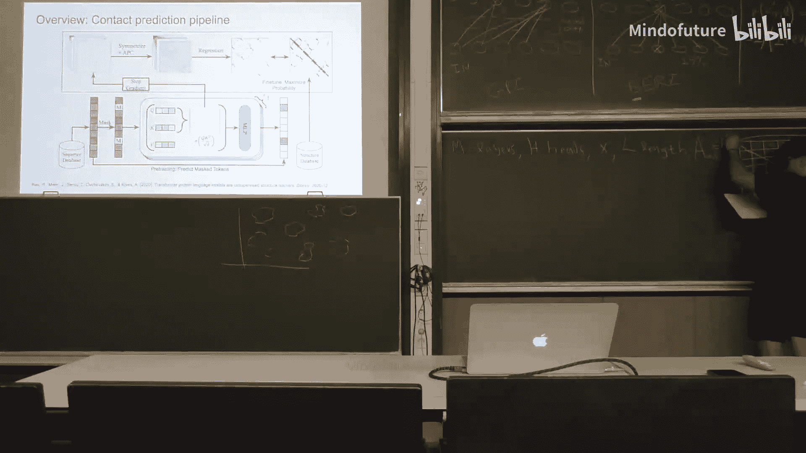

# 【Hhu Dusseldorf】表征学习 ｜ Representation Learning Msc Course Ss2023 p21 P21_W12.2_蛋白质中的表示学习_第2-2部分 -BV1RPZwB6EJZ_p21-

Or a significant number of those sequences， they have very high confidence。

And another aspect we really care in biology is how。How unique need。

These structures are compared to already existing and predicted structures。Because we said that。

St structure implies function， if we can have a new structure， this would imply a new function。

So they see that for a significant proportion of those 225 million sequences。

They can have a very low score on the sequence identity。

 so 100% sequence identity would be it already exists， 0% would be it doesn't exist at any。Degree。

From the training data。Because all these sequences are sequences that the model has never seen。

So it's kind of。Ancing data out of distribution and generalization。call it different ways。So。Overall。

 I would say that all these protein language models are something very new。

And many things will come up and they are really， really a promising research avenue if you ever want to work in this type of application and the representation learning is the essence of。

Pre training appropriate language more。So now we will check the internal representation so so far I showed you like some output visualization so now we will check the pretraining language models。

 the internal representation， which are the attention maps。嗯。So again， instead of having wordsds。

Here and modeling interactions between words， we take this output of the model before the。

The get the法。And we have as many。Attention maps as the number of layers multiplied from the number of heads。

本人理嘅。So its attention maps， attention map already gives us a probability distribution of how this specific token attends to all the other tokens in the sequence。

The question is， how useful are these attention maps？Okay。

 I've already showed you the contact prediction was like a small glimpse。

 but now we more study this a bit more extensively。🤧So here you can see。The property of binding site。

So this part is a so called binding site on the 3D structure of the propane。And this is how。

 let's say， globally。These orange lines indicate the attention between all the。

All the other amino acids， and you can see that the model already。T。

All the surrounding tolkens attend in this very， very important part of the protein。

 which is the binding side。And this happens only based on the sequence information。

And this is a small addition， this is just for one of all the heads average between the test data。

 so this seven corresponds to layer。And this one corresponds to head。 So if you have this。

The matrix from heads and layers。I think the first one corresponds to layers and the second one corresponds to heads。

But this is just a visualization we will see more measured and here you can see these orange lines now indicate the contact map so what bind to what and you can already see this global interaction。

So， even though some。诶。Some sequences。Are close on the。

Primary structure so in the sequence they are neighbors from the sequence on the 3D space。

 the image looks completely different。So this is what they did。

 they took like a random disjoin test set from the PDB。

 which are experimentally validated 3D structures and sequences with very high quality。

And they took different bird protein language models。嗯。And they find out similar to natural language。

 that there are some special。At least in their scale of analysis。

 they found that there are indeed some attention heads that really specialize to specific aminoyl acid。

So here we have again， the illustration of。Layers。Take this one。

 so we have different layers and different heads， and you can see at some cases。

 in some cases you have these high blue heat maps。Rereferred to gray highmobil。哎。

And to illustrate how much what does 45% means？Here they provide the frequencies that statistically the amino acids attend to each other are always below 9。

4。So predicting with such a assigning with such a high confidence， such a high。Percentage means。

That these heads are kind of specialized， is that clear why this confidence is so important？

Nonetheless， this analysis， they have a lot of fls， and I will try to go a bit quick。

This analysis was performed on individual heads from individual layers and already identified this idea of specialized heads。

But still， this is related to。跌费咁啲颜色。诶。And this is again the same analysis。

 but now we care about the contact maps， so we have a different property and we see that indeed there may be some heads that on after edge based on the test data special on some task。

So on that map here。These are just even more illustrations to see what this is true across different models。

And regarding biting sites， you can see that。Many， many heads from different layers attend tense。

In with a very high probability into this。Area of interest， so this point of interest。

 which is the binding side。So you can think of it of this binding side。

And as if you have like object detection and you have like a hugezema of 1000 by 1000。

 when the object is kind of localized。诶。How different parties would attend to this area of interest。

Or these attention maps we saw that the model lags in vision。

 but kind of encode the foreground in the background。On the last lecture。🤧诶。所以这呢。Attention heads。

Do learn something， they do have useful information that is captured， and depending on the task。

 for example， the binding size they can hold many heads and from different layers。诶。

Use their assign a lot of attention probability， or in the case of contact maps。

 some very specialized heads。And do the the heavy eating。🤧And here they just took different proteins。

 so because they are2 different。A specific number of proteins you can assign one different letter to。

诶。Protein， maybe the amino acid and create like a general heat mo for all the data sets。

We take this heat map of this。诶系。Pro or。 Yeah， this is a。And this is like 20 by 20， so 20 amino acid。

Sorry going take and then you can kind of。correlate to heat mapps from different proteins and get another heatm。

 which would be a， the pairwise relationship between all the amino acids with a given transformer for all your testide。

And they compare this one to the so-called substitution matrix。

 which this is one where you get from bioinformatic analysis based on statistics and analytical methods and this is the one based on the transformer and they saw that。

You get a similar， let's say。关机住。Proerspective for im。So indeed， only from sequence data。

 we can capture structural properties。We can even see how these are。

These weights target binding sites。They are consistent with the standard analysis from bioinformatics。

 as we saw with the substitution matrix。And。The fact that for higher level tasks like contact mal prediction。

 the highest layers capture， the specialized heads are usually the last layers for high level tasks because they have more abstract representation。

So now。30 minutes， okay？So now we will see how we can combine attention maps。

For different tasks like compact prediction， distogram prediction。

 instead of analyzing what each individual head is doing。So this is another analysis。

 which is closer to the one you will do in the exercise class， where they consider different modelss。

They think show the ASM version two because it was not published from 2020。诶。

So this is the ground rules from contact prediction。So this is the L by L binary map we discussed。

 so one is this INZ bind together。Ba thesymmetric， so if you know the other triangular side。

 you just copy the elements and you have the hole by a matrix。

And this is the predicted content they found。So the question is how to do that。

Because the amount of information that you get is much， much more。嗯。So you have M layers。A1。

Your in is eggs， and you have a length。哎。The we will use the letter A。

So the attention map from layer M， non capital H。

双。🤧。So how many？Just to make sure that you're all following how many for a given transformer model。

 how many attention maps we get for one input sequence。Yes。😊，I guess N by age， yes， entire age。

So let's solve the problems one by one。Probble number one。The model has no constraint。To produce。

The ground truth we sell is symmetric， so position IJ is exactly the same as position JI。

 but the model has no information whatsoever or any constraint to produce a symmetric。まあ。

So what do we do。In linear algebra the brave， you have a matrix。

Let's focus on one individual matrix and L by L。How can you make it symmetric？Any idea。

Does anybody remember， yes？包。Yes， this is also possible。Yeah， so what you suggested is？This one。

Right。This is also true， but what we do is slightly different。In general， in the first step。

 you need to sumatize。有天吗。So we do a。Oh。猪。So it's the second way， which is the preferred way to do。

 but what you said probably also important。🤧。Okay， so now all the attention maps are symmetric。

 maybe not the best way， maybe we'll find another way， but at least。It is。

It looked like the way the album looked。嗯。So in this paper， what's called transformers are。

Transformer protein language model are unsupervised structured learners。

So you see the attention map here， this S stands for soft mask。

Here you see the stop gradient because we just use them as an input we don't propagate any gradient。

 so you seesymmetricization first and then AC， so AC。I stands for average product correction。

And it's defined， it's applied independently， both operationss are applied independently for all the M by A attention maps。

And it's compute as follows。We say APC average product correction。

So I is the row of the index of the row， j is the index of the column and this is the full matrix。

 so this is the row sum， so for row I。所以 who want to。If we take this element。

The F will be the sum of this row。This would be FDA day。诶。

And this would be the sum of all the elements on the Lbi8 market。

So you can think of this as some sort of。Normalization step。It's not 100% clear to me with this。

In usually behind it， but we did some visualization in the lab and we saw that even visually。

 you see a mass pi picture of the。Of the predictive contacts。 And if you remove it。

 you have some sort of。R wise， cold wise or road wise noise。好关系。Sorry， yes， Mr。

 F just a normalized H A。F is the sum of the whole L by L matrix。啊。Yeah， I use the word F。

 but basically it's a so the attention maps， so the symmetized the attention map。You sub。

Allder the rows and the row wise some。You subscribetract this value， yes。Iしてくさ。F I by T J。我收。三十上。

Yeah， both。 this is a the。productduct divided by我得好多得心。

So you need to compute these values and these values and how you need to compute all three values for each position。

And then we want to。So then we want to discard as many， so now we remove the noise。

 we made the symmetry， we remove the noise， but now we want to see widths of those attention maps are useful。

So useful， depending on what， depending on the task， so we have this contact prediction。

And we do a regression， like logistic regression。I have some notes。태풍。So how do we do that？

We have these N8 attention maps。And we assign a certain weight。

For the whole so this wave is position independent， so Ij independent， so W1 corresponds to the head。

The first head of the first layer， w2， the second head of the first layer and so on。

 so we have these weights that are positioned independent。So now we don't want to see the individual。

Contributions， we just want to see width of those maps。Are the most useful， so we do。

This binary classification， so we train。These weights with。Logistic regression。问你咁多。

We apply regularization， which's called L1 regularization。I have some slide already。诶。

And the question is why the authors of this war？😔，Choose to apply L1 regularization and not just logistic regression to find the individual contribution of those waves。

 what do we gain by additionally constraining the weights with this term？No ideas。Okay。

 I would ahead。嗯。So anyone else。Aization。So by the way。第十2呃。The math for logistic aggress。

So these are the ways that are position independent， so there's no IA impact。

 this would definitely you on the slide。It's called Vita here。

 and these are all the different IJ for different heads， for different layers。So， anyone。

Regularization。He。Or different weights correspond again to different attachment months。嗯。

And it's different。From L2 organizationsization。We should be。航平 please。嗯。

So I will tell you the answer and then we'll try to come up with why this answer is true so if you read any interview based question they will say why do we apply L1 regularization and the answer would be because it leads to sparse weights which means that many of the ways will become zero。

Does anybody based on these can see they different。Behavior in Hawaii， that is the case。

Why we will end up with a lot of zero weights。So， if we take。The gradient。

It would be something like this。So this would mean w1 divided by the length。马克修有内裤。

And then w to device。So， in this example。嗯。And if we。你会再起来上面就一圈。I that。Basically the sign。

 so the gradient here is not dependent to how big or large these weights are。

 so all the weights will be scaled down， it will have smaller values because we regularize them independent of how big or small they are。

 which is in contrast to a utilizationization where if you take the gradient here。

Its dependent on the weight， so here all the weights will be scaled down。

 but here will be based on a constant factor of one。

 but here we will scale the weights based on their values。So we penalize much more。The big waves。

When we do anti regularization， which is what we do in standard。Uural networkvise。

 self supervised free training。But here we do N1 because we want to push。

To have like a spae solution is to discard as many attention maps as possible。诶诶。

The visualization here is something like this。说的是在。The log， the regularization term。

 and the gradient。Would be either one。Or minus one。So here from the grave。

 you can see that all the weights could be scaled up and down basically the independent of there。诶。

Of their body。Is it clear why L2 L1 regularization leads to sparse swas？Any questions？And then。

We just select。The one we want， and then we just take the average like in the next step。

 so in this step of logistic regression we decide which ways are the most important and then we just take the average。

P。Then we try to do some analysis based from different layers and different heads。

And they found out different behaviors depending on what。

Or what type of distances they want to predict？We covered so much about it， however。

 there is some exp collaborator of mine who did some similar work on protein and antibodies with protein language models。

And she found some really， really interesting results。So based on his test set， he considered。

All the contacts that are really， really unlikely to happen with the probability between 0 and 0。001。

Here some contexts that are much more likely but state。诶你 medium 。

Likely to happen same and here are the complex that are really。

 really frequent and she saw that the model performs extremely poorly here， mediumly well here。

On top for those who are interested， he found out that the protein language models。

 even though they have never been trained on this safety。Data distribution is antibodyvaluedid。

 but only。Be trained on sequences， they were able to perform extremely better or significantly better。

 And here， all the models perform。They were able to capture all these very。

 very frequent statistics for different conduct independent of the different hotels。

So the g here is that the bottom line is that rare contacts are extremely hard to predict predict。

Even with the largest scale models。And here are the。Again， this analysis between layers and heads。

 so here white means that the weights are discarded from a and the non discarded are visualized from these ranges of colors from blue to blue。

 so you can see already that there are just a few weights。

Regarding contact predictions that are very， very useful。 I see that the same image on my computer。

I can identify much more head。But ok。Yeah， I also have the number。

 so only 1002 out of 660 are the ones that are。The one that they were found。

 they found by logistic regression that they're ones that contributing to contact prediction and all the others can be discarded。

And again。That based on the previous analysis of different heads on different sub tasks。

 that they are attention maps that specialize at different ranges of prediction。

Which I just want to reemphasize this idea of attention， heads learning， very。

 very specific functions。And the last part， which is a bit more to give you like a very broader scope of happening。

 like some really recent work from the Baker lab， is that they took these protein language models。

And they try to use them in a generative way to produce。

Artificial proteins that would lead to new drugs and new vaccines and stuff。And surprisingly。

 is there any question？😊，So surprisingly， they took these 660 attention maps from these layers of this ESM2 model that we saw before。

And they applied a linear layer based on all the 660 features from all these attention maps。

But a third linear projection， so for position。I they。They took this back。M by8。

 I don't remember how many。Heads and layers， but their product is 660。

 and they apply a c linear layer with。Which is triviala to train， like I think less than 15。

000 per a。And the target was the distographs。So note the contact map。

 which was the binary theme in this L byL matrix。But they instead consider a thistoogram between。

18 bins， so 18 classes in the classification task where did the the the first bin corresponds to all the proteins。

 all the contact all the。Pairs position I say that correspond to distance from two to three angstroms and then class two is three to four astroms and so on。

 is it clear。🤧。And they saw that they were able to。Predict。The disograms。

Quite well for their considered data set。And even a linear layer without coming up with a sophisticated network。

 if you have this largely pretrained essential model on billions of amino acids，You can already get。

Some very good protein structure。🤧Yeah， this is the information about the bean。

So they have these 16 beam， and this is the ranges from 2。5 to 20 atrons with one aron difference。

And then they use it for different generative tasks， which is。

 which was unclear how generative can a protein language model be。

So they considered two different setups， so the first one was to。To say that， okay。

 we want to create a protein that looks like this on the 3D space。 Find us the。The sequence。

 So the primary structure。 And the other was， okay， it can both changet both the。

The primary structure and the tertiary structure。And they try different setups。

 I will provide some information。So here you have this same。Contact prediction visualization。

 where this one is the ground truth part， and this one is the one predicted from the model。

This one is also another thing we haven't discussed about。So。By masking during inference。

 if you must。诶。One of the so here， so let's say the model is already trained and you must this token and you predict。

A probability of what is the best。Pos candidate from this 20 amino acids to be in this position。

And this already gives you like a probability distribution。And。

It's a way to find possible new candidates design new proteins。So let's say if amino acid。

 amino acid number one was here and the protein language model predicts here and amino acid。

 let's say。Number four， maybe this kind of mutation， this。

If we experimentally design this with a specific mutation as indicated。

From the top candidates of the language model， we can design novel protein with novel。

Structures and functions。嗯。And for the terary structure。

 they just use the linear layer to predict these results。To have all these。Pair wise distance。

So the nice thing about this work is that there is like a huge biomaine learning team and they already they not only predicted some candidates and structures。

 but they also experimentally validated those possible candidates predicted by the Pro language model。

🤧And all the green ones are some TS visualization。But all in all。

I would like to emphasize on the fact that they produce novel sequences， novel 3Ds。

 so novel functions as identified by sequence identity。So the lower the sequence identity。

The more novel the structure and the function。And you can see they had some success。With very。

 very low sequence identity of 22%。嗯。🤧So the core findings from this work。

Is that they were able to design this the so called the novel structures or novel structures。

And they also reemphased on the fact that this protein language model kind of materialize and encapsulate these underlying principles that led from。

Many， many years of natural evolution。And this model we're able to capture and not just to capture these relations。

As themselves， but also generate novel structures that might lead to。New drugs。

 new proteins with new functions。Okay， so。What are the limitations。

 I've just show you how amazing these models are， but as everything they have some limitations。

So the first limit is comes from。The most dominant module from attention。

 So attention has this quadratic complexity， and we are still not able to scale these to。

Very large sequences。So even in biological data， you may have。Protes of 3000 or 4000。Sequence length。

 I'm speculating， I don't know exactly the exact numbers。And so this would be very hard。

 these are still like computational bottlene that comes。Comes on par with the attention mechanism。

And the thing is that if the model。Is trained on a maximum sequence length， let's say， of 1000。

 It's not clear how this model。ul perform on larger sequences。

 even though the transformer by itself can process any type of sequence length。

We saw that these positional encodings or positional embeddings that are learned for its position are fixed。

 so you are a bit constrained on the maximum number of sequence。

When one the model is traineded with a maximum sequence of 1000。

And it has like positional embeddings。 You cannot use this model you have to。There are ways。

 but you cannot like。Inherently， use the model as it is。The other thing is that。

Storing 660 attention maps。Of N by N for each individual sequence。If you had 50。

000 sequence sequences like a test would result in terabytes of information。If you do the math。

 all these values are floating points， you can see that you already get in a tiny。Subet， test set。

 you can already get terabytes with information， which is invisible to。

To store locally on hard drives， even though the cloud will be highly co。

So these largely pretent transformers are kind of a compressed version of all the sequence they have seen。

So it's impossible to store these maps then。It's about symmetryries so right now we do this symmetization trick like the cheapest possible trick we could do but the model doesn't really encapsulate all the physics or respect the rules so for example on DNAs and RNAs you have some rules for example。

The base， for example， add theing， it's called a binds to I don't remember exactly。

 but only U and not， for example， Z。And this is not。These rule based。Physics informed in。

Information is not。诶。I's not guaranteed from the model。

There might be future methods that take that into account。And as a result， physical rules。😊。

That proteins from when proteins are。Trannscribed and translated from DNA to RNA to proteins。

 they have this jittering folding procedure。🤧诶。But we only predict， let's say， the last。Frame。

 so the last three distractive， the result of this jittery folding process。

 I don't know if you've seen the videos that I send you。

 usually there's a lot of deterittering for these proteins to bind and translate and transcribe。

And we know that all these language models have very。

 very limited understanding of this folding procedure and the trajectories that proteins follow。

So I just want to keep that in perspective。And last but not least， the rare contacts。

 so even on billion scale aminoidances， there are contacts and stuff you will not really see very often。

 which are extremely hard to predict。That's the end。Any questions？对在。

