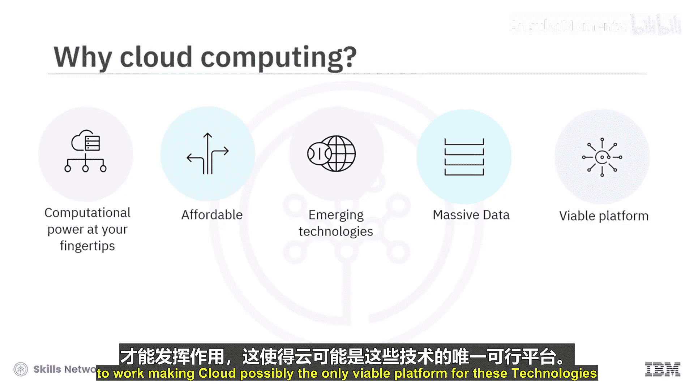
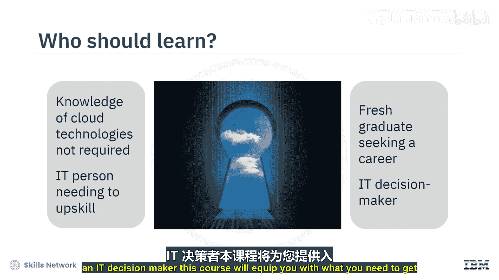
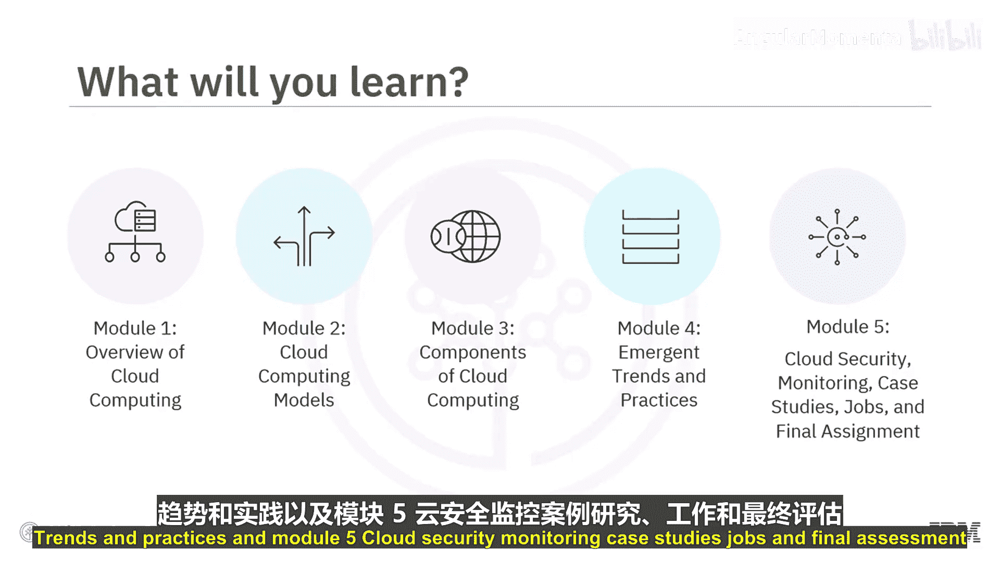
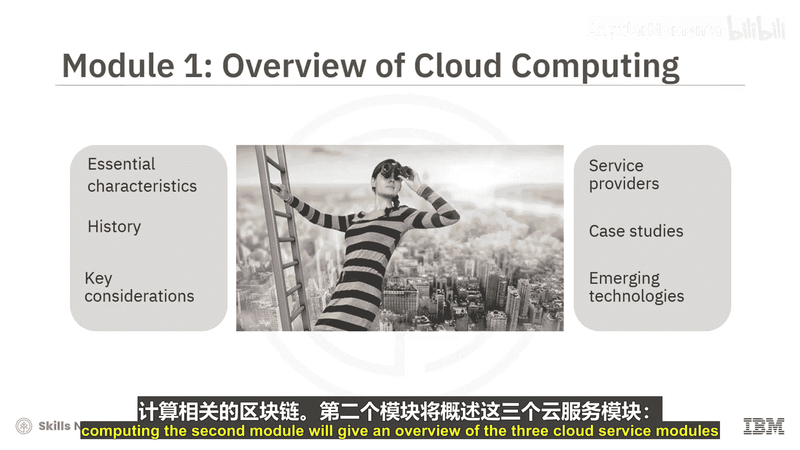
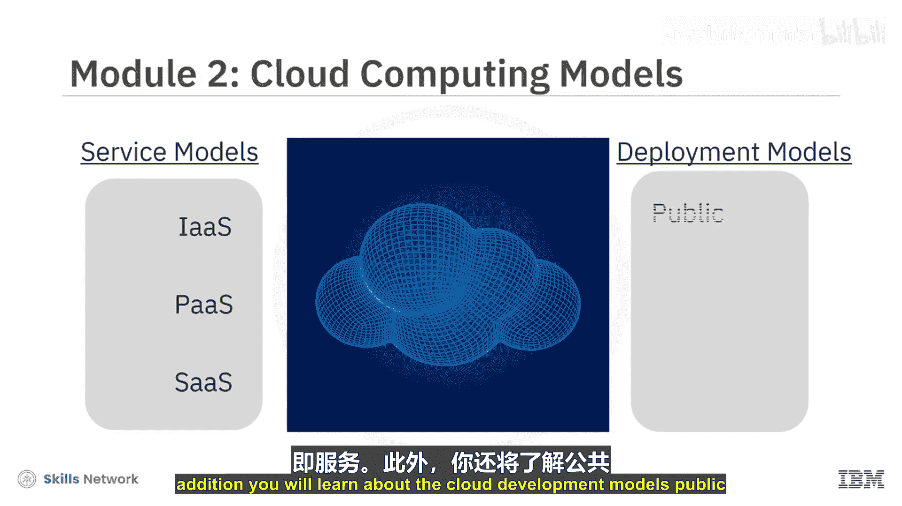
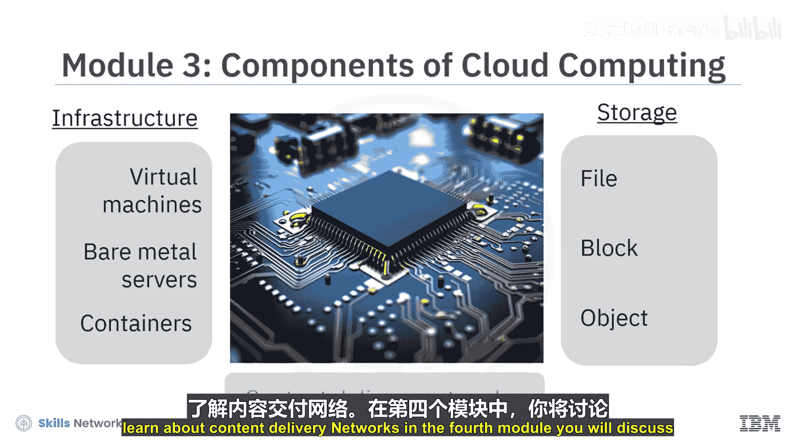
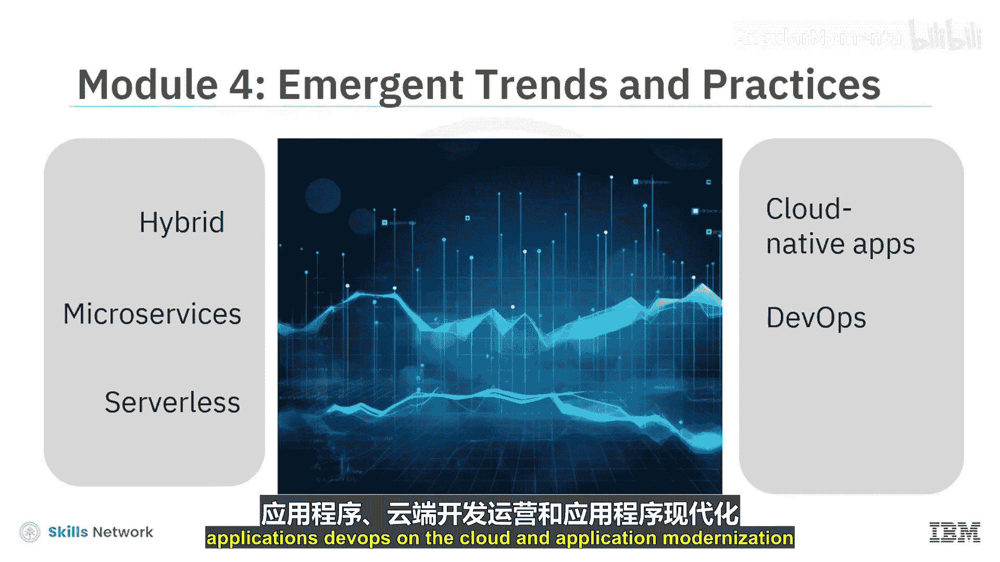
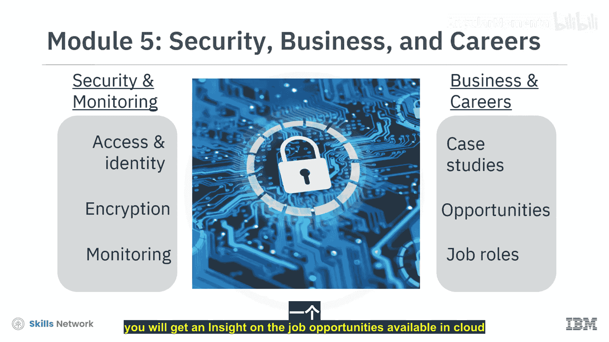
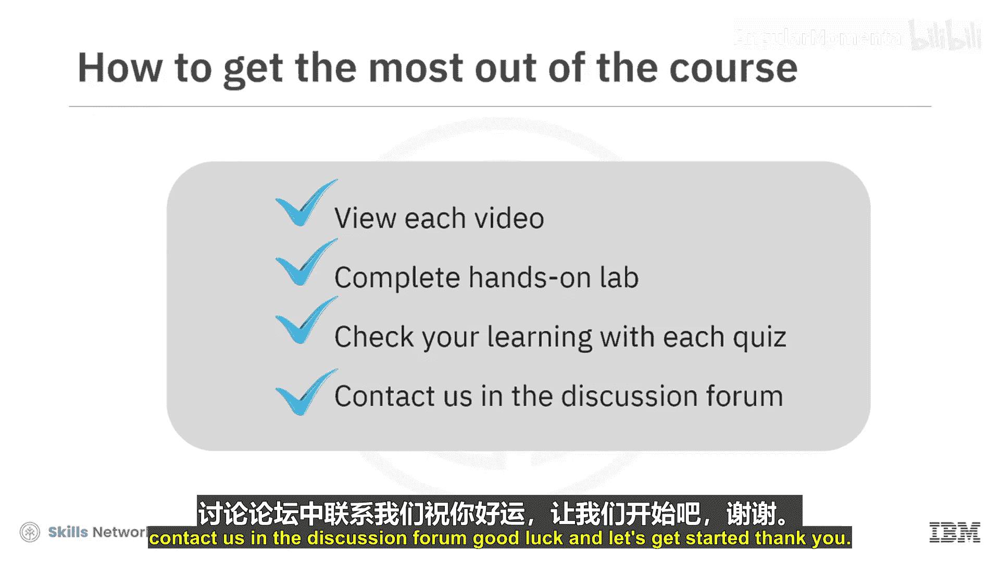

# 【IBM】云计算导论-｜-Introduction-to-Cloud-Computing-p01-01_01_01_课程欢迎--BV1X66rBqE8G_p1-

Welcome to this course on cloud computinguting， designed to give you the foundational skills you need to be a cloud practitioner。

To day， the cloud represents a huge market that continues to grow at an unprecedented scale。

 Enmous computational power， once considered a prerogative of large enterprises。

 is now available at the fingertips of even the smallest of businesses and individual developers。

 thanks to the cloud。 Moreover， the cloud makes all this computational power highly affordable with pay as you go economics。

😊，If you look at some of the key emerging technologies of our times， such as artificial intelligence。

 the Internet of things， blockchain and analytics， all of these technologies work with massive amounts of data and need huge storage space and computational power in order to work making cloud possibly the only viable platform for these technologies。

 this course is designed for everyone it doesn't matter if you have a background in cloud technologies。

 whether you're an IT person looking to upskill or explore this domain。

 a fresh graduate looking to make a career in cloud technologies， or an IT decision maker。

 this course will equip you with what you need to get started。😊。

This course will introduce you to the core concepts of cloud computing in the following modules。

 module 1 overview of cloud computing， module 2， cloud computinguting models， Mo3。

 components of cloud computing， moduleule 4， Emnt T and Pra， and Moule 5。

 Cloud Security Mon case studies， Jobs and Fi assessment。

In this first module， you will learn about the essential characteristics， the history and evolution。

 key considerations and service providers of cloud computing。

 you will also explore some case studies and emerging technologies like internet of things。

 artificial intelligence and blockchain associated with cloud computing。😊。

The second module will give an overview of the three cloud service modules。

 infrastructure as a service， platform as a service， and software as a service。In addition。

 you will learn about the cloud development models， public， community。

 private and hybrid In the third module， you will learn about the components of the cloud infrastructure like virtual machines。

 bare metal servers and containers。😊。

You will also get an insight on the types of cloud storage such as fileile， blocklock， and object。

In addition， you will learn about content delivery networks。

In the fourth module， you will discuss the emerging trends in cloud computing such as hybrid cloud computing。

 microservices and serverless computing。You will also explore cloud native applications。

 DevOs on the cloud， and application modernization。

In the fifth module， you will learn about cloud security and how to manage access and identity in addition。

 you will learn about cloud encryption and monitoring。

The module will also cover some case studies in different industry verticals。

You will get an insight on the job opportunities available in cloud computingut。

In the final module， you can test your knowledge of what you learned in the course with a final quiz。

 there is also an honors project where you can apply your skills and knowledge in this hands on lab。

You will deploy an app on the cloud by building a Docker container image。

 uploading it to IBM Cloud Con registry， and deploying it using a serverless technology called IBM Code Engine no programming knowledge is required。

So there is a lot to cover here， to get the most from this course， complete viewing each video。

 complete all hands on laps， and check your learning with each quiz。

We're very happy to have you with us as you start your cloud computing journey。

 If you have any trouble with any of the course material。

 please don't hesitate to contact us in the discussion forum。 Good luck。 and let's get started。😊。

