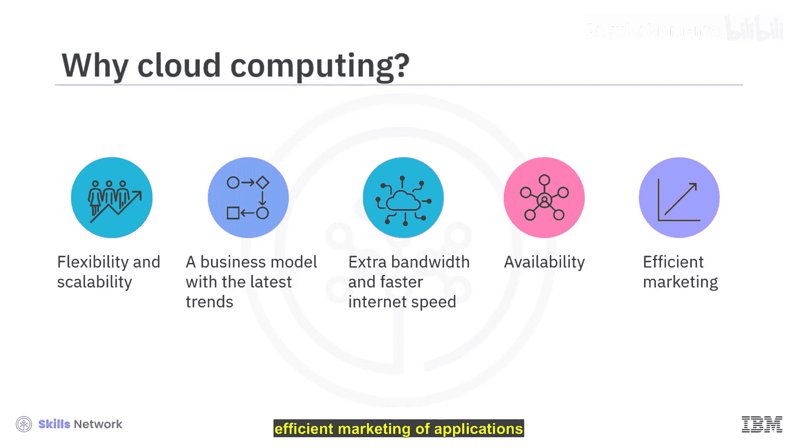
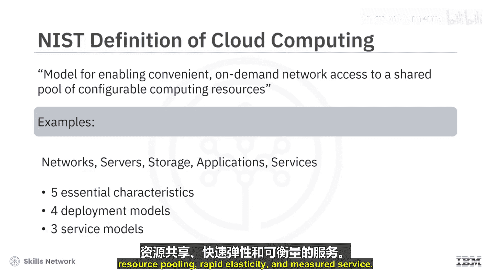
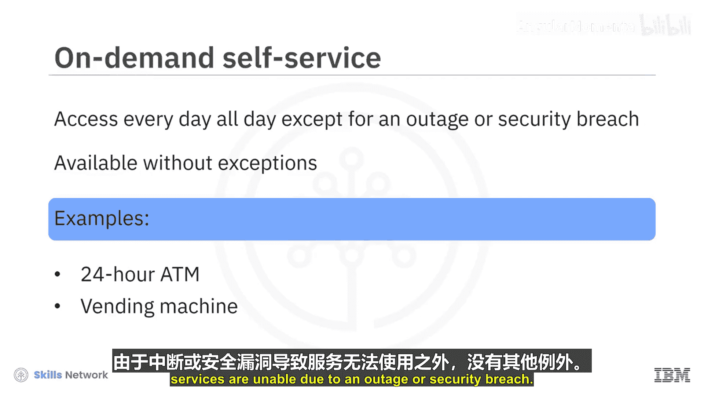
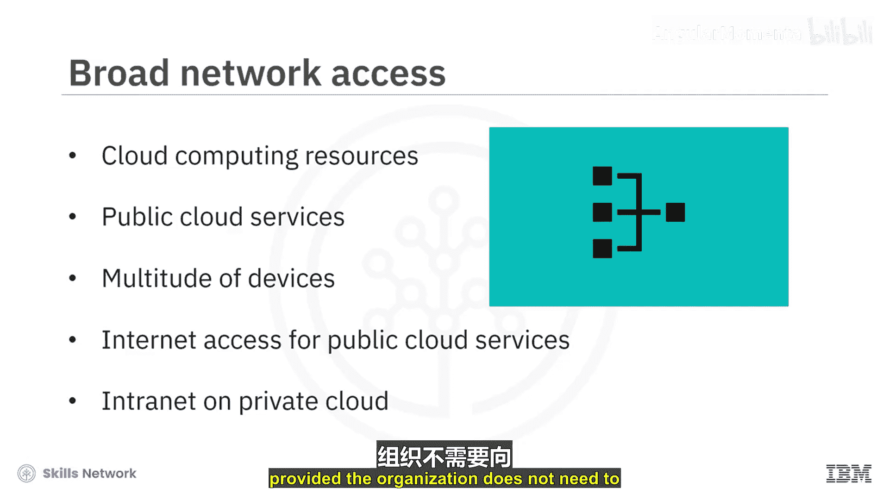
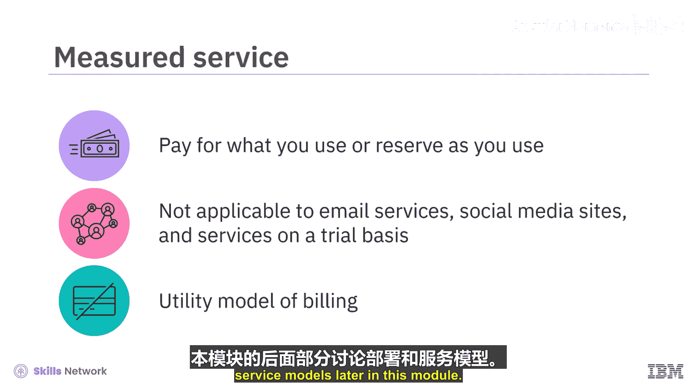

# 【IBM】云计算导论-｜-Introduction-to-Cloud-Computing-p02-01_02_01_云计算的定义与基本特征--BV1X66rBqE8G_p2-

Why would you choose cloud computing over traditional hosting on a local server？

Cloud computing offers businesses more flexibility and scalability than hosting on a local server。

It is a business model or service that combines technology like virtualization with a few of the latest trends。

 and if you require extra bandwidth， a cloud based service can address that need promptly rather than waiting for a complex and costly update to your I infrastructure。

Users can customize their applications using cloud services from anywhere if they have an internet connection。

In addition， cloud computing enables efficient marketing of applications。

 regardless of maintenance and cost。

To get a common understanding of cloud computing， let's start with the US National Institute of Standards and Technology。

 N IST's definition of cloud computing。NIST defines cloud computing as a model for enabling convenient on demand network access to a shared pool of configurable computing resources that can be rapidly provisioned and released with minimal management effort or service provider interaction。

Examples of computing resources include networks， servers， storage， applications and services。

This cloud model is composed of five essential characteristics， four deployment models。

 and three service models。Let's start with understanding the five essential characteristics of the cloud。

 which include on demand self service， broad network access， resource pooling。

 rapid elasticity and measured service on demand self service。

 the first characteristic means you can access cloud resources whenever required。 For example。

 a 24 hour ATM or a vending machine at the office or store。

 Services are always available on all days of the year。

 Regardless of whether a particular day is a national holiday weekend， festival day and so on。😊。

There are no exceptions other than when services are unable due to an outage or security breach。

Broad network access means that cloud computing resources can be accessed through the network。

Public cloud services could generally be accessible from anywhere and on any device with internet connectivity and browser capabilities。

Today， we are open to more than just desktops or laptops for accessing cloud services。

 There are many other devices such as tablets， iPads， smartphones， E readers。

 smart wearables and so on。😊，Also， to emphasize again。

 internet access is mandatory for accessing public cloud services。 However。

 in an on premises private cloud， an entrainnet can only suffice for accessing cloud services provided the organization does not need to reach out to the entire world public。

With resource pooling， consumers save on costs when using a shared model。

 This model provides cloud providers economies of scale， which they can pass on to their customers。

 making the cloud cost efficient。Computing resources are pooled to serve multiple consumers using a multi tenantant model。

Cloud resources are dynamically assigned and reassigned according to demand。

 without customers needing to concern themselves with the physical location of these resources。

Rapid elasticity implies that you can increase or decrease resources as per your demand because of the elastic property of the cloud。

Resources can be scaled up or down vertically scaling or scaled out， as in horizontal scaling。

 An ideal example would be to add resources when there is an increase in demand due to the increase in the number of users while shopping online。

 like during a holiday sale， and the converse after the sales period。

 Me service means that you only pay for what you use or reserve as you go。😊，Measured services。

 however， do not apply to certain cloud services such as general email services like Gmail， Hotmail。

 Yahoo， social media sites like Facebook， Twitter， WhatsApp。

 and cloud service evaluation on a trial basis like AWS， Azure， and GCP。

 which are provided for free due to the discretion policies extended by the respective service providers。

Measured service is also termed as a utility model of billing。

 where you are charged after the usage and at the end of the predefined period。

 like monthly electric charges。We will discuss the deployment and service models later in this module。

。