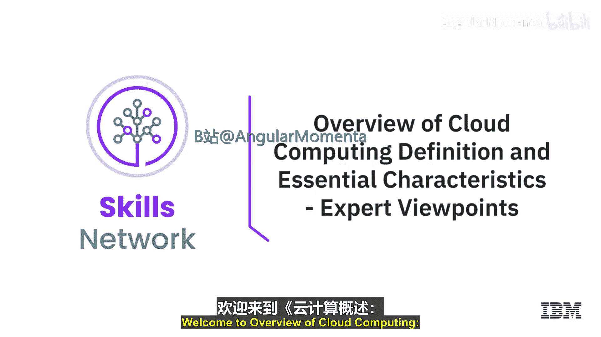
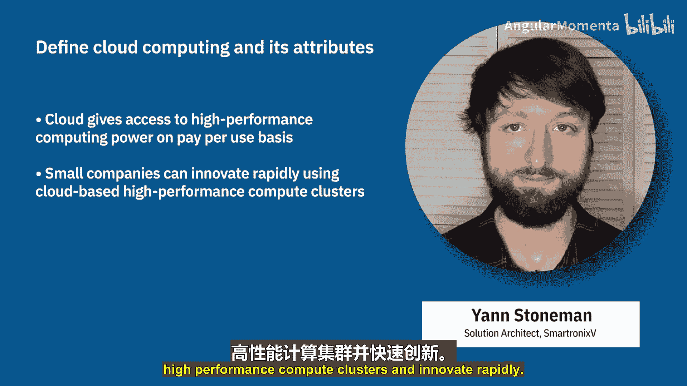

# 【IBM】云计算导论-｜-Introduction-to-Cloud-Computing-p03-01_02_02_专家观点：云计算的定义与核心特征--BV1X66rBqE8G_p3-

Welcome to Overview of Cloud Computing Defition andEssential characteristicsistics experter viewpoints。

😊。

In this video， we will listen to several cloud native and application development professionals discuss the definition of cloud computing and cloud computing's unique attributes。

 How do you define cloud computing， and what are some of its attributes。😊。

As a cloud native developer， cloud computing basically boils down to two things for me。

 first it is on demand and second it is self serving。

So what that means is as a developer I should be able to log into a portal and get the exact amount of services that I need。

 I'm not waiting around for procurement or infrastructure services to assign something or provision something for me。

And this is true for the whole stack arranging from infrastructure to platform to solution of the service。

To me， cloud computing is the ability to deploy code or infrastructure anywhere in the world and at scale。

 some of the key characteristics include distribution， high availability， resiliency and scalability。

Cloud computing refers to the delivery of computing services that can include servers， database。

 networking， analytics， etc over internet or cloud。

Key attributes of cloud computing are flexible cost， global scale， reduce time to deploy resources。

 higher productivity and performance， and higher reliability and security。To me。

 cloud computing means unlimited compute database。Machine learning capacity。

And the ability to work with that in an instant。Unlike with data centers where you need to order all those things。

 set it up。And manage the availability of it yourself。With cloud computing。

The cloud provider manages the physical security of the service for you。And all you do is。Manage the。

Stuff on it I would summarize cloud computing as a suite of API driven services to manage all aspects of compute networking resources for enterprise computing you could think of it as virtualized resources defined by software some other key characteristics are the resources are elastic and can grow or shrink with demand。

 think of e-commerce on high demand holidays。Also the computing costs are dynamic。

 so instead of capital expenditures for hardware， you have operating expenses for cloud resources to me cloud computing is。

Not a yes or no， it's really a scale and everything uses cloud computing or almost everything does nowadays the idea is that you can dip your toes in。

 just use cloud computing for a little bit like authentication。

 use some social login so people can log in with their Facebook or their Google login or you can go all the way in and you know have your entire project hosted on a cloudbased infrastructure。

😊，The point is， is that both of those leverage cloud technologies， really whenever you。

Reach into that void of the cloud and take compute power or something else storage。

 it doesn't matter， that is using a cloud technology。

 and I think that's really important to understand。Almost everything is the cloud nowadays。

There's a joke that cloud computing is just using someone else's computer over the internet。

That's only very narrowly true what cloud computing actually gives you is a degree of availability。

 consistency and scalability that you very likely would not be able to achieve running your own machines。

At its best， cloud computing allows you to abstract away the management of the things you probably don't care about。

And focus on the things that you do care about。With high performance compute in the cloud。

 you can have extremely fast clusters of computers at your fingertips and only pay for them when you need them and thanks to the cloud smaller companies are able to set up high performance compute clusters。

And innovate rapidly。

