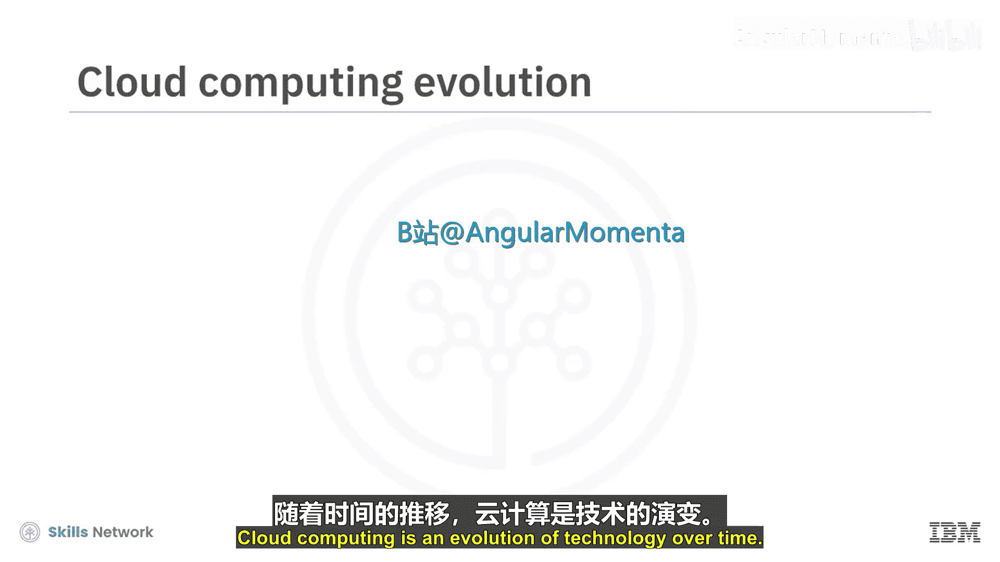
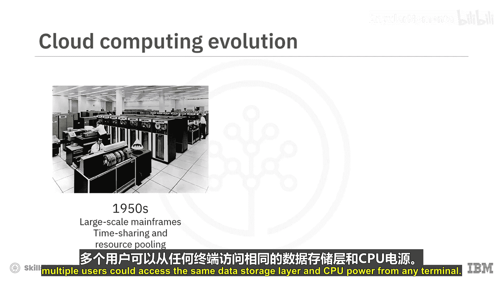
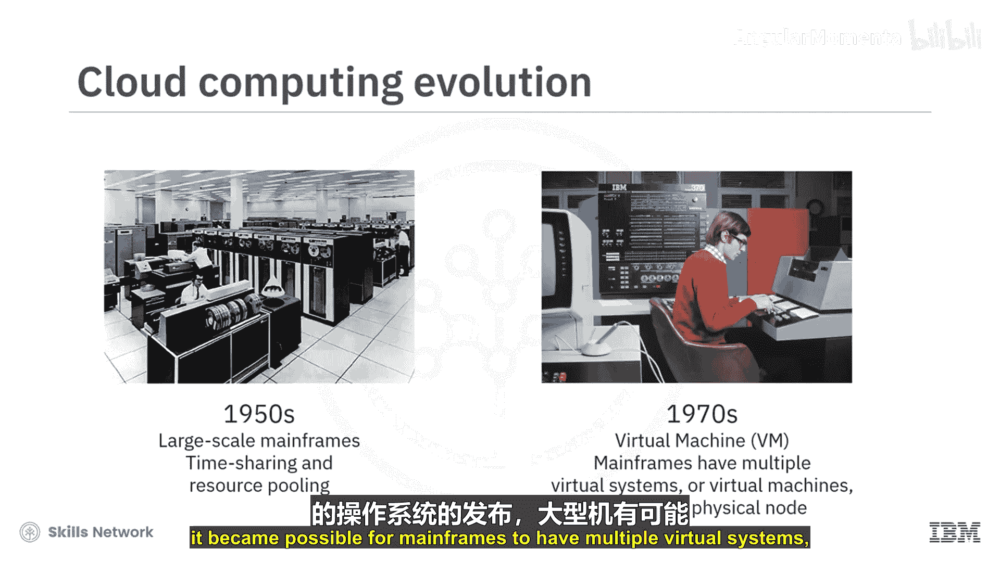
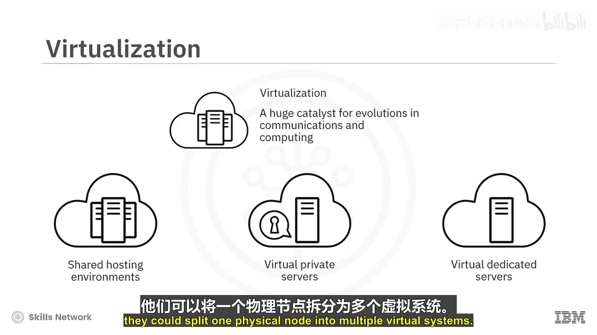
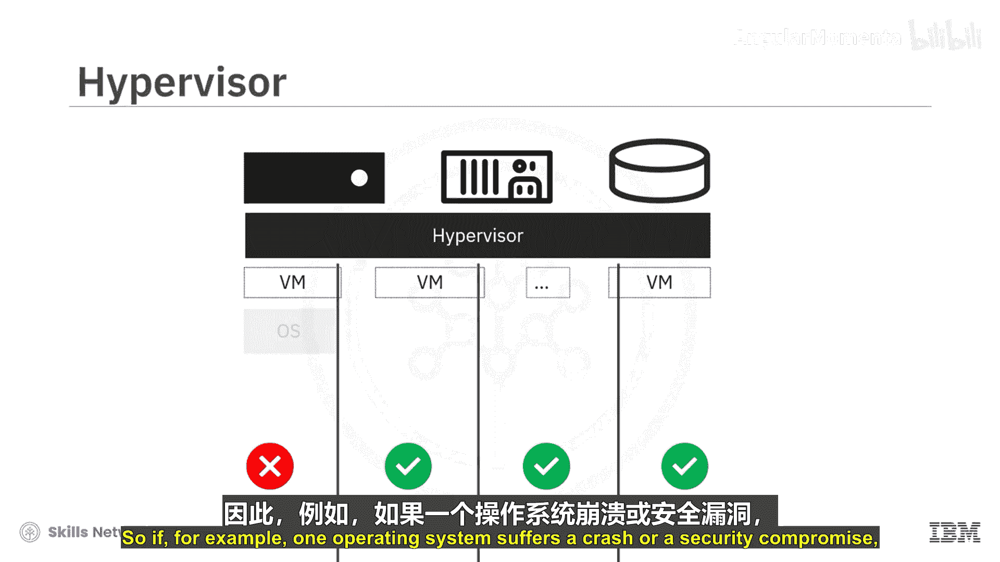
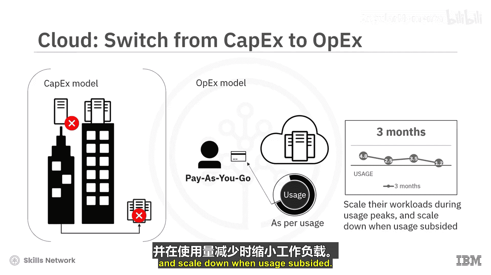
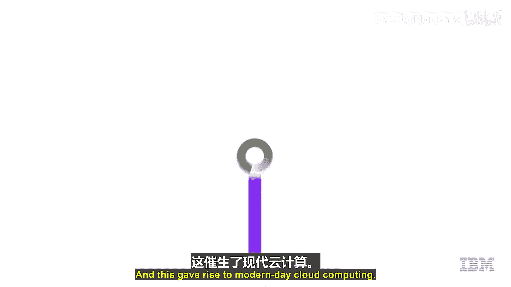

# 【IBM】云计算导论-｜-Introduction-to-Cloud-Computing-p04-01_02_03_云计算的历史与演进--BV1X66rBqE8G_p4-

Welcome to The History and Evol of cloud Computing。

Cloud computing is an evolution of technology over time。

 The concept of cloud computing dates to the 1950s when large scale mainframes with high value processing power became available。

The practice of time sharing or resource pooling evolved to make efficient use of the computing power of mainframes using dumb terminals whose sole purpose was facilitating access to the mainframes。

 multiple users could access the same data storage layer and CPU power from any terminal。

In the 1970s， with the release of an operating system called virtual machine VM。

 it became possible for mainframes to have multiple virtual systems or virtual machines on a single physical node。

The virtual machine operating system evolved from the 1950s application of shared access of a mainframe by allowing multiple distinct computing environments to exist on the same physical hardware。

 Each virtual machine hosted guest operating systems that behaved like they had their own memory。

 CPU and hard drives， even though these were shared resources。

 Virization thus became a technological driver and a massive catalyst for some of the most significant evolutions in communications and computing。

😊，Even 20 years ago， dis hardware was quite expensive。

With the internet becoming more accessible and the need to make hardware costs more viable。

 servers were virtualized into shared hosting environments。

 virtual private servers and virtual dedicated servers。

 using the same functionality the virtual machine operating system provided。 So， for example。

 if a company needed an X number of physical systems to run their applications。

 they could split one physical node into multiple virtual systems。😊。

A hypervisor is a small software layer that enables multiple operating systems to run alongside each other。

 sharing the same physical computing resources。A hypervisor also separates the virtual machines logically。

 assigning each slice of the underlying computing power， memory and storage。

 preventing the virtual machines from interfering with each other。 So if， for example。

 one operating system suffers a crash or a security compromise， the others can keep working。😊。

As technologies and hypervisors improved and could share and deliver resources reliably。

 some companies decided to make the cloud's benefits accessible to users。

 these users did not have an abundance of physical servers to create their cloud computing infrastructure。

Since the servers were already online， spinning up a new instance was instantaneous。

 Use could now order cloud resources from a larger pool of available resources and pay for them on a per use basis。

 also known as pay as you go。😊，This pay as you go， or utility computing model became one of the key drivers behind cloud computing's launching。

The pay per use model allowed companies and even individual developers to pay for the computing resources as and when they use them。

 just like units of electricity。This allowed them to switch to a more cash flow friendly Opex model from a CAex model。

This model appealed to all sizes of companies， those who had little or no hardware and even those that had lots of hardware。

 because now， instead of making substantial capital expenditures and hardware。

 they could pay for compute resources as and when needed。

It also allowed them to scale their workloads during usage peaks and scale down when usage subsided。

 And this gave rise to modern day cloud computing。😊。

。

