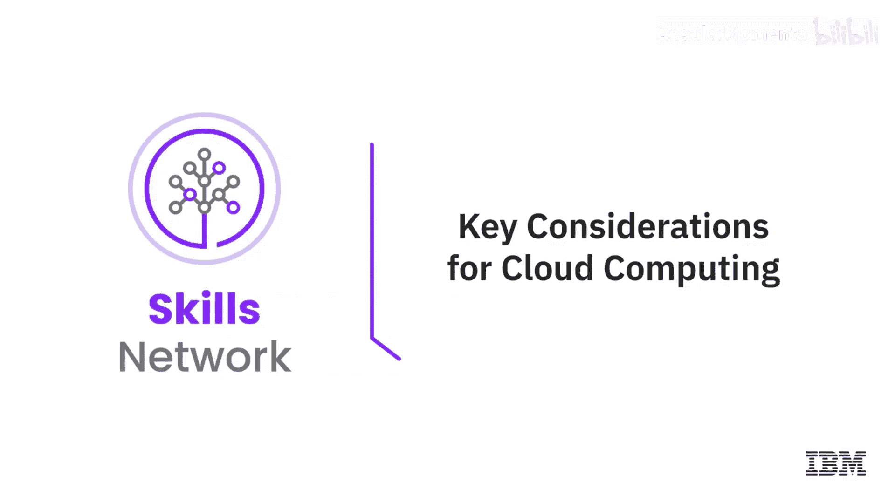
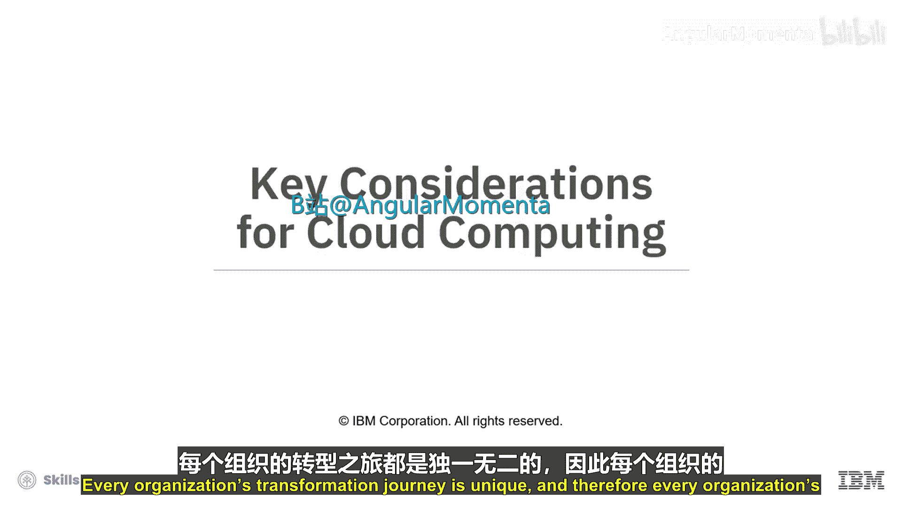
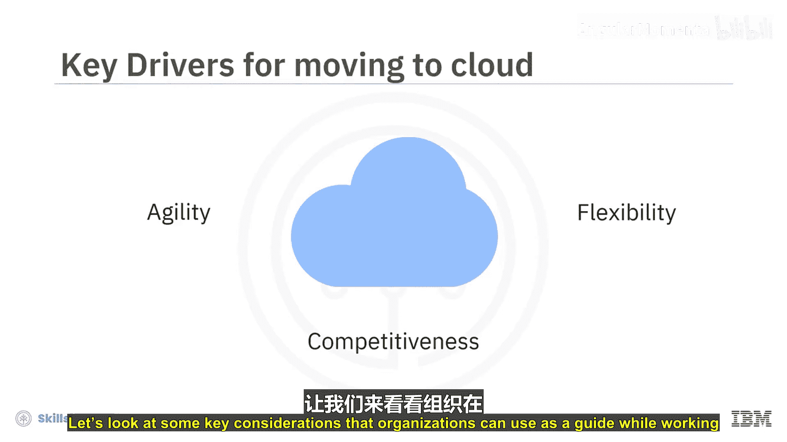
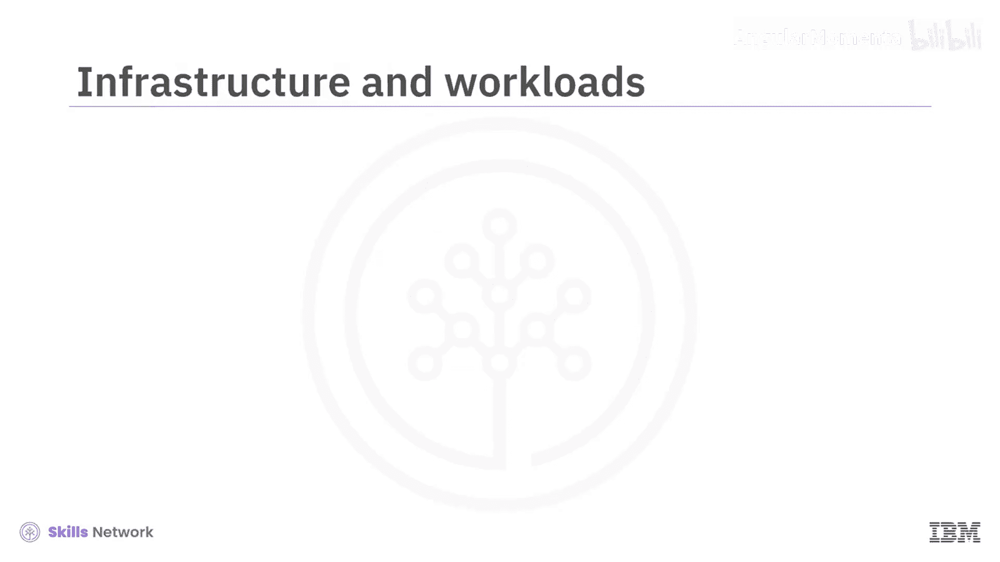
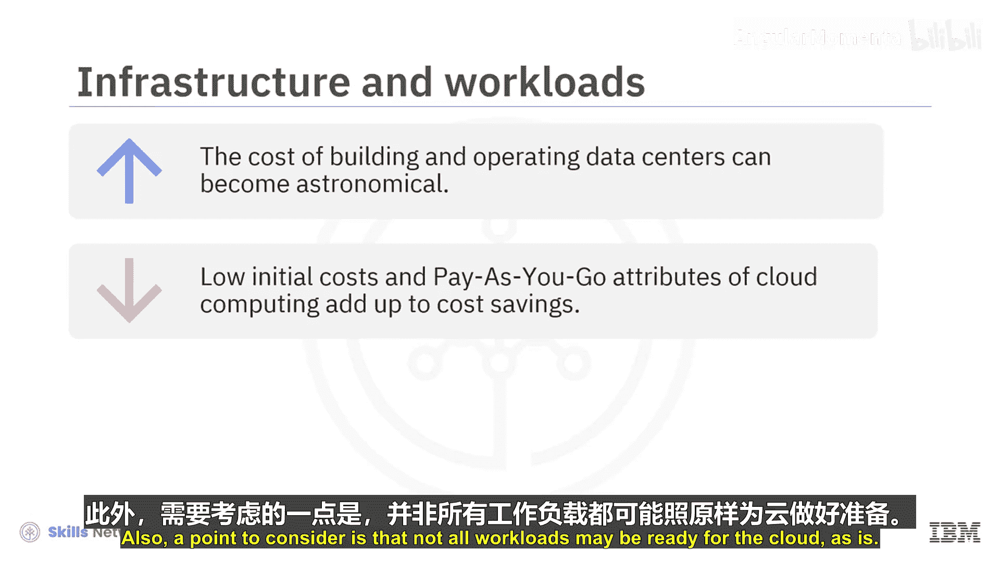
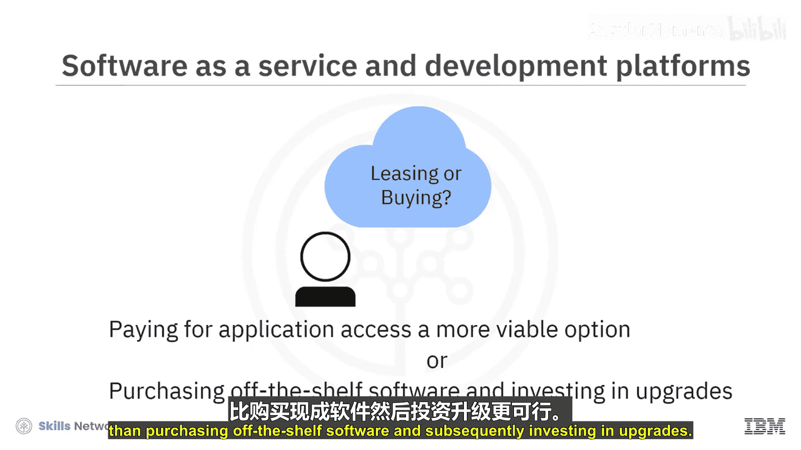
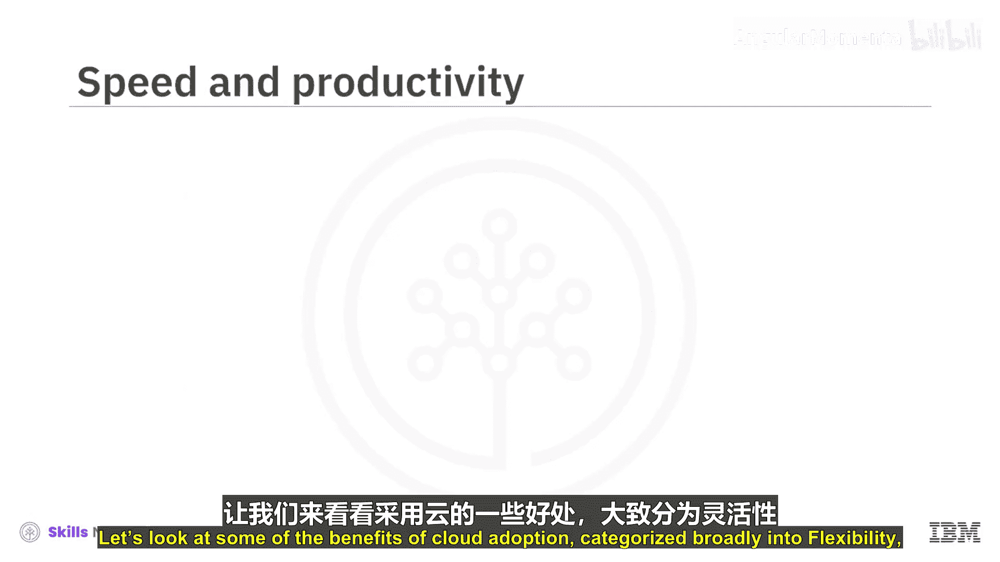
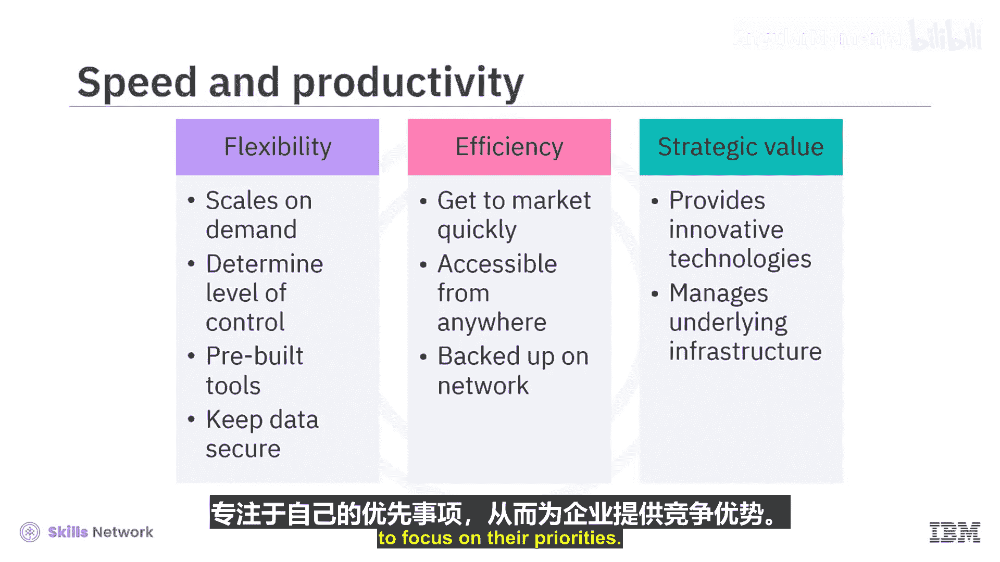
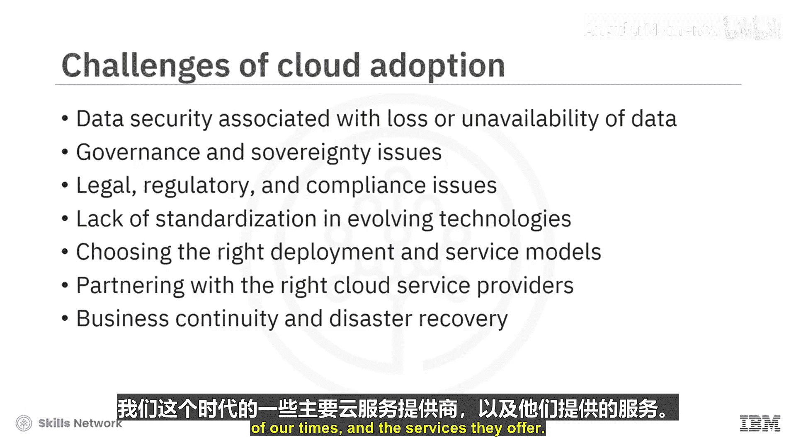

# 【IBM】云计算导论-｜-Introduction-to-Cloud-Computing-p05-01_02_04_云计算的关键考量因素--BV1X66rBqE8G_p5-

Every organization's transformation journey is unique， and therefore。

 every organization's cloud adoption strategy is also unique to them。 Agility。

 flexibility and competitiveness are key drivers for moving to the cloud provided it is done without creating business disruption or issues related to security。

 compliance and performance。😊。

Let's look at some key considerations that organizations can use as a guide while working through their cloud strategy。

The first consideration is infrastructure and workloads。

The cost of building and operating data centers can become astronomical。 On the other hand。

 low initial costs and pay as you go attributes of cloud computing can add up to significant cost savings。

Also， a point to consider is that not all workloads may be ready for the cloud， as is。

 The second consideration is around software as a service and development platforms。

 Organs need to consider if paying for application access is a more viable option than purchasing off the shelf software and subsequently investing in upgrades。

😊。

Organizations need to consider speed and productivity。

 what it means for them to get a new application up and running in X hours on the cloud versus a couple of weeks。

 even months on traditional platforms， and the person hour cost efficiencies they gain from using cloud dashboards。

 realtime statistics and active analytics。Let's look at some of the benefits of cloud adoption categorized broadly into flexibility。

 efficiency， and strategic value。

Cloud gives us flexibility users can scale back or scale up services to fit their needs。

 customize applications， and access cloud services from anywhere with an internet connection。😊。

Cloud infrastructure scales on demand to support fluctuating workloads。

Organizations can determine their level of control with asA service options。

Users can select from a menu of prebuilt tools and features to build a solution that fits their specific needs。

And options like encryption and API keys help keep data secure。Cloud also brings great efficiency；

 enterprise users can get applications to market quickly without worrying about underlying infrastructure costs or its maintenance。

😊，Cloud based applications and data are accessible from virtually any internet connected device。

 hardware failures do not result in data loss because of backups maintained on the network。

Cloud computing uses remote resources， saving organizations the cost of servers and other equipment。

 and paying on use basis。Cloud services give enterprises a competitive advantage by providing the most innovative technologies available while managing the underlying infrastructure。

 thus enabling organizations to focus on their priorities。

While Cloud brings great opportunity， it also introduces challenges for business leaders and IT departments。

 Some of these perceived risks include data security associated with loss or unavailability of data causing business disruption。

😊，Governance and sovereignty issues。Legal， regulatory and compliance issues。

Lack of standardization in how the constantly evolving technologies integrate and interoperate。

Choosing the right deployment and service models to serve specific needs。

Partnering with the right cloud service providers。Concerns related to business continuity and disaster recovery。

Organizations can no longer think of cloud adoption as something that is to be looked at in the future with the right cloud adoption strategies。

 technologies， services， and service providers， these risks can be mitigated。In the next video。

 we're going to look at some of the key cloud service providers of our time and the services they offer。

