# 【IBM】云计算导论-｜-Introduction-to-Cloud-Computing-p06-01_02_05_主要云服务提供商及其服务--BV1X66rBqE8G_p6-

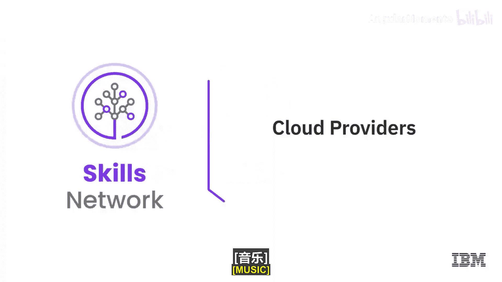

Let's look at some numbers and predictions that help us see the scale cloud is predicted to achieve in the coming years。

😊。

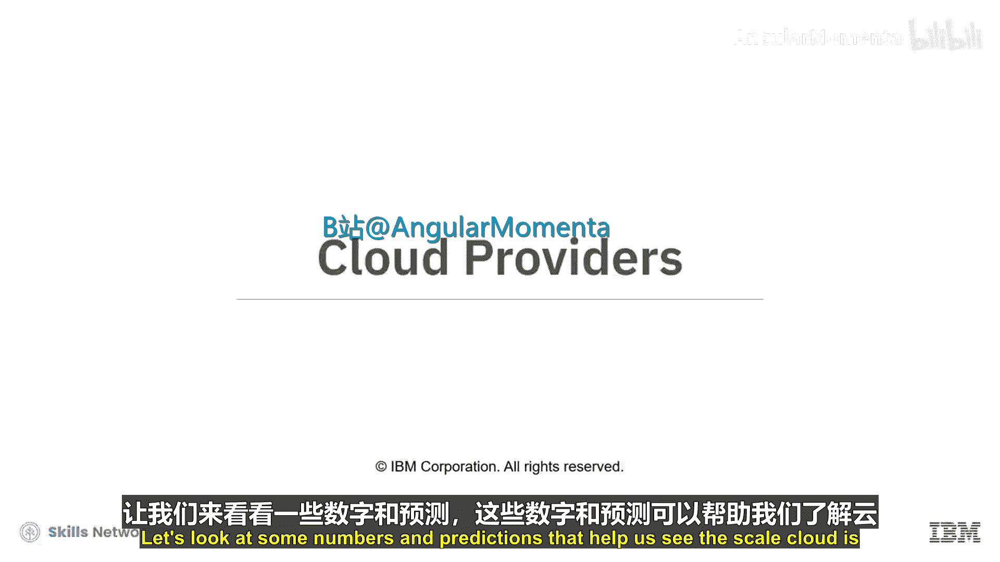

Gartner Inc。 forecasts。

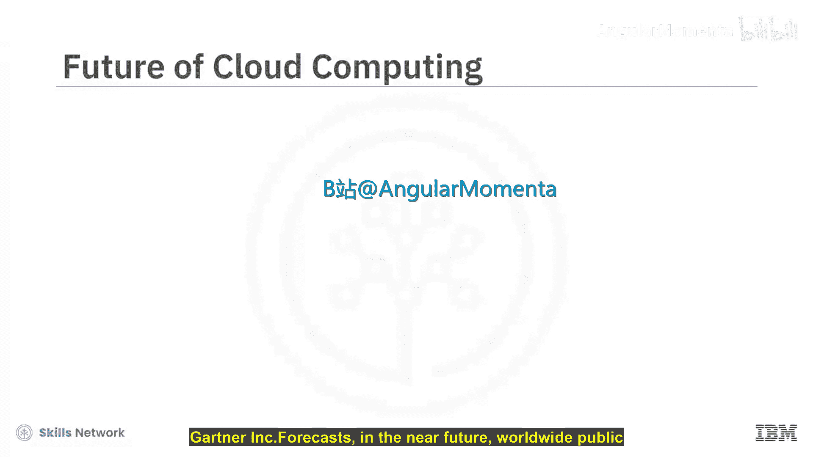

In the near future， worldwide public cloud spending will grow 20。7% to total $591。8 billion。

 scaling up from $490。3 billion in previous years。Global spending on desktoptop as a service will reach $3。

2 billion in 2023 as companies shift away from traditional client computing solutions to subscription based virtual desktop services。

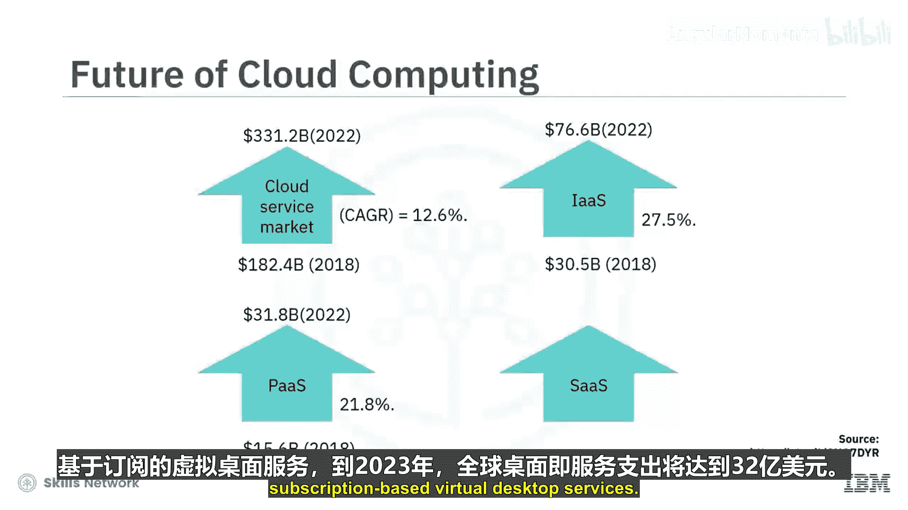

In the coming years， enterpriseses will spend more on public cloud services than traditional IT solutions。

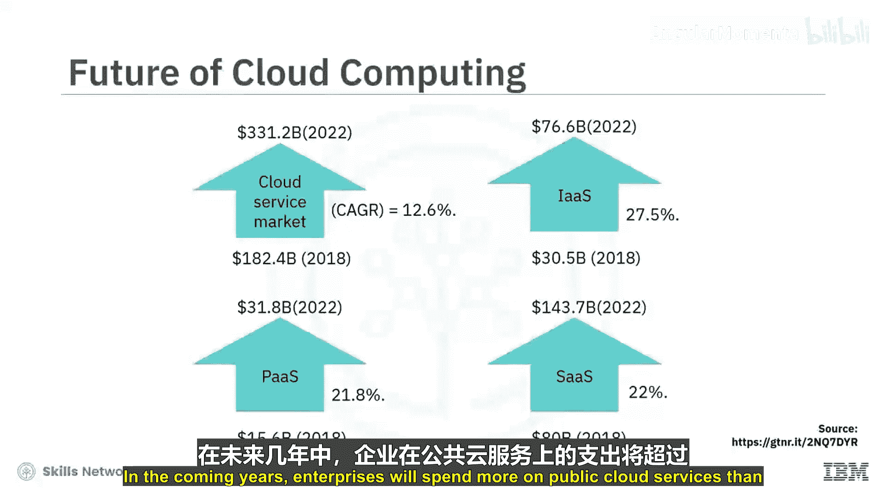

What is clear is that cloud is accelerating faster than predicted。

 adoption is high and revenues are soaring。The question for businesses today is no longer if they need to adopt the cloud。

 rather what their cloud adoption strategy should be to best serve their businesses and customers。

 keeping up with this technological wave and driving it forward are the cloud service providers with a wide range of services。

We will now talk about some of the major cloud service providers in alphabetical order。

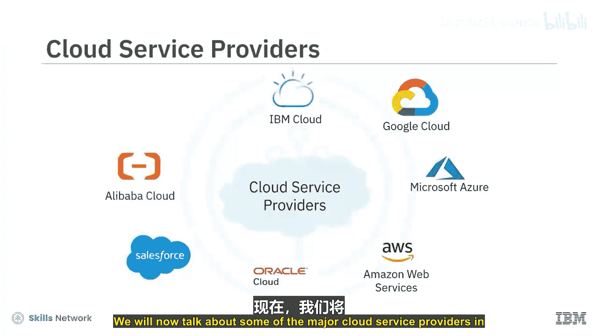

Alibaba Cloud， while relatively new， is the largest Chinese cloud computing service provider。

Alibaba Cloud provides a comprehensive suite of global cloud computing services to power not just their customers' online businesses。

 but also the Alibaba group's own e-commerce ecosystem。

It offers a host of products and services such as compute， network， storage， security。

 monitoring and managing， communication， analytics， IoT， application development， data migration。

 web hosting， and more。

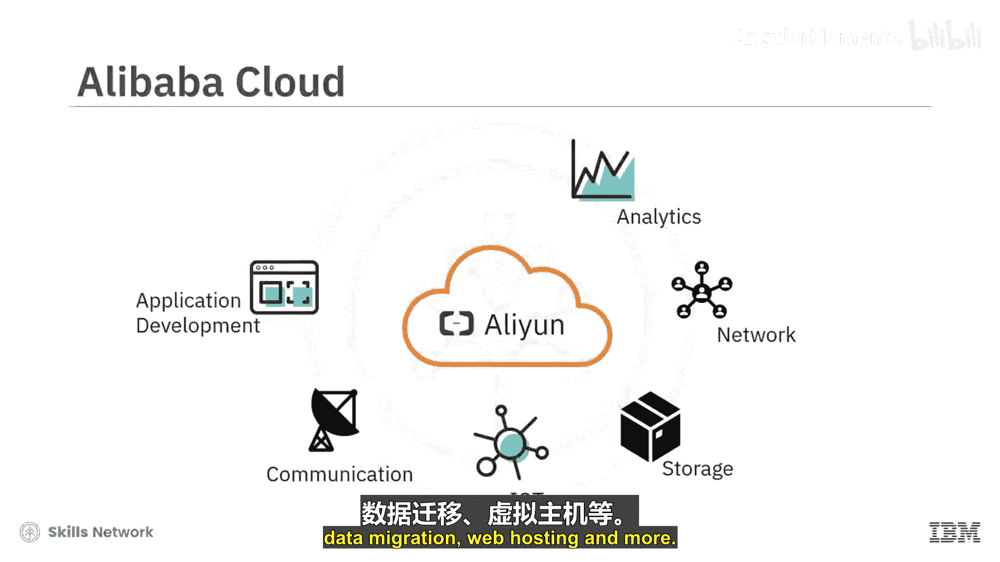

One of the first to enter the cloud computing space， Amazon Web Services， or AWS Cloud。

 offers an extensive range of infrastructure and platform services to individuals。

 companies and governments on a meered pay as you go basis。

 The Amazon Cloud provides a wide range of products， services and solutions ranging from compute。

 DevOs， data， analytics， IoT， machine learning， networking， content delivery， robotics。

 serverless computing， and much more。😊。

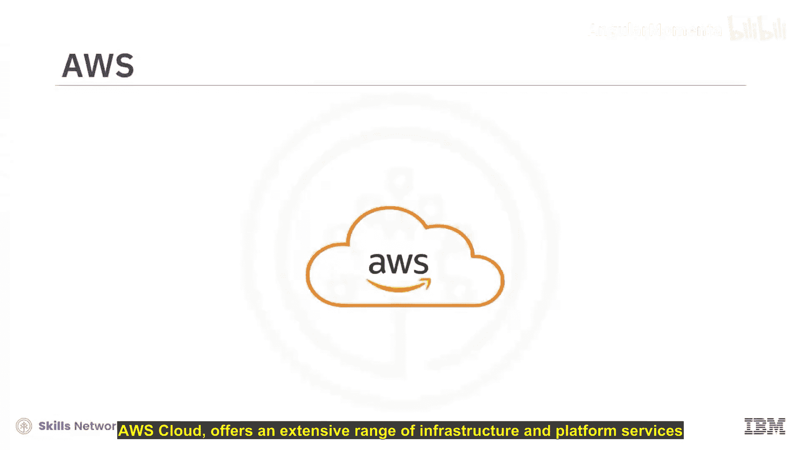

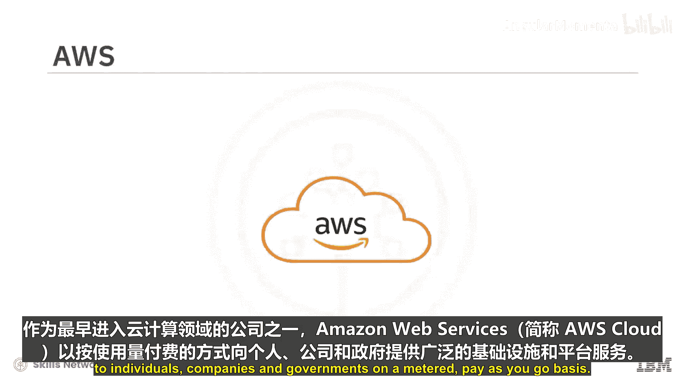

Google Cloud Platform or GCP， is a suite of cloud computing services， providing infrastructure。

 platform， and serverless computing environments。

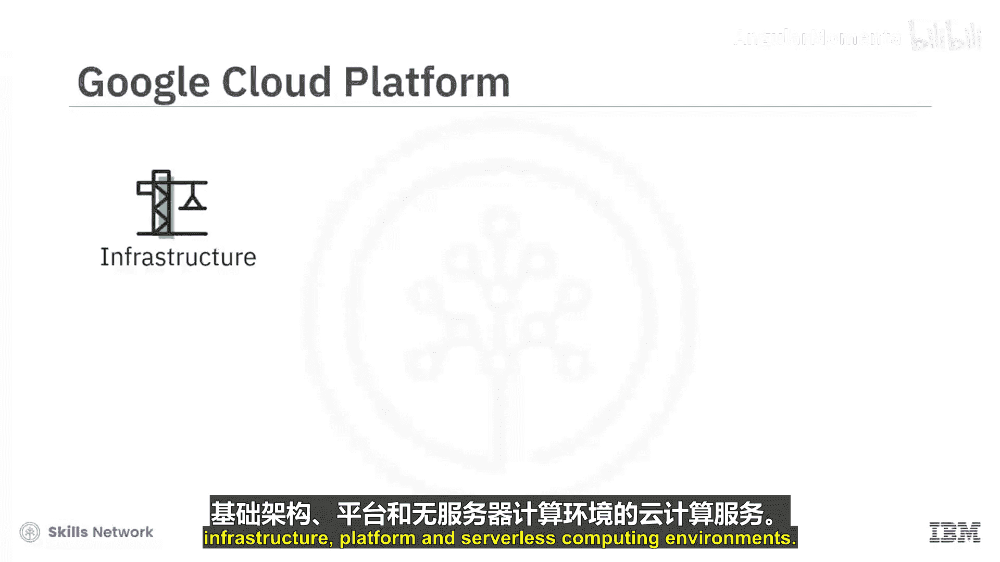

Google also uses GCP internally for their end user products， such as Google Search and YouTube。

Google Cloud includes G Suite with products for communication， productivity， collaboration， storage。

 and more。The Google App engine is a platform for developing and hosting web applications in Google managed data centers。

 automatically allocating and delocating resources to handle demand。

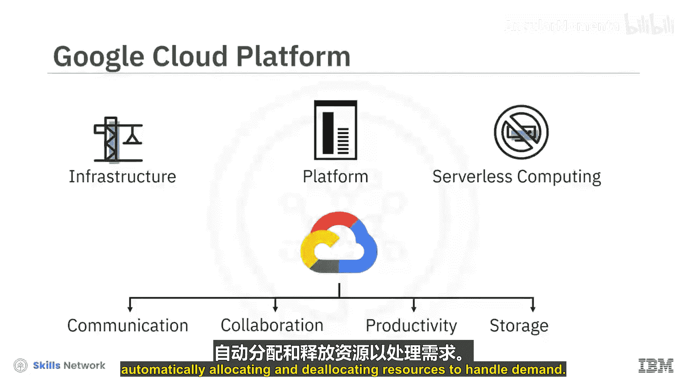

IBM Cloud is a fulltat cloud platform that spans public。

 private and hybrid environments with products and services covering compute， network， storage。

 management， security， DevOs and databases， some of their prominent offerings include their bare metal servers。

 VMware， Cloud packs for application modernization， virtual private cloud。

 and the suite of emerging technologies such as AI， IoT， blockchain， data and analytics。😊。

With the acquisition of Red Hat， IBM is also positioning itself as the leading hybrid cloud provider of our times。

😊。

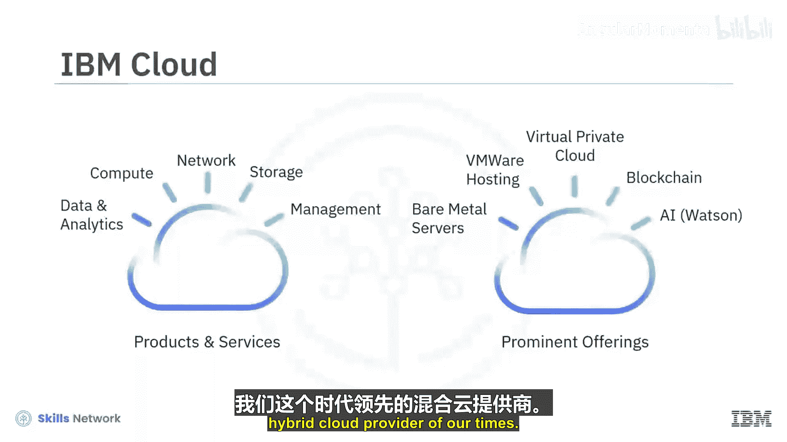

Microsoft Azure is a flexible cloud platform for building， testing， deploying。

 and managing applications and services through Microsoft managed data centers。

 with its data centers spread out in many regions， Azure provides a global reach with local presence。

 it provides software， platform and infrastructure services。

 supporting Microsoft specific and thirdpart languages， tools and frameworks。😊。

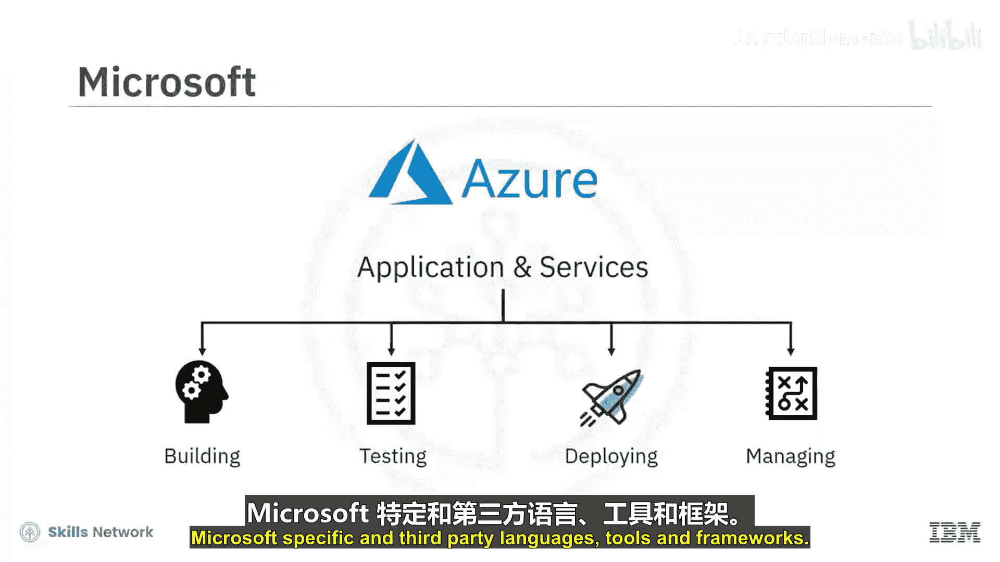

Orracle Cloud is primarily known for SAAS and database as a service。

 also known as the Oracle Data Cloud。Oracle's SAAS offering includes wide ranging applications such as ERP。

 SCM， HCM， marketing， sales， and CX running in the cloud。

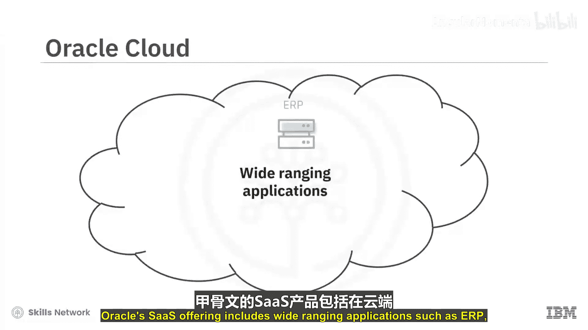

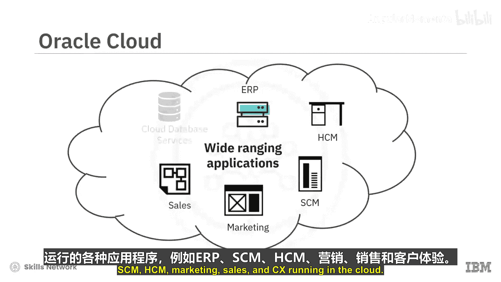

And the Oracle Data Cloud provides one of the largest cloud based data management platforms。

 helping customers personalize their online， offline。

 and mobile marketing campaigns for targeted audiences。

Oracle Cloud also provides some cloud infrastructure and platform services。

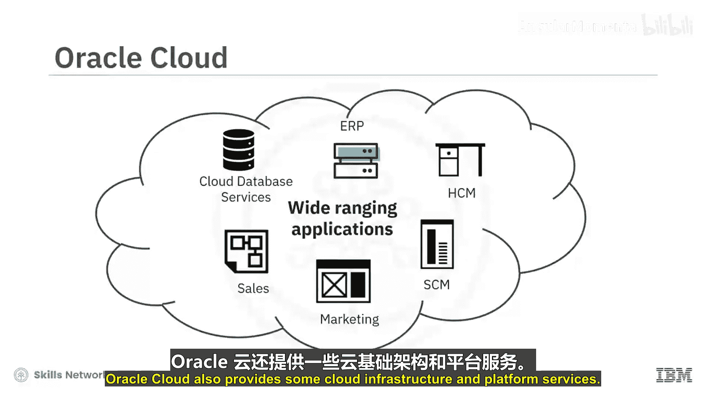

Salesforce specializes in their software as a service offering that focuses on customer relationship management。

 supporting businesses to better connect with their customers， partners and potential customers。

Salesforce offers multiple cloud services， such as Sales Cloud， Service Cloud， and marketing Cloud。

 helping customers track analytics in real time， customer success and support， customer complaints。

 even listening into customers across social platforms to automatically root them to the appropriate agents for resolution。

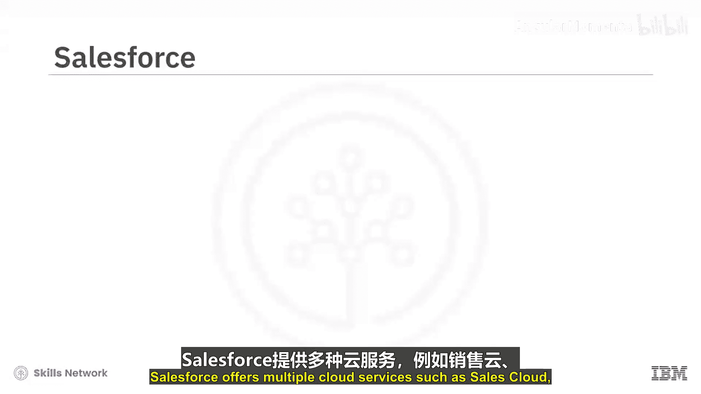

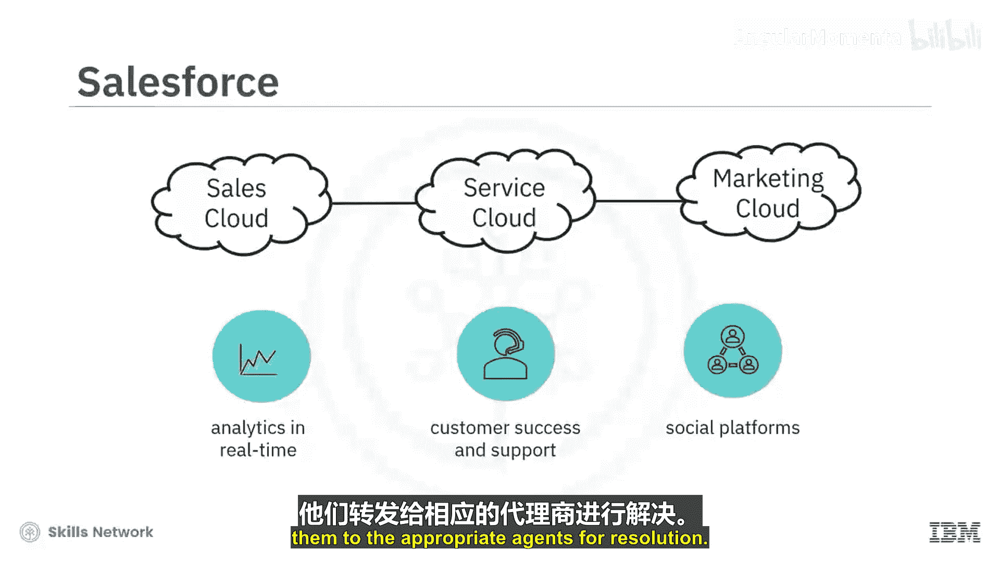

SAP is known for enterprise software and applications such as ERRP， CRM， HR。

 and Fin running in the cloud。

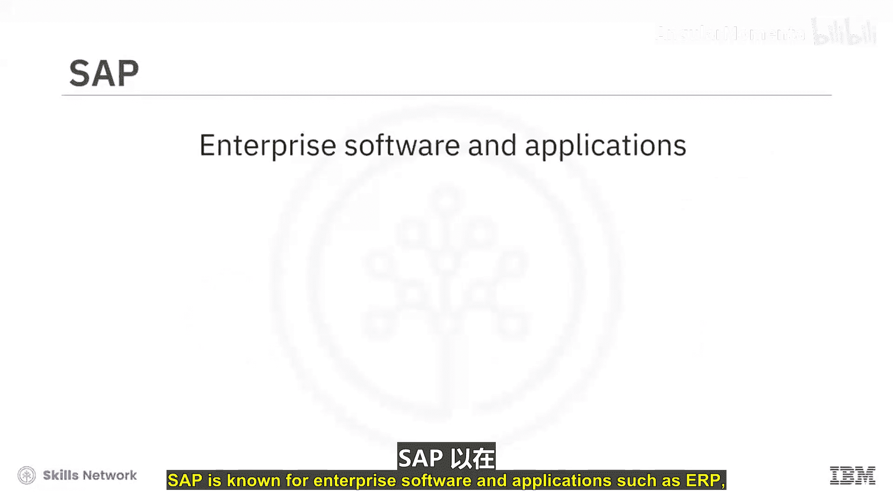

There is also an SAP cloud platform for building and extending business applications with rapid innovation cycles in a secure cloud computing environment managed by SAP。

In the next video， we're going to look at the business case for cloud computing。

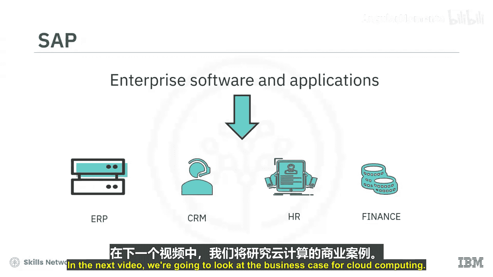