# 【IBM】云计算导论-｜-Introduction-to-Cloud-Computing-p07-01_03_01_云采用已非选择--BV1X66rBqE8G_p7-

Cloud adoption is no longer a thing of the future from a single individual to a global multibillion dollar enterprise。

 anybody can access the computing capacity they need on the cloud。

The lag time from decision to value is no longer a journey of years with high upfront capital Cloud makes it possible for businesses to experiment。

 fail， and learn much faster than ever before with low risk exposure。

Businesses today have greater freedom to change course than to live with the consequences of expensive decisions taken in the past。

 According to an IBM Institute for Business Val studyy。

 more than three quarters of enterprises today are using cloud computing to expand into new industries。

 74% have adopted cloud to improve customer experience。

 and 71% use cloud to create enhanced products and services while simultaneously downsizing legacy systems and reducing costs。

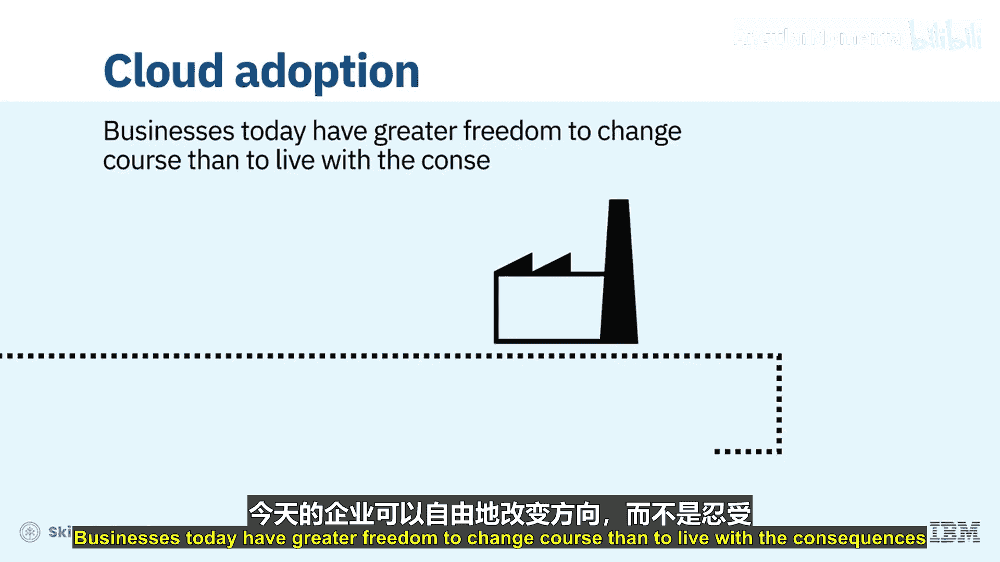

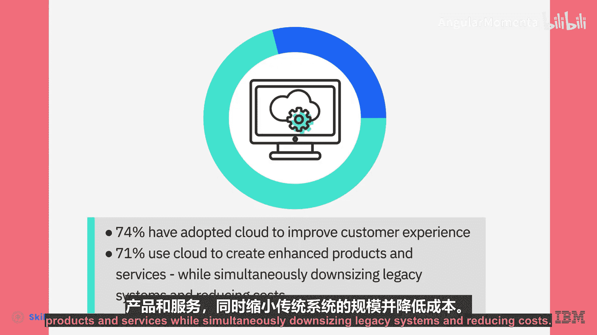

To remain competitive， businesses need to be able to respond quickly to marketplace changes。

 use analytics to understand customer experience， and apply that understanding to adapt their products and services based on what they learn。

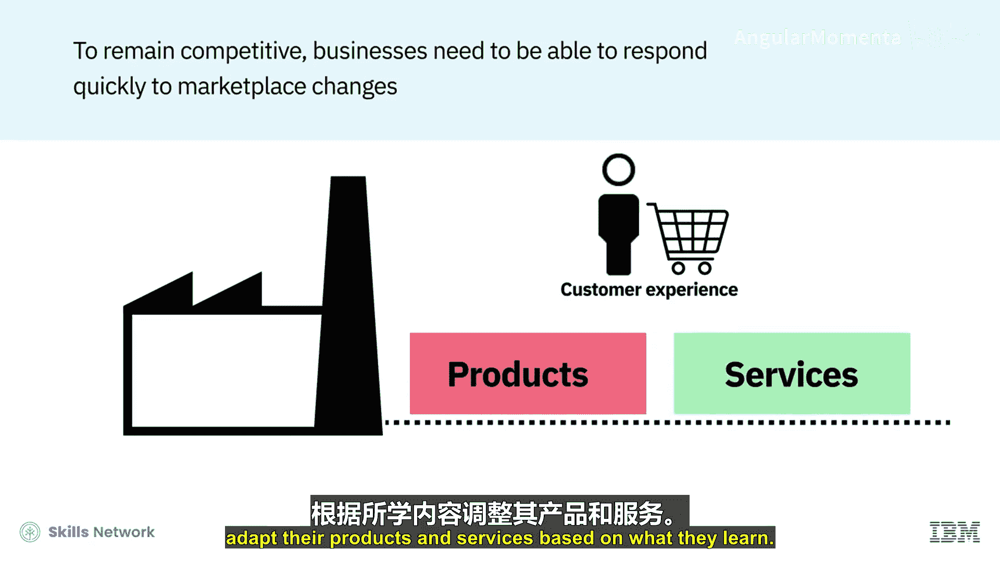

Product life cycles have shortened and barriers to entry have become lower cognitively enabled workflows。

 applied exponential technologies such as AI， automation。

 IoT and blockchain applications that span new and legacy solutions and open。

 hybrid and secure multi-cloud infrastructures are today's enablers for growth。

 agility and innovation。

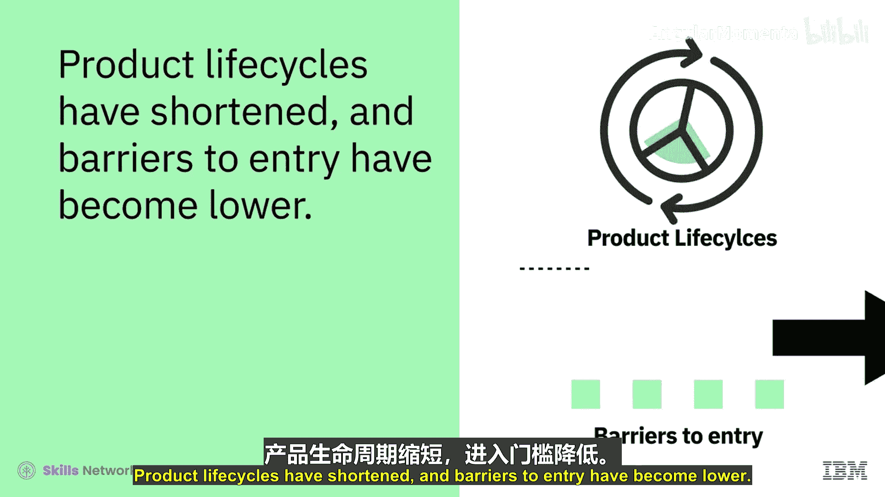

The power， scalability， flexibility， and pay as you go economics of cloud has made it the underpinning foundation for digital transformation。

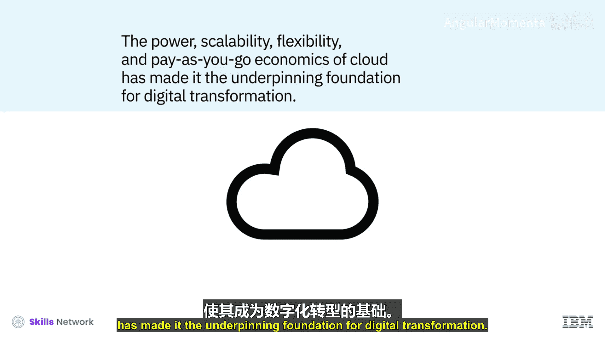

The International Data Corporation， IDC predicts that by 2025。

 the total amount of digital data created worldwide will rise to 163zeabytes。

 where onezeabbyte is equivalent to a trillion gigabytes。

 and 30% of this data will be real-time information。

 considering the unprecedented amounts of data being produced daily and the ability to make datadven decisions crucial to any business。

 cloud computing becomes essential for businesses to succeed， sustain and compete in today's markets。

 a cloud strategy more than just an IT strategy is the core component of any business strategy today。

 businesses that haven't already or are not currently integrating cloud into their business strategy。

 run the risk of lacking the speed， agility， innovation and decision making capacities needed to be competitive。

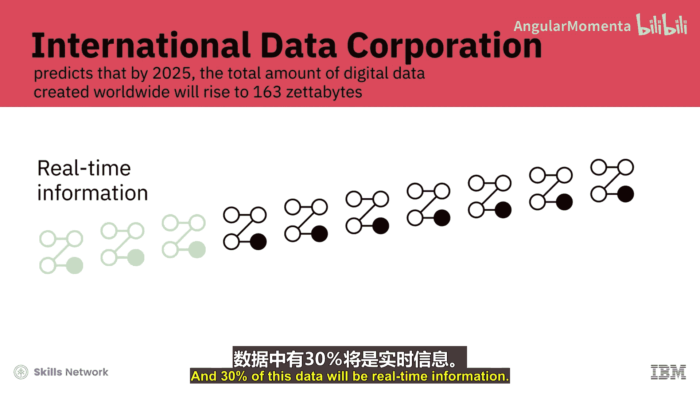

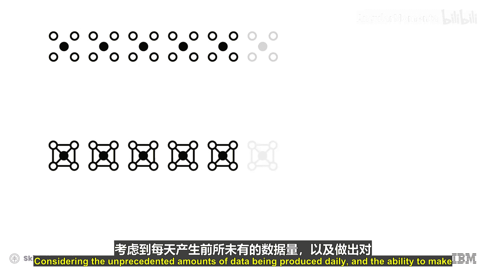

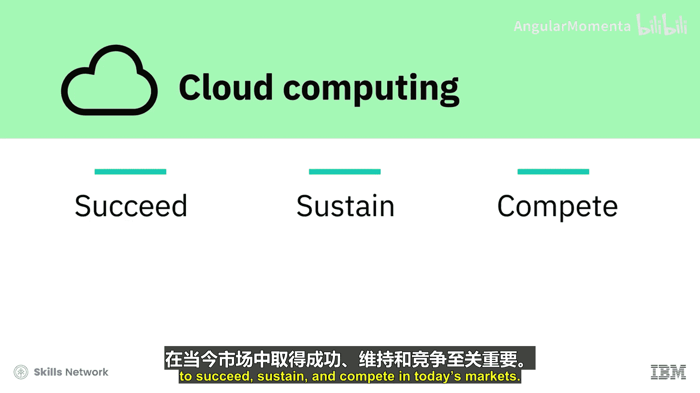

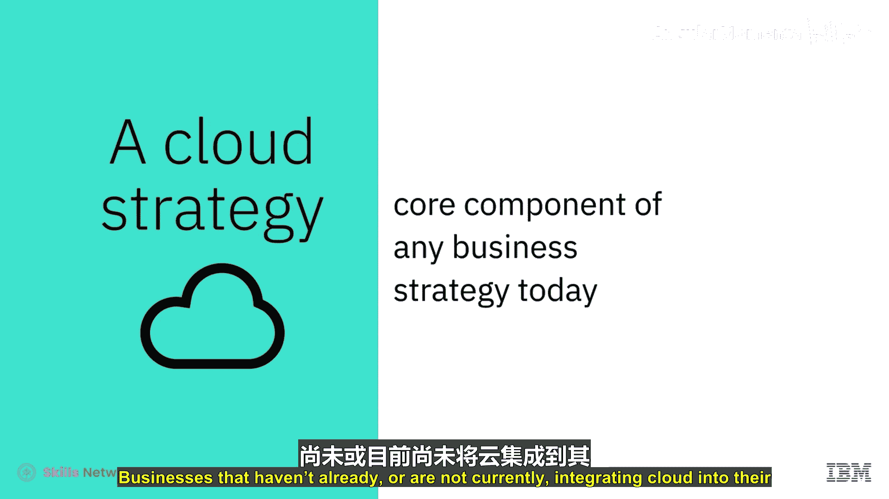

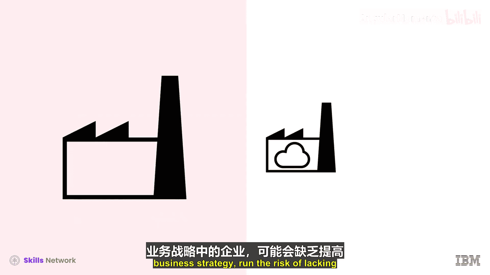

As also their ability to respond to digital disruption。

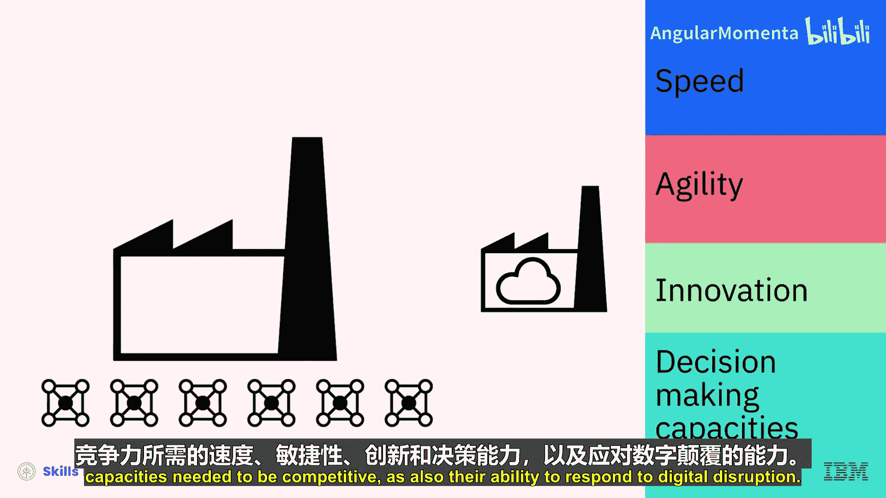

In the next video， we'll look at some case studies that demonstrate the impact businesses have created by adopting cloud。

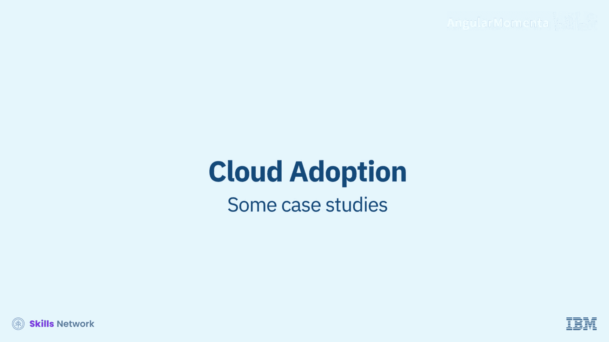

。