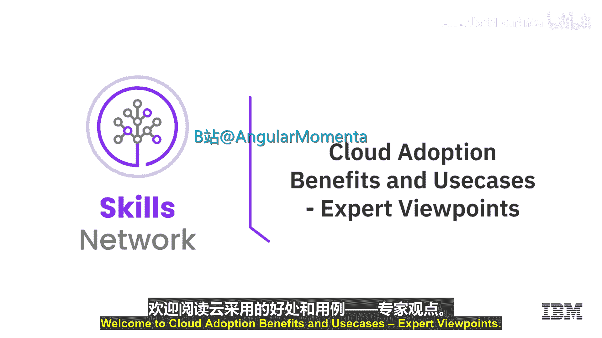
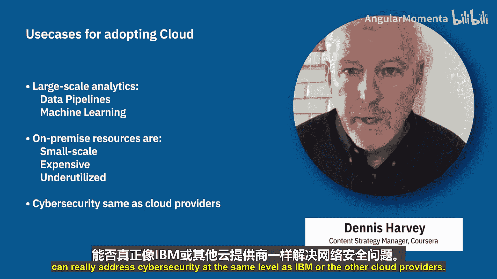
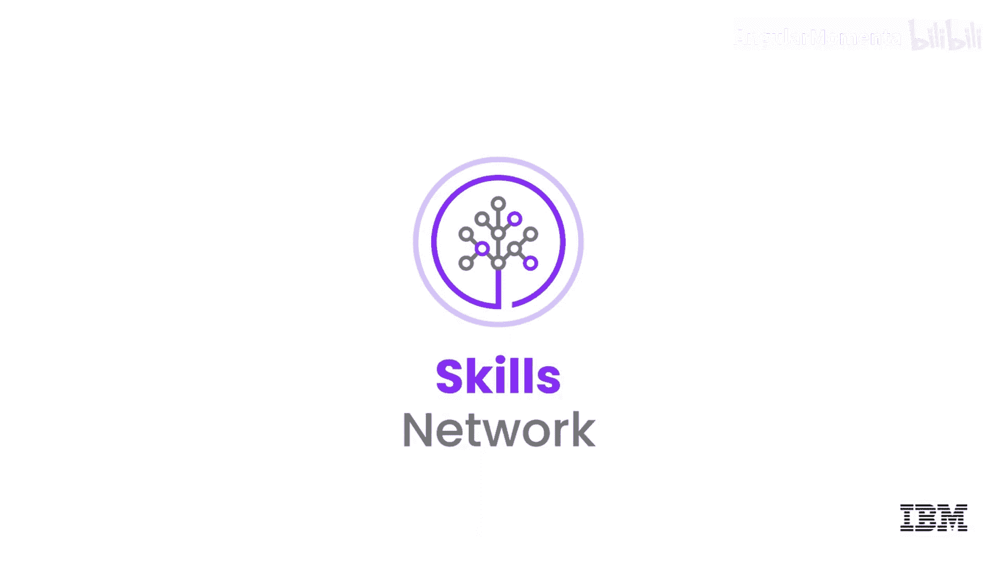

# 【IBM】云计算导论-｜-Introduction-to-Cloud-Computing-p08-01_03_02_专家观点：云采用的益处与应用场景--BV1X66rBqE8G_p8-

Welcome to Cloud Adtion Benefs and Use casess Expert Viewpoints。

In this video， we will listen to several cloud application professionals discuss cloud adoption。

According to you， what are some of the most compelling reasons for businesses to adopt cloud technologies？

One of the biggest reasons for a business to adopt cloud technologies is the sheer speed it gives you to move forward and enhance your product。

 for example， every industry has its own needs and every business has its own specific needs and a lot of these needs are already met with services and technologies available in the cloud you can quite frankly stand on the shoulders of giants with cloud technologies。

 you don't need to create AI algorithms yourselves you can use AI services。

 you don't need to worry about building a machine connecting it to the internet those are already provided for you so the best thing about the cloud is how easy and how fast it is to just get going into get really specialized stuff going without needing that specialization yourself。

😊，By using cloud computing businesses pay only for services they use which help in reducing their infrastructure and operating cost machines can be deployed and used within a matter of minutes。

 the infrastructure can be scaled elastically to meet the growing business needs。

As cloud computing services run on variety of secure data centers around the world。

 there is reduced network latencies for applications and greater economies of scale。

Cloud computing also makes data backups and recovery services less expensive along with providing policies for higher levels of security。

Cloud technologies allow businesses to focus entirely on their core business model and let the cloud handle other components for example if my business is not pertaining to databases then I don't want to worry about managing and deploying a database I can offload that to the cloud and I'm guaranteed a highly available and distributed database for my business。

 allowing me and my engineers to focus on what actually matters for my application and my users。

With high performance compute in the cloud， you can have extremely fast clusters of computers at your fingertips and only pay for them when you need them and thanks to the cloud。

 smaller companies are able to set up high performance compute clusters。And innovate rapidly。For me。

 the most compelling reason to adopt cloud technologies is that you typically only pay for what you use。

That means there's a very low barrier to entry， you can typically start trying something out with an hourly billing plan and no upfront costs。

Another compelling reason is to take advantage of the high level of service that the cloud can provide。

So for example， I need access to databases， I want them to be highly available。

Fast and have regular backups， but I'm not in the business of database management and if I have the option of getting someone else to manage that for me。

 I will typically take it。And finally， time to market pressure to build new products， you know。

 we're seeing many or perhaps most startups using cloud platforms to build and deploy their products quickly and with less expense。

One is your business requires a global footprint and you it's quite likely that your business cannot afford global data centers。

 so that's one very obvious one。Another one is your business requires elastic resources。

 think of retail and e-commerce， during high demand， holidays， think of live event ticketing。

 maybe HR and healthcare annual enrollment， basically any application where demand is highly variable or spiky。

Another interesting one is large scale analytics or a development of data pipelines and machine learning on- premise physical resources are you know possibly too small to expensive or underutilized another good one is cybersecurity。

 you know I think you have to assess whether your organization can really address cybersecurity at you know the same level as IBM or the other cloud providers。

