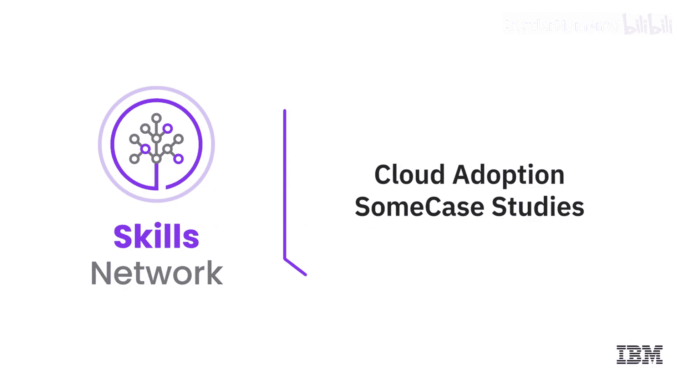
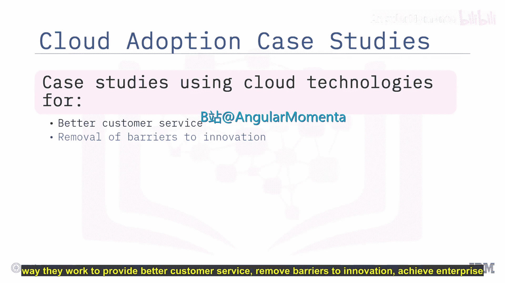
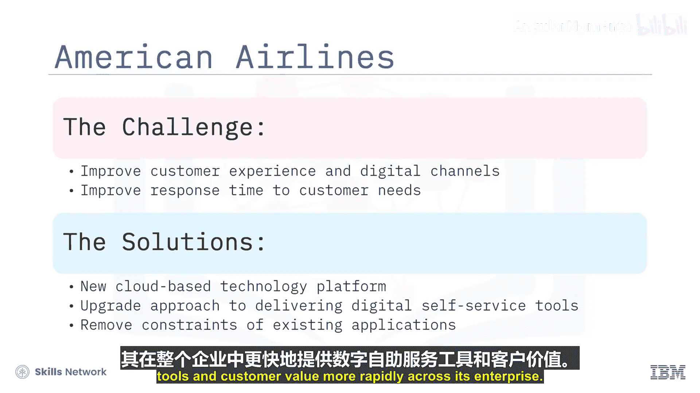
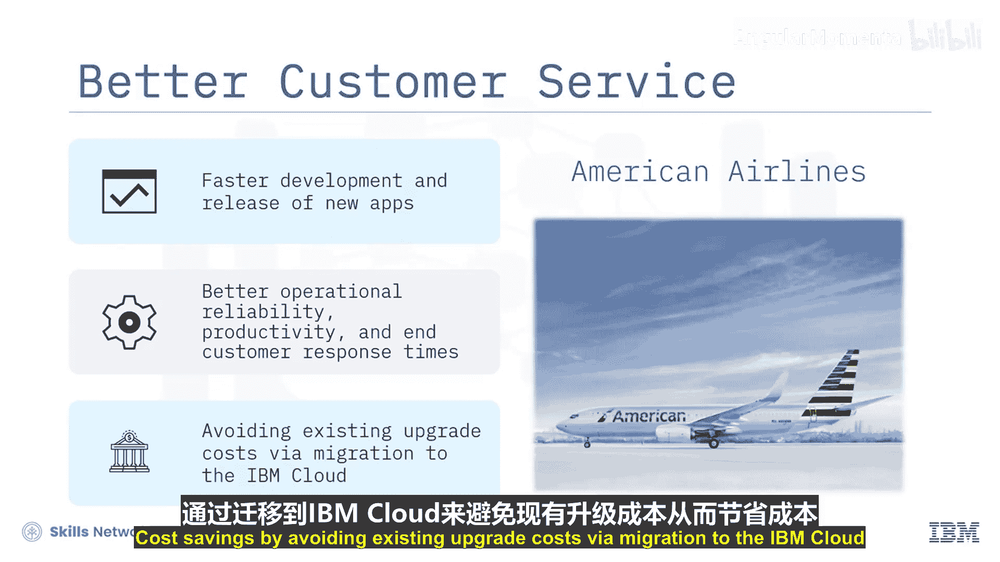
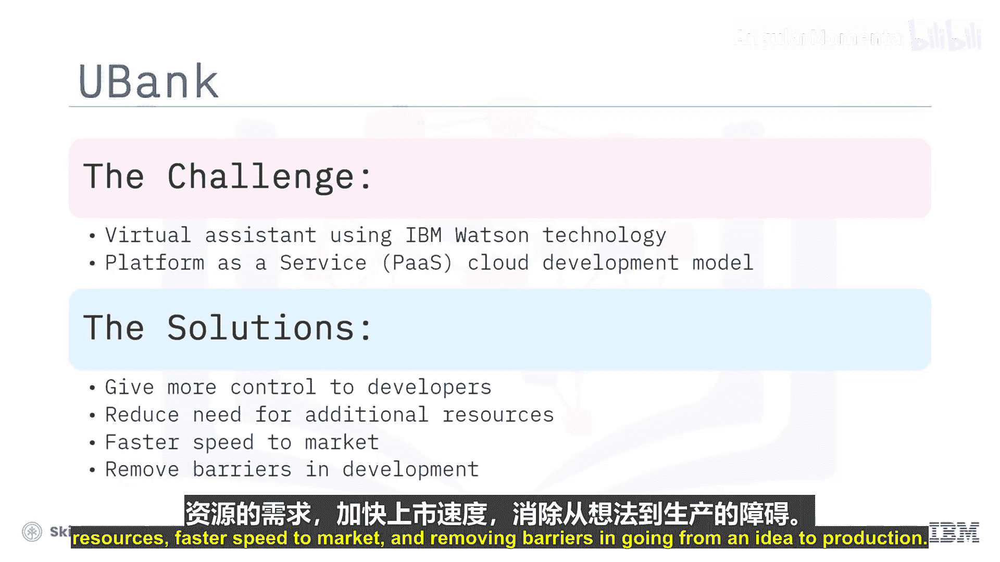
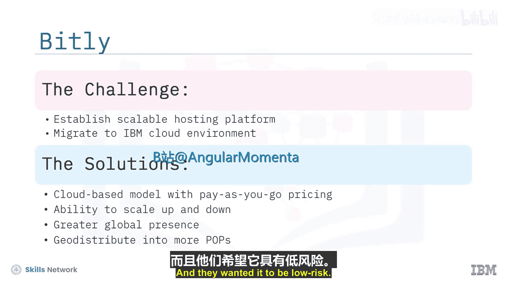
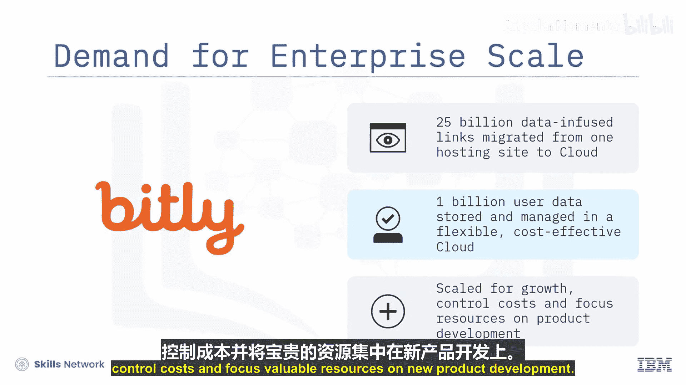
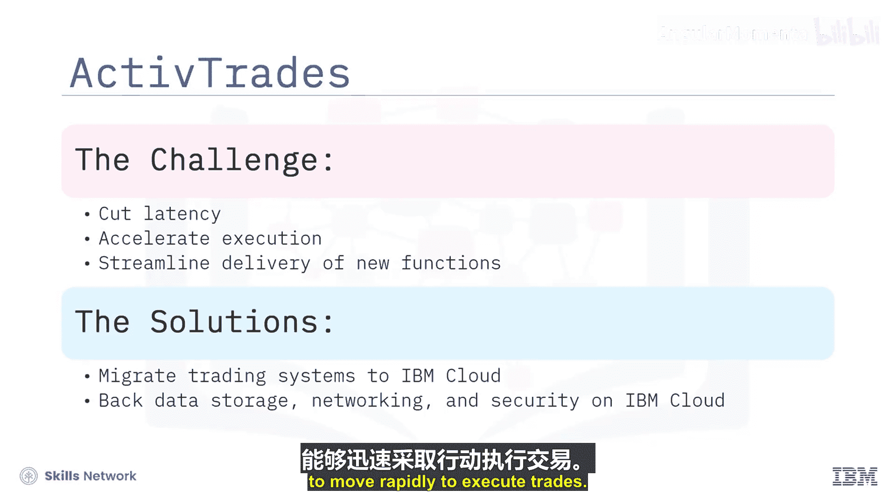
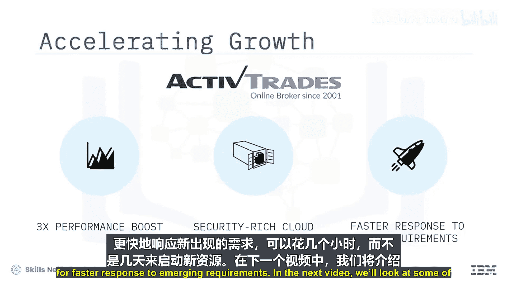

# 【IBM】云计算导论-｜-Introduction-to-Cloud-Computing-p09-01_03_03_云采纳：若干案例研究--BV1X66rBqE8G_p9-

In this video， we will look at how some of the leading businesses have transformed the way they work to provide better customer service。

 remove barriers to innovation， achieve enterprise scale。

 and accelerate growth using cloud technologies， although the case studies we'll look at are curated from IBM Cloud。

 similar stories with dramatic impact to business can be found across the spectrum of companies utilizing other cloud service providers as well。

 better customer service in the highly competitive airline industry。

 customer experience is a major point of differentiation。

 and digital channels are increasingly important。

To become more responsive to customer needs， American Airlines needed a new technology platform and a new approach to development that would help it deliver digital self-service tools and customer value more rapidly across its enterprise。

The airline recognized the opportunity to remove the constraints of their existing customer facing applications based on monolithic code into cloudnative based microservices architecture on the cloud。

 the results， faster development and release of new apps， improved operational reliability。

 productivity， and end customer response times， cost savings by avoiding existing upgrade costs via migration to the IBM cloud。

Removing barriers to innovation。As a lean organization with a selfimposed limit on headcount。

 UBank excels at finding innovative ways to meet demands。

 continually challenged to find more efficient ways to operate。

 Ubanknk's IT team explored a platform as a service or PAAS， cloud development model。

Their need was to give more control to their developers， reduce the need for additional resources。

 faster speed to market， and removing barriers in going from an idea to production UBank launched a new initiatives in an IBM cloud platform environment。

 including a virtual assistant that incorporates IBM Watson technology to support the bank's online home loan application The results faster time to market made possible through the cloud platform framework that streamlines development and empowers product teams foster greater innovation with cloud-based development resources that are quick。

 easy and cost effective to deploy more efficient operations。

Demand for enterprise Sc。Since its inception in 2008。

 Bitley has journeyed from a startup that offered intelligent link shortening technology adopted by users to compress lengthy URLs for social media posts to an enterprise product seeking an agile costeffective IT infrastructure to support this transition。

 Biley started planning for cloud migration their need was to have a cloudbased model with pay as you go pricing。

 the ability to scale up and down a more global presence and the ability to geodisribute into more PPs and they wanted it to be low risk Bitley migrated to an IBM cloud environment establishing a scalable hosting platform for lowlatency delivery to enterprise customers around the world The results 25 billion datainfused links migrated from one hosting site to cloud infrastructure with data center locations worldwide billion。

User interaction data stored and managed in a flexible。

 cost effective cloud object storage environment， transformed IT operations to scale for growth。

 control costs and focus valuable resources on new product development。

Accelating growth。Financial traders demand extreme speed and availability from trading systems profitabilityfiability depends on split secondcon decisions as a leading online broker for Forex commodities equities。

 cryptocurrencies， indices， and other financial instruments。

 active trades enables investors to buy and sell on numerous financial markets investors need reliable access to accurate market information。

 combined with the ability to move rapidly to execute trades， as its client-based crew。

 active trades wanted to cut latency， accelerate execution and streamline the delivery of new functions。

 Act trades migrated three major trading systems from on-premise infrastructure to IBM cloud for VMware solutions backed by data storage。

 networking and security offerings on the IBM cloud The results up to three times performance boost。

 helping clients。

Seize fleetleing opportunities for profit Security rich cloud platform with ultra high availability protects client investments。

Hours， not days to fire up new resources for faster response to emerging requirements。

In the next video， we'll look at some of the emerging technologies that are available on the cloud and the opportunities they bring to businesses。

