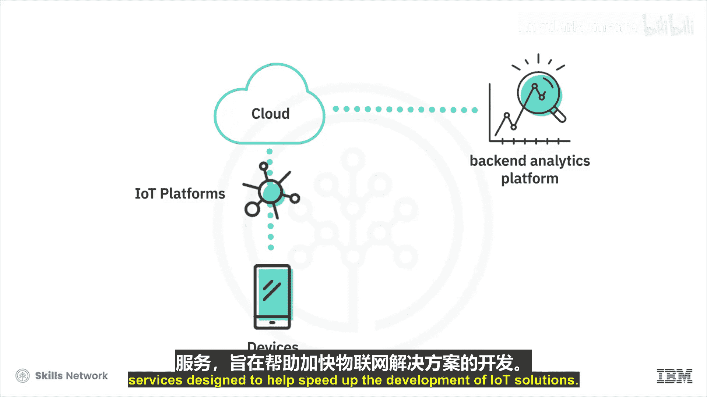
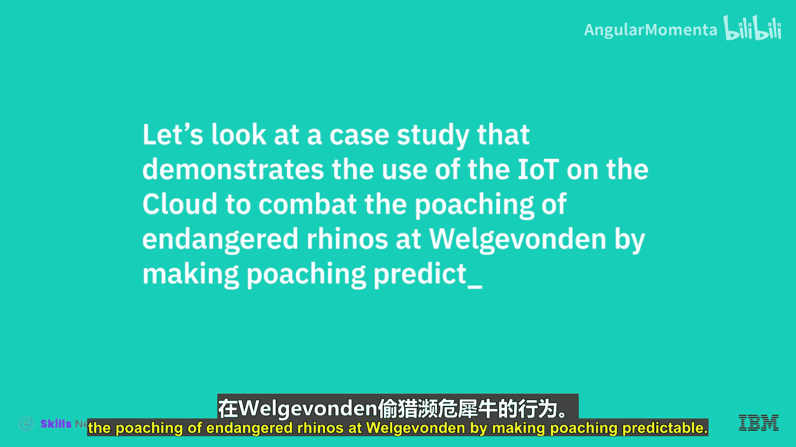
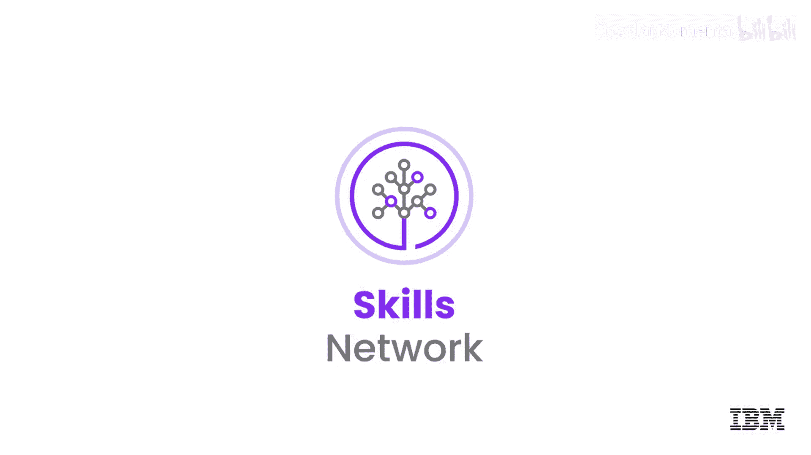

# 【IBM】云计算导论-｜-Introduction-to-Cloud-Computing-p10-01_04_01_云端物联网--BV1X66rBqE8G_p10-

In this new era， technologies such as Internet of Things， big data。

 artificial intelligence and blockchain are disrupting existing business models and industries while creating unprecedented opportunities for businesses to differentiate themselves and create value for their clients。

 the power scale， dynamic nature and economics of the cloud resources make cloud computing a key enabler for adoption and evolution of these emerging technologies。

In this video we will look at how the Internet of Things or IoT powered by cloud is making a big difference for businesses today The Internet of things or IoT is a giant network of connected things and people that have changed much of how we live our daily lives from the way we drive to how we make purchases monitoring our personal health and even how we get energy for our homes。

 smart devices and sensors are continuously tracking and collecting data， for example。

 a smart building could have thousands of sensors measuring all kinds of data related to thermal。

 optical， structural and environmental stimuli。An unprecedented amount of data is being generated。

 putting a tremendous strain on the internet。 That is where the cloud comes in by connecting the IoT device user to the cloud。

 be it for device registration， device identity， storing data or accessing enterprise data。

 data collected through IoT devices is stored and processed on the cloud。

 Since IoT devices can be in a state of motion， the cloud serves as a collection point in closest proximity。

 minimizing the latency in reporting up the data points and providing a response back to the IoT application。

So from IoT platforms running entirely on the cloud to the interfaces used by customers to interact with these devices。

 to the back end analytics platforms， cloud computing supports and enables IoT。

Cloud service providers also offer specialized IoT services designed to help speed up the development of IoT solutions Let's look at a case study that demonstrates the use of the IoT on the cloud to combat the poaching on endangered rhinos at Well Gonin by making poaching predictable。

Aina has become one of the key species that is becoming endangered due to poaching throughout Africa。

 but now especially in South Africa， up until now。Poachers have been increasing in numbers。

 and they've become more militarised with weapons。 And so， of course， we've had to do the same。

 This is not sustainable。 The only way to do this better is to bring in technology and things that they do not have。

This endangered species is getting help from some unexpected friends， the zebra and antelope。

 they're wearing IoT sensors connected to the IBM cloud。When poachers enter the area。

 the animals run for it， which alerts rangers who can track their motions and help stop them before any harm is done。

 it's a smart way to help increase the rhino population and turn the poachers into the endangered species。

In the next video， we're going to look at how artificial intelligence on the cloud is impacting businesses。

