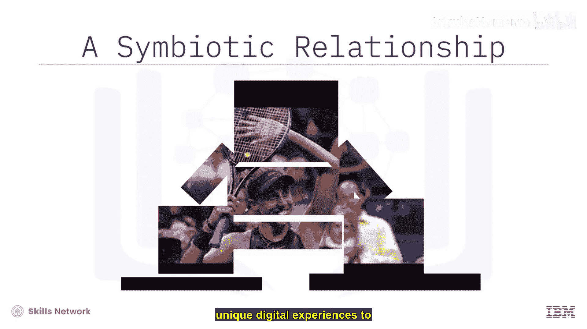
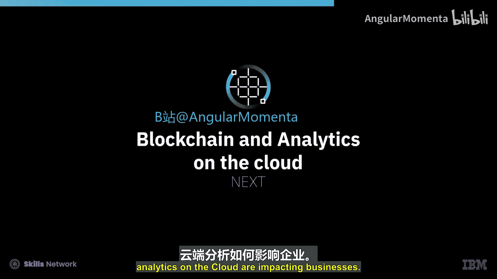
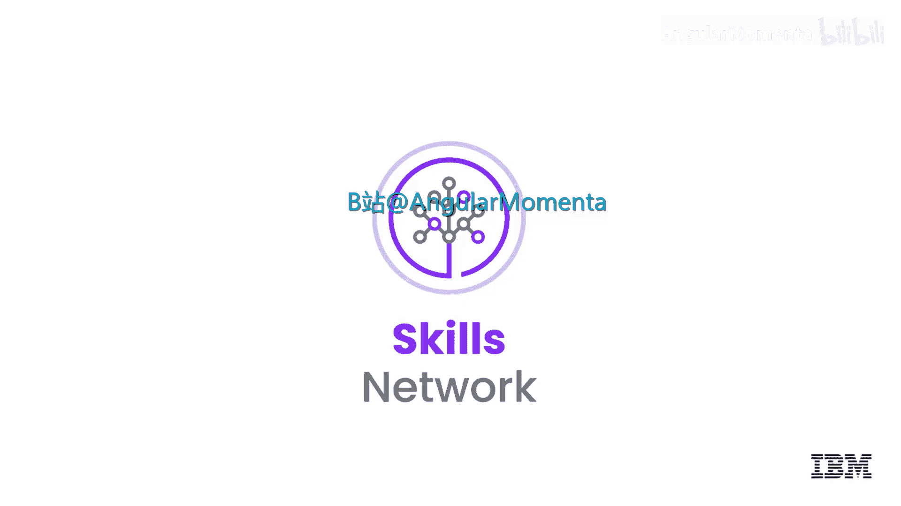

# 【IBM】云计算导论-｜-Introduction-to-Cloud-Computing-p11-01_04_02_人工智能在云端--BV1X66rBqE8G_p11-

Making sense of the endless streams of data is where artificial intelligence or AI comes in Many of the applications where we apply AI today simply wouldn't have been possible without the scalable on-demand computing offered by the cloud There is a threeway relationship between AI。

 IoT and cloud just as AI consumes the data produced by IoT devices the IoT device' behavior can be dictated based on responses from AI For example。

 smart assistance a common type of IoT device continues to learn about the user' preferences as usage grows such as songs they like their home temperature settings preferred meal times and over time they anticipate their actions based on the user' past history So what we see is a symbiotic relationship between IoT。

 AI and cloud IOT delivers the data AI powers the insights。

And both these emerging technologies leverage cloud scalability and processing power to provide value to individuals and businesses alike。

Let's look at how the United States Tennis Association， USTA。

 is using AI on the cloud to deliver unique digital experiences to millions of fans around the world。

For two weeks at the end of every summer， tennis fans around the world turned their eyes to New York City and the US。

 Open hundreds of thousands on site and millions more online。But where UC tennis， IBM sees data。

The scores and statistics。The sites。The sounds。IBM integrates and analyzes the data flowing from the court and delivers unique digital experiences to more than 10 million tennis fans around the world。

And we do it all in the IBM cloud The IBM cloud is the digital foundation of the US Open。

 it scales rapidly to meet a 5，000% increase in web traffic and it delivers a consistent experience to our fans all around the globe。

And with Watson on the IBM cloud， we can engage fans in unique ways， year after year。

Slam Traer analyzes more than 26 million historical data points。

 it gives fans deep insight into featured matches， and it can see the momentum of a match shifting in real time。

AI Highlights uses Watson to process thousands of hours of U Open video。

 it can hear the cheers of the crowd， it can see a player celebrating。

 and it knows what makes a great tennis highlight。And this year。

 we're putting the power of AI highlights into the hands of US players and coaches。

Watson is analyzing match video so coaches can quickly find the footage they need to guide the development of their players。

 and if you need to know where to park， find a good burger， or grab the latest US Open gear。

 you can find the answers with the guest information feature in the US Open app and mobile web using Watson。

We work with IBM because they keep us on the cutting edge of the fan experience they help us to adopt the latest technology like cloud and AI and they bring data to life in a way that's accessible and engaging for our fans In the next video。

 we're going to look at how blockchain and analytics on the cloud are impacting businesses。

