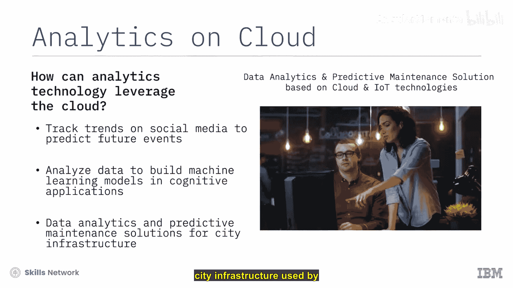
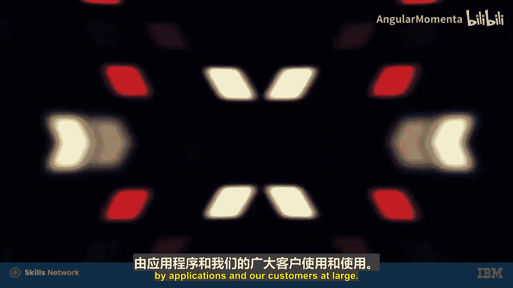
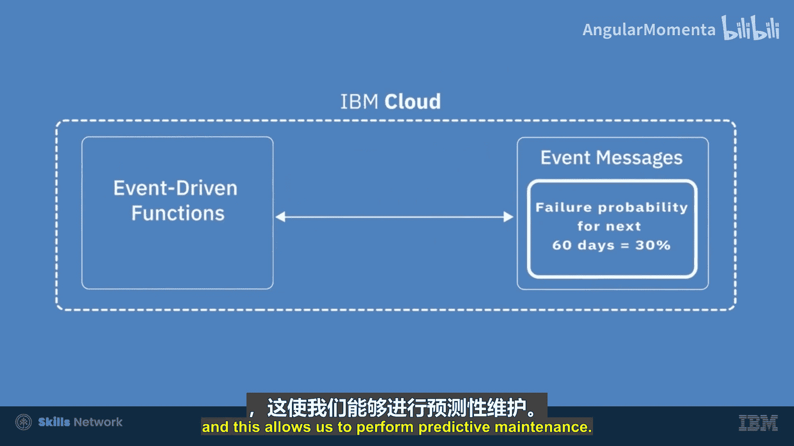
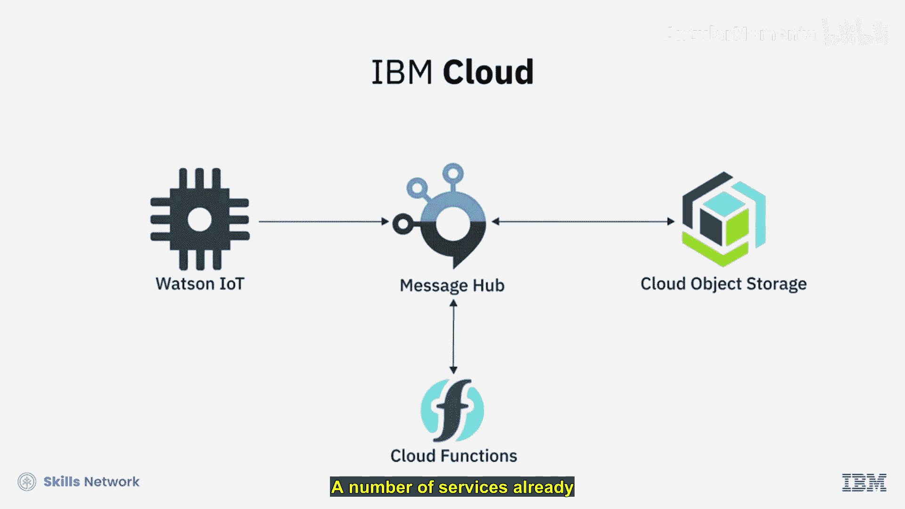

# 【IBM】云计算导论-｜-Introduction-to-Cloud-Computing-p12-01_04_03_区块链与云端分析--BV1X66rBqE8G_p12-

Blockchain is a secure， distributed open technology that can help speed up processes， lower costs。

 and build transparency and traceability in transactional applications。

It is an immutable network allowing members to view only those transactions that are relevant to them the more open。

 diverse and distributed the network， the stronger the trust and transparency in the data and transactions 85% of businesses today rely on multiple clouds to meet their IT needs with more than 70% using more than three these businesses need to be able to move applications and data across multiple clouds easily and securely leading to the emerging demand to build and manage business applications such as blockchain for the multi-cloud environment blockchain and AI much like IoT and AI powered by the cloud also have a threeway relationship where blockchain technology provides the trusted decentralized source of truth AI powers the analytics and decision making from the data collected and cloud provides globally distributed scalable and costeicient computing。

Resources to support both the unprecedented amounts of data being collected and the processing power required to draw insights from this data。

Blockchain serves to make AI more understandable by recording the data and variables that go into a decision made in an AI algorithm。

 leading to greater trust and transparency in the conclusions and decisions made by these algorithms Let's look at how blockchain on the cloud is helping farmers reduce waste at times of recall by building traceability and transparency in the food supply chain。

For farmers here， this is our life's work。You know。

 60% of the nation's lettuce is grown right here in Salinas when it comes down to how plants are looked at。

 I really relate back to how humans are raised and nurtured。

I want to make sure that everything is safe before it leaves the ranch。But when a recall happens。

 perfectly good food goes to waste， you have to take all product off your shelf， no matter what age。

 no matter where it came from。And it takes resources to grow those things。

 that now we're actually eating into our future food supply。But we've got a way around that。

Wlockchain technology on the IBM cloud， we're able to track our product within seconds。

 giving the consumers instant access where the product came from in case there's any recall so we don't have to take all the food off the shelves。

Having that instant access allows you to reduce the waste。

There's a lot of starving people in this world。I want to be the generation that fixes that。🎼Yeah。

 it is。Analytics technologies on the cloud leverage the flexibility， scalability。

 and computing resources available on the cloud from tracking trends on social media to predict future events to analyzing data to build machine learning models that can be deployed in cognitive applications Cloud provides the integrated environment that is required to leverage data for continuous improvement and accelerated business growth Let's look at how Cone has invested in cloud and IoT technologies to power a data analytics and predictive maintenance solution for city infrastructure used by more than 1 billion people daily。

At Cone we manufacture elevators， escalators， autowalks and doors。

 all of these devices are streams of data that we are collecting in order to process those streams we need a scalable way of handle the amount of data that is coming in and that's where cloud function fits in perfectly we handle that data with event- drivenn architecture we use functions to persist that data and to generate further events on that data that are then utilized and consumed by applications and our customers and users in our analytics platform we analyze the set of data and we generate value predictive in a sense that we can predict the failure rate to a certain percentage that is about to happen in the future for our equipment and this allows us to perform predictive maintenance and this is kind of the whole concept that we have behind our 247 connect。

Servic which is a promise to our customers that the equipment is connected to the cloud and we are monitoring it and that's where we generate the real value for our customers from me。

At the moment we use almost all aspects of the IBM cloud， we use storage from the cloud。

 we use cloud function， we use messaging services， we use IoT services。

 so a number of services already in use in platform and that use will only grow as our digital footprint in the industry grows。

。