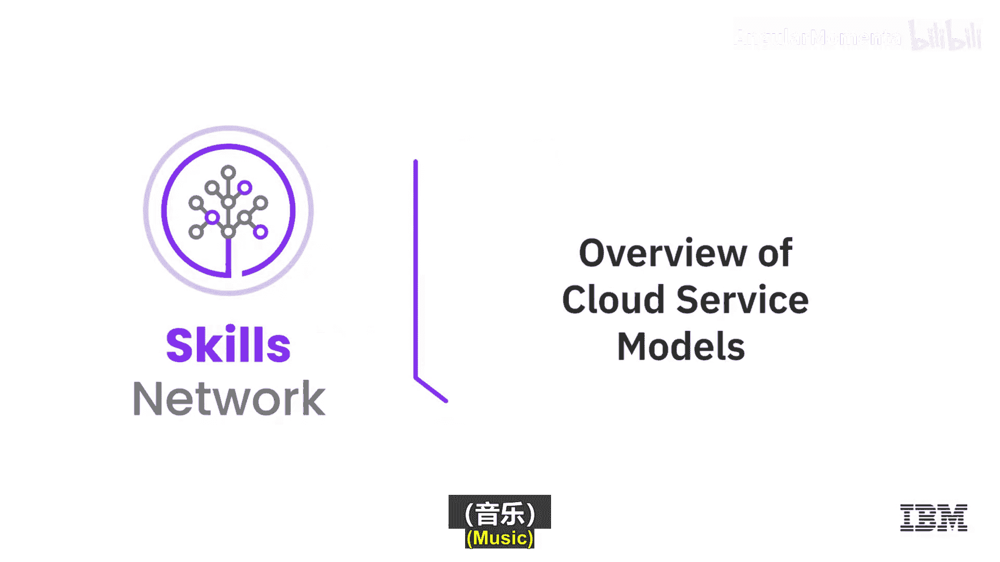
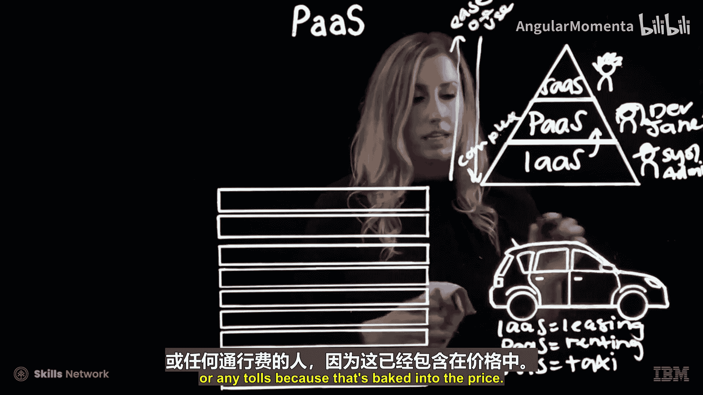
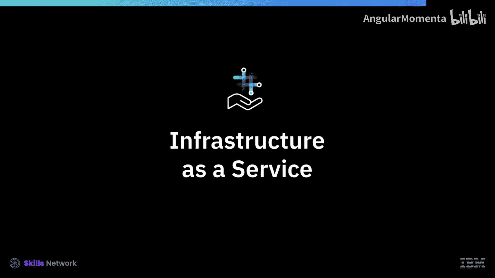

# 【IBM】云计算导论-｜-Introduction-to-Cloud-Computing-p13-02_01_01_云服务模型概述--BV1X66rBqE8G_p13-

In our introductory cloud video， we briefly talked about the three service models available on the cloud。

 infrastructure as a service， platform as a service and software as a service Before we dive into the details of each of these service models in the subsequent videos。

 let's get started with a quick overview of these models Hi。

 I'm Tessa Reds and I'm a designer on IBM Cloud。So let's start with the foundation here with IAS。

ISIS is a set of compute networking and storage resources that have been virtualized by a vendor so that a user can access and configure them any way they want。

In design， we have a concept of talking about users called personas。

And the persona for IS is a system admin。Or an IT admin。

Let's jump up to the top with software as a service that's the easy one software as a service is just software that you don't have to install on your machine and you don't have to manually update。

😊，The user。For software as a service could be anyone in fact。

 if you're watching this on YouTube right now。The mirror user of software as a service。

 it's usually charged on a subscription model rather than a one time license fee。

Then that brings us to platform as a service。PaS takes advantage of all the virtualized resources from IA and then just abstracts them away so the user doesn't have to worry about managing any of those virtualized resources。

 the user for PAS。Is not a system admin。Usually， it's usually a dev。And IBM。We call this devb Jane。

That's the name of our persona。And so this whole metaphor。

 the pymid metaphor is meant to indicate that as you move down。You're increasing complexity。

In terms of your knowledge and management of infrastructure resources and your increasing。

The ease of use。Another metaphor I use when I'm talking to the designers on my team about PAS is having to do with a car。

So。In this metaphor， I as。Is like leasing a car。So if you've ever released a car。

 you probably did a lot of research and you care about the specs of the car and their performance。

 you care about the color of the car， what kind of car it is。You're the one driving。

And you're paying for it。We're also paying for the gas and any tolls or maintenance。

With platform as a service in this metaphor。That's more like renting a car。

So say you're on vacation and you just got off the airport and you're going to pick up your rental car。

 you don't really care what color it is。You don't really even care about the specs of it。

 but you're still driving and you're paying for the gas and any tolls you go through。

Suffers and services again。The easiest one， that one's more like getting a taxi。or an Uber。

 so with a taxi or in Uber， you don't care at all about what kind of car it is， what color it is。

 and in fact， you're not even the one driving or paying for gas。Or any tolls。

 because that's baked into the price。

So let's see what it means in terms of cloud computing and its three service models with IAAS。

 the cloud provider manages the physical resources， data centers， cooling， power。

 network and security， as well as computing resources that includes servers and storage with PAAS。

 the provider， in addition to the computing resources， also manages the platform infrastructure。

 which includes the operating systems， development tools， databases， and business analytics。

In the SAAS model， in addition to the infrastructure and the platform resources。

 the provider also hosts and manages the applications and data。In the next video。

 we'll take a closer look at infrastructure as a service， its features， benefits， and some use cases。

