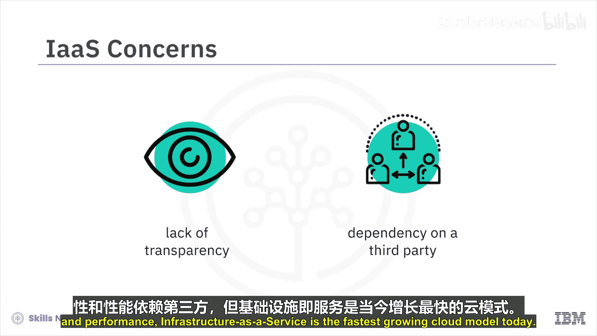
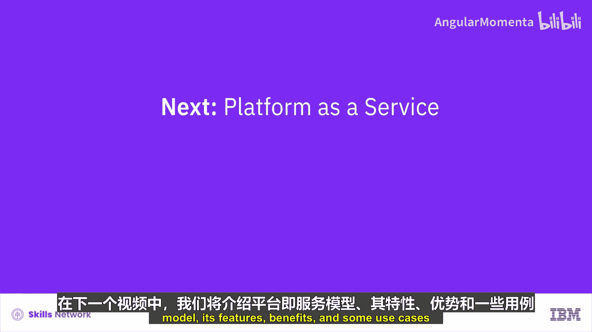

# 【IBM】云计算导论-｜-Introduction-to-Cloud-Computing-p14-02_01_02_IaaS-基础设施即服务--BV1X66rBqE8G_p14-

In this video， we will discuss the infrastructure as a service model in more detail infrastructurera as a service commonly referred to as IAA or simply IS is a form of cloud computing that delivers fundamental compute network and storage resources to consumers on demand over the Internet on a pay as you go basis The cloud provider hosts the infrastructure components Traly present in an on-prems data center as well as the virtualization or hypervisor layer In an I cloud environment。

  customers can create or provision virtual machines or VMs in their choice of region and zone available from the cloud provider These VMs typically come preinstalled the customers choice of operating system The customers can then deploy middleware install applications and run workloads on these VMs they can also create storage for their workloads and backups Cloud providers often provide。

Custom the ability to track and monitor the performance and usage of their cloud services and manage disaster recovery Let's look at the key components of cloud infrastructure physical data centers I providers manage large data centers that contain the physical machines required to power the various layers of abstraction on top of them in most I models and users do not interact directly with the physical infrastructure but experience it as a service provided to them Comp I providers manage the hypervisors and end users programmatically provisioned virtual instances with desired amounts of compute memory and storage resources Cloud compute typically comes with supporting services like auto scaling and low balancing that provide scalability and highper network users get access to networking resources on the cloud through virtualization or program。

APIsThere are three types of cloud data storage， object file and block storage Object storage is the most common mode of storage in the cloud。

 given that it is highly distributed and resilient。Is supports a wide array of use cases。

 We'll look at some typical use cases here。 organizationsgans today are using cloud infrastructure services to enable their teams to set up test and development environments faster。

 helping create new applications more quickly by abstracting the lowlevel components。

 Cloud infrastructure is helping developers focus more on business logic than infrastructure management Business continuity and disaster recovery require a significant amount of technology and staff investments。

 IS is helping organizations reduce this cost and make applications and data accessible as usual during a disaster or outage。

 Organ are using cloud infrastructure to deploy their web applications faster and also scale infrastructure up and down as demand fluctuates Organs are leveraging the high performance computing capabilities of cloud infrastructure to solve complex problems involving。

😊，Of variables and calculations such as climate and weather predictions and financial modeling mining massive data sets to locate valuable patterns。

 trends and associations requires a huge amount of processing power。

 cloud infrastructure not only provides the required highperance computing but also makes it economically viable while there are some concerns regarding the lack of transparency in the cloud infrastructure's configuration and management and dependency on a thirdpart for workload availability and performance infrastructure as a service is the fastest growing cloud model today In the next video we will look at platform as a service model its features。

 benefits and some use cases。

