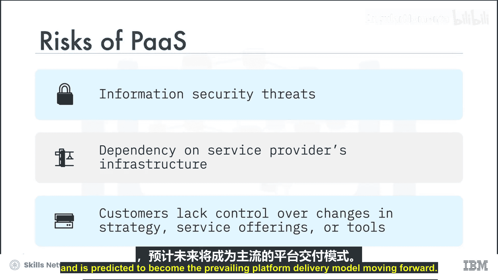
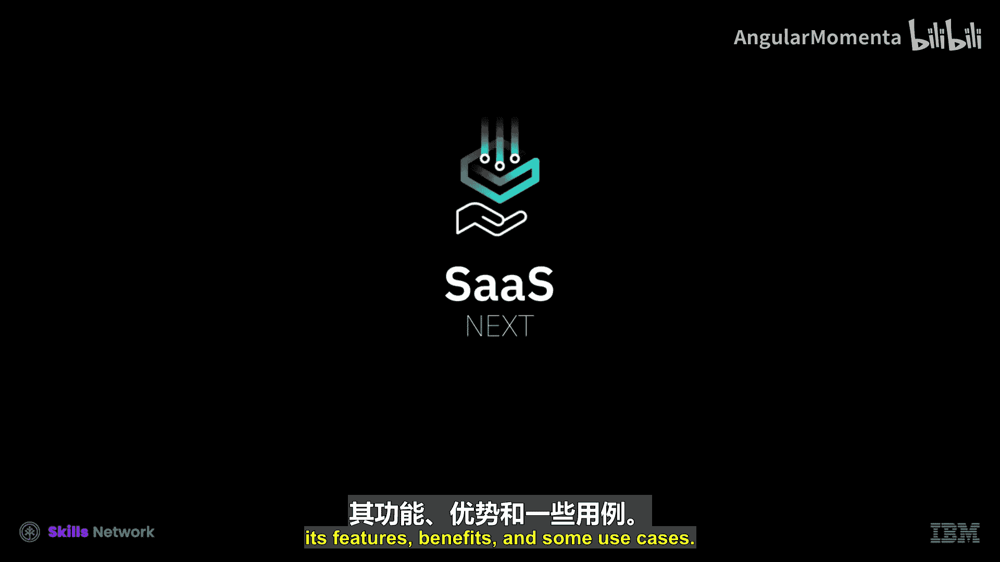
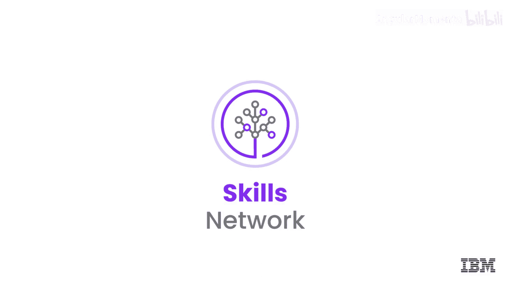

# 【IBM】云计算导论-｜-Introduction-to-Cloud-Computing-p15-02_01_03_平台即服务--BV1X66rBqE8G_p15-

Platform as a service， commonly referred to as PAAS or simply pass is a cloud computing model that provides customers a complete platform to develop。

 deploy， manage， and run applications created by them or acquired from a third party。

The PA provider hosts everything， servers， networks， storage， operating system， application runtimes。

 APIs， middleware databases and other tools at their data center the provider also takes responsibility for the installation configuration and operation of the application infrastructure。

 leaving the user responsible for only the application code and its maintenance customers pay for this service on a usage basis and purchase resources on demand。

With IAAS， the cloud provider offers access to raw computing resources such as servers。

 storage and networking while the user is responsible for the platform and application software with PAAS or pass the cloud service provider delivers and manages the entire platform infrastructure abstracting users from the lower level details of the environment let's look at some essential characteristics of platform as a service or pass。

Pass clouds are distinguished by the high level of abstraction they provide to the users。

 eliminating the complexity of deploying applications， configuring infrastructure。

 and provisioning and configuring supporting technologies like load balancers and databases。

PassCs provide services and APIs that help simplify the job of developers in delivering elastically scalable and highly available cloud applications。

These services typically include a variety of capabilities， such as APIs for distributed caing。

 queuing and messaging， file and data storage， workload management， user identity， and analytics。

 thus eliminating the need to integrate disparate components。

The past runtime environment executes end user code according to policies set by the application owner and cloud provider。

Many of the pass offerings provide developers with rapid deployment mechanisms or push and run mechanisms for deploying and running applications pass offerings support a range of application infrastructure or middleware capabilities。

 such as application servers， database management systems， business analytics servers。

 mobile backend services， integration services， business process management systems。

 rules engines and complex event processing systems such an application infrastructure assists developers by reducing the amount of code that must be written while expanding the application functional capabilities。

 the most important use case for passS is strategic， build， test， deploy。

 enhance and scale applications rapidly and cost effectively。

Let's look at some more use cases for PAS。APpiI development and Management Ors are using PAS to develop。

 run， manage and secure APIs and microservices， which are loosely coupled。

 independently deployable components and services。Internet of Things or IoT。

PassCs support a broad range of application environments， programming languages。

 and tools used for IoT deployments。Business Anatics or In Pa tools allow organizations to analyze their data to find business insights that enable more informed business decisions and predictions。

Business Pro Management or BPPM。Organizations are using the Pass cloud to access BPPM platform delivered as a service。

Master data Management or MDM Or are leveraging the Pass cloud to provide a single point of reference for critical business data。

 such as information about customer transactions and analytical data to support decision making。

Let's look at some advantages of using PAS Scalability made possible because of the rapid allocation and deallocation of resources with a payUU model offered by pass the APIs support services and middleware capabilities that pass clouds provide assist developers in focusing their efforts on application development and testing。

 resulting in faster time to market for their products and services。

Middleware capabilities also reduce the amount of code that need to be written while expanding the application's functional capabilities。

Greater agility and innovation， because using PA platforms means that you can experiment with multiple operating systems。

 languages， and tools without having to invest in these resources。

You can evaluate and prototype ideas with very low risk exposure， resulting in faster， easier。

 less risky adoption of a wider range of resources。

Some of the key pass offerings available in the market today include AWS Elastic Beanstock。

 Cloud Foundry， IBM Cloud packs， Windows Azure， Red Hat Openshift， MaggentoCommerce Cloud， Force。

com and Apachestrads。Pass clouds do come with some risks。

 risks that all cloud offerings have in general， such as information security threats and dependency on the service provider's infrastructure。

Services can get impacted when a service provider's infrastructure experiences downtime customers also don't have any direct control over the changes that may take place when a provider makes changes in its strategy。

 service offerings or tools。But the benefits can far outweigh these risks PAS continues to experience strong growth and is predicted to become the prevailing platform delivery model moving forward In the next video we will look at software as a service model。

 its features， benefits and some use cases。

